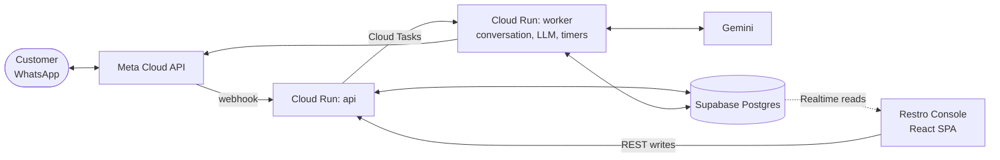

# Restro (Restro-Agent)

WhatsApp ordering and retention for cafés. Customers scan a table QR, order through an AI agent on WhatsApp and get live status updates. Staff run service in the **Restro Console**. Cafés keep every customer as an opted-in contact and bring them back with offers they can measure.

> **Status: design phase.** Design docs only. No code yet.

## Docs

| Doc | Holds |
|---|---|
| [CLAUDE.md](CLAUDE.md) | Stack, invariants, working rules (people and AI agents) |
| [docs/plan.md](docs/plan.md) | Product, roadmap, resources, work split, open decisions, risks |
| [docs/architecture.md](docs/architecture.md) | System, pipeline, timers, security, infrastructure, monitoring, cost |
| [docs/backend.md](docs/backend.md) | Conversation, AI agent, cart, orders, help, menu, WhatsApp, retention |
| [docs/data-and-api.md](docs/data-and-api.md) | Schema, RLS, views, endpoints, Realtime |
| [docs/console.md](docs/console.md) | Console shell, urgency, every screen |
| [docs/rules.md](docs/rules.md) | Per-folder rules and required tests |
| [docs/decisions.md](docs/decisions.md) | Settled trade-offs |

Inputs: [Restro_Build_Plan.md](Restro_Build_Plan.md) · `Restro Console v2-Updates.html` (open in a browser).

## Layout

Planned; each folder is created with its first real file.

| Path | Purpose |
|---|---|
| `backend/` | Python 3.12 + FastAPI, deployed as `api` and `worker` |
| `frontend/` | Restro Console (React + Vite + TypeScript) |
| `supabase/` | Migrations, RLS, views, seed |
| `contracts/` | Frozen schema, OpenAPI, events, LLM schema, state machines |
| `evals/` | LLM eval set and runner |
| `loadtest/` | Webhook simulator and scenarios |
| `infra/` | GCP resources per environment |
| `.github/` | CI workflows, PR template |
| `docs/` | Design docs |
