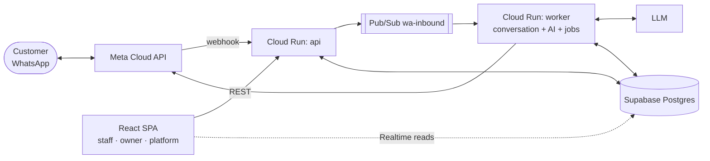

# Restaurant Agentic System (Restro-Agent)

A WhatsApp ordering and retention system for cafés. Customers scan a table QR, order through an AI agent on WhatsApp and get live status updates. Cafés keep every customer as an opted-in contact and can bring them back with offers they can measure.

> **Status: design phase.** This repo holds the folder skeleton, the layered context files and the architecture docs. No code yet.

## Start here

| | |
|---|---|
| Project context (for engineers and AI agents) | [CLAUDE.md](CLAUDE.md) |
| How context is layered | [docs/CONTEXT-MAP.md](docs/CONTEXT-MAP.md) |
| All design docs | [docs/README.md](docs/README.md) |
| Build plan | [docs/delivery/build-order.md](docs/delivery/build-order.md) |
| Open decisions | [docs/delivery/open-decisions.md](docs/delivery/open-decisions.md) |

## At a glance

## Repository layout

| Path | Purpose | Context file |
|---|---|---|
| `backend/` | Python 3.12 + FastAPI, deployed as `api` and `worker` | [backend/CLAUDE.md](backend/CLAUDE.md) |
| `frontend/` | React + Vite + TypeScript SPA | [frontend/CLAUDE.md](frontend/CLAUDE.md) |
| `supabase/` | Migrations, RLS, views, seed | [supabase/CLAUDE.md](supabase/CLAUDE.md) |
| `infra/` | GCP resources per environment | [infra/CLAUDE.md](infra/CLAUDE.md) |
| `.github/` | CI/CD workflows, PR template | — |
| `docs/` | Architecture split by area, plus ADRs | [docs/README.md](docs/README.md) |
