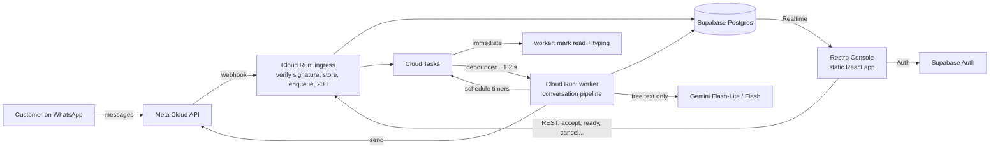
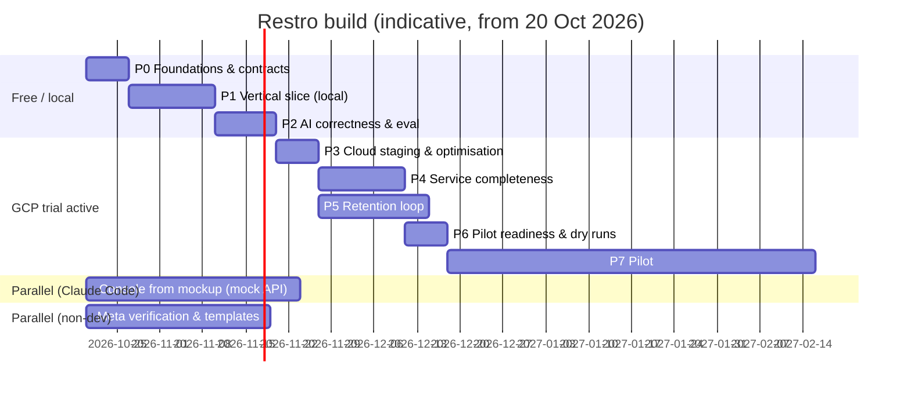

# Restro — Build Plan: from Mockup to Pilot

**Version:** 1.0 · 19 Oct 2026 · Owner: Aman
**Scope:** WhatsApp ordering agent (customer side) + Restro Console (restaurant side) + platform admin, up to and through the first pilot.
**Inputs:** Customer Journey, MVP Planning & Critique, WhatsApp Integration Plan, Customer/AI/Restaurant Q&A, Restro Console v2 mockup + Addenda 1–3.

> Anything marked **[verify]** is a vendor fact (pricing, free-tier limit, feature availability) that changes often. Check the vendor's current docs before relying on it.

---

## Table of contents

1. [TL;DR](#1-tldr)
2. [Assumptions](#2-assumptions)
3. [Guiding principles](#3-guiding-principles)
4. [Resource strategy: when to switch on what](#4-resource-strategy-when-to-switch-on-what)
5. [Target architecture](#5-target-architecture)
6. [Critical core vs Claude Code work](#6-critical-core-vs-claude-code-work)
7. [Contracts to freeze first](#7-contracts-to-freeze-first)
8. [Build phases](#8-build-phases)
9. [Backend cost and latency design](#9-backend-cost-and-latency-design)
10. [Console: from mockup to product](#10-console-from-mockup-to-product)
11. [Testing strategy](#11-testing-strategy)
12. [Observability and cost tracking](#12-observability-and-cost-tracking)
13. [Security baseline](#13-security-baseline)
14. [Working with Claude Code](#14-working-with-claude-code)
15. [Risks](#15-risks)
16. [Open questions for Aman](#16-open-questions-for-aman)

---

## 1. TL;DR

1. **Don't activate the GCP $200 / 90-day trial yet.** The clock starts on activation. Build locally (Docker + Supabase CLI + Meta test number + tunnel) until Phase 3, so the 90 days cover staging and the pilot, not development.
2. **Start the slow, free things today:** Meta business verification, display-name proof for the pilot café, and drafting the WhatsApp templates. These take days to weeks and cost nothing.
3. **Freeze the contracts in week 0:** DB schema, order and conversation state machines, the console API (OpenAPI), realtime events, and the LLM output schema. Contracts let the critical backend and the Claude Code work run in parallel without blocking each other.
4. **Build a thin vertical slice first:** QR → greeting → menu → free-text order → cart confirmation → order appears on the Live screen → Accept → customer gets a status message. This one path exercises every risky integration (Meta, queue, LLM, DB, realtime) and is the "hook" the pilot depends on.
5. **Your team owns the critical core:** webhook ingestion, message pipeline, state machines, cart and pricing, LLM orchestration and guardrails, the send layer with the 24-hour gate, timers and escalation, consent, tenant isolation, and cost metering.
6. **Claude Code builds everything that only depends on contracts:** the console UI from the mockup (against a mock API), CSV menu import, QR sheet generator, print tickets, the weekly report, seed data, eval and load-test harnesses, and the platform admin screens.
7. **LLM only for free text.** Buttons, lists, greetings, confirmations, order status and waiter calls are handled in code. One structured LLM call per customer turn, with deterministic validation afterwards. This is the single biggest cost and latency lever.
8. **Decide the model routing with data, not opinion.** Run the same eval set on Flash-Lite and Flash in Phase 2. Measure accuracy, p95 latency and cost per order, then choose.
9. **Retention comes second, but its templates are submitted in week 1,** because Meta approval runs in parallel with the build.
10. **Analytics comes last.** During the pilot, a weekly report built from SQL views is enough.

---

## 2. Assumptions

Correct any of these and the plan adjusts. The open questions are in [§16](#16-open-questions-for-aman).

| Area | Assumption |
|---|---|
| Stack | Python + FastAPI backend, React (Vite) console, Supabase (Postgres + Auth), GCP for compute and LLM, Meta WhatsApp Cloud API directly |
| LLM | Gemini Flash-Lite and Flash (current generation), GCP only |
| Credits | GCP free trial: $200 valid for 90 days from activation **[verify current offer and whether Gemini on Vertex can be billed to trial credits]** |
| Load | 1–2 pilot cafés; normal 10–20 concurrent conversations, peak 60+, design headroom 100+ |
| Rollout | Month 1 pilot testing, then volume grows over months 2–3 |
| Team | 2–3 developers plus Claude Code. Durations below assume this; scale them to your real capacity |
| Roles | Shift Manager, Manager, Owner, Platform |
| Order statuses | New → Accepted → Ready → Served, plus Cancelled. Flags (Overdue, Edited, Item sold out, Near closing, Escalated) are not statuses |
| Operating model | One on-shift person runs the console and relays to the cook and waiter by voice |
| Not in MVP | Payments gateway, bookings / pre-orders, voice notes, POS or printer integration, multi-location, Embedded Signup |

---

## 3. Guiding principles

1. **Gate every paid or time-limited resource behind a phase exit.** Nothing starts its clock until the work that needs it is ready.
2. **Contract first, then parallel.** The schema and API contracts are the handshake between the core team and Claude Code.
3. **Deterministic over generative.** The LLM interprets and drafts text. Code decides prices, totals, availability, order state, consent and eligibility.
4. **Vertical slice before breadth.** One complete working path beats ten half-built screens.
5. **Measure before optimising.** Every LLM call and every WhatsApp send is logged with tokens, latency and cost from day one.
6. **Reliability over features.** One lost order costs more trust than ten missing features (MVP definition of done: 30+ orders in an evening, zero lost or wrong).
7. **Everything idempotent.** Meta retries, Cloud Tasks retries, customers double-tap. Every handler must be safe to run twice.

---

## 4. Resource strategy: when to switch on what

### 4.1 Activation timeline

| Resource | Cost model | Activate when | Why then |
|---|---|---|---|
| Meta business verification | Free, slow (days–weeks) | **Now** | Gates higher limits and Tech Provider status later |
| Meta developer app + test number | Free; test number allows up to 5 recipient numbers **[verify]** | **Week 0** | The whole ordering loop can be built against it |
| WhatsApp templates (utility + marketing) | Free to submit; approval takes time | **Week 1** drafts, submit on the pilot café's WABA in Phase 3 | Approval runs in parallel with the build |
| Supabase local (CLI + Docker) | Free | **Week 0** | Real Postgres, Auth and Realtime locally; no cloud project needed |
| Supabase cloud (free tier) | Free; inactive projects pause and free tier has no backups **[verify]** | **Phase 3** (staging) | Needed once the backend runs in the cloud |
| Supabase paid plan | Monthly fee **[verify]** | **Before pilot go-live** (recommended) | Backups, no pausing; a pilot café's orders must not be lost |
| Gemini via free developer tier | Free with rate limits; free-tier data terms differ **[verify]** | **Week 1–2**, synthetic data only | Prompt and eval work at zero cost. Never send real customer data on a free tier |
| **GCP free trial ($200 / 90 days)** | Credits expire 90 days after activation | **Start of Phase 3** | Covers staging, dry runs and the pilot instead of dev weeks |
| Cloud Run, Cloud Tasks, Secret Manager | Pay-per-use; generous free tiers **[verify]** | Phase 3 | Only needed in the cloud |
| Console hosting | Free static hosting (Firebase Hosting, Cloudflare Pages or similar) | Phase 3 | Keep the static console off Cloud Run |
| Domain + HTTPS | Small yearly cost | Phase 3 | Needed for privacy policy, terms and data-deletion URLs (Meta app review) |

### 4.2 How the 90 days line up

If the trial is activated at the start of Phase 3 (around week 4):

| Weeks after activation | Use |
|---|---|
| 0–4 | Staging, load tests, service completeness, dry runs with friends |
| 4–8 | Pilot month 1 (testing with the café) |
| 8–13 | First half of pilot growth (months 2–3) |
| After day 90 | Paid usage. Budget for this now; see [§9.7](#97-cost-model-worksheet) |

The credits will not cover all three pilot months if the build takes ~8 weeks. That is acceptable as long as the post-trial cost is known before day 90. The worksheet in §9.7 produces that number from real pilot data.

### 4.3 Credit guardrails (set these on day one of the trial)

- Budget of $200 with alerts at 25%, 50%, 75% and 90%, sent to two people.
- Cloud Run `max-instances` capped per service (e.g., 3–5). This also stops a retry storm from turning into a bill.
- Vertex AI request quotas set just above expected peak.
- One region for everything (Mumbai, `asia-south1`, if Gemini is available there or via a global endpoint **[verify]**).
- No GKE, Cloud SQL, Memorystore, load balancers, NAT or static IPs. Supabase replaces Cloud SQL and Postgres replaces Redis.
- Artifact Registry cleanup policy (keep the last ~10 images).
- Cloud Logging: exclude verbose request logs; log structured events only.
- Weekly 10-minute cost review: GCP billing report plus the `llm_calls` and `wa_messages` cost tables.
- A kill switch: an environment flag that routes all LLM traffic to the cheaper model or forces human handoff if daily LLM spend exceeds a limit.

---

## 5. Target architecture

### 5.1 Components



| Component | Responsibility | Notes |
|---|---|---|
| **Ingress** (Cloud Run) | Meta webhook (GET verify, POST receive), console REST API | Returns 200 within milliseconds. Stores raw event, enqueues work. Nothing slow here |
| **Worker** (Cloud Run) | Conversation pipeline, order transitions, timers, sends | Triggered only by Cloud Tasks. Same image as ingress, different entrypoint |
| **Cloud Tasks** | Durable queue + delayed tasks | Used for debounced processing and all timers (escalation, overdue, auto-served, feedback, idle hand-back) |
| **Supabase Postgres** | Source of truth | Tenant-scoped tables, RLS for console reads, advisory locks for per-conversation ordering |
| **Supabase Realtime** | Push changes to the console | Avoids running websockets on Cloud Run |
| **Supabase Auth** | Console logins | Role and café stored in a `memberships` table, enforced by RLS |
| **Secret Manager** | App secret, system user token, PINs | DB stores only references |
| **Console** | React app on free static hosting | Reads via Supabase (RLS), writes via ingress REST (business rules stay server-side) |

### 5.2 Why Cloud Tasks and not "return 200 then process in the background"

On Cloud Run with request-based billing, CPU is throttled after the response is sent **[verify for your configuration]**. A FastAPI background task started after returning 200 may stall or be killed. Pushing the work to Cloud Tasks, which calls the worker as a normal request, keeps the 200 fast and the processing reliable. Cloud Tasks also retries failures and supports scheduled (delayed) delivery, which gives us debouncing and timers without a cron job polling the database.

### 5.3 Message pipeline (one customer turn)

1. Meta → **ingress**: verify `X-Hub-Signature-256` on raw bytes → insert into `webhook_events` (dedupe on `wamid`) → insert into `inbound_messages` → resolve `cafe_id` from `phone_number_id` → enqueue two tasks:
   - `ack` (immediate): mark read + typing indicator.
   - `process(conversation_id)` with a ~1.2 s delay.
   - Return 200.
2. **Worker** `process`:
   1. Take a Postgres advisory lock on `conversation_id`. If it's already held, exit; the holder will pick up new messages.
   2. Read all unprocessed inbound messages for the conversation (this batches "hi" / "i want" / "2 cold coffee" into one turn).
   3. **Route:**
      - Button or list reply → deterministic handler, no LLM.
      - Known command (call waiter, bill, STOP) → deterministic handler.
      - Free text → LLM step.
   4. LLM step: one call with a structured output schema (see [§9.3](#93-llm-strategy)).
   5. **Validate:** cart operations checked against the live menu and availability; prices and totals computed in code.
   6. Persist state changes in one transaction.
   7. Send the reply through the send layer (24-hour window check, `wa_messages` row, idempotency key).
   8. Mark the inbound messages processed and release the lock.
3. Status webhooks (sent / delivered / read / failed, with pricing) update `wa_messages` and never move a status backwards.

### 5.4 Timers (all via scheduled Cloud Tasks)

| Timer | Created when | Fires after | On fire (checks current state first) |
|---|---|---|---|
| Accept escalation 1 | Order → New | 60 s | Still New → escalate to Manager |
| Accept escalation 2 | Escalation 1 fired | +2 min | Still New → escalate to Owner |
| Help escalation | Help request opened | 2 min | Still open → escalate; send honest "team is busy" message |
| Overdue | Order → Accepted | Expected prep time | Still Accepted → mark Overdue flag |
| Auto-served | Order → Ready | 10 min | Still Ready → Served (actor: System) |
| Feedback + opt-in | Order → Served | Café setting (15/30/60 min) | Send feedback, then opt-in if not yet asked |
| Idle hand-back | Last message in human mode | 15 min | No unanswered customer message → bot mode |

Every timer is idempotent: it reads the current state and does nothing if the state has moved on.

---

## 6. Critical core vs Claude Code work

### 6.1 How to decide

A component is **critical core** if a bug in it can do any of the following:

- lose or duplicate an order,
- charge a wrong price,
- message the wrong customer or the wrong café's customers,
- send marketing without consent,
- leak a token, or
- materially change cost or latency.

Everything else is **delegated to Claude Code**, built against frozen contracts, and reviewed through PRs.

Claude Code can still help write core code. The difference is that a person on the team designs the core, writes or reviews every line, and owns its tests. Delegated work only needs normal review.

### 6.2 Critical core (team owns)

| Module | Why it is critical |
|---|---|
| Webhook ingress (signature, dedupe, tenant resolution) | Security, duplicates, cross-tenant leaks |
| Conversation pipeline (locking, debounce, batching) | Lost or out-of-order messages, double replies |
| Order state machine + transitions API | Lost orders, invalid transitions, edit/accept races |
| Cart, pricing and tax engine | Wrong totals |
| Menu availability checks | Selling sold-out items |
| LLM orchestration: prompt, output schema, validation, routing, guardrails | Accuracy, hallucinated items, cost, latency |
| Allergen and handoff rules | Customer safety |
| Send layer (24-hour gate, idempotent sends, template selection) | Policy violations, duplicate messages, cost |
| Timers and escalation | Missed orders, unanswered customers |
| Consent and opt-out enforcement | Legal (DPDP), WhatsApp quality rating |
| Supabase RLS policies and memberships | Data leaks between cafés and roles |
| Secrets handling | Token compromise |
| Cost metering (`llm_calls`, `wa_messages` pricing) | You can't price the product without it |
| Campaign sender (throttling, limits, codes) | Number quality, cost, the core sales metric |

### 6.3 Delegated to Claude Code (depend only on contracts)

| Work package | Depends on | Notes |
|---|---|---|
| Console app shell: routing, auth screens, role-based nav, layout, design tokens from mockup | OpenAPI, roles table | Start week 0 against a mock API |
| Console screens (Live, Calls, Chats, Menu, Setup, Service report, Today, Customers, Campaigns, Analytics) | OpenAPI + Realtime event contract | Built against MSW mocks, then switched to the real API |
| Urgency UI system (severity tokens, timers, badges, sound manager) | Severity rules from Addendum 1 Part I | Pure frontend |
| Mock API server (MSW) + seed data generator | OpenAPI, schema | Also used for console demos to prospects |
| Menu CSV import + validation UI | Menu schema | Backend endpoint is small; validation rules come from the schema |
| QR sheet generator (PDF of table QRs with the fallback notice) | Tables schema | Uses `wa.me` links with prefilled text |
| Print ticket layout (browser print CSS) | Order schema | |
| Weekly owner report (SQL views → PDF or Sheet) | Schema | Stand-in for analytics during the pilot |
| Analytics SQL views | Schema | The team reviews the queries |
| Platform admin screens (Cafés, Number health, Templates list, Costs, Audit, AI review) | OpenAPI | Read-mostly screens |
| Eval harness (runner, scoring, report) | LLM output schema | **Test cases are written and reviewed by the team** |
| Load-test scripts (webhook simulator, k6 or Locust) | Webhook payload format | |
| Infra scripts (gcloud/Terraform for Cloud Run, Tasks, budgets) | Architecture | The team reviews them line by line: they touch cost |
| Landing page, privacy policy, terms and data-deletion pages | — | Needed for Meta app review |

---

## 7. Contracts to freeze first

These are written in week 0, reviewed by the whole team, and stored in `/contracts`. Changing them later requires a PR that touches both the backend and the console.

### 7.1 Database schema (core tables)

| Table | Key columns (beyond id and timestamps) | Notes |
|---|---|---|
| `cafes` | name, timezone, waba_id, phone_number_id, display_phone_number, onboarding_model, token_ref, status, opening_hours, cutoff_minutes, settings (json) | `token_ref` points to Secret Manager |
| `memberships` | user_id, cafe_id, role (shift_manager, manager, owner), active | Platform admins live in a separate table |
| `tables` | cafe_id, label, area, seats | |
| `table_sessions` | cafe_id, table_id, opened_at, closed_at | Groups orders from several customers at one table |
| `customers` | cafe_id, wa_id, name, first_seen_at, last_inbound_at, last_visit_at | Unique (cafe_id, wa_id) |
| `customer_preferences` | customer_id, kind, value, source | Explicitly stated preferences only; never allergies inferred from orders |
| `consents` | customer_id, type, status, wording_version, source, created_at | Append-only |
| `menu_items` | cafe_id, name, category, price_paise, prep_minutes, veg, spice, available, version | Money in integer paise |
| `menu_item_allergens` | item_id, allergen, state (contains, free_from, unknown) | Default `unknown` |
| `conversations` | cafe_id, customer_id, mode (bot, human), assigned_to, table_session_id, state (json) | `state` holds the cart and flow step |
| `inbound_messages` | conversation_id, wamid, type, payload, processed_at | Unique wamid |
| `wa_messages` | wamid, cafe_id, customer_id, direction, type, status, error_code, pricing_category, billable, status timestamps | Updated by status webhooks |
| `orders` | cafe_id, customer_id, table_session_id, status, flags, total_paise, source (qr, campaign), campaign_recipient_id, idempotency_key, version | Status timestamps per transition |
| `order_items` | order_id, item_id, name_snapshot, price_snapshot_paise, qty, note | Snapshots protect history from menu edits |
| `order_events` | order_id, from_status, to_status, actor_type, actor_id, reason | Full audit of transitions |
| `requests` | cafe_id, table_session_id, conversation_id, kind (help, bill, low_rating), status, reason_tag, acknowledged_by | |
| `escalations` | subject_type, subject_id, level, target, sent_at, outcome | |
| `feedback` | order_id, rating, text | |
| `templates`, `campaigns`, `campaign_recipients`, `redemptions` | as in the Integration Plan | Phase 5 |
| `llm_calls` | conversation_id, model, input_tokens, cached_tokens, output_tokens, latency_ms, outcome, cost_estimate | Cost metering |
| `audit_log` | actor, role, cafe_id, action, change (json) | Every console write |
| `webhook_events` | received_at, signature_valid, payload, processed_at | Pruned after a fixed period |

### 7.2 Order state machine

| From | To | Who | Guard |
|---|---|---|---|
| — | New | System (customer confirmed the cart) | Idempotency key per confirmation button tap |
| New | New (edited) | Customer | Only while New; atomic version check |
| New | Cancelled | Customer | Only while New |
| New | Accepted | Shift Manager / Manager / Owner | Atomic: fails if the customer edited or cancelled first |
| New | Cancelled (declined) | Shift Manager+ | Reason required |
| Accepted | Ready | Shift Manager+ | |
| Accepted / Ready | Cancelled | Shift Manager+ | Reason required; Manager notified |
| Ready | Served | Shift Manager+ or System (auto after 10 min) | |
| any | previous | Same actor, within the 5 s undo window | Status reverts; the queued customer message is cancelled |

All transitions go through one function, `transition(order_id, to, actor, expected_version)`, which uses optimistic locking. The console never writes order rows directly.

### 7.3 Conversation state machine (simplified)

`greeting → browsing ↔ building_cart → confirming → order_placed → (post-order: status / feedback / opt-in)`, with `human` as an overlay mode that pauses the bot and can be entered from any state.

### 7.4 Console API (OpenAPI) — first endpoints

- `POST /orders/{id}/transition` `{to, reason?, expected_version}`
- `POST /orders/{id}/delay` `{minutes}`
- `POST /requests/{id}/ack`, `POST /requests/{id}/resolve`
- `POST /conversations/{id}/takeover`, `/handback`, `/reply`
- `POST /menu/{id}/availability`, `PUT /menu/{id}`
- `POST /cafes/{id}/pause-ordering`
- `POST /bills/{table_session_id}/apply-code`, `/deliver`

Reads go through Supabase with RLS, so most screens need no custom read endpoints.

### 7.5 LLM output schema (one call per turn)

```json
{
  "intent": "browse | ask_question | add_items | modify_cart | confirm | cancel | order_status | human | smalltalk | unclear",
  "cart_ops": [{ "op": "add | remove | set_qty | set_note", "item_ref": "string", "qty": 1, "note": "string" }],
  "allergen_question": { "allergen": "string", "item_ref": "string" },
  "needs_human": { "flag": false, "reason": "asked | frustration | allergen_unknown | repeated_unclear" },
  "clarify": "string or null",
  "reply": "string"
}
```

The backend resolves `item_ref` against the menu and rejects unknown or sold-out items. It recomputes totals, renders the confirmation message itself, and answers allergen questions from `menu_item_allergens`. An `unknown` allergen state always triggers a handoff.

### 7.6 Realtime events (what the console subscribes to)

Inserts and updates on `orders`, `requests`, `conversations` (mode and assignment), `inbound_messages` (for open chats), `menu_items.available`, `cafes.settings.paused`. Each is filtered by `cafe_id` through RLS.

---

## 8. Build phases

Durations assume 2–3 developers plus Claude Code working in parallel. Each phase has an exit gate; don't start the next phase's paid resources until the gate passes.



### Phase 0 — Foundations and contracts (week 1) · cost: ₹0

**Goal:** everyone can work in parallel from day 2.

| Track | Tasks | Owner |
|---|---|---|
| Contracts | Schema (§7.1), state machines (§7.2–7.3), OpenAPI v0 (§7.4), LLM schema (§7.5), realtime events (§7.6) | Core |
| Repo | Monorepo, CI (lint, type check, unit tests), `CLAUDE.md` rules (§14) | Core + CC |
| Local env | `docker compose` for backend; Supabase CLI local stack; cloudflared or ngrok tunnel for the webhook | Core |
| Meta | Developer account, business portfolio, **start business verification**, Meta app, test number, add team phones as recipients | Core |
| Console | Scaffold Vite + React, design tokens from mockup, role-based nav, MSW mock API from OpenAPI v0 | CC |
| AI | Draft eval set categories (§11.2); start writing 50 real-feeling Hinglish / English / Hindi cases | Core |
| Pilot | Collect the pilot café's menu (with allergens) and its proof of business name | Non-dev |

**Exit gate:** contracts merged; the local stack runs; the Meta test number receives a message through the tunnel and it lands in `webhook_events`.

### Phase 1 — Thin vertical slice, all local (weeks 2–3) · cost: ₹0

**Goal:** one complete order loop works end to end on the test number.

| Step | Detail | Owner |
|---|---|---|
| Ingress | Signature verification, dedupe, tenant resolution, store, enqueue (use a local queue shim with the same interface as Cloud Tasks) | Core |
| Worker | Lock, debounce, batch, route (button / command / free text) | Core |
| Deterministic flows | Greeting (new vs returning, name capture), menu category list, item list, cart summary with Confirm / Edit / Cancel buttons | Core |
| LLM step v1 | Single model, structured output, validation against the menu | Core |
| Orders | `transition()` with optimistic locking; New → Accepted → Ready → Served; customer status messages | Core |
| Send layer | 24-hour window check, `wa_messages` rows, idempotent sends | Core |
| Console Live screen | Wired to local Supabase Realtime; Accept, Ready, Served buttons call the real API | CC (UI) + Core (API) |
| Metering | `llm_calls` and `wa_messages` written from the first call | Core |

**Exit gate:** on a team phone, scan a QR → order "2 cold coffee aur ek avocado toast, toast mein chilli nahi" → confirm → the order appears on the Live screen within 2 s → Accept → the customer receives "being made". Run it 20 times with no lost or duplicate orders.

### Phase 2 — AI correctness and model decision (weeks 4–5, part) · cost: ₹0 (free dev tier, synthetic data)

**Goal:** prove the agent is accurate enough and pick the model routing with numbers.

| Task | Detail |
|---|---|
| Eval set | Grow to 150–250 cases (§11.2) |
| Prompt work | Compact menu format, stable prompt prefix for caching, Hinglish few-shots |
| Guardrails | Allergen three-state logic, two-strike clarification → handoff, frustration → handoff, off-topic redirect |
| Model comparison | Run the full eval set on Flash-Lite and Flash. Record accuracy per category, p50/p95 latency, input/output/cached tokens, estimated cost per order |
| Routing decision | Choose one of: (a) Flash only, (b) Flash-Lite only, (c) deterministic router (default Flash-Lite; Flash for recommendations, allergen or dietary questions, multi-item messages, Hindi script, or after a failed clarification) |

**Exit gate (minimums):**

| Metric | Target |
|---|---|
| Cart extraction exact match | ≥ 95% overall, ≥ 90% on Hinglish |
| Invented items or prices reaching the customer | 0 (blocked by validation) |
| Unknown allergen → handoff | 100% |
| "Call waiter / human" intent detected | ≥ 98% |
| LLM p95 latency | ≤ 3 s |

### Phase 3 — Cloud staging and optimisation (week 5) · **activate the GCP trial here**

**Goal:** the same slice runs in the cloud at pilot load, with costs and latency measured.

| Task | Detail |
|---|---|
| Activate | GCP trial, apply all guardrails from §4.3 on day one |
| Deploy | Ingress and worker on Cloud Run (`asia-south1`), Cloud Tasks queues, Secret Manager, Supabase cloud (Mumbai region), console on static hosting |
| DB connections | Connect through the Supabase pooler in transaction mode; small pool per instance **[verify IPv4/IPv6 connectivity from Cloud Run]** |
| Meta | Webhook switched to the staging URL; pilot café WABA created and number registered (if the café is ready); submit utility templates (`order_update`, `new_order_alert`/escalation alert, `feedback_request`) and marketing templates (`weekly_offer`, `winback`) |
| Load test | Simulate 100 concurrent conversations with a **stub LLM** (fixed latency), then a short burst with the real model |
| Tune | Cloud Run concurrency, min/max instances, Cloud Tasks rate limits, pool size |

**Exit gate:** 100 concurrent simulated conversations with zero lost or duplicated messages, inbound-to-reply p95 ≤ 5 s, and a measured cost per order.

### Phase 4 — Service completeness (weeks 6–7) · GCP credits

**Goal:** everything a café needs on a busy evening, from the Q&A decisions and Addenda 1–3.

| Feature | Owner |
|---|---|
| Customer edits and cancels while New; edit/accept race handled atomically | Core |
| Multiple customers per table session; bill sheet (whole table / per person) | Core + CC |
| Human mode: assignment, reply from the console, hand back via Resolve, 15-min idle auto-resume rule | Core + CC |
| Handoff triggers with reason tags (asked, two failed clarifications, complaint, allergen unknown, system error) | Core |
| Escalation chain Shift Manager → Manager → Owner (in-app + WhatsApp utility alert) | Core |
| Sold-out toggle; flag existing orders containing the item | Core + CC |
| Opening hours, last-order cutoff, "near closing — accept?" flag | Core + CC |
| Pause WhatsApp ordering | Core + CC |
| +10 min delay message; cancel with reason; 5 s undo | Core + CC |
| Print ticket, allergy lines prominent | CC |
| Offline banner, "orders while offline", add manual order | CC + Core |
| Urgency UI rules across all screens | CC |
| Text-only handling: voice note / image / sticker → polite "please type" reply | Core |

**Exit gate:** every scenario in the dry-run script (§11.4) passes on staging.

### Phase 5 — Retention loop (weeks 6–8, overlaps Phase 4)

**Goal:** the part of the product the owner actually pays for.

| Feature | Owner |
|---|---|
| Opt-in after Served (independent of feedback answer) + counter QR source; consent records with wording version | Core |
| STOP / "Stop offers" button / block-failure → opted out immediately | Core |
| Template sync from Meta + status webhooks | Core |
| Campaign builder UI (audience, template, message, schedule, review) | CC |
| Campaign sender: snapshot audience, unique codes per recipient, throttling, daily-limit rollover, 131049 handling | Core |
| Redemption in the bill sheet; order linked to the campaign recipient | Core + CC |
| Campaign report: sent → held by WhatsApp → delivered → read → redeemed → revenue, discount and WhatsApp cost | CC (UI) + Core (queries) |

**Exit gate:** a test campaign to team phones on the test number, including opt-out, a redemption at the bill, and a correct report.

### Phase 6 — Pilot readiness (week 8)

| Task | Owner |
|---|---|
| Per-café go-live checklist (from the Integration Plan) complete | Core + Non-dev |
| Menu loaded with allergens, checked with the owner | Non-dev |
| Table QRs printed, with the manual fallback notice on every stand | CC (generator) + Non-dev |
| Shift Manager trained in under 10 minutes | Non-dev |
| Two dry runs with friends at the real café, including Hinglish, confusing orders, a waiter call, an allergen question, a delay, an edit, a sold-out mid-order, and an internet drop | All |
| Monitoring and alerts on (§12) | Core |
| Supabase moved to a paid plan with backups (if agreed) | Core |

**Exit gate:** the MVP definition of done — 30+ orders in an evening with zero lost or wrong orders, and every unhandled conversation reaching a human within a minute.

### Phase 7 — Pilot (months 1–3 of rollout)

| Period | Focus |
|---|---|
| Pilot month 1 | Stability. Daily review of failed sends, handoffs, fallbacks and cost per order. Weekly owner report. No new features except fixes |
| Month 2 | First campaigns (small batches); Owner "Today" screen; tune routing and prompts from real conversations |
| Month 3 | Analytics screen from SQL views; platform AI review and cost screens; decide post-trial budget; prepare the case-study numbers |

---

## 9. Backend cost and latency design

### 9.1 Where cost actually comes from

| Cost driver | Expected size | Lever |
|---|---|---|
| LLM tokens | Largest variable cost | Fewer calls, smaller prompts, caching, model choice |
| WhatsApp messages | Near zero for ordering (free inside the 24-hour service window); real cost for campaigns and utility templates outside the window **[verify current pricing]** | Keep ordering inside the window; send templates only when needed |
| Cloud Run idle | Small, from any min-instances | min-instances 1 only on ingress, only from the pilot |
| Everything else (Tasks, Secrets, Logging, Registry) | Likely within free tiers **[verify]** | Guardrails in §4.3 |

### 9.2 Reduce LLM calls

1. **Buttons and lists first.** Greeting, menu navigation, quantity changes, Confirm/Edit/Cancel, order status, call waiter and bill are all deterministic.
2. **Batch bursts.** The ~1.2 s debounce merges "hi" + "i want" + "2 coffee" into one LLM call instead of three.
3. **Code builds the confirmation.** The cart summary and total never need the LLM.
4. **Welcome back by code.** "Hi Riya! Last time: Cold Brew Tonic and Avocado Toast. Same again?" comes from SQL plus a template string.
5. **Target:** 2–5 LLM calls per completed order. Measure this from Phase 1.

### 9.3 LLM strategy

| Decision | Approach |
|---|---|
| Calls per turn | One structured-output call (§7.5). Avoid multi-step tool loops; each extra round trip adds latency |
| Prompt layout | Stable prefix first (system rules + café menu in compact form), variable suffix last (customer summary, cart, last turns). Stable prefixes benefit from implicit/context caching where the model supports it **[verify caching rules and minimum sizes]** |
| Menu in prompt | Compact lines like `id|name|price|veg|spice|tags`, sold-out items excluded. Cache per `(cafe_id, menu_version)` in worker memory; check the version with one tiny query per turn so sold-out changes apply on the next message |
| History | Last ~6 turns + current cart + a SQL-built customer summary (90-day recent orders, favourites, stated preferences). Never the full chat history |
| Output length | Ask for short WhatsApp-style replies; set a max output token limit |
| Temperature | Low, for consistent extraction |
| Routing | Decided in Phase 2 with data (§8). Keep the model name behind one config value per café so it can change without a deploy |
| Failure handling | LLM error or timeout (e.g., 6 s) → one retry on the other model → honest "having trouble, a team member will help" + handoff |

### 9.4 Latency budget (inbound message → reply)

| Step | Target |
|---|---|
| Meta → ingress → 200 | < 300 ms |
| Mark read + typing indicator | < 1 s after inbound (customer sees activity immediately) |
| Debounce window | ~1.2 s |
| Load context (one or two queries, menu from cache) | < 80 ms |
| LLM call | p50 ~1–1.5 s, p95 ≤ 3 s |
| Validate + persist | < 100 ms |
| Send to Meta | < 500 ms |
| **Total** | **p50 < 3 s, p95 < 5 s** |

Deterministic turns (buttons) should reply in under 1 s because they skip the debounce and the LLM.

### 9.5 Throughput and autoscaling for 100+ concurrent conversations

- FastAPI fully async (async DB driver, one shared `httpx` client for Meta and Gemini).
- Cloud Run concurrency ~40–80 per instance (I/O bound), max instances 3–5 per service. Load-test to confirm.
- Cloud Tasks queue rate limit set below the WhatsApp number's throughput and the Vertex quota.
- Postgres via the pooler, small pool per instance, so autoscaled instances don't exhaust connections.
- Per-conversation advisory locks keep ordering correct without a global lock.

### 9.6 Cold starts

- Slim image (no heavy ML libraries; the LLM is remote).
- Cloud Run startup CPU boost on **[verify]**.
- Ingress min-instances 1 during the pilot; worker min-instances 0, accepting a slightly slower first turn after idle periods. Revisit after measuring.

### 9.7 Cost model worksheet

Fill in from Phase 2/3 measurements and current price pages.

| Variable | Source | Value |
|---|---|---|
| LLM calls per order | `llm_calls` | |
| Avg input tokens per call (uncached / cached) | `llm_calls` | |
| Avg output tokens per call | `llm_calls` | |
| Price per 1M input / cached / output tokens (each model) | Gemini pricing page **[verify]** | |
| Orders per café per month | Pilot data | |
| Template messages per month (utility + marketing) | `wa_messages` | |
| Price per template message (India, by category) | Meta pricing page **[verify]** | |
| Cloud Run + other GCP per month | Billing report | |
| Supabase plan per month | Supabase pricing **[verify]** | |

**Cost per order** = calls × (in_tokens × in_price + cached × cached_price + out_tokens × out_price) + (infra per month ÷ orders per month)

**Cost per café per month** = cost per order × orders + campaign template cost + share of fixed infra

This gives the post-trial budget and the floor for pricing the subscription.

---

## 10. Console: from mockup to product

### 10.1 What the v2 mockup already covers

The v2 mockup includes Today, Live orders, Calls & bills, Chats, Menu, Service report, Customers, Campaigns, Analytics, Setup, platform Cafés + café detail, Templates, Number health, Costs, AI review and Audit. It also has support mode, the pause banner, the disconnected banner, the alerts prompt and the demo controls toggle.

### 10.2 Still to align before or during the build

| Item | Source |
|---|---|
| Role names: v2 still uses Staff / Manager internally; change to Shift Manager, Manager, Owner, Platform with Addendum 3 permissions | Addendum 3 |
| Order columns: New / Accepted / Ready (no Preparing) | Addendum 1 |
| Flags: Edited, Item now sold out, Near closing, Escalated | Addendum 1 |
| Structured three-state allergens in the menu edit form (v2 still has free-text tags & allergens) | Addendum 1 |
| Print ticket; escalation chain display | Addenda 2–3 |
| Single "Live" screen vs separate Orders / Calls / Chats | Addendum 2 — **decide (see §16)** |
| Bill sheet per table session with whole-table / per-person | Addendum 1 |

### 10.3 Build priority for screens

| Priority | Screens | Needed by |
|---|---|---|
| P0 | Login, Live (orders + needs-you panel), Chats, Menu (sold-out) | Phase 1 slice / Phase 4 |
| P1 | Calls & bills, Setup (tables & QR, hours & cutoff, accounts, alerts), Service report | Phase 4 |
| P2 | Customers, Campaigns, Today | Phase 5 / pilot month 2 |
| P3 | Analytics, platform screens (Cafés, Health, Costs, Audit, AI review) | Pilot months 2–3. Until then, use Supabase Studio and SQL directly |

The platform screens are deliberately last. During a two-café pilot, your team can operate from Supabase Studio, the GCP console and Meta's WhatsApp Manager. Build the screens once the manual work hurts.

---

## 11. Testing strategy

### 11.1 Unit and integration (core, in CI, free)

- Cart and pricing: every combination of quantities, notes, GST inclusive/exclusive, discounts. Money in integer paise only.
- Order state machine: every allowed and forbidden transition, the edit/accept race, undo.
- Webhook: bad signature rejected, duplicates ignored, out-of-order statuses never move backwards.
- Send layer: a non-template send outside the 24-hour window is blocked.
- Consent: STOP, button opt-out and block failure all opt out immediately; opted-out customers never enter a campaign audience.
- Tenant isolation: a request for café A can never read or send for café B (test RLS policies directly).
- Timers: firing after the state moved on does nothing.

### 11.2 LLM eval set (team-written, Claude Code builds the runner)

| Category | Examples | Count (target) |
|---|---|---|
| Clean English orders | "2 flat whites and a croissant" | 25 |
| Hinglish orders | "do cold coffee aur ek toast, chilli mat dalna" | 40 |
| Hindi script | "दो कोल्ड कॉफी" | 15 |
| Multi-item with notes | quantities + modifiers in one message | 20 |
| Ambiguous / misspelt | "cappucino", "the usual", "that green drink" | 25 |
| Recommendations | "kuch healthy, protein wala, spicy nahi" | 20 |
| Allergen / dietary | known contains, known free-from, unknown | 20 |
| Sold-out item requested | must be refused with an alternative | 10 |
| Handoff | "talk to a person", complaints, frustration | 15 |
| Off-topic / small talk | cricket score, jokes | 10 |
| Edits and cancels | before and after Accepted | 15 |

Scoring is deterministic: compare the validated cart and intent to the expected values. The reply text is spot-checked by a person. Run the full set only when prompts or routing change, to save tokens.

### 11.3 Load testing

- A webhook simulator sends signed payloads for N concurrent conversations with realistic bursts.
- Stub LLM mode (fixed latency, canned outputs) for most runs; a short real-model run to check quotas.
- Pass criteria: zero lost or duplicate messages, p95 within budget, no DB connection errors at 100 concurrent conversations.

### 11.4 Dry-run script (Phase 6)

Written as a checklist the team executes at the real café: new customer, returning customer, Hinglish order, confusing order, edit while New, edit attempt after Accept, sold-out mid-order, allergen unknown, call waiter, bill with offer code, delay message, near-closing order, pause ordering, internet drop and recovery, escalation to Manager and Owner, feedback + opt-in, STOP.

---

## 12. Observability and cost tracking

| Signal | Where | Alert when |
|---|---|---|
| Webhook signature failures | Logs → metric | Any spike |
| Failed sends (by Meta error code) | `wa_messages` | Above a small threshold per hour |
| Unprocessed inbound messages older than 30 s | DB check (scheduled task) | Any |
| New orders unaccepted (escalation fired) | `escalations` | Owner-level escalation |
| LLM latency p95, error rate | `llm_calls` | p95 > 4 s or errors > 2% |
| LLM spend today | `llm_calls` | Above the daily limit → kill switch |
| Token validity, quality rating, messaging tier | Daily job | Invalid token, quality drop |
| GCP budget | Billing alerts | 25 / 50 / 75 / 90% |

A daily one-page summary for your team (orders, handoffs, fallbacks, cost per order, errors) is enough for the pilot. It becomes the platform Costs and AI review screens later.

---

## 13. Security baseline

Follows the Integration Plan. The essentials for the build:

- Secrets only in Secret Manager; the DB stores references; nothing in the frontend or logs.
- Signature check on raw bytes before parsing; reject on mismatch.
- Every query resolves `cafe_id` from `phone_number_id` (webhooks) or the user's membership (console), never from request input.
- RLS on every tenant table; the service role key is used only by the backend.
- The console writes only through the API, which enforces role permissions and writes the audit log.
- Phone numbers masked in the console where not needed; data-deletion endpoint and Meta's data-deletion callback.
- Two-factor authentication on every Meta, GCP and Supabase account; app roles instead of shared logins.

---

## 14. Working with Claude Code

### 14.1 Repository layout

```
/contracts      schema.sql, openapi.yaml, events.md, llm_output.schema.json, state-machines.md
/backend        FastAPI app
  /core         ingress, pipeline, orders, cart, llm, send, timers, consent   ← team owns
  /api          console endpoints (thin, call into core)
  /jobs         reports, sync jobs
/console        React + Vite app
/evals          cases/, runner, reports/
/loadtest       simulator, scenarios
/infra          gcloud/Terraform scripts, budget setup
/docs           this plan, runbooks, dry-run script
CLAUDE.md
```

### 14.2 Rules for `CLAUDE.md`

- `/contracts` is the source of truth. Do not change it unless the task explicitly says so.
- Do not modify `/backend/core` unless the task names the file and the change.
- Never put secrets, tokens or real customer data in code, fixtures or tests. Use the seed generator.
- Money is integer paise. Never use floats for prices.
- Every console write goes through the API; no direct table writes from the frontend.
- Follow the urgency UI rules (severity tokens, colour + icon + label, red only for critical).
- Each task ends with tests and a short note listing assumptions.

### 14.3 Workflow

1. A team member writes the task with links to the contract sections it depends on.
2. Claude Code implements it on a branch and opens a PR.
3. A team member reviews it. Core-adjacent PRs need a second reviewer.
4. CI runs lint, types, unit tests, and (for prompt changes only) the eval set.

---

## 15. Risks

| Risk | Impact | Mitigation |
|---|---|---|
| GCP trial activated too early | Credits expire during development | Activate at Phase 3 (§4) |
| Meta business verification or display-name approval slow | Pilot can't go live | Start now; collect proof of association early |
| Templates rejected | No escalation alerts or campaigns | Submit early; keep utility wording free of promotional language |
| Free-tier data terms on dev LLM usage | Customer data exposure | Synthetic data only until Vertex on credits |
| Supabase free tier: pausing, no backups | Lost pilot data | Paid plan before go-live (if agreed) |
| Hinglish accuracy below target | Wrong orders | Phase 2 gate; confirmation step always shown; handoff on two failed clarifications |
| Edit/accept race | Kitchen makes the wrong order | Optimistic locking in `transition()`; tested |
| Verbal relay to the cook loses notes | Allergy incidents | Print ticket; allergy lines prominent |
| Shift Manager misses alerts | Unaccepted orders | Escalation chain; sound + WhatsApp backup |
| Credits end before the pilot finishes | Unplanned spend | Cost worksheet (§9.7) filled by pilot week 2 |
| Team builds platform screens too early | Time wasted | Screen priority (§10.3) |
| Scope creep from the mockup | Late pilot | Phase exit gates; anything not in a phase goes to a backlog |

---

## 16. Open questions for Aman

These change the plan. Answers can be one line each.

1. **Has the GCP free trial already been activated?** If yes, on what date? This decides whether to compress Phases 0–2 or shift some work to free local tooling.
2. **Team size and split:** how many developers, and who owns the critical core vs Claude Code supervision?
3. **Is there a pilot café and a target go-live date?** Phase 6 depends on their menu, number and proof documents.
4. **Has Meta business verification started?** Do you have a registered entity (GST or incorporation certificate) and a domain with an email on it?
5. **Gemini access path:** Vertex AI (billed to GCP credits) or the Gemini developer API? This affects the dev-phase free tier and data terms.
6. **Budget after the trial and for Supabase:** is a monthly spend approved for a Supabase paid plan (backups) during the pilot?
7. **Live screen:** one combined "Live" screen (Addendum 2) or separate Orders / Calls & bills / Chats (v2 mockup)?
8. **Billing default:** one bill per table or per person?
9. **Opt-in wording:** final text for the consent message (stored as `wording_version`).
10. **Does the counter person also take payment,** or does billing stay in the café's existing POS?
