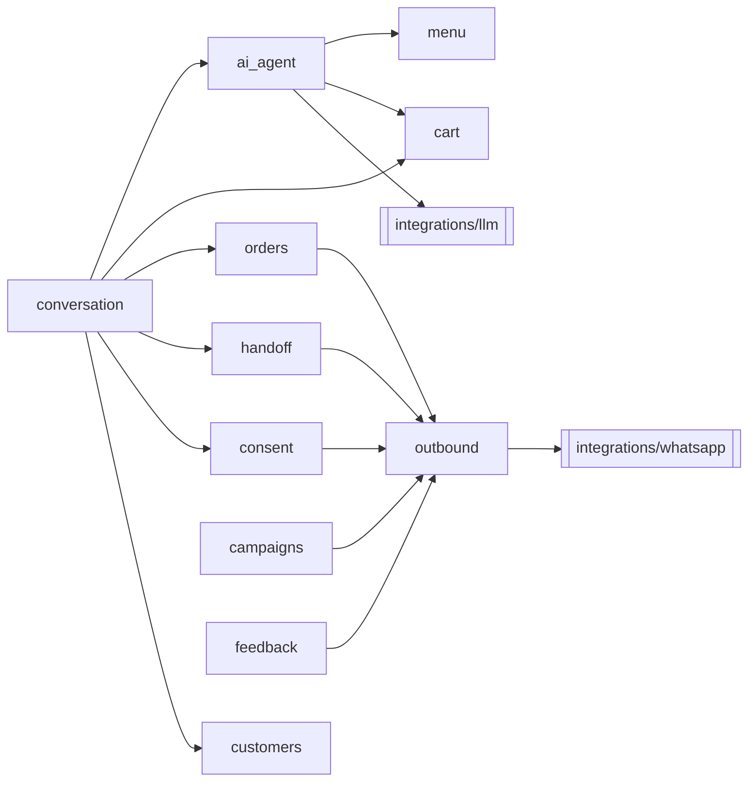

# app/domain — Module Context (L2)

> Parent: [backend/CLAUDE.md](../../CLAUDE.md) · Root: [/CLAUDE.md](../../../CLAUDE.md)
> Docs: [module-structure](../../../docs/backend/module-structure.md) · [design-principles](../../../docs/architecture/design-principles.md)

## Responsibility

All business rules live here. Each sub-folder is one domain service with a small public interface. The domain layer doesn't know whether it runs in `api` or `worker`.

| Module | Owns | Risk | Own context file |
|---|---|---|---|
| `conversation/` | Router, stages, bot/human mode, locks, greeting | High | [CLAUDE.md](conversation/CLAUDE.md) |
| `ai_agent/` | Prompt builder, tools, guardrails, structured output | High | [CLAUDE.md](ai_agent/CLAUDE.md) |
| `cart/` | Lines, totals, tax, versioning, priced snapshot | **Money** | [CLAUDE.md](cart/CLAUDE.md) |
| `orders/` | Create, transitions, ETA, overdue flag | **Money/state** | [CLAUDE.md](orders/CLAUDE.md) |
| `outbound/` | The single sender, 24h guard, message builders | High | [CLAUDE.md](outbound/CLAUDE.md) |
| `consent/` | Opt-in/out, append-only register | **Legal** | [CLAUDE.md](consent/CLAUDE.md) |
| `campaigns/` | Audience, codes, send, redeem, report | **Legal/money** | [CLAUDE.md](campaigns/CLAUDE.md) |
| `menu/` | Catalogue, availability, CSV import | Medium | → [menu-management](../../../docs/backend/menu-management.md) |
| `customers/` | Profile, history, favourites, visit count, anonymise | Medium | → [customers](../../../docs/backend/customers.md) |
| `handoff/` | Waiter/bill requests, human mode, escalation | Medium | → [human-handoff](../../../docs/backend/human-handoff.md) |
| `feedback/` | 1–5 rating, comment, low-rating alert | Low | → [feedback](../../../docs/backend/feedback.md) |
| `analytics/` | Read models over views, weekly report | Low | → [analytics-views](../../../docs/database/analytics-views.md) |
| `audit/` | Append `audit_log` rows | Low | → [security-controls](../../../docs/security/security-controls.md) |

## Dependency rules

- `outbound` is the **only** path to WhatsApp, and `ai_agent` is the **only** path to the LLM.
- `ai_agent` may call `menu` (reads) and `cart` (line edits). It may **not** call `orders`, `consent`, `campaigns` or `outbound`.
- Every service function takes `cafe_id`, plus a `conversation_id` where scoped, and passes them to repositories.
- State changes made by staff call `audit`.
