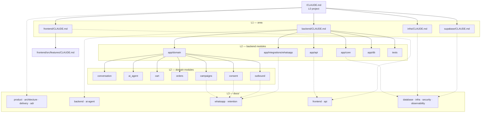
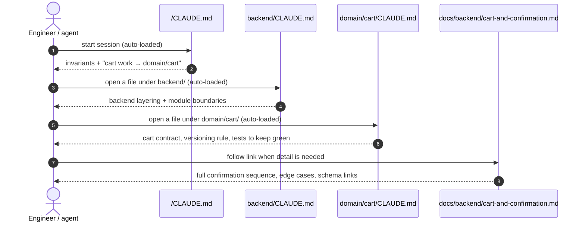

# Context map

> **Area:** Meta · **Status:** Draft v0.1 · **Owner:** Aman
> **Used by:** [/CLAUDE.md](../CLAUDE.md) and every other `CLAUDE.md`

## Summary

Context is layered so that an engineer or an AI coding agent working on one area loads only what that area needs. `CLAUDE.md` files hold the **rules and pointers** and stay short. `docs/` holds the **full design** and is read on demand. Claude Code loads the root `CLAUDE.md` at session start, and loads a folder's `CLAUDE.md` when it reads or edits files in that folder.

## Levels

| Level | Where | Loaded | Holds | Size target |
|---|---|---|---|---|
| **L0 — Project** | [`/CLAUDE.md`](../CLAUDE.md) | Always | Mission, stack, the 10 global invariants, repo map, task → doc router | ≤ 150 lines |
| **L1 — Area** | `backend/`, `frontend/`, `supabase/`, `infra/` `CLAUDE.md` | When working in that area | Area invariants, folder layout, boundaries, doc links | ≤ 100 lines |
| **L2 — Module** | e.g. `backend/app/domain/cart/CLAUDE.md` | When working in that module | Module contract, must / must-never, edge cases, tests to keep green | ≤ 60 lines |
| **L3 — Reference** | `docs/**` | On demand, via links | Flows, diagrams, schema, API tables, decisions | ~250 lines per file |
| **Frozen** | [`docs/_source/`](_source/mvp-architecture-v0.1.md) | Never edited | The original v0.1 architecture, for traceability | — |

## Context tree

The tree below shows which context file points at which docs.

Solid arrows mean the parent context file links to the child context file. Dotted arrows mean the context file links into those doc folders.

## How a task resolves context

## Which file states which rule

| Rule | Stated in | Detailed in |
|---|---|---|
| AI talks, code decides | L0 §3, [ai_agent](../backend/app/domain/ai_agent/CLAUDE.md) | [ai-agent/guardrails.md](ai-agent/guardrails.md), [adr/0001](adr/0001-ai-talks-code-decides.md) |
| Ack fast, process later | L0 §3, [api](../backend/app/api/CLAUDE.md), [whatsapp](../backend/app/integrations/whatsapp/CLAUDE.md) | [whatsapp/webhooks.md](whatsapp/webhooks.md), [adr/0002](adr/0002-ack-fast-process-async.md) |
| Per-customer ordering + lock | L0 §3, [conversation](../backend/app/domain/conversation/CLAUDE.md) | [backend/inbound-pipeline.md](backend/inbound-pipeline.md), [adr/0003](adr/0003-per-customer-ordering-and-locks.md) |
| Tenant from infrastructure | L0 §3, [db](../backend/app/db/CLAUDE.md), [core](../backend/app/core/CLAUDE.md) | [security/auth-and-tenant-isolation.md](security/auth-and-tenant-isolation.md), [adr/0006](adr/0006-tenant-from-infrastructure.md) |
| Writes only via FastAPI | L0 §3, [frontend](../frontend/CLAUDE.md), [supabase](../supabase/CLAUDE.md) | [database/row-level-security.md](database/row-level-security.md), [adr/0004](adr/0004-all-writes-through-fastapi.md) |
| One outbound sender, 24h window | L0 §3, [outbound](../backend/app/domain/outbound/CLAUDE.md) | [whatsapp/outbound-sender.md](whatsapp/outbound-sender.md) |
| Cart versioning / idempotent confirm | [cart](../backend/app/domain/cart/CLAUDE.md), [orders](../backend/app/domain/orders/CLAUDE.md) | [backend/cart-and-confirmation.md](backend/cart-and-confirmation.md) |
| Marketing needs OptedIn | [consent](../backend/app/domain/consent/CLAUDE.md), [campaigns](../backend/app/domain/campaigns/CLAUDE.md) | [retention/consent.md](retention/consent.md) |

## Rules for maintaining context

1. **Rules go up, detail goes down.** If something must never be broken, state it in the nearest `CLAUDE.md`. If it explains *how*, put it in `docs/`.
2. **Don't duplicate detail.** A `CLAUDE.md` links to a doc. It doesn't copy its tables or diagrams.
3. **Add an L2 file only for risky modules,** where a mistake costs money, orders, consent or tenant isolation. Simple modules inherit from L1.
4. **Keep it current.** A PR that changes behaviour updates the doc, and the context file too if an invariant changed. Reviewers check this.
