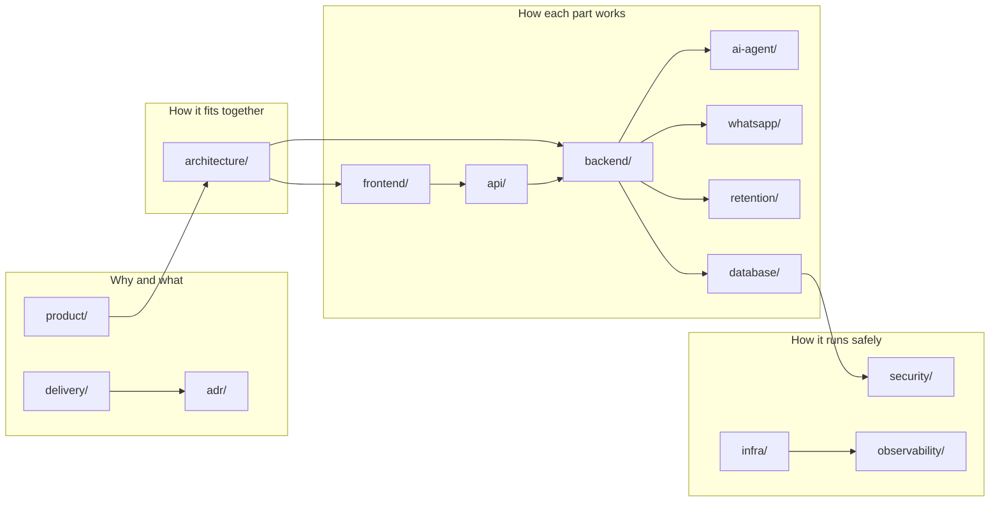

# Documentation index

> **Area:** Meta · **Source:** MVP Architecture v0.1 (all sections) · **Status:** Draft v0.1 · **Owner:** Aman
> **Used by:** [/CLAUDE.md](../CLAUDE.md)

The v0.1 architecture, split into one topic per file. Start with [CONTEXT-MAP.md](CONTEXT-MAP.md) to see how these docs connect to the `CLAUDE.md` context files, and follow [CONVENTIONS.md](CONVENTIONS.md) when writing or editing any doc.

## Map

Read left to right: *product* says what we're building, *architecture* how the pieces fit, the build folders how each part works, and the run folders how it's deployed, secured and watched.

## Folders

| Folder | What's inside | Source § |
|---|---|---|
| [product/](product/README.md) | Purpose and scope, feature map, priorities, roles and permissions, glossary | §1, §3, §4 |
| [architecture/](architecture/README.md) | Tech stack, system context, container view, design principles, end-to-end flow | §2, §5 |
| [backend/](backend/README.md) | Module structure, inbound pipeline, conversation router and state machine, cart and confirmation, order lifecycle, human handoff, feedback, menu, customers, background jobs | §6.1–6.4, §6.6–6.10, §6.15–6.17 |
| [ai-agent/](ai-agent/README.md) | Prompt context, tools, guardrails, LLM provider, evaluation | §6.5, §14 |
| [whatsapp/](whatsapp/README.md) | Webhooks, outbound sender and 24-hour window, interactive messages, templates, number health | §6.2, §6.13, §6.17 |
| [retention/](retention/README.md) | Consent, campaigns, redemption, data deletion | §6.11, §6.12 |
| [frontend/](frontend/README.md) | App structure, staff panel, owner console, platform admin, realtime and alerts | §6.8, §8, §12 |
| [api/](api/README.md) | Public, staff, admin, platform and internal endpoints | §8 |
| [database/](database/README.md) | Data model (ER), schema by domain, constraints, RLS, migrations, analytics views | §6.16, §7 |
| [infra/](infra/README.md) | Deployment, environments, Pub/Sub, Tasks and Scheduler, IAM and secrets, CI/CD | §9 |
| [security/](security/README.md) | Auth and tenant isolation, security controls, data protection (DPDP) | §6.14, §10 |
| [observability/](observability/README.md) | Logging, metrics, alerts, cost tracking | §11 |
| [delivery/](delivery/README.md) | Build order, open decisions, risks | §13, §14 |
| [adr/](adr/README.md) | Architecture decision records | §5.3, §6.5 |
| [_source/](_source/mvp-architecture-v0.1.md) | Frozen original v0.1 document | all |

## Reading paths

| You are… | Read in this order |
|---|---|
| New to the project | [product/purpose-and-scope](product/purpose-and-scope.md) → [architecture/container-view](architecture/container-view.md) → [architecture/design-principles](architecture/design-principles.md) → [architecture/end-to-end-flow](architecture/end-to-end-flow.md) |
| Building the backend | [backend/module-structure](backend/module-structure.md) → [backend/inbound-pipeline](backend/inbound-pipeline.md) → [backend/conversation-router](backend/conversation-router.md) → [database/data-model](database/data-model.md) |
| Building the panels | [frontend/app-structure](frontend/app-structure.md) → [api/README](api/README.md) → [frontend/staff-panel](frontend/staff-panel.md) → [frontend/realtime-and-alerts](frontend/realtime-and-alerts.md) |
| Working on WhatsApp | [whatsapp/webhooks](whatsapp/webhooks.md) → [whatsapp/outbound-sender](whatsapp/outbound-sender.md) → [whatsapp/templates](whatsapp/templates.md) |
| Setting up cloud | [infra/environments](infra/environments.md) → [infra/deployment](infra/deployment.md) → [infra/iam-and-secrets](infra/iam-and-secrets.md) |
| Planning work | [delivery/build-order](delivery/build-order.md) → [product/feature-priority](product/feature-priority.md) → [delivery/open-decisions](delivery/open-decisions.md) |
