# Restaurant Agentic System — MVP Architecture (source snapshot)

> **Frozen snapshot.** This is the original v0.1 architecture document, kept verbatim so every split doc can be traced back to a section (`§n`).
> **Do not edit this file.** Make changes in the split docs under [`docs/`](../README.md) and record significant decisions in [`docs/adr/`](../adr/README.md).

| | |
|---|---|
| **Document** | High-level and low-level architecture for the WhatsApp ordering & retention MVP |
| **Version** | 0.1 (draft) |
| **Date** | Oct 5, 2026 |
| **Owner** | Aman |
| **Related docs** | Customer Restaurant Journey · First Customer, MVP & MVP Critique · WhatsApp Integration Plan |

> **How to read this.** Section 3 is the feature scope (your list plus the additions, marked ➕). Section 5 is the high-level architecture. Section 6 is the low-level design, one subsection per feature area, each with a Mermaid diagram. Sections 7–12 cover the data model, API surface, deployment, security, observability and repo layout. Meta and Supabase facts are as of mid-2026; verify limits and pricing before building against them.

---

## 1. Purpose and scope

The MVP is the smallest system a café can run live on a busy evening without us in the kitchen. It has two jobs, matching the business plan:

1. **The hook — ordering.** A customer scans a table QR, chats with the AI agent on WhatsApp, orders, gets status updates and can call a waiter.
2. **The value — retention.** Every customer who orders becomes an opted-in WhatsApp contact the café owns. The owner sends an offer on a slow day and sees how many people came back and what they spent.

Reliability beats features: one lost or wrong order costs more trust than ten missing features. Every design choice below favours deterministic code for anything involving money, order state or consent, and keeps the AI to conversation and recommendation.

**Out of scope for the MVP:** payment gateway and refunds, table bookings and pre-orders, loyalty tiers, POS/printer integration, multi-location, Embedded Signup (Phase 2 of the integration plan), full BI dashboards.

---

## 2. Technology stack

| Layer | Choice | Role in this system |
|---|---|---|
| Backend | Python 3.12 + FastAPI | Webhook receiver, REST API for the panels, conversation engine, workers |
| Frontend | React + Vite (TypeScript) | One SPA with role-based areas: Staff panel, Owner console, Platform admin |
| Database | Supabase Postgres | System of record; Row Level Security (RLS) for anything the frontend reads directly |
| Auth | Supabase Auth | Staff, owner and platform-admin logins only. Customers never log in: their identity is their WhatsApp number (`wa_id`) |
| Realtime | Supabase Realtime (Postgres Changes) | Live order feed and waiter-call alerts in the staff panel |
| File storage | Supabase Storage | Menu images, menu PDF fallback, generated QR codes |
| Compute | GCP Cloud Run | `api` service (public) and `worker` service (internal) from one codebase |
| Async | GCP Pub/Sub + Cloud Tasks + Cloud Scheduler | Inbound message queue, delayed/throttled jobs, periodic sweeps |
| Secrets | GCP Secret Manager | Meta App Secret, WABA tokens, 2FA PINs, Supabase service key, LLM key |
| Frontend hosting | Firebase Hosting (GCP) | Static Vite build behind a CDN |
| WhatsApp | Meta WhatsApp Cloud API (direct) | Messages, interactive messages, templates, webhooks |
| LLM | **Open decision** (see §14) | Recommendations and Q&A via tool calling. Gemini on Vertex AI would draw on the GCP credit |

**Stack notes worth deciding early**

- **Supabase free tier.** Free projects have historically been paused after about a week of inactivity and have a small database size cap. That is fine for development; for a live pilot café, plan on the paid tier so the database never pauses on a quiet week. Check current Supabase limits.
- **Region alignment.** Put Cloud Run in `asia-south1` (Mumbai) and the Supabase project in its Mumbai region. Every inbound message touches the database several times, so cross-region latency adds up.
- **Cloud Run cold starts.** Meta expects a fast `200` on webhooks. Keep `min-instances=1` on the `api` service in production. This is a small but real cost against the $300 credit.
- **Supabase Auth MAU.** Only staff and owners count toward Auth MAU. Customers are rows in `customers`, not Auth users, so the 50,000 MAU limit is not a constraint.

---

## 3. Feature scope

### 3.1 Your list, reviewed

Your list covers the ordering loop well. The gaps fall into four groups:

1. **Things a live café will hit on day one** that aren't on the list: new-order alerts, a two-tap sold-out toggle, editing or cancelling an order before the kitchen starts, and asking for the bill.
2. **The retention loop is only half there.** "Offers" and "Consent" exist, but the piece that proves value, **redemption tracking**, is missing. Without it you can send offers but can't show the owner "42 people came back and spent ₹X". It needs a staff-side action (enter the code) and an owner-side report.
3. **"Admin" is two different people.** The café owner (offers, customers, analytics, staff) and us as the platform operator (onboarding a café's WhatsApp number, template status, token health, cost per order). Mixing them in one role would let a café owner see other cafés' data.
4. **Platform plumbing that has no feature name but must exist:** webhook verification and deduplication, the 24-hour window guard, per-customer message ordering, AI guardrails and fallback, an audit log, cost tracking, and DPDP data-deletion handling.

### 3.2 Final MVP feature map

`➕` marks additions. `⏳` marks items to build last or only if discovery interviews confirm them.

```mermaid
flowchart LR
    MVP(("Restaurant<br/>Agentic System<br/>MVP"))

    MVP --> C["Customer (WhatsApp)"]
    MVP --> S["Restaurant staff (panel)"]
    MVP --> O["Café owner / manager (console)"]
    MVP --> P["➕ Platform admin (us)"]
    MVP --> X["➕ Platform services"]

    C --> C1["Start conversation<br/>➕ table session from QR"]
    C --> C2["Browse menu"]
    C --> C3["Ask questions"]
    C --> C4["Get recommendations"]
    C --> C5["Build cart"]
    C --> C6["Confirm order"]
    C --> C7["➕ Edit / cancel before preparing"]
    C --> C8["➕ Reorder 'same again'"]
    C --> C9["Track order"]
    C --> C10["Request human help"]
    C --> C11["➕ Request bill"]
    C --> C12["Give feedback"]
    C --> C13["Consent / offers<br/>➕ STOP opt-out"]
    C --> C14["➕ Data deletion request"]

    S --> S1["Login"]
    S --> S2["See orders<br/>➕ sound alert + overdue highlight"]
    S --> S3["Change order status"]
    S --> S4["Manage menu<br/>➕ two-tap sold-out toggle"]
    S --> S5["Handle customer requests<br/>➕ waiter queue + reply in chat"]
    S --> S6["View customer information"]
    S --> S7["➕ Redeem offer code"]

    O --> O1["Restaurant settings<br/>tables, hours, staff"]
    O --> O2["➕ Table QR generator"]
    O --> O3["Offers / campaigns<br/>➕ campaign report"]
    O --> O4["Customer intelligence"]
    O --> O5["Consent register"]
    O --> O6["Basic analytics<br/>➕ weekly report export"]

    P --> P1["Café onboarding<br/>WABA, number, tokens"]
    P --> P2["Template management + status"]
    P --> P3["Token, quality and limit health"]
    P --> P4["Cost per order / campaign"]
    P --> P5["AI conversation review"]
    P --> P6["Audit log"]

    X --> X1["Webhook verify + dedupe"]
    X --> X2["24-hour window guard"]
    X --> X3["AI guardrails + human fallback"]
    X --> X4["Scheduled jobs"]
    X --> X5["Logging, metrics, alerts"]
```

### 3.3 Feature priority

| Priority | Features |
|---|---|
| **P0 — pilot can't run without it** | Webhook + sender, table QR session, menu browse, AI Q&A/recommendations, cart, deterministic confirmation, staff login, live orders with sound alert, status changes → customer updates, sold-out toggle, call waiter + human mode |
| **P1 — the retention pitch** | Welcome back, consent capture + STOP, redemption code, simple campaign send, campaign report, feedback 1–5 |
| **P2 — useful in the pilot** | Edit/cancel before preparing, reorder, request bill, customer profile view, weekly report, cost tracking screen, AI conversation review |
| **⏳ After discovery** | Bookings, pre-orders, payment links, segments beyond "lapsed" and "all opted-in" |

---

## 4. Roles and permissions

| Role | Who | Can do | Cannot do |
|---|---|---|---|
| `staff` | Waiter / kitchen | See live orders, change status, toggle sold-out, handle waiter calls, reply in human mode, redeem codes, view a customer's name and past orders | Edit prices, send campaigns, see analytics, export data |
| `manager` | Shift manager | Everything `staff` can, plus edit menu, cancel orders, view analytics | Manage staff accounts, send campaigns |
| `owner` | Café owner | Everything `manager` can, plus staff accounts, tables/QR, campaigns, consent register, customer intelligence, exports | Anything outside their own café |
| `platform_admin` | Us | Onboard cafés, manage WhatsApp config and templates, view health, costs, audit log, AI transcripts across cafés | (Use sparingly; every action audited) |

Roles live in `staff_memberships (user_id, cafe_id, role)`. One person can belong to several cafés later without schema changes.

---
## 5. High-level architecture

### 5.1 System context

Who and what the system talks to.

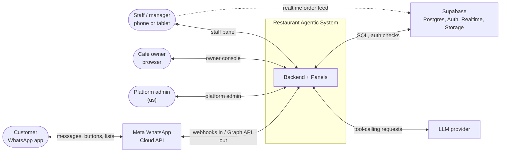

### 5.2 Container view

The main deployable pieces and how data moves between them.

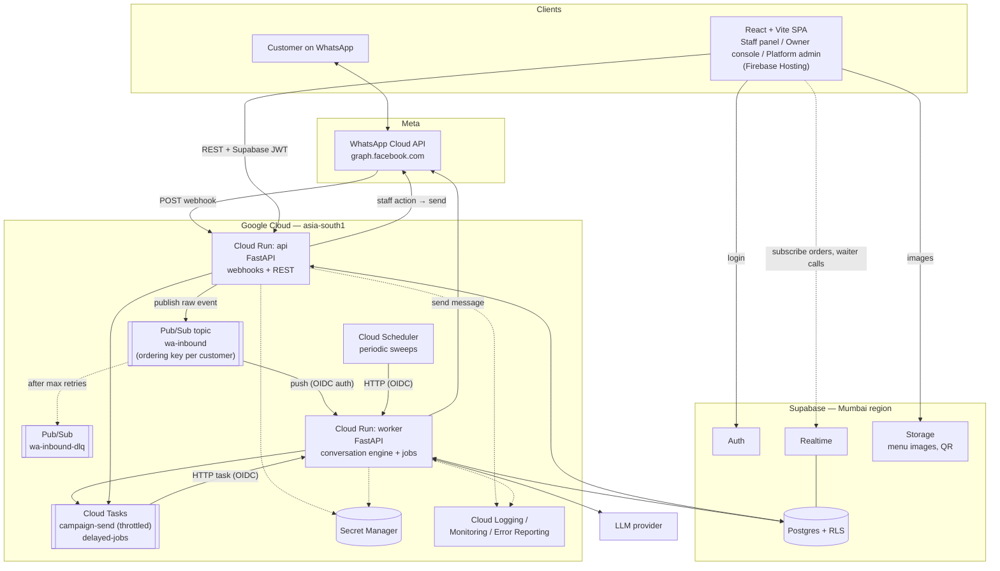

### 5.3 Design principles

1. **Acknowledge fast, process later.** The webhook verifies the signature, stores the raw event, publishes it and returns `200`. All real work happens in the worker.
2. **One message at a time per customer.** Pub/Sub ordering key `{phone_number_id}:{wa_id}` plus a Postgres advisory lock per conversation. Two quick messages from the same person never race each other to create two carts.
3. **AI talks, code decides.** The AI chooses what to say and which dishes to suggest. Prices, availability, totals, order creation, status changes and consent are fixed code paths reading the database.
4. **Menu database is the only source of truth.** The AI only ever sees currently available items, and dish names and prices in confirmation messages are rendered by code from the database.
5. **Every write goes through FastAPI.** The SPA uses Supabase directly only for login and for realtime *reads*. Status changes go through the API, because each one must also send a WhatsApp message and write an audit row.
6. **Tenant from the infrastructure, never from input.** On inbound messages the café is resolved from `phone_number_id`; on panel requests from the staff membership behind the JWT.
7. **Idempotent everything.** Unique `wamid`, unique order per cart version, monotonic message status. Meta retries and duplicates are expected, not exceptional.
8. **A human is always one tap away.** Any AI failure, low-confidence turn or explicit request lands with staff within a minute.

### 5.4 Customer-side and business-side flow

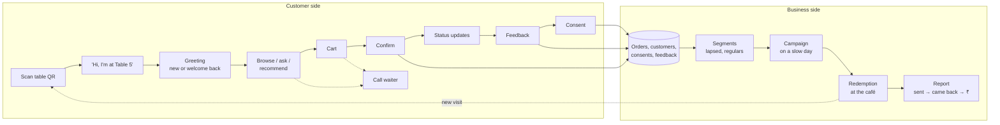

---
## 6. Low-level architecture

### 6.1 Backend module structure

One FastAPI codebase, deployed twice: `api` mounts the public routers, `worker` mounts the internal ones. Domain services don't know which service they run in.

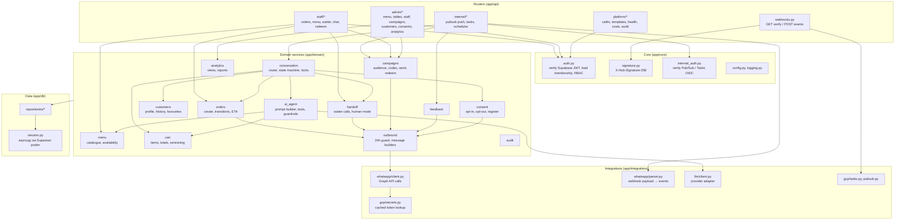

### 6.2 Inbound message pipeline

From Meta's webhook to a reply on the customer's phone.

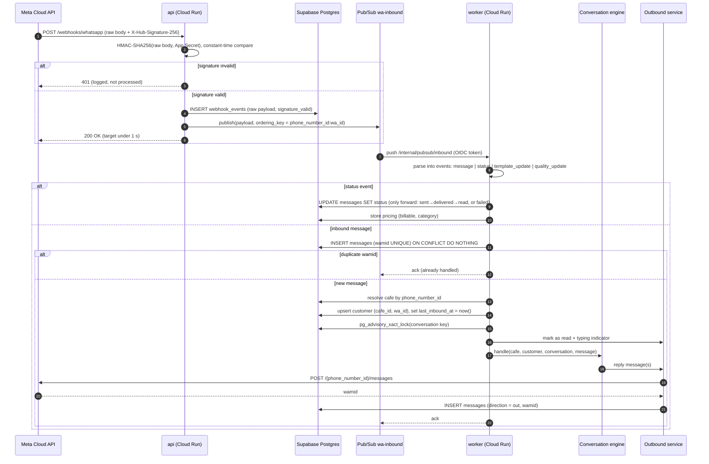

**Failure handling.** If the worker returns non-2xx, Pub/Sub retries with backoff; after N attempts the event goes to `wa-inbound-dlq` and an alert fires. Because of the `wamid` uniqueness check, a retry after a partial success won't double-reply. Long AI calls are bounded by a timeout (e.g. 12 s); on timeout the customer gets a fixed fallback message with buttons.

**Burst coalescing (optional, P2).** People often send "hi", "menu?" and "table 5" as three messages within two seconds. The engine can wait ~1.5 s for further messages from the same customer before calling the AI, and pass them in as one turn.

### 6.3 Conversation router

Most turns never reach the AI. Button and list taps, keywords and fixed steps are handled by code.

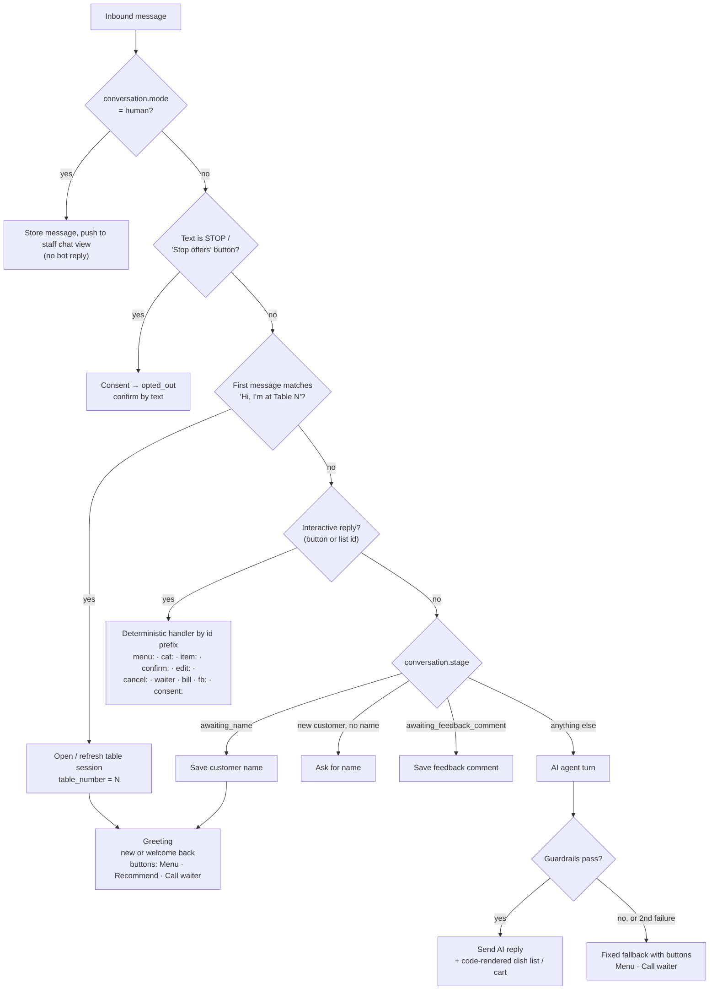

Interactive IDs follow `action:arg1:arg2`, for example `confirm:{cart_id}:{cart_version}` or `item:{menu_item_id}`. Handlers act on the ID, never on the visible title, so old buttons still resolve correctly (and stale ones, like an outdated cart version, are rejected politely).

### 6.4 Conversation state machine

`stage` tracks where the customer is in the ordering loop. `mode` (bot or human) is separate and can switch at any stage.

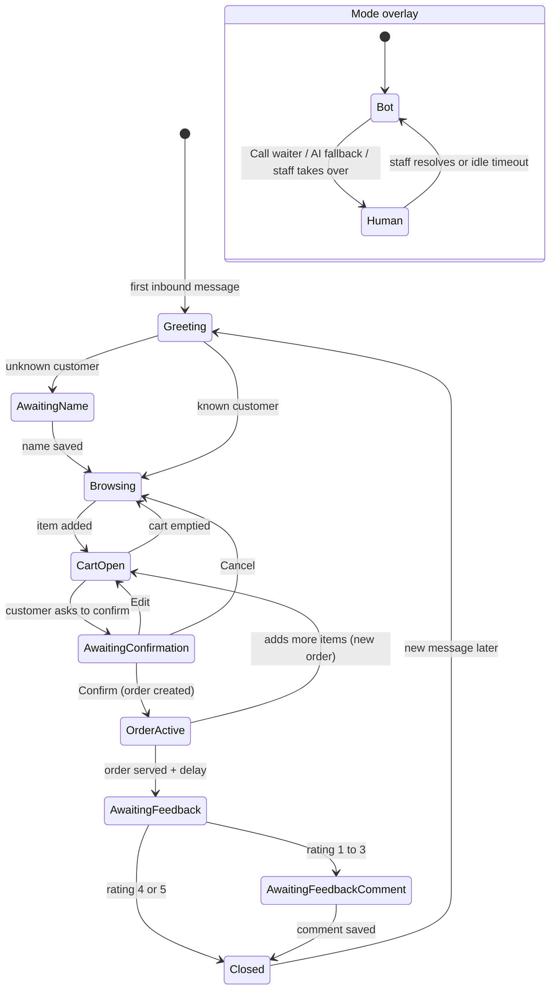

Conversation and cart state live in Postgres, not in worker memory, so any worker instance can pick up the next message.

### 6.5 AI agent

**Context per turn (built by code):**

- System prompt: café name, tone, language rules (reply in the customer's language, Hinglish included), hard rules (never state a price, never invent dishes, never promise times).
- **Compact available-menu JSON** — only `is_available = true` items, with id, name, category, veg flag, spice level, tags, protein/calories if present, allergens, short description. Cafés typically have tens to low hundreds of items, so the whole available menu fits in the prompt; this is more reliable than search for small menus. Switch to the `search_menu` tool (and pgvector) only if a menu grows too large.
- Customer context: first name, last 3 orders (item names only), visit count. No phone number.
- Current cart (from the database).
- Last ~10 messages of this conversation.

**Tools the AI can call:**

| Tool | Does | Guardrail |
|---|---|---|
| `search_menu(query, veg?, max_spice?, tags?)` | Filters available items (large menus only) | Returns available items only |
| `get_item_details(item_id)` | Full detail for one dish | Unknown or unavailable id → error the AI must handle |
| `add_to_cart(item_id, qty, note?)` | Adds a line | Re-checks availability; qty 1–20 |
| `update_cart_item(line_id, qty?, note?)` / `remove_from_cart(line_id)` | Edits the cart | Cart must belong to this conversation |
| `get_cart()` | Returns cart with code-computed totals | — |
| `request_confirmation()` | Hands off to the deterministic confirmation step | Only route to place an order |
| `get_order_status()` | Current active order status | Read-only |
| `call_human(reason)` | Switches to human mode | Always allowed |

**What the AI cannot do:** set or state prices, create an order, change order status, send templates, record consent, or see other customers.

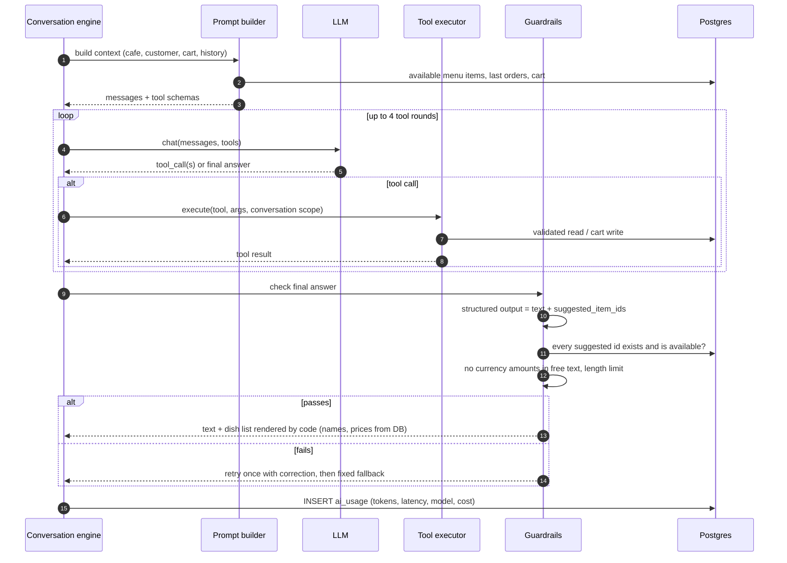

The AI returns structured output `{ "reply_text": "...", "suggested_item_ids": [...], "intent": "..." }`. The outbound layer renders the suggested dishes as a WhatsApp list message from the database, so a hallucinated name or price can't reach the customer.

### 6.6 Cart and order confirmation

Confirmation is fixed code. This is the step that must never be wrong.

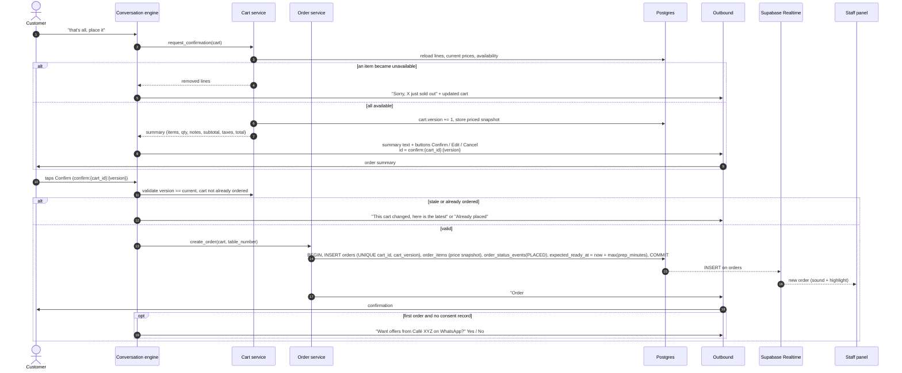

### 6.7 Order lifecycle

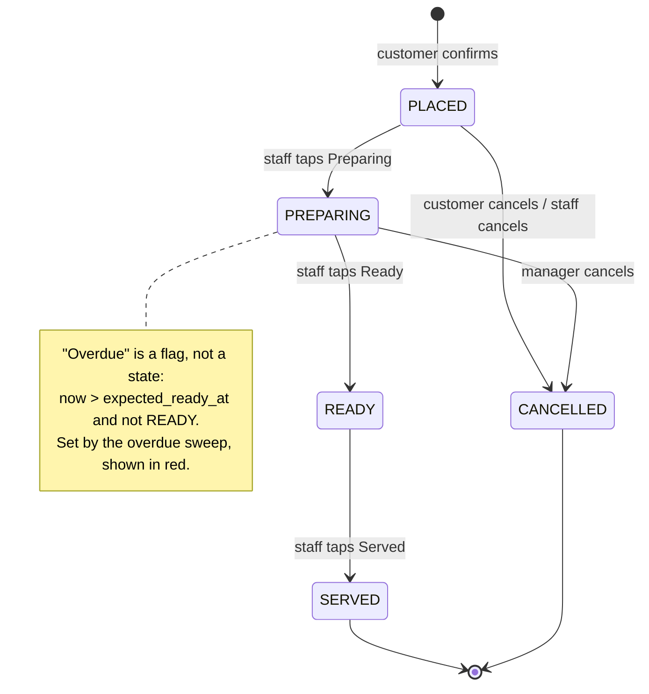

| Transition | Who | Customer message (inside 24-h window) | Side effects |
|---|---|---|---|
| → PLACED | Customer | "Order #123 received, about 20 min" | Staff alert; consent ask on first order |
| PLACED → PREPARING | Staff | "The kitchen has started on your order" | Customer edits/cancels now blocked |
| → READY | Staff | "Your order is ready and on its way" | — |
| Overdue flag set | Sweep | "Sorry, it's taking a little longer. We'll update you" (sent once) | Order highlighted red |
| READY → SERVED | Staff | — | Feedback task scheduled (+30 min) |
| → CANCELLED | Customer / manager | "Your order has been cancelled" + reason | Audit row; excluded from analytics revenue |

Every transition writes `order_status_events (order_id, from, to, actor, at)`. That table gives prep times, delays and the "who changed what" trail without extra work.

### 6.8 Staff panel: live orders and status changes

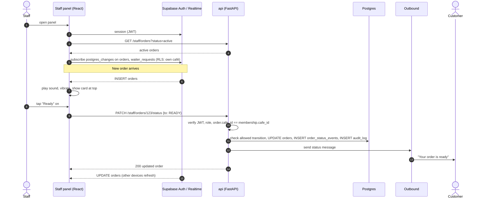

**Staff alerts.** The primary alert is a sound and vibration in the panel. A browser tab can be killed in the background on phones, so add a backup: a `new_order_alert` utility template to a staff WhatsApp number if an order stays unacknowledged in `PLACED` for more than 60 seconds (checked by the overdue sweep).

---
### 6.9 Human help: call waiter and human mode

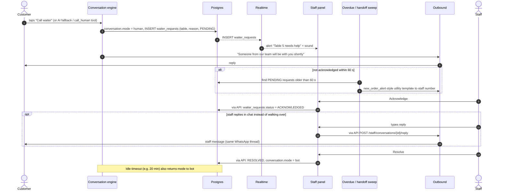

While `mode = human`, inbound messages are stored and shown in the staff chat view, and the bot stays silent. The **"Request bill"** button reuses the same path with `reason = BILL`, so it costs almost nothing extra to build.

### 6.10 Feedback

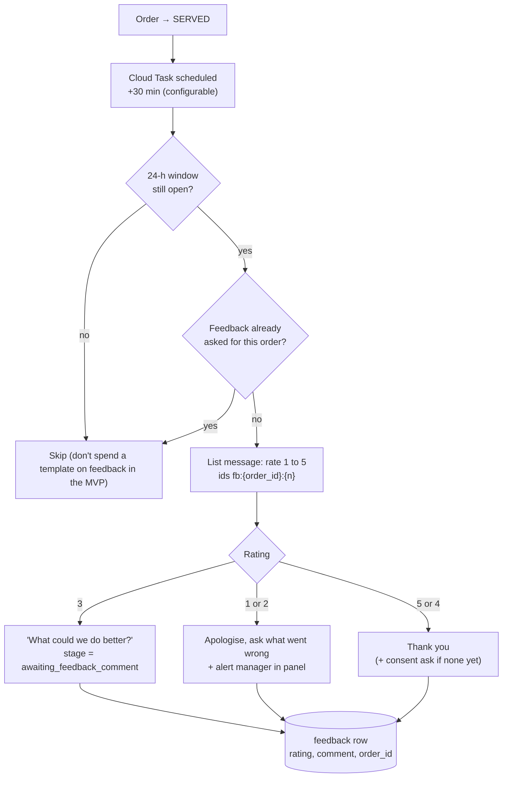

### 6.11 Consent

Consent records are append-only; the latest row per customer and type is the current state.

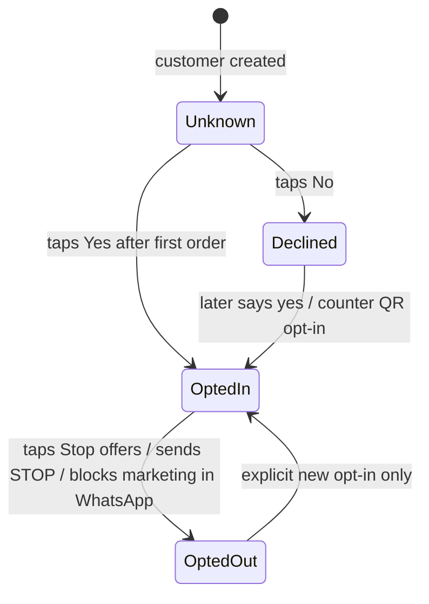

Each row stores `status`, `wording_version` (the exact text shown), `source` (`order_flow`, `counter_qr`, `feedback_flow`) and `created_at`. Campaign audiences query only `OptedIn`. Never ask again within N days after a "No", or the ask becomes spam.

**Data deletion (DPDP).** A customer can send "delete my data". The engine creates a `data_deletion_requests` row, confirms by text, and a job anonymises the customer (name and `wa_id` replaced, messages purged, orders kept as anonymous rows so the café's sales history stays intact). Meta's data deletion callback goes through the same job.

### 6.12 Offers, campaigns and redemption

This is the retention value the owner pays for, so the report at the end matters as much as the send.

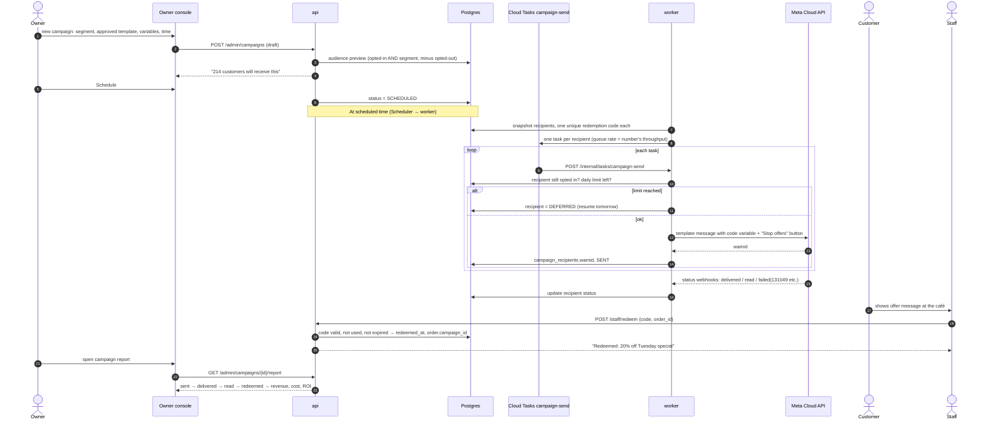

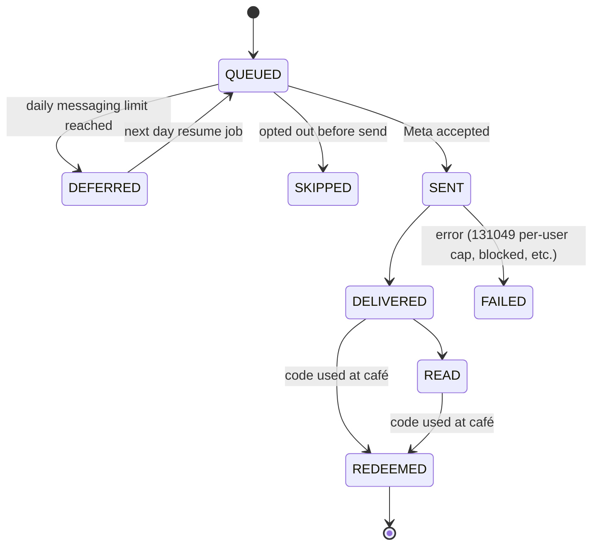

**MVP segments (only three):** all opted-in, lapsed (no order in N days), regulars (≥ K orders in 60 days). Add more only after the owner asks for them.

### 6.13 Outbound sender and the 24-hour window

Every message to a customer goes through one function, so the window rule and logging can't be bypassed.

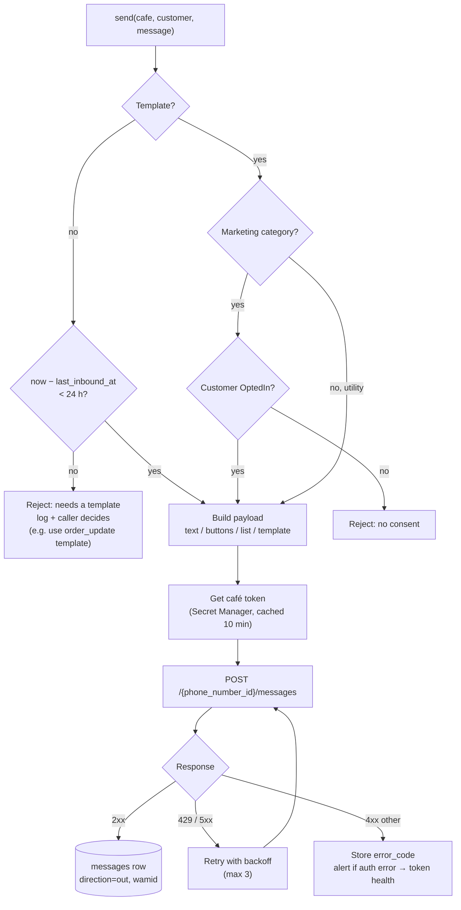

### 6.14 Authentication and tenant isolation

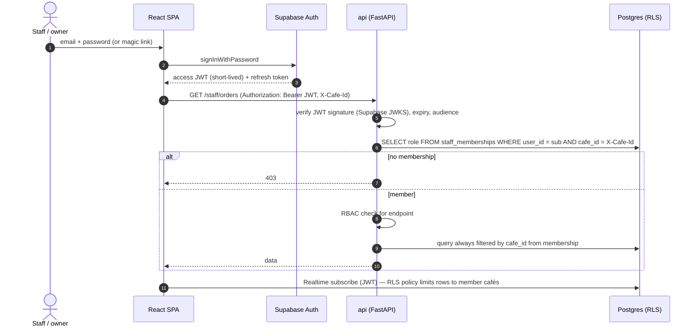

- **Backend DB access** uses a server-side Postgres role through the Supavisor pooler; the backend enforces `cafe_id` in every repository method (repositories take `cafe_id` as a required argument).
- **Frontend direct access** is read-only Realtime under RLS: `cafe_id IN (SELECT cafe_id FROM staff_memberships WHERE user_id = auth.uid())`.
- **Inbound WhatsApp traffic** resolves `cafe_id` from `phone_number_id` in the webhook payload, never from message text.
- **The Supabase service-role key** never leaves Secret Manager and the backend.

### 6.15 Menu management and sold-out propagation

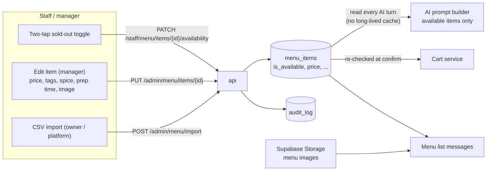

Sold-out takes effect on the next AI turn because the available menu is read per turn (a cache, if added, must be invalidated on every toggle). A sold-out item already in someone's cart is caught at the confirmation re-check (§6.6). An optional "back in stock at …" auto-reset can come later.

### 6.16 Customer intelligence and basic analytics

No separate analytics stack in the MVP. Postgres views over the operational tables, served by the API, are enough for one or two cafés.

```mermaid
flowchart LR
    subgraph OLTP["Operational tables"]
        O1[("orders, order_items")]
        O2[("order_status_events")]
        O3[("customers, consents")]
        O4[("feedback")]
        O5[("campaign_recipients")]
        O6[("messages, ai_usage")]
    end
    subgraph VIEWS["SQL views / materialised views (refreshed nightly)"]
        V1["v_daily_sales<br/>orders, revenue, AOV by day / hour"]
        V2["v_item_performance<br/>top and bottom dishes"]
        V3["v_customer_profile<br/>visits, last visit, favourites, spend, segment"]
        V4["v_prep_times<br/>placed→ready, overdue %"]
        V5["v_feedback_summary<br/>avg rating, low-rating comments"]
        V6["v_campaign_funnel<br/>sent→delivered→read→redeemed→₹"]
        V7["v_unit_costs<br/>WhatsApp + AI cost per order / campaign"]
    end
    O1 --> V1
    O1 --> V2
    O1 --> V3
    O3 --> V3
    O2 --> V4
    O4 --> V5
    O5 --> V6
    O1 --> V6
    O6 --> V7
    V1 --> UI["Owner console<br/>Analytics + Customers"]
    V2 --> UI
    V3 --> UI
    V4 --> UI
    V5 --> UI
    V6 --> UI
    V7 --> PA["Platform admin<br/>Costs"]
    V1 --> WR["Weekly report<br/>CSV / one-page summary"]
    V2 --> WR
    V6 --> WR
```

**Customer intelligence in the MVP** means a searchable customer list and a profile page: name, masked number, first and last visit, visit count, total spend, favourite dishes, consent status, feedback, campaigns received and redeemed, and a segment label (new, regular, lapsed). That is what the owner needs to believe the "you now own your customer list" pitch.

### 6.17 Background and scheduled jobs

| Job | Trigger | What it does |
|---|---|---|
| `overdue_sweep` | Scheduler, every 1 min | Flags orders past `expected_ready_at`, sends one delay message, re-alerts unacknowledged orders and waiter calls (> 60 s) |
| `human_mode_timeout` | Scheduler, every 5 min | Returns idle human-mode conversations to bot mode |
| `feedback_prompt` | Cloud Task, +30 min after SERVED | Sends the 1–5 rating list if the window is open |
| `campaign_start` | Scheduler, every 5 min | Starts campaigns whose `scheduled_at` has passed |
| `campaign_resume` | Scheduler, daily 10:00 local | Re-queues DEFERRED recipients |
| `campaign_send` | Cloud Task (rate-limited queue) | Sends one template to one recipient |
| `token_health` | Scheduler, daily | Debug-token check per café; alerts and flags "Reconnect" |
| `quality_and_limits` | Scheduler, daily + webhooks | Reads quality rating and messaging tier, stores for the owner and platform screens |
| `template_sync` | Webhook + daily | Keeps template status in sync with Meta |
| `refresh_views` | Scheduler, nightly | Refreshes materialised analytics views |
| `weekly_report` | Scheduler, Monday 09:00 | Generates the owner's weekly summary |
| `data_deletion` | On request / Meta callback | Anonymises a customer |
| `prune_webhook_events` | Scheduler, daily | Deletes raw webhook logs older than 30 days |

Scheduler and Cloud Tasks call internal worker endpoints authenticated with OIDC; those endpoints are not reachable from the public internet.

---
## 7. Data model

Every business table carries `cafe_id`. The same person ordering at two cafés is two customer rows, because each café owns its own list.

```mermaid
erDiagram
    CAFES ||--o{ CAFE_TABLES : has
    CAFES ||--o{ STAFF_MEMBERSHIPS : employs
    CAFES ||--o{ CUSTOMERS : owns
    CAFES ||--o{ MENU_CATEGORIES : has
    MENU_CATEGORIES ||--o{ MENU_ITEMS : contains
    CUSTOMERS ||--o{ CONSENTS : gives
    CUSTOMERS ||--o{ CONVERSATIONS : has
    CONVERSATIONS ||--o{ MESSAGES : contains
    CONVERSATIONS ||--o| CARTS : holds
    CARTS ||--o{ CART_ITEMS : contains
    MENU_ITEMS ||--o{ CART_ITEMS : referenced_by
    CUSTOMERS ||--o{ ORDERS : places
    CARTS ||--o| ORDERS : becomes
    ORDERS ||--o{ ORDER_ITEMS : contains
    MENU_ITEMS ||--o{ ORDER_ITEMS : referenced_by
    ORDERS ||--o{ ORDER_STATUS_EVENTS : logs
    ORDERS ||--o| FEEDBACK : receives
    CONVERSATIONS ||--o{ WAITER_REQUESTS : raises
    CAFES ||--o{ TEMPLATES : has
    TEMPLATES ||--o{ CAMPAIGNS : used_by
    CAMPAIGNS ||--o{ CAMPAIGN_RECIPIENTS : targets
    CUSTOMERS ||--o{ CAMPAIGN_RECIPIENTS : is
    CAMPAIGN_RECIPIENTS ||--o| ORDERS : redeemed_in
    CONVERSATIONS ||--o{ AI_USAGE : costs

    CAFES {
        uuid id PK
        text name
        text timezone
        text business_id
        text waba_id
        text phone_number_id UK
        text display_phone_number
        text onboarding_model
        text token_secret_ref
        text status
        jsonb settings
    }
    CAFE_TABLES {
        uuid id PK
        uuid cafe_id FK
        text label
        text qr_url
        bool active
    }
    STAFF_MEMBERSHIPS {
        uuid id PK
        uuid user_id FK
        uuid cafe_id FK
        text role
        bool active
    }
    CUSTOMERS {
        uuid id PK
        uuid cafe_id FK
        text wa_id
        text name
        text language_hint
        timestamptz first_seen_at
        timestamptz last_inbound_at
        timestamptz last_visit_at
        int visit_count
        timestamptz anonymised_at
    }
    CONSENTS {
        uuid id PK
        uuid customer_id FK
        text type
        text status
        text wording_version
        text source
        timestamptz created_at
    }
    CONVERSATIONS {
        uuid id PK
        uuid cafe_id FK
        uuid customer_id FK
        text mode
        text stage
        text table_label
        timestamptz opened_at
        timestamptz last_activity_at
    }
    MESSAGES {
        text wamid PK
        uuid cafe_id FK
        uuid conversation_id FK
        text direction
        text type
        jsonb payload
        text status
        text error_code
        text pricing_category
        bool billable
        timestamptz created_at
    }
    MENU_CATEGORIES {
        uuid id PK
        uuid cafe_id FK
        text name
        int sort_order
    }
    MENU_ITEMS {
        uuid id PK
        uuid cafe_id FK
        uuid category_id FK
        text name
        text description
        numeric price
        bool is_veg
        int spice_level
        text_array tags
        text_array allergens
        int protein_g
        int calories
        int prep_minutes
        text image_path
        bool is_available
    }
    CARTS {
        uuid id PK
        uuid conversation_id FK
        int version
        text status
        jsonb priced_snapshot
    }
    CART_ITEMS {
        uuid id PK
        uuid cart_id FK
        uuid menu_item_id FK
        int qty
        text note
    }
    ORDERS {
        uuid id PK
        uuid cafe_id FK
        uuid customer_id FK
        uuid cart_id FK
        int cart_version
        int order_number
        text table_label
        text status
        numeric subtotal
        numeric tax
        numeric total
        text source
        uuid campaign_recipient_id FK
        timestamptz expected_ready_at
        bool overdue
        timestamptz created_at
    }
    ORDER_ITEMS {
        uuid id PK
        uuid order_id FK
        uuid menu_item_id FK
        text name_snapshot
        numeric unit_price_snapshot
        int qty
        text note
    }
    ORDER_STATUS_EVENTS {
        uuid id PK
        uuid order_id FK
        text from_status
        text to_status
        text actor
        timestamptz at
    }
    WAITER_REQUESTS {
        uuid id PK
        uuid cafe_id FK
        uuid conversation_id FK
        text table_label
        text reason
        text status
        uuid acknowledged_by
        timestamptz created_at
        timestamptz resolved_at
    }
    FEEDBACK {
        uuid id PK
        uuid order_id FK
        int rating
        text comment
        timestamptz created_at
    }
    TEMPLATES {
        uuid id PK
        uuid cafe_id FK
        text meta_template_id
        text name
        text language
        text category
        text status
        text quality
        jsonb components
    }
    CAMPAIGNS {
        uuid id PK
        uuid cafe_id FK
        uuid template_id FK
        jsonb segment_definition
        jsonb variables
        timestamptz scheduled_at
        text status
    }
    CAMPAIGN_RECIPIENTS {
        uuid id PK
        uuid campaign_id FK
        uuid customer_id FK
        text wamid
        text send_status
        text redemption_code UK
        timestamptz redeemed_at
        uuid order_id FK
    }
    AI_USAGE {
        uuid id PK
        uuid conversation_id FK
        text model
        int input_tokens
        int output_tokens
        int latency_ms
        numeric cost_usd
        bool fallback_used
        timestamptz created_at
    }
```

Supporting tables not drawn above: `webhook_events` (raw log), `audit_log (actor, cafe_id, action, entity, before, after, at)`, `data_deletion_requests`.

**Key constraints and indexes**

| Table | Constraint / index | Why |
|---|---|---|
| `customers` | `UNIQUE (cafe_id, wa_id)` | One record per person per café |
| `messages` | `PRIMARY KEY (wamid)` | Deduplicates Meta retries |
| `orders` | `UNIQUE (cart_id, cart_version)` | A double-tapped Confirm can't create two orders |
| `orders` | `INDEX (cafe_id, status, created_at)` | Live orders query |
| `orders` | `UNIQUE (cafe_id, order_number)` via per-café sequence | Short readable order numbers |
| `campaign_recipients` | `UNIQUE (redemption_code)`, `UNIQUE (campaign_id, customer_id)` | One code per person per campaign |
| `consents` | `INDEX (customer_id, type, created_at DESC)` | Fast "current consent" lookup |
| `cafes` | `UNIQUE (phone_number_id)` | Tenant resolution from webhooks |

**RLS.** Enable RLS on every table. Add `SELECT` policies only on the tables the SPA subscribes to (`orders`, `order_items`, `waiter_requests`, and `messages` for the human-mode chat view). No `INSERT/UPDATE/DELETE` policies for the `authenticated` role, so the frontend can't write directly even with a valid JWT.

**Migrations.** Use the Supabase CLI migrations folder as the source of truth (tables, indexes, RLS policies, views), and keep SQLAlchemy/Pydantic models in sync by hand or by generation.

---

## 8. API surface

### 8.1 Public (api service)

| Method | Path | Auth | Purpose |
|---|---|---|---|
| GET | `/webhooks/whatsapp` | `hub.verify_token` | Meta verification handshake |
| POST | `/webhooks/whatsapp` | `X-Hub-Signature-256` | Inbound messages and statuses |
| POST | `/webhooks/meta/data-deletion` | Signed request | Meta data deletion callback |
| GET | `/health` | none | Liveness |

### 8.2 Staff panel (`staff`, `manager`, `owner`)

| Method | Path | Purpose |
|---|---|---|
| GET | `/staff/orders?status=active` | Live orders |
| PATCH | `/staff/orders/{id}/status` | Status transition (validated) |
| POST | `/staff/orders/{id}/cancel` | Cancel with reason (`manager`+) |
| GET | `/staff/waiter-requests?status=open` | Waiter / bill queue |
| POST | `/staff/waiter-requests/{id}/ack` · `/resolve` | Handle requests |
| GET | `/staff/conversations/{id}/messages` | Chat view in human mode |
| POST | `/staff/conversations/{id}/reply` | Reply to customer as staff |
| POST | `/staff/conversations/{id}/takeover` · `/release` | Switch human/bot mode |
| PATCH | `/staff/menu/items/{id}/availability` | Sold-out toggle |
| GET | `/staff/customers/{id}` | Name, past orders, notes (masked number) |
| POST | `/staff/redeem` | Redeem an offer code against an order |

### 8.3 Owner console (`owner`; `manager` where noted)

| Method | Path | Purpose |
|---|---|---|
| CRUD | `/admin/menu/categories`, `/admin/menu/items` | Menu management (`manager`+) |
| POST | `/admin/menu/import` | CSV import |
| CRUD | `/admin/tables` · GET `/admin/tables/{id}/qr` | Tables and QR codes |
| CRUD | `/admin/staff` | Invite and manage staff |
| GET/PUT | `/admin/settings` | Hours, tone, feedback delay, tax |
| GET | `/admin/templates` | Approved templates for this café |
| POST | `/admin/campaigns` · `/preview` · `/schedule` · `/cancel` | Campaign lifecycle |
| GET | `/admin/campaigns/{id}/report` | Funnel, revenue, cost |
| GET | `/admin/customers` · `/admin/customers/{id}` | Customer list and profile |
| GET | `/admin/consents` · `/export` | Consent register |
| GET | `/admin/analytics/{sales,items,prep,feedback,customers}` | Basic analytics (`manager`+) |
| GET | `/admin/reports/weekly` | Weekly summary (JSON / CSV) |

### 8.4 Platform admin (`platform_admin`)

| Method | Path | Purpose |
|---|---|---|
| POST | `/platform/cafes` | Onboard café: IDs, token secret ref, display number |
| GET | `/platform/cafes/{id}/health` | Token validity, quality rating, messaging tier, webhook errors |
| POST | `/platform/cafes/{id}/templates` · `/sync` | Create templates on the café's WABA, sync status |
| GET | `/platform/costs` | WhatsApp + AI cost per order and per campaign |
| GET | `/platform/conversations` | AI transcript review (fallbacks, low ratings) |
| GET | `/platform/audit` | Audit log |

### 8.5 Internal (worker service, OIDC only)

| Path | Caller |
|---|---|
| `/internal/pubsub/inbound` | Pub/Sub push |
| `/internal/tasks/campaign-send` · `/feedback-prompt` | Cloud Tasks |
| `/internal/jobs/{job_name}` | Cloud Scheduler |

---

## 9. Deployment architecture

```mermaid
flowchart TB
    DEV["Developer"] -->|"push / PR"| GH["GitHub"]
    GH -->|"GitHub Actions: test, build"| AR["Artifact Registry<br/>backend image"]
    GH -->|"vite build"| FH["Firebase Hosting<br/>app.yourdomain"]
    AR --> CRA
    AR --> CRW

    subgraph PROD["GCP project: prod — asia-south1"]
        CRA["Cloud Run: api<br/>min 1, max 5, public ingress<br/>api.yourdomain"]
        CRW["Cloud Run: worker<br/>min 0, max 10, internal + OIDC only"]
        PS[["Pub/Sub: wa-inbound + DLQ"]]
        CTQ[["Cloud Tasks: campaign-send, delayed-jobs"]]
        SCH["Cloud Scheduler"]
        SM[("Secret Manager")]
        MON["Logging, Monitoring,<br/>Error Reporting, Uptime checks"]
        SA1["Service account: api-sa"]
        SA2["Service account: worker-sa"]
        SA3["Service account: invoker-sa"]
    end

    subgraph SUPAP["Supabase project: prod — Mumbai"]
        PG[("Postgres + RLS")]
        AU["Auth"]
        RTP["Realtime"]
        STO["Storage"]
    end

    META["Meta Cloud API"] -->|"webhook"| CRA
    CRA --> PS --> CRW
    CRW --> CTQ --> CRW
    SCH --> CRW
    CRA --> PG
    CRW --> PG
    CRA -.-> SM
    CRW -.-> SM
    CRA -.-> SA1
    CRW -.-> SA2
    PS -.->|"push as"| SA3
    CTQ -.->|"call as"| SA3
    SCH -.->|"call as"| SA3
    FH --> AU
    FH --> RTP
    FH --> CRA
```

**Environments.** Two GCP projects and two Supabase projects: `dev` (Meta test number, team phones) and `prod` (pilot cafés). Keep `dev` scaled to zero to protect the credit. A separate Meta app per environment avoids test webhooks hitting production.

**Service accounts (least privilege).** `api-sa`: Pub/Sub publisher, Secret Manager accessor (App Secret, tokens), Cloud Tasks enqueuer. `worker-sa`: Secret Manager accessor, Cloud Tasks enqueuer. `invoker-sa`: Cloud Run invoker on `worker` only.

**Rough monthly shape for 1–2 pilot cafés.** Cloud Run `api` at min-instance 1 is the main fixed GCP cost; Pub/Sub, Tasks, Scheduler and Secret Manager are negligible at this volume. The variable costs are the LLM (per conversation) and Meta marketing templates (per campaign). Measure all three from day one (§11) rather than estimating.

---

## 10. Security

| Area | Control |
|---|---|
| Webhook authenticity | HMAC-SHA256 of the **raw** body with the App Secret, constant-time compare, before JSON parsing |
| Secrets | App Secret, WABA tokens, 2FA PINs, Supabase service credentials and LLM key in Secret Manager; the DB stores only references; nothing in logs or the frontend |
| Tenant isolation | `cafe_id` from `phone_number_id` (inbound) or membership (panel); repositories require `cafe_id`; RLS for direct frontend reads; integration test that tries cross-café access |
| Frontend | Supabase anon key only; no write policies; all writes through FastAPI |
| Internal endpoints | Worker has internal ingress and requires OIDC from `invoker-sa` |
| Staff accounts | Per-person logins, no shared accounts; owner can deactivate staff instantly; audit log on status changes, sold-out flips, cancellations, campaigns and redemptions |
| Personal data | Mask phone numbers in the staff panel; minimise what the AI sees (first name and past items, no number); encryption at rest (Supabase default) |
| DPDP / Meta | Consent records with wording version; STOP handling; deletion requests and Meta deletion callback; retention limits on raw webhook logs and message payloads |
| Prompt injection | Customer text is never treated as instructions for tools; tools are scoped to the current conversation; the AI has no tool that reads other customers or sends templates |
| Rate limiting | Per-IP limits on public endpoints; per-customer limit on AI turns per minute to cap cost from spam |
| Token health | Daily debug-token check; alert and "Reconnect" flag if a café token stops working |

---

## 11. Observability and cost tracking

**Structured logs** (JSON) with `cafe_id`, `conversation_id`, `wamid`, `order_id` and a request ID on every line, so one customer's turn can be traced from webhook to reply.

**Metrics and alerts**

| Metric | Alert when |
|---|---|
| Webhook → reply latency (p95) | > 8 s for 5 min |
| Pub/Sub DLQ depth | > 0 |
| Outbound send failures | > 5% in 15 min |
| AI fallback rate | > 15% of turns in an hour |
| Waiter requests unacknowledged > 60 s | any |
| Orders in PLACED unacknowledged > 2 min | any |
| Token invalid / quality rating drops | any |

**Cost tracking from the first pilot day**

- AI cost per turn → `ai_usage`; per order = sum over the conversation that produced it.
- WhatsApp cost per message → `pricing` object from status webhooks stored on `messages`.
- Per campaign: WhatsApp cost, delivered, redeemed, revenue → cost per redeemed visit and revenue ÷ cost.

These numbers feed the platform cost screen and, later, pricing.

---

## 12. Repository layout

```text
restaurant-agentic-system/
├── backend/
│   ├── app/
│   │   ├── main_api.py            # mounts webhooks, staff, admin, platform routers
│   │   ├── main_worker.py         # mounts internal routers
│   │   ├── core/                  # config, logging, auth (JWT/JWKS), signature, internal OIDC, RBAC
│   │   ├── api/
│   │   │   ├── webhooks.py
│   │   │   ├── staff/             # orders, waiter, chat, menu availability, redeem
│   │   │   ├── admin/             # menu, tables, staff, campaigns, customers, consents, analytics
│   │   │   ├── platform/          # cafés, templates, health, costs, audit
│   │   │   └── internal/          # pubsub push, tasks, jobs
│   │   ├── domain/
│   │   │   ├── conversation/      # router, stages, locks, greeting
│   │   │   ├── ai_agent/          # prompt builder, tools, guardrails, structured output
│   │   │   ├── menu/  cart/  orders/  customers/
│   │   │   ├── handoff/  consent/  campaigns/  feedback/
│   │   │   ├── analytics/  outbound/  audit/
│   │   ├── integrations/
│   │   │   ├── whatsapp/          # client, payload parser, message builders, error codes
│   │   │   ├── llm/               # provider adapter
│   │   │   └── gcp/               # pubsub, tasks, secrets
│   │   └── db/                    # session (asyncpg/SQLAlchemy), repositories, models
│   ├── tests/
│   │   ├── unit/                  # cart totals, transitions, guardrails, 24h guard
│   │   ├── integration/           # webhook signature, dedupe, tenant isolation
│   │   └── conversations/         # scripted chats incl. Hinglish and confusing orders
│   └── Dockerfile
├── frontend/
│   └── src/
│       ├── app/                   # routes, role-based layout
│       ├── features/
│       │   ├── orders/  waiter/  chat/  menu/  redeem/       # staff
│       │   ├── campaigns/  customers/  analytics/  settings/ # owner
│       │   └── platform/                                     # platform admin
│       └── lib/                   # supabase client, api client, realtime hooks, sound alerts
├── supabase/
│   └── migrations/                # tables, indexes, RLS policies, views
└── infra/
    └── (Terraform or gcloud scripts: Cloud Run, Pub/Sub, Tasks, Scheduler, IAM, secrets)
```

---

## 13. Build order

Mapped to the MVP plan, starting from the existing chatbot demo.

```mermaid
flowchart LR
    S0["0. Foundations<br/>Meta test number, webhook + signature,<br/>Pub/Sub → worker, outbound sender,<br/>Supabase schema, CI/CD"]
    S1["1. Ordering core<br/>menu data + import, router,<br/>AI agent + guardrails,<br/>cart, deterministic confirm"]
    S2["2. Staff panel<br/>login + roles, live orders + sound,<br/>status → customer messages,<br/>sold-out toggle"]
    S3["3. Human help<br/>call waiter, human mode,<br/>staff chat reply, request bill,<br/>overdue sweep"]
    S4["4. Retention<br/>welcome back, consent + STOP,<br/>templates, campaign send,<br/>redemption, report"]
    S5["5. Insight<br/>feedback, customer profiles,<br/>analytics views, weekly report,<br/>cost screen"]
    S6["6. Pilot hardening<br/>Hinglish + chaos tests,<br/>30-order evening dry run,<br/>monitoring + alerts"]
    S0 --> S1 --> S2 --> S3 --> S4 --> S5 --> S6
```

Template approval for `weekly_offer`, `winback`, `order_update` and `new_order_alert` takes time, so submit them during step 1, not step 4.

---

## 14. Open decisions and risks

| Topic | Question | Suggested default |
|---|---|---|
| LLM provider | Which model for tool calling in English + Hinglish, at what cost per order? | Benchmark two candidates on 50 scripted conversations; Gemini on Vertex uses the GCP credit |
| Supabase tier | Free tier pausing and size caps vs a live pilot | Free for dev, paid for the pilot café |
| Menu size | Full menu in prompt vs search tool | Full available menu in prompt until it exceeds a token budget |
| Tax and pricing | GST inclusive or exclusive per café? Service charge? | Café setting, computed only in the cart service |
| Order edits | How long can a customer edit/cancel? | Until PREPARING |
| Feedback timing | Minutes after SERVED | 30, configurable per café |
| Consent re-ask | After a "No" | Not within 30 days |
| Bill / payment | UPI link now or later? | MVP: "Request bill" → staff; UPI link after discovery |
| Pilot number | New dedicated number vs café's existing number | Dedicated number (see integration plan) |
| Realtime reliability on phones | Panel in a background tab may miss alerts | WhatsApp backup alert to staff number after 60 s |

**Top risks:** an order lost between confirmation and the kitchen (mitigated by the transactional create, realtime + backup alert and the unacknowledged-order sweep); the AI recommending sold-out or invented dishes (mitigated by available-only context and code-rendered dish lists); and campaigns hurting the number's quality rating (mitigated by opt-in only, small first batches and an easy Stop button).
