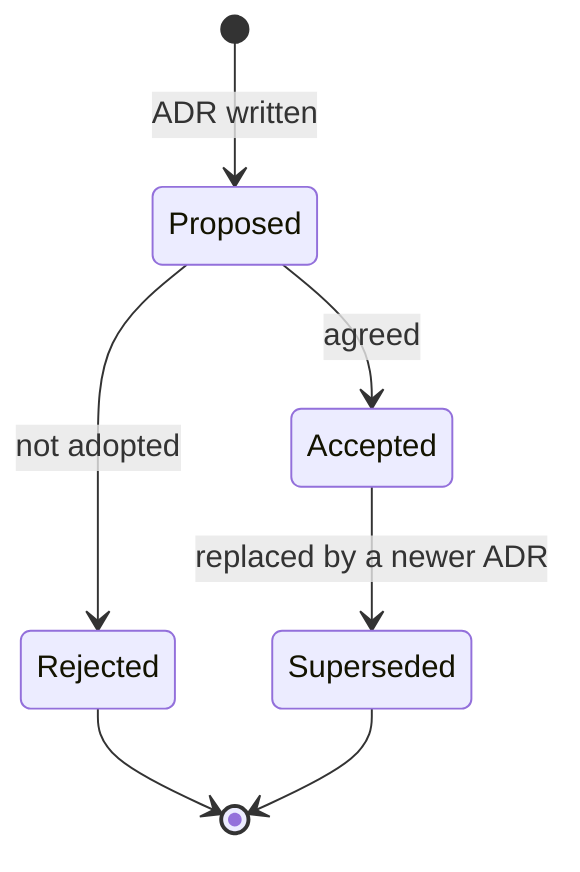

# Architecture decision records

> **Area:** Architecture
> **Source:** MVP Architecture v0.1 §5.3, §6.1, §6.5, §9 ([source](../_source/mvp-architecture-v0.1.md))
> **Status:** Draft v0.1 · **Owner:** Aman
> **Used by:** [/CLAUDE.md](../../CLAUDE.md), [backend/CLAUDE.md](../../backend/CLAUDE.md)

## Summary

An ADR records one significant decision with real trade-offs: the context, what was decided, what it costs, and what else was considered. ADRs 0001–0007 capture decisions already made in architecture v0.1. New decisions, including closing an item in [open-decisions.md](../delivery/open-decisions.md), get a new ADR.

## When to write one

- A choice between two or more workable designs with trade-offs.
- A change to a design principle or an invariant stated in a `CLAUDE.md`.
- Closing a topic in [open-decisions.md](../delivery/open-decisions.md).

Copy [0000-template.md](0000-template.md), take the next number, keep it to 30–60 lines.

## Status lifecycle

An accepted ADR is never edited to change its decision; a new ADR supersedes it and both link to each other. Rejected is included for completeness. (proposed)

## Index

| ADR | Title | Status | Date |
|---|---|---|---|
| [0000](0000-template.md) | Template | — | — |
| [0001](0001-ai-talks-code-decides.md) | AI talks, code decides | Accepted | 2026-10-05 |
| [0002](0002-ack-fast-process-async.md) | Acknowledge webhooks fast, process asynchronously | Accepted | 2026-10-05 |
| [0003](0003-per-customer-ordering-and-locks.md) | Per-customer ordering key and advisory lock | Accepted | 2026-10-05 |
| [0004](0004-all-writes-through-fastapi.md) | All writes go through FastAPI | Accepted | 2026-10-05 |
| [0005](0005-full-menu-in-prompt.md) | Full available menu in the prompt | Accepted | 2026-10-05 |
| [0006](0006-tenant-from-infrastructure.md) | Tenant from the infrastructure, never from input | Accepted | 2026-10-05 |
| [0007](0007-one-codebase-two-services.md) | One codebase, two Cloud Run services | Accepted | 2026-10-05 |

## Open questions

- Whether a `Rejected` state is needed is not stated in the source; it is added here as a proposal.

## Related

- [../architecture/design-principles.md](../architecture/design-principles.md)
- [../delivery/open-decisions.md](../delivery/open-decisions.md)
- [../CONVENTIONS.md](../CONVENTIONS.md)
