# AI agent docs

> **Area:** AI agent
> **Source:** MVP Architecture v0.1 §6.5 (also §1, §5.3, §10, §14) ([source](../_source/mvp-architecture-v0.1.md))
> **Status:** Draft v0.1 · **Owner:** Aman
> **Used by:** [`/CLAUDE.md`](../../CLAUDE.md), [`backend/app/domain/ai_agent/CLAUDE.md`](../../backend/app/domain/ai_agent/CLAUDE.md), [`backend/app/domain/conversation/CLAUDE.md`](../../backend/app/domain/conversation/CLAUDE.md)

## Summary

The AI agent handles free-text turns that the conversation router can't resolve with code: menu questions, recommendations and cart building via tool calls. It runs in `app/domain/ai_agent` inside the worker. The governing rule is **AI talks, code decides**: the AI chooses what to say and which dishes to suggest; prices, availability, totals, order creation, status changes and consent are fixed code paths reading the database.

## Index

| Doc | One-liner |
|---|---|
| [prompt-context.md](prompt-context.md) | What the prompt builder puts into each turn, privacy limits and language rules (incl. Hinglish) |
| [tools.md](tools.md) | The tools the AI can call, their guardrails and scoping, and the 4-round limit |
| [guardrails.md](guardrails.md) | Structured output, checks on every answer, retry and fixed fallback, timeout, prompt-injection and rate-limit controls |
| [llm-provider.md](llm-provider.md) | The open provider decision, the adapter in `integrations/llm`, and `ai_usage` logging |
| [evaluation.md](evaluation.md) | Scripted conversation suite, metrics, provider benchmark and pilot hardening |

## The boundary

```mermaid
flowchart LR
    subgraph AI["AI may"]
        A1["Choose reply wording<br/>in the customer's language"]
        A2["Suggest dishes by id<br/>suggested_item_ids"]
        A3["Answer menu questions<br/>from available items"]
        A4["Edit the cart via tools<br/>add, update, remove"]
        A5["Read cart and order status"]
        A6["Ask for confirmation<br/>request_confirmation"]
        A7["Call a human<br/>call_human"]
    end
    subgraph CODE["Only code may"]
        C1["Set or state prices"]
        C2["Compute totals and tax"]
        C3["Create an order"]
        C4["Change order status"]
        C5["Send templates"]
        C6["Record consent"]
        C7["See other customers"]
        C8["Render dish names and prices<br/>from the database"]
    end
    AI -->|"tool calls, validated"| GATE["Tool executor<br/>+ guardrails"]
    GATE --> CODE
```

Everything on the left is a request; the tool executor and guardrails decide whether it happens, and only the right side touches money, orders or consent.

## Rules / invariants

- The AI never states a price, invents a dish or promises a time.
- The AI only sees currently available menu items and only this customer's context (first name, past item names, visit count; no phone number).
- `request_confirmation()` is the only path from AI to an order; the Confirm step itself is deterministic ([../backend/cart-and-confirmation.md](../backend/cart-and-confirmation.md)).
- Dish lists and cart summaries shown to the customer are rendered by code from the database.
- Every turn writes an `ai_usage` row.

## Open questions

- LLM provider is not chosen ([llm-provider.md](llm-provider.md), [../delivery/open-decisions.md](../delivery/open-decisions.md)).

## Related

- [../adr/0001-ai-talks-code-decides.md](../adr/0001-ai-talks-code-decides.md) · [../adr/0005-full-menu-in-prompt.md](../adr/0005-full-menu-in-prompt.md)
- [../backend/conversation-router.md](../backend/conversation-router.md) · [../backend/menu-management.md](../backend/menu-management.md)
- Context file: [`backend/app/domain/ai_agent/CLAUDE.md`](../../backend/app/domain/ai_agent/CLAUDE.md)
