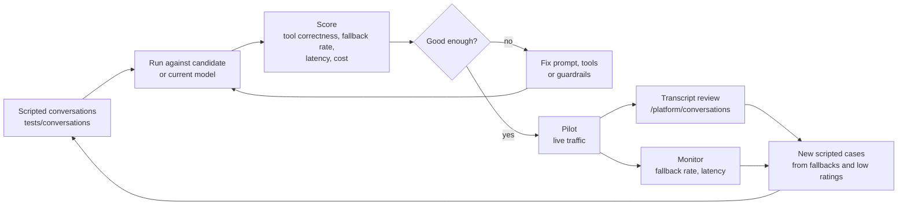

# AI evaluation

> **Area:** AI agent
> **Source:** MVP Architecture v0.1 §12, §13, §14 (also §8.4, §11) ([source](../_source/mvp-architecture-v0.1.md))
> **Status:** Draft v0.1 · **Owner:** Aman
> **Used by:** [`backend/app/domain/ai_agent/CLAUDE.md`](../../backend/app/domain/ai_agent/CLAUDE.md), [`backend/tests/CLAUDE.md`](../../backend/tests/CLAUDE.md)

## Summary

The AI is evaluated in three places: a scripted conversation test suite in the repo, a one-off benchmark to choose the provider, and live metrics plus transcript review during the pilot. Hinglish and confusing orders are first-class test cases, because that is what a busy café evening looks like.

## Test suite

| Folder | Covers |
|---|---|
| `backend/tests/unit/` | Cart totals, transitions, guardrails, 24h guard |
| `backend/tests/integration/` | Webhook signature, dedupe, tenant isolation |
| `backend/tests/conversations/` | Scripted chats incl. Hinglish and confusing orders |

Conversation tests should assert outcomes the code controls, for example: suggested ids are available, no amounts appear in free text, the cart matches the intended order, and confirmation goes through `request_confirmation()` **(proposed assertions)**.

## Provider benchmark

Benchmark two candidates on 50 scripted conversations (English + Hinglish) before choosing; compare tool-calling correctness, fallback rate, latency and cost per order from `ai_usage` ([llm-provider.md](llm-provider.md)).

## Live metrics

| Metric | Alert when |
|---|---|
| AI fallback rate | > 15% of turns in an hour |
| Webhook → reply latency (p95) | > 8 s for 5 min |

Platform admin can review AI transcripts across cafés via `GET /platform/conversations`, filtered on fallbacks and low ratings.

## Pilot hardening (build step 6)

Hinglish + chaos tests, a 30-order evening dry run, and monitoring + alerts ([../delivery/build-order.md](../delivery/build-order.md)).

## Eval loop

Failures found in the pilot become new scripted cases, so the suite grows from real conversations **(proposed loop)**.

## Rules / invariants

- Changes to prompts, tools or guardrails run the conversation suite.
- Hinglish cases are always in the suite.
- Fallback rate and latency are tracked from day one via `ai_usage` and metrics.

## Open questions

- Pass thresholds for the benchmark and suite are not defined.
- Whether the conversation suite calls a real LLM in CI (cost) or a recorded one is not decided.
- Content of the 50 benchmark conversations is not specified.

## Related

- [llm-provider.md](llm-provider.md) · [guardrails.md](guardrails.md) · [README.md](README.md)
- [../observability/logging-and-metrics.md](../observability/logging-and-metrics.md) · [../frontend/platform-admin.md](../frontend/platform-admin.md) · [../infra/ci-cd.md](../infra/ci-cd.md)
