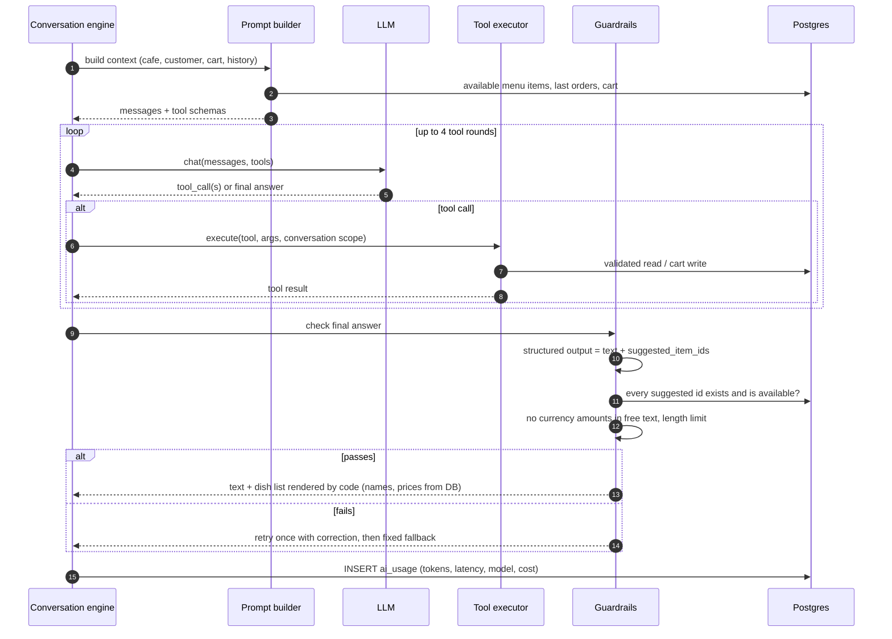
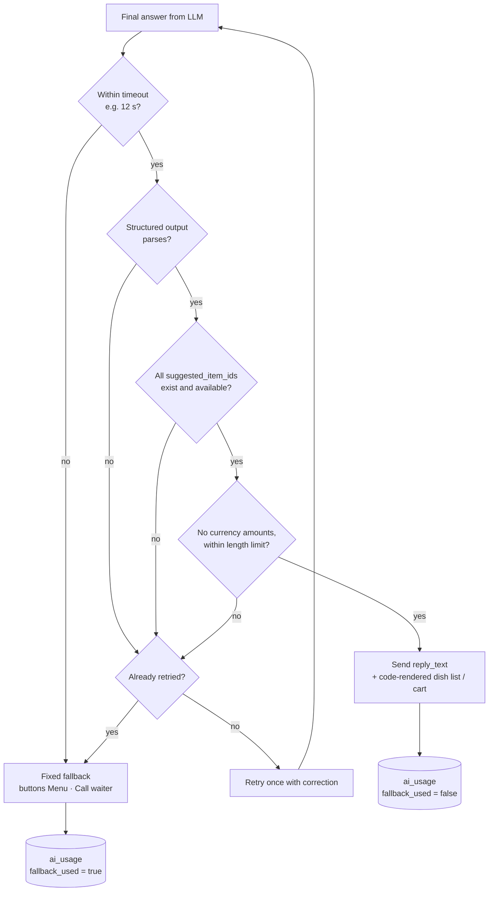

# AI guardrails and fallback

> **Area:** AI agent
> **Source:** MVP Architecture v0.1 §6.5 (also §6.2, §6.3, §10, §11) ([source](../_source/mvp-architecture-v0.1.md))
> **Status:** Draft v0.1 · **Owner:** Aman
> **Used by:** [`backend/app/domain/ai_agent/CLAUDE.md`](../../backend/app/domain/ai_agent/CLAUDE.md), [`backend/app/domain/outbound/CLAUDE.md`](../../backend/app/domain/outbound/CLAUDE.md)

## Summary

Every AI answer passes through code checks before anything reaches the customer. The AI returns structured output; suggested dishes are validated against the database and rendered by code as a WhatsApp list, so a hallucinated name or price can't reach the customer. A failing answer is retried once with a correction, then replaced by a fixed fallback with buttons.

## Turn sequence (§6.5)

The guardrail block after the loop is where code takes over: the AI's text is checked and the dish list is built from the database, not from the model.

## Structured output shape

The AI returns one object with three fields:

| Field | Type | Meaning |
|---|---|---|
| `reply_text` | string | The message text to send; no prices, within the length limit |
| `suggested_item_ids` | list of menu item ids | Dishes to show; rendered by code as a WhatsApp list message with names and prices from the DB |
| `intent` | string | What the AI thinks the customer wants; used for routing and review |

## Checks

| Check | Fails when |
|---|---|
| Structured output parses | Missing or malformed fields |
| Suggested ids valid | Any id doesn't exist in this café's menu or `is_available = false` |
| No currency amounts in free text | `reply_text` contains a price or amount |
| Length limit | `reply_text` too long |
| Timeout | LLM call exceeds the turn timeout (e.g. 12 s) |

## Decision flow

Every path ends in an `ai_usage` row; the fallback rate is what the > 15% / hour alert watches.

## Other controls

| Control | Detail | Source |
|---|---|---|
| Code-rendered dish list | Outbound renders suggested dishes as a list message from the DB | §6.5 |
| Prompt injection | Customer text is never treated as instructions for tools; tools are scoped to the current conversation; the AI has no tool that reads other customers or sends templates | §10 |
| Rate limit | Per-customer limit on AI turns per minute to cap cost from spam | §10 |
| Human always reachable | Fallback offers Call waiter; `call_human` always allowed | §5.3 |
| Hard rules in prompt | Never state a price, never invent dishes, never promise times | §6.5 |

## Rules / invariants

- Nothing the AI writes reaches the customer without passing these checks.
- Dish names and prices are never taken from AI output.
- At most one retry per turn; then the fixed fallback.
- Every turn logs `ai_usage` including `fallback_used`.

## Open questions

- Allowed `intent` values are not enumerated.
- The length limit value is not set.
- Timeout is "e.g. 12 s"; final value open.
- Per-customer AI turn rate limit value, and what the customer sees when limited, are not specified.
- Whether a fallback also switches to human mode — see [../backend/conversation-state-machine.md](../backend/conversation-state-machine.md).

## Related

- [tools.md](tools.md) · [prompt-context.md](prompt-context.md) · [evaluation.md](evaluation.md)
- [../whatsapp/interactive-messages.md](../whatsapp/interactive-messages.md) · [../security/security-controls.md](../security/security-controls.md) · [../observability/logging-and-metrics.md](../observability/logging-and-metrics.md)
