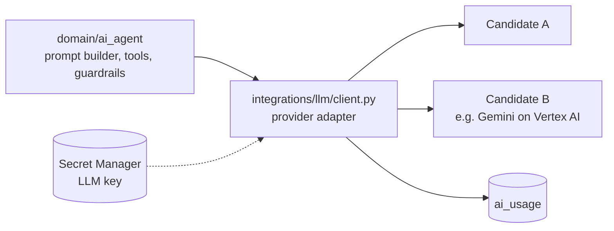

# LLM provider

> **Area:** AI agent
> **Source:** MVP Architecture v0.1 §2, §14 (also §6.1, §6.5, §7, §11) ([source](../_source/mvp-architecture-v0.1.md))
> **Status:** Draft v0.1 · **Owner:** Aman
> **Used by:** [`backend/app/domain/ai_agent/CLAUDE.md`](../../backend/app/domain/ai_agent/CLAUDE.md), [`backend/CLAUDE.md`](../../backend/CLAUDE.md)

## Summary

The LLM provider is an **open decision**. It must handle tool calling in English and Hinglish at an acceptable cost per order. The default plan is to benchmark two candidates on 50 scripted conversations; Gemini on Vertex AI would draw on the GCP credit. Whatever is chosen sits behind a provider adapter so it can be swapped.

## The decision (§14)

| Topic | Question | Suggested default |
|---|---|---|
| LLM provider | Which model for tool calling in English + Hinglish, at what cost per order? | Benchmark two candidates on 50 scripted conversations; Gemini on Vertex uses the GCP credit |

Selection criteria from the source: tool-calling reliability, English and Hinglish quality, cost per order. The benchmark is described in [evaluation.md](evaluation.md).

## Adapter

The domain talks only to the adapter, so changing provider is a change in `integrations/llm`, not in the agent.

- `app/integrations/llm/client.py` is the only place that knows the provider's API.
- The LLM key lives in Secret Manager.
- The adapter exposes chat with tools, and returns tool calls or a final answer plus token counts and latency.

## Usage logging

Every turn writes one `ai_usage` row:

| Column | Meaning |
|---|---|
| `conversation_id` | Which conversation the turn belongs to |
| `model` | Model identifier used |
| `input_tokens`, `output_tokens` | Token counts |
| `latency_ms` | LLM latency |
| `cost_usd` | Computed cost of the turn |
| `fallback_used` | Whether the guardrails fell back to the fixed message |
| `created_at` | When |

AI cost per order = sum over the conversation that produced it. `v_unit_costs` combines it with WhatsApp cost for the platform cost screen ([../observability/cost-tracking.md](../observability/cost-tracking.md)).

## Rules / invariants

- No provider SDK outside `app/integrations/llm`.
- Log `ai_usage` on every turn, including failures and fallbacks.
- The LLM key never appears in logs, the frontend or the database (the DB stores only references).

## Open questions

- Provider choice — tracked in [../delivery/open-decisions.md](../delivery/open-decisions.md).
- Region for the model endpoint (latency from `asia-south1`) is not discussed.
- Whether one model is used per café or platform-wide is not discussed.

## Related

- [evaluation.md](evaluation.md) · [guardrails.md](guardrails.md) · [README.md](README.md)
- [../architecture/tech-stack.md](../architecture/tech-stack.md) · [../infra/iam-and-secrets.md](../infra/iam-and-secrets.md)
