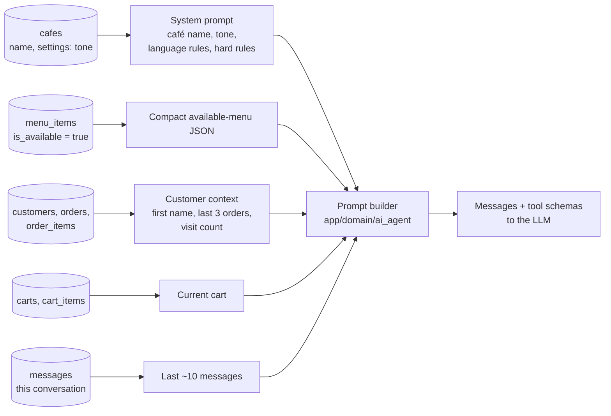

# Prompt context per turn

> **Area:** AI agent
> **Source:** MVP Architecture v0.1 §6.5 (also §5.3, §6.15, §10, §14) ([source](../_source/mvp-architecture-v0.1.md))
> **Status:** Draft v0.1 · **Owner:** Aman
> **Used by:** [`backend/app/domain/ai_agent/CLAUDE.md`](../../backend/app/domain/ai_agent/CLAUDE.md)

## Summary

Each AI turn gets a context built fresh by code from the database: system prompt, the compact available menu, minimal customer context, the current cart and recent messages. Nothing is cached across turns, so a sold-out flip or cart change is reflected immediately. The context is deliberately minimal on personal data.

## Inputs

Five inputs, each read from its own table on every turn; the prompt builder only assembles them.

## Context per turn (built by code)

| Part | Contents | Notes |
|---|---|---|
| System prompt | Café name, tone, language rules, hard rules | Hard rules: never state a price, never invent dishes, never promise times |
| Available menu | Compact JSON of only `is_available = true` items: id, name, category, veg flag, spice level, tags, protein/calories if present, allergens, short description | Read every turn, no long-lived cache |
| Customer context | First name, last 3 orders (item names only), visit count | No phone number |
| Current cart | From the database | Same source the cart service uses |
| History | Last ~10 messages of this conversation | This conversation only |

**Why the whole menu.** Cafés typically have tens to low hundreds of items, so the whole available menu fits in the prompt; this is more reliable than search for small menus. Switch to the `search_menu` tool (and pgvector) only if a menu grows too large — the default is the full available menu until it exceeds a token budget ([../adr/0005-full-menu-in-prompt.md](../adr/0005-full-menu-in-prompt.md)).

Prices are **not** needed for the AI to talk, since it must never state them; dish prices reach the customer only through code-rendered lists ([guardrails.md](guardrails.md)). Whether `price` is included in the menu JSON at all is listed below as an open question.

## Language rules

- Reply in the customer's language, Hinglish included.
- Hinglish is a first-class case in the conversation test suite ([evaluation.md](evaluation.md)) and in the provider benchmark ([llm-provider.md](llm-provider.md)).
- The fixed, code-written messages (greeting, confirmation, fallback) are separate from the AI's language handling.

## Privacy

- The AI never receives the customer's phone number or `wa_id`.
- Customer context is limited to first name, past item names and visit count (§10: minimise what the AI sees).
- History is limited to this conversation; the AI has no tool to read other customers.

## Rules / invariants

- Build context per turn from the database; never reuse a previous turn's menu or cart.
- Only available items enter the prompt.
- No phone numbers, no other customers' data, no secrets in the prompt.
- Customer text is data, never instructions for tools (§10).

## Open questions

- Whether `price` appears in the menu JSON (the source field list omits it) — recommended to leave it out **(proposed)**.
- The token budget that triggers the switch to `search_menu` is not set.
- Whether `customers.language_hint` is passed to the prompt is not specified.
- "~10 messages": exact window and whether burst-coalesced messages count as one (P2) are open.

## Related

- [tools.md](tools.md) · [guardrails.md](guardrails.md) · [README.md](README.md)
- [../backend/menu-management.md](../backend/menu-management.md) · [../backend/customers.md](../backend/customers.md) · [../security/data-protection.md](../security/data-protection.md)
