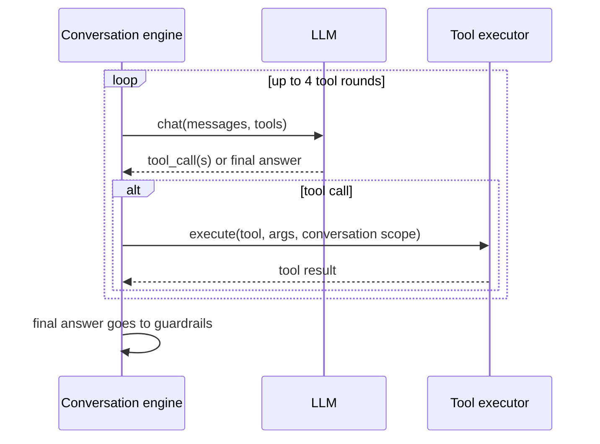

# AI tools

> **Area:** AI agent
> **Source:** MVP Architecture v0.1 §6.5 (also §10) ([source](../_source/mvp-architecture-v0.1.md))
> **Status:** Draft v0.1 · **Owner:** Aman
> **Used by:** [`backend/app/domain/ai_agent/CLAUDE.md`](../../backend/app/domain/ai_agent/CLAUDE.md), [`backend/app/domain/cart/CLAUDE.md`](../../backend/app/domain/cart/CLAUDE.md)

## Summary

The AI acts only through a small set of tools, each executed by code with its own guardrail. Tools are scoped to the current conversation: they can read the menu, edit this conversation's cart, read this customer's active order and hand off to a human or to the deterministic confirmation step. A turn may use up to 4 tool rounds.

## Tools (§6.5)

| Tool | Does | Guardrail |
|---|---|---|
| `search_menu(query, veg?, max_spice?, tags?)` | Filters available items (large menus only) | Returns available items only |
| `get_item_details(item_id)` | Full detail for one dish | Unknown or unavailable id → error the AI must handle |
| `add_to_cart(item_id, qty, note?)` | Adds a line | Re-checks availability; qty 1–20 |
| `update_cart_item(line_id, qty?, note?)` / `remove_from_cart(line_id)` | Edits the cart | Cart must belong to this conversation |
| `get_cart()` | Returns cart with code-computed totals | — |
| `request_confirmation()` | Hands off to the deterministic confirmation step | Only route to place an order |
| `get_order_status()` | Current active order status | Read-only |
| `call_human(reason)` | Switches to human mode | Always allowed |

**What the AI cannot do:** set or state prices, create an order, change order status, send templates, record consent, or see other customers.

## Per-tool notes

| Tool | Scope | Notes |
|---|---|---|
| `search_menu` | Caller's café, available items | Only enabled once a menu exceeds the prompt token budget; otherwise the menu is already in the prompt |
| `get_item_details` | Caller's café | Errors are returned to the AI as tool results, not raised to the customer |
| `add_to_cart` | This conversation's cart | Calls the cart service, which re-checks `is_available`; qty outside 1–20 is rejected |
| `update_cart_item` / `remove_from_cart` | This conversation's cart | `line_id` must belong to this conversation's cart |
| `get_cart` | This conversation's cart | Totals come from the cart service; the AI may describe the cart but must not quote amounts in free text |
| `request_confirmation` | This conversation's cart | Ends the AI's part; code sends the summary with Confirm / Edit / Cancel ([../backend/cart-and-confirmation.md](../backend/cart-and-confirmation.md)) |
| `get_order_status` | This customer's active order | Read-only |
| `call_human` | This conversation | Sets `mode = human` and raises a `waiter_requests` row ([../backend/human-handoff.md](../backend/human-handoff.md)) |

## Scoping

The tool executor receives the tool name, arguments and the **conversation scope** (`cafe_id`, customer, conversation, cart) from the engine, never from the model. The model can name an item or line id; it cannot name a café, customer or conversation. This is the core prompt-injection control: customer text is never treated as instructions for tools, and no tool reads other customers or sends templates (§10).

## Tool round limit

The loop is capped at 4 rounds so one turn can't spin on tools and run up cost or latency.

## Rules / invariants

- Every tool call is validated and executed by code against the database.
- Scope (`cafe_id`, conversation, cart) comes from the engine, never from tool arguments.
- Cart tools re-check availability; only available items can enter a cart.
- No tool creates orders, changes order status, sends templates or records consent.
- `call_human` is always allowed.

## Open questions

- Behaviour when the 4-round limit is reached without a final answer is not specified; proposed: treat as a guardrail failure and use the fixed fallback **(proposed)**.
- `call_human` reason values are not enumerated.

## Related

- [guardrails.md](guardrails.md) · [prompt-context.md](prompt-context.md) · [README.md](README.md)
- [../backend/cart-and-confirmation.md](../backend/cart-and-confirmation.md) · [../security/security-controls.md](../security/security-controls.md)
