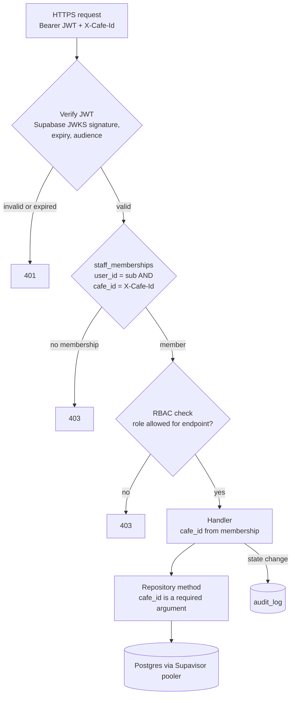

# API surface

> **Area:** API
> **Source:** MVP Architecture v0.1 §5.3, §6.1, §6.14, §8, §9, §10 ([source](../_source/mvp-architecture-v0.1.md))
> **Status:** Draft v0.1 · **Owner:** Aman
> **Used by:** [`backend/app/api/CLAUDE.md`](../../backend/app/api/CLAUDE.md), [`backend/app/core/CLAUDE.md`](../../backend/app/core/CLAUDE.md), [`backend/CLAUDE.md`](../../backend/CLAUDE.md), [`frontend/CLAUDE.md`](../../frontend/CLAUDE.md)

## Summary

One FastAPI codebase is deployed as two Cloud Run services. The **`api`** service is public and mounts the webhook, staff, admin and platform routers. The **`worker`** service has internal ingress, accepts only OIDC-authenticated calls and mounts the internal routers. Panel requests are authenticated with a Supabase JWT plus an `X-Cafe-Id` header, and the café is always taken from the caller's membership — never from the request body.

## Route groups

| Group | Service | Doc | Who calls it |
|---|---|---|---|
| `/webhooks/*`, `/health` | `api` (public) | [public.md](public.md) | Meta, uptime checks |
| `/staff/*` | `api` (public) | [staff.md](staff.md) | Staff panel |
| `/admin/*` | `api` (public) | [admin.md](admin.md) | Owner console |
| `/platform/*` | `api` (public) | [platform.md](platform.md) | Platform admin |
| `/internal/*` | `worker` (internal) | [internal.md](internal.md) | Pub/Sub, Cloud Tasks, Cloud Scheduler |

## Auth matrix

| Route group | Service | Auth mechanism | Roles allowed |
|---|---|---|---|
| `GET /webhooks/whatsapp` | `api` | `hub.verify_token` | Meta (no user) |
| `POST /webhooks/whatsapp` | `api` | `X-Hub-Signature-256` (HMAC-SHA256 of raw body with App Secret) | Meta (no user) |
| `POST /webhooks/meta/data-deletion` | `api` | Signed request | Meta (no user) |
| `GET /health` | `api` | none | anyone |
| `/staff/*` | `api` | `Authorization: Bearer <Supabase JWT>` + `X-Cafe-Id` | `staff`, `manager`, `owner` (cancel is `manager`+) |
| `/admin/*` | `api` | `Authorization: Bearer <Supabase JWT>` + `X-Cafe-Id` | `owner`; `manager` for menu and analytics |
| `/platform/*` | `api` | `Authorization: Bearer <Supabase JWT>` | `platform_admin` |
| `/internal/*` | `worker` | OIDC token from `invoker-sa`; internal ingress | Pub/Sub push, Cloud Tasks, Cloud Scheduler |

Role order is `staff` < `manager` < `owner`; each role can do everything the one before it can (§4). `platform_admin` is separate and cross-café.

## Request pipeline (staff and admin)

Follow `cafe_id`: it enters as a header, is confirmed by the membership lookup, and from then on only the membership's `cafe_id` is passed down — the handler never reads one from the body.

## Conventions

- **Two services, one codebase.** `api` mounts webhooks, staff, admin and platform routers (`main_api`); `worker` mounts internal routers (`main_worker`). Domain services don't know which service they run in.
- **Auth dependencies live in `app/core`:** `auth.py` (JWT, membership, RBAC), `signature.py` (`X-Hub-Signature-256`), `internal_auth.py` (Pub/Sub / Tasks OIDC).
- **Tenant from infrastructure.** Panel requests: `cafe_id` from the membership behind the JWT. Inbound WhatsApp: `cafe_id` from `phone_number_id`. Never from request bodies or message text.
- **Every write goes through FastAPI.** The SPA has no Supabase write policies; Supabase is used directly only for login and realtime reads.
- **Audit.** Every state-changing call writes `audit_log (actor, cafe_id, action, entity, before, after, at)`. The source explicitly names status changes, sold-out flips, menu edits, cancellations, campaigns, redemptions and all `platform_admin` actions.
- **Errors.** `401` for a missing, invalid or expired JWT (and for an invalid webhook signature); `403` for no membership or insufficient role. Other codes are not specified by the source.
- **Rate limiting.** Per-IP limits on public endpoints.
- **Idempotency.** Duplicates are expected (Meta retries, double taps); uniqueness constraints (`wamid`, `(cart_id, cart_version)`, `redemption_code`) make repeats harmless.
- **Request bodies** are described as field tables in each group doc, not as JSON examples.

## Rules / invariants

- No endpoint accepts `cafe_id` from the request body.
- Every `/staff/*` and `/admin/*` request is checked: JWT → membership for `X-Cafe-Id` → role → handler.
- Every repository call takes `cafe_id` as a required argument.
- `/internal/*` is reachable only from inside GCP with an OIDC token from `invoker-sa`.
- The webhook signature is verified on the **raw** body before JSON parsing.
- The Supabase service-role key never leaves Secret Manager and the backend.

## Open questions

- **Error codes beyond 401/403** (invalid transition, stale campaign, used code) are not defined; group docs mark suggestions **(proposed)**.
- **Where `platform_admin` is stored** — `staff_memberships` is per café. See [../security/auth-and-tenant-isolation.md](../security/auth-and-tenant-isolation.md).
- **Membership listing** for the SPA café picker has no endpoint in §8. See [../frontend/app-structure.md](../frontend/app-structure.md#open-questions).

## Related

- [public.md](public.md) · [staff.md](staff.md) · [admin.md](admin.md) · [platform.md](platform.md) · [internal.md](internal.md)
- [../security/auth-and-tenant-isolation.md](../security/auth-and-tenant-isolation.md) · [../security/security-controls.md](../security/security-controls.md)
- [../backend/module-structure.md](../backend/module-structure.md) · [../infra/iam-and-secrets.md](../infra/iam-and-secrets.md)
- ADRs: [0004 all writes through FastAPI](../adr/0004-all-writes-through-fastapi.md) · [0006 tenant from infrastructure](../adr/0006-tenant-from-infrastructure.md) · [0007 one codebase, two services](../adr/0007-one-codebase-two-services.md)
- Context files: [`backend/app/api/CLAUDE.md`](../../backend/app/api/CLAUDE.md), [`backend/app/core/CLAUDE.md`](../../backend/app/core/CLAUDE.md)
