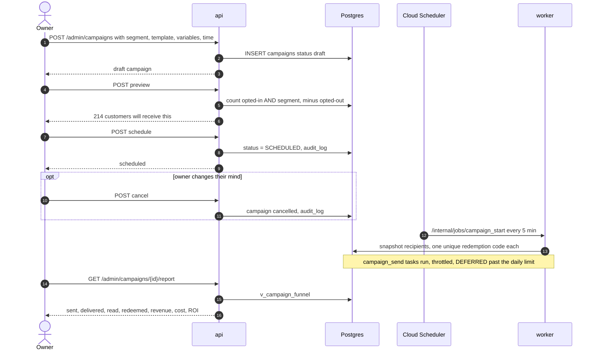

# Owner console endpoints

> **Area:** API
> **Source:** MVP Architecture v0.1 §4, §6.11, §6.12, §6.15, §6.16, §6.17, §8.3 ([source](../_source/mvp-architecture-v0.1.md))
> **Status:** Draft v0.1 · **Owner:** Aman
> **Used by:** [`backend/app/api/CLAUDE.md`](../../backend/app/api/CLAUDE.md), [`backend/app/domain/campaigns/CLAUDE.md`](../../backend/app/domain/campaigns/CLAUDE.md), [`backend/app/domain/consent/CLAUDE.md`](../../backend/app/domain/consent/CLAUDE.md), [`frontend/src/features/CLAUDE.md`](../../frontend/src/features/CLAUDE.md)

## Summary

The `/admin/*` routes on the `api` service back the Owner console: menu, CSV import, tables and QR, staff accounts, settings, templates, campaigns, customers, the consent register, analytics and the weekly report. They require a Supabase JWT and `X-Cafe-Id`. Most are `owner` only; menu management and analytics are open to `manager`.

## Endpoints (§8.3)

Source table, verbatim:

| Method | Path | Purpose |
|---|---|---|
| CRUD | `/admin/menu/categories`, `/admin/menu/items` | Menu management (`manager`+) |
| POST | `/admin/menu/import` | CSV import |
| CRUD | `/admin/tables` · GET `/admin/tables/{id}/qr` | Tables and QR codes |
| CRUD | `/admin/staff` | Invite and manage staff |
| GET/PUT | `/admin/settings` | Hours, tone, feedback delay, tax |
| GET | `/admin/templates` | Approved templates for this café |
| POST | `/admin/campaigns` · `/preview` · `/schedule` · `/cancel` | Campaign lifecycle |
| GET | `/admin/campaigns/{id}/report` | Funnel, revenue, cost |
| GET | `/admin/customers` · `/admin/customers/{id}` | Customer list and profile |
| GET | `/admin/consents` · `/export` | Consent register |
| GET | `/admin/analytics/{sales,items,prep,feedback,customers}` | Basic analytics (`manager`+) |
| GET | `/admin/reports/weekly` | Weekly summary (JSON / CSV) |

## Min role and notes

| Method | Path | Min role | Notes |
|---|---|---|---|
| CRUD | `/admin/menu/categories`, `/admin/menu/items` | `manager` | Item edit is `PUT /admin/menu/items/{id}` (price, tags, spice, prep time, image). Writes `audit_log`. Read per AI turn, so changes apply on the next turn |
| POST | `/admin/menu/import` | `owner` | CSV import ("owner / platform" in §6.15). Writes `audit_log` |
| CRUD | `/admin/tables` | `owner` | Table labels, `active` flag |
| GET | `/admin/tables/{id}/qr` | `owner` | QR code for one table; stored in Supabase Storage (`qr_url`) |
| CRUD | `/admin/staff` | `owner` | Invite, set role, deactivate instantly (`staff_memberships.active`). Per-person logins only |
| GET/PUT | `/admin/settings` | `owner` | Hours, tone, feedback delay (default 30 min), tax (GST inclusive/exclusive). Stored in `cafes.settings` |
| GET | `/admin/templates` | `owner` | Approved templates only, for picking in a campaign |
| POST | `/admin/campaigns` | `owner` | Create a draft: segment, approved template, variables, time |
| POST | `/admin/campaigns` · `/preview` | `owner` | Audience count: opted-in **and** segment, minus opted-out |
| POST | `/admin/campaigns` · `/schedule` | `owner` | `status = SCHEDULED`; started by `campaign_start` once `scheduled_at` passes |
| POST | `/admin/campaigns` · `/cancel` | `owner` | Cancel the campaign |
| GET | `/admin/campaigns/{id}/report` | `owner` | sent → delivered → read → redeemed → revenue, cost, ROI (`v_campaign_funnel`) |
| GET | `/admin/customers`, `/admin/customers/{id}` | `owner` | Searchable list; profile with masked number, visits, spend, favourites, consent, feedback, campaigns, segment (`v_customer_profile`) |
| GET | `/admin/consents` · `/export` | `owner` | Current consent per customer and type, with `wording_version`, `source`, `created_at` |
| GET | `/admin/analytics/{sales,items,prep,feedback,customers}` | `manager` | Postgres views refreshed nightly |
| GET | `/admin/reports/weekly` | `owner` | JSON / CSV; generated Monday 09:00 by `weekly_report` |

### Campaign create fields

| Field | Meaning |
|---|---|
| segment | One of the three MVP segments: all opted-in, lapsed (no order in N days), regulars (≥ K orders in 60 days); stored in `campaigns.segment_definition` |
| template | An approved template of this café (`template_id`) |
| variables | Template variable values (`campaigns.variables`); the redemption code variable is filled per recipient by the worker |
| time | `scheduled_at` |

## Campaign lifecycle

The owner-facing calls are create, preview, schedule, cancel and report; the actual sending happens in the worker, out of the owner's request path.

## Rules / invariants

- Campaign audiences contain only customers whose current consent is `OptedIn`; opted-out customers are always subtracted.
- `cafe_id` for every row comes from the membership; templates, customers and campaigns are never readable across cafés.
- Phone numbers are masked in customer responses.
- Settings changes affecting money (tax) are applied only by the cart service, never by the frontend.
- Menu, campaign and redemption changes write `audit_log`.

## Open questions

- **Campaign sub-path shape.** `/admin/campaigns` · `/preview` · `/schedule` · `/cancel` likely means `/admin/campaigns/{id}/preview` etc., but §8.3 doesn't say. §6.12 also shows the preview returned from the draft `POST` itself.
- **Consent export path** is read as `/admin/consents/export`; export format is not specified.
- **Cancel semantics** — before start only, or also stopping queued sends — and the full campaign status set are not defined.
- **CSV import format** (columns, update vs create) is not defined.
- **Analytics query parameters** (date range) are not defined.

## Related

- [README.md](README.md) · [staff.md](staff.md) · [internal.md](internal.md)
- [../frontend/owner-console.md](../frontend/owner-console.md)
- [../retention/campaigns.md](../retention/campaigns.md) · [../retention/consent.md](../retention/consent.md)
- [../backend/menu-management.md](../backend/menu-management.md) · [../database/analytics-views.md](../database/analytics-views.md)
- Context files: [`backend/app/api/CLAUDE.md`](../../backend/app/api/CLAUDE.md), [`backend/app/domain/campaigns/CLAUDE.md`](../../backend/app/domain/campaigns/CLAUDE.md)
