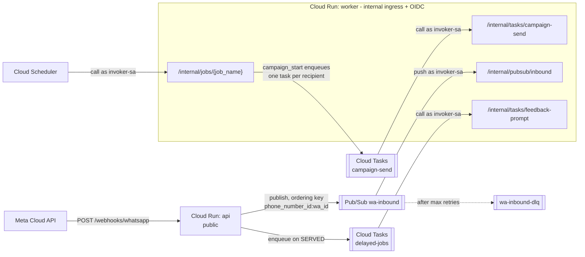

# Internal endpoints (worker service)

> **Area:** API
> **Source:** MVP Architecture v0.1 §5.2, §6.1, §6.2, §6.10, §6.11, §6.12, §6.17, §8.5, §9, §10 ([source](../_source/mvp-architecture-v0.1.md))
> **Status:** Draft v0.1 · **Owner:** Aman
> **Used by:** [`backend/app/api/CLAUDE.md`](../../backend/app/api/CLAUDE.md), [`backend/app/core/CLAUDE.md`](../../backend/app/core/CLAUDE.md), [`infra/CLAUDE.md`](../../infra/CLAUDE.md)

## Summary

The `/internal/*` routes are mounted only on the `worker` service. They are called by GCP itself — Pub/Sub push, Cloud Tasks and Cloud Scheduler — never by a browser or Meta. The worker has **internal ingress** and requires an **OIDC token from `invoker-sa`** on every call, so these endpoints are not reachable from the public internet.

## Endpoints (§8.5)

Source table, verbatim:

| Path | Caller |
|---|---|
| `/internal/pubsub/inbound` | Pub/Sub push |
| `/internal/tasks/campaign-send` · `/feedback-prompt` | Cloud Tasks |
| `/internal/jobs/{job_name}` | Cloud Scheduler |

## Authentication

| Control | Detail |
|---|---|
| Ingress | Cloud Run `worker`: internal + OIDC only (min 0, max 10) |
| Identity | Pub/Sub pushes as, and Cloud Tasks and Cloud Scheduler call as, `invoker-sa` |
| Permission | `invoker-sa` has Cloud Run invoker on `worker` only |
| Verification | `app/core/internal_auth.py` verifies the Pub/Sub / Tasks OIDC token |
| Response contract | Non-2xx from `/internal/pubsub/inbound` makes Pub/Sub retry with backoff; after N attempts the event goes to `wa-inbound-dlq` and an alert fires |

## Job → caller → endpoint

Job names and triggers are from §6.17. Using the job name as the `{job_name}` path segment is **(proposed)**.

| Job | Trigger | Caller | Endpoint |
|---|---|---|---|
| `overdue_sweep` | Every 1 min | Cloud Scheduler | `/internal/jobs/overdue_sweep` |
| `human_mode_timeout` | Every 5 min | Cloud Scheduler | `/internal/jobs/human_mode_timeout` |
| `feedback_prompt` | +30 min after `SERVED` | Cloud Tasks (`delayed-jobs` queue) | `/internal/tasks/feedback-prompt` |
| `campaign_start` | Every 5 min | Cloud Scheduler | `/internal/jobs/campaign_start` |
| `campaign_resume` | Daily 10:00 local | Cloud Scheduler | `/internal/jobs/campaign_resume` |
| `campaign_send` | One task per recipient, rate-limited | Cloud Tasks (`campaign-send` queue) | `/internal/tasks/campaign-send` |
| `token_health` | Daily | Cloud Scheduler | `/internal/jobs/token_health` |
| `quality_and_limits` | Daily + webhooks | Cloud Scheduler; webhook part arrives as a `quality_update` event | `/internal/jobs/quality_and_limits`; `/internal/pubsub/inbound` |
| `template_sync` | Webhook + daily | Cloud Scheduler; webhook part arrives as a `template_update` event | `/internal/jobs/template_sync`; `/internal/pubsub/inbound` |
| `refresh_views` | Nightly | Cloud Scheduler | `/internal/jobs/refresh_views` |
| `weekly_report` | Monday 09:00 | Cloud Scheduler | `/internal/jobs/weekly_report` |
| `data_deletion` | On request / Meta callback | Not specified | Not specified — see open questions |
| `prune_webhook_events` | Daily | Cloud Scheduler | `/internal/jobs/prune_webhook_events` |

### Who enqueues the tasks

| Task | Enqueued by | When |
|---|---|---|
| `campaign-send` | `worker` during `campaign_start` | One task per recipient after the recipient snapshot; queue rate = number's throughput |
| `feedback-prompt` | `api` on `PATCH /staff/orders/{id}/status` to `SERVED` | Scheduled +30 min (configurable per café) |

Both `api-sa` and `worker-sa` hold Cloud Tasks enqueuer.

## Callers diagram

Every arrow into the worker box carries an `invoker-sa` OIDC token; nothing outside GCP can reach it.

## Rules / invariants

- `/internal/*` is mounted only on `worker`, never on `api`.
- Every call must present a valid OIDC token from `invoker-sa`; anything else is rejected.
- Handlers are idempotent: Pub/Sub, Tasks and Scheduler may deliver more than once (`wamid` uniqueness, monotonic message status, recipient status checks).
- `/internal/pubsub/inbound` returns 2xx only after the event is handled or recognised as a duplicate.
- `campaign-send` re-checks that the recipient is still opted in and that the daily limit is not reached before sending.

## Open questions

- **`{job_name}` values** — using the §6.17 job names verbatim as path segments is **(proposed)**.
- **`data_deletion` caller** — §6.17 says "on request / Meta callback" but §8.5 gives no task or job path. Options: a Cloud Task on `delayed-jobs`, or a Scheduler sweep over pending `data_deletion_requests` **(proposed)**.
- **`campaign_resume` "10:00 local"** — Scheduler is one schedule; per-café time zones (`cafes.timezone`) need either one run per zone or a sweep that checks local time.
- **Webhook-triggered parts** of `quality_and_limits` and `template_sync` are assumed to run inside `/internal/pubsub/inbound` handling of `quality_update` / `template_update` events.

## Related

- [README.md](README.md) · [public.md](public.md)
- [../backend/background-jobs.md](../backend/background-jobs.md) · [../backend/inbound-pipeline.md](../backend/inbound-pipeline.md)
- [../infra/async-messaging.md](../infra/async-messaging.md) · [../infra/iam-and-secrets.md](../infra/iam-and-secrets.md) · [../infra/deployment.md](../infra/deployment.md)
- ADRs: [0002 ack fast, process async](../adr/0002-ack-fast-process-async.md) · [0007 one codebase, two services](../adr/0007-one-codebase-two-services.md)
- Context files: [`backend/app/api/CLAUDE.md`](../../backend/app/api/CLAUDE.md), [`backend/app/core/CLAUDE.md`](../../backend/app/core/CLAUDE.md), [`infra/CLAUDE.md`](../../infra/CLAUDE.md)
