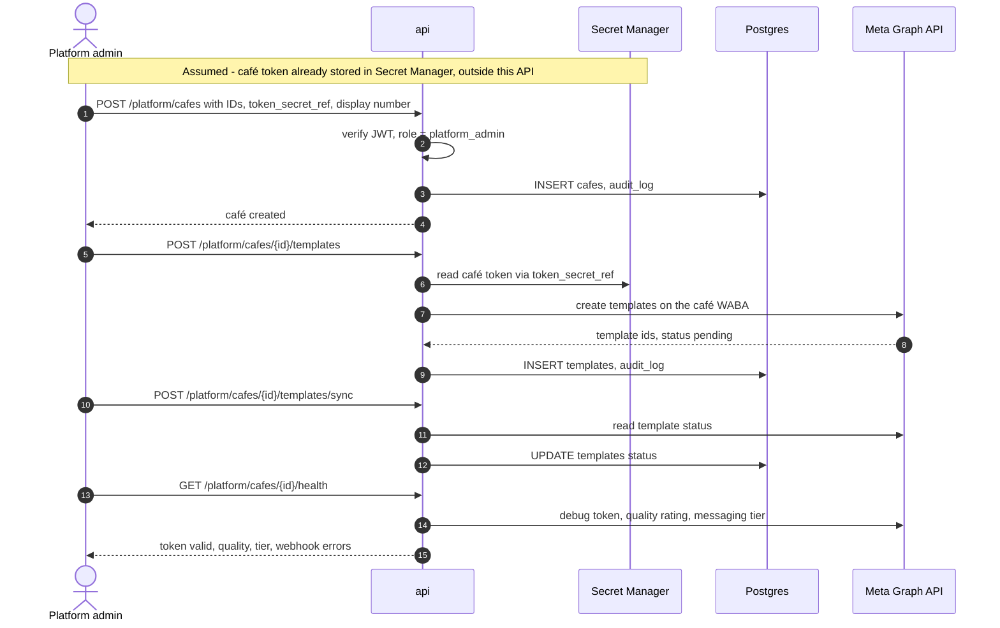

# Platform admin endpoints

> **Area:** API
> **Source:** MVP Architecture v0.1 §3.1, §4, §6.16, §6.17, §7, §8.4, §10, §11, §13 ([source](../_source/mvp-architecture-v0.1.md))
> **Status:** Draft v0.1 · **Owner:** Aman
> **Used by:** [`backend/app/api/CLAUDE.md`](../../backend/app/api/CLAUDE.md), [`backend/app/integrations/whatsapp/CLAUDE.md`](../../backend/app/integrations/whatsapp/CLAUDE.md), [`frontend/src/features/CLAUDE.md`](../../frontend/src/features/CLAUDE.md)

## Summary

The `/platform/*` routes on the `api` service are for us as the platform operator: onboarding a café's WhatsApp number, managing templates on the café's WABA, checking token/quality/limit health, reviewing costs and AI transcripts, and reading the audit log. They require a Supabase JWT with the `platform_admin` role and work **across cafés**, so every call is audited.

## Endpoints (§8.4)

Source table, verbatim:

| Method | Path | Purpose |
|---|---|---|
| POST | `/platform/cafes` | Onboard café: IDs, token secret ref, display number |
| GET | `/platform/cafes/{id}/health` | Token validity, quality rating, messaging tier, webhook errors |
| POST | `/platform/cafes/{id}/templates` · `/sync` | Create templates on the café's WABA, sync status |
| GET | `/platform/costs` | WhatsApp + AI cost per order and per campaign |
| GET | `/platform/conversations` | AI transcript review (fallbacks, low ratings) |
| GET | `/platform/audit` | Audit log |

## Notes

| Endpoint | Notes |
|---|---|
| `POST /platform/cafes` | Fields from `cafes`: `name`, `timezone`, `business_id`, `waba_id`, `phone_number_id` (unique; tenant key for inbound webhooks), `display_phone_number`, `onboarding_model`, `token_secret_ref` (a Secret Manager reference — never the token), `status`, `settings`. Embedded Signup is out of scope, so this is a manual registration |
| `GET /platform/cafes/{id}/health` | Token validity from the daily `token_health` debug-token check ("Reconnect" flag); quality rating and messaging tier from `quality_and_limits` (daily + webhooks); webhook errors |
| `POST /platform/cafes/{id}/templates` | Creates a template on the café's WABA via the Graph API and stores it in `templates` (`meta_template_id`, `name`, `language`, `category`, `status`, `quality`, `components`) |
| `POST /platform/cafes/{id}/templates/sync` | On-demand status sync with Meta; the `template_sync` job does the same on webhook and daily |
| `GET /platform/costs` | From `v_unit_costs`: WhatsApp cost per message (stored `pricing` from status webhooks) and AI cost per turn (`ai_usage`), rolled up per order and per campaign |
| `GET /platform/conversations` | Transcripts across cafés where the AI fell back (`ai_usage.fallback_used`) or the order got a low rating |
| `GET /platform/audit` | `audit_log (actor, cafe_id, action, entity, before, after, at)` across cafés |

## Onboarding sequence

Read top to bottom: register the café, submit templates early because approval takes time, sync status, then confirm health before the pilot.

- Templates to submit early (build step 1): `weekly_offer`, `winback`, `order_update`, `new_order_alert`.
- Whether `/health` calls Meta live or returns the values stored by `token_health` / `quality_and_limits` is not specified; the diagram shows a live read for illustration.

## Rules / invariants

- Only `platform_admin` may call `/platform/*`; café roles get `403`.
- Every platform call writes `audit_log`.
- The API stores secret **references** only; tokens never appear in requests, responses or logs.
- `phone_number_id` must be unique across cafés (`UNIQUE (phone_number_id)`), because it resolves the tenant for inbound webhooks.

## Open questions

- **How the café token reaches Secret Manager** (manual step vs an endpoint) is not described.
- **No list, read or update endpoint for cafés** (`GET /platform/cafes`, `PATCH ...`) in §8.4; the platform screens need one **(proposed)**.
- **No platform template list endpoint**; reading templates per café is undefined.
- **First owner invite** for a new café is not covered by any endpoint (`/admin/staff` is owner-only) **(proposed)**: a platform-side invite.
- **Live vs stored health values** for `/health`.
- **Where `platform_admin` is stored** (not a per-café `staff_memberships` role).

## Related

- [README.md](README.md) · [admin.md](admin.md)
- [../frontend/platform-admin.md](../frontend/platform-admin.md)
- [../whatsapp/templates.md](../whatsapp/templates.md) · [../whatsapp/number-health.md](../whatsapp/number-health.md)
- [../observability/cost-tracking.md](../observability/cost-tracking.md) · [../infra/iam-and-secrets.md](../infra/iam-and-secrets.md)
- Context files: [`backend/app/api/CLAUDE.md`](../../backend/app/api/CLAUDE.md), [`backend/app/integrations/whatsapp/CLAUDE.md`](../../backend/app/integrations/whatsapp/CLAUDE.md)
