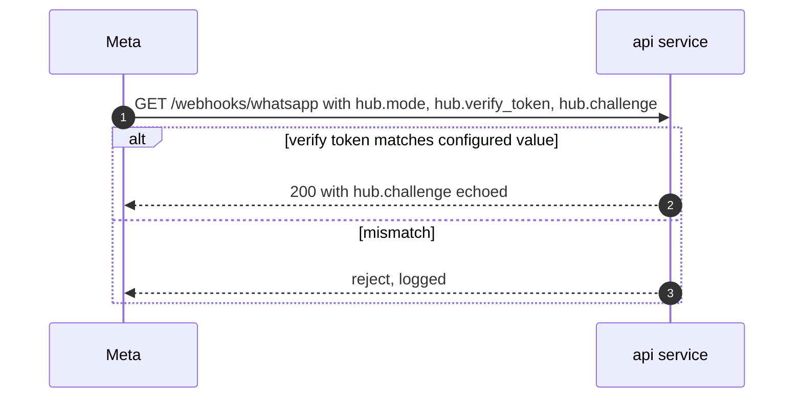

# Public endpoints (api service)

> **Area:** API
> **Source:** MVP Architecture v0.1 §2, §6.2, §6.11, §8.1, §9, §10 ([source](../_source/mvp-architecture-v0.1.md))
> **Status:** Draft v0.1 · **Owner:** Aman
> **Used by:** [`backend/app/api/CLAUDE.md`](../../backend/app/api/CLAUDE.md), [`backend/app/integrations/whatsapp/CLAUDE.md`](../../backend/app/integrations/whatsapp/CLAUDE.md), [`backend/app/core/CLAUDE.md`](../../backend/app/core/CLAUDE.md)

## Summary

The public, unauthenticated-by-user endpoints on the `api` service: the WhatsApp webhook (verification handshake and event delivery), Meta's data deletion callback and a liveness check. These are the only routes Meta calls. The webhook's job is to **acknowledge fast and process later**: verify, store, publish, return `200`.

## Endpoints (§8.1)

| Method | Path | Auth | Purpose |
|---|---|---|---|
| GET | `/webhooks/whatsapp` | `hub.verify_token` | Meta verification handshake |
| POST | `/webhooks/whatsapp` | `X-Hub-Signature-256` | Inbound messages and statuses |
| POST | `/webhooks/meta/data-deletion` | Signed request | Meta data deletion callback |
| GET | `/health` | none | Liveness |

## Per-endpoint notes

### `GET /webhooks/whatsapp`

- One-time handshake when the webhook URL is registered in the Meta app.
- The request carries the verify token Meta was configured with; if it matches ours, the endpoint echoes Meta's challenge value with `200`, otherwise it rejects.
- A separate Meta app per environment (`dev`, `prod`) keeps test webhooks out of production.

This is Meta's standard subscribe handshake; it runs once per app/URL, not per message. Full detail in [../whatsapp/webhooks.md](../whatsapp/webhooks.md).

### `POST /webhooks/whatsapp`

| Step | What happens |
|---|---|
| 1 | Read the **raw** body and `X-Hub-Signature-256` |
| 2 | HMAC-SHA256(raw body, App Secret), constant-time compare — **before** JSON parsing |
| 3 | Invalid → `401` (logged, not processed) |
| 4 | Valid → `INSERT webhook_events` (raw payload, `signature_valid`) |
| 5 | Publish to Pub/Sub `wa-inbound` with ordering key `{phone_number_id}:{wa_id}` |
| 6 | Return `200 OK`, target under 1 s |

- Carries inbound messages, message statuses (`sent` → `delivered` → `read`, or `failed`, with pricing), template updates and quality updates; the worker parses them.
- Keep `min-instances=1` on `api` in production so a cold start never delays the `200`.
- Raw `webhook_events` older than 30 days are deleted by `prune_webhook_events`.
- Per-IP rate limiting applies to public endpoints.

### `POST /webhooks/meta/data-deletion`

- Meta's data deletion callback, authenticated as a signed request.
- Goes through the same path as a customer's "delete my data": a `data_deletion_requests` row and the `data_deletion` job, which anonymises the customer (name and `wa_id` replaced, messages purged, orders kept as anonymous rows).

### `GET /health`

- Liveness for Cloud Run and uptime checks. No auth, no tenant data.

## Rules / invariants

- Signature check happens on the raw body before any parsing; an invalid signature is never processed.
- The webhook handler does no conversation work; it stores and publishes only.
- `cafe_id` for inbound events is resolved later from `phone_number_id`, never from message text.
- The App Secret lives in Secret Manager; it is never logged.

## Open questions

- **Where the webhook verify token is stored** is not stated (Secret Manager lists App Secret, WABA tokens, 2FA PINs, Supabase service key and LLM key).
- **Response for a failed handshake** (status code) is not specified.
- **Data-deletion callback response** — Meta expects a confirmation payload; its contents are not described in the source.

## Related

- [README.md](README.md) · [internal.md](internal.md)
- [../whatsapp/webhooks.md](../whatsapp/webhooks.md) · [../backend/inbound-pipeline.md](../backend/inbound-pipeline.md)
- [../retention/data-deletion.md](../retention/data-deletion.md) · [../security/security-controls.md](../security/security-controls.md)
- ADR: [0002 ack fast, process async](../adr/0002-ack-fast-process-async.md)
- Context files: [`backend/app/api/CLAUDE.md`](../../backend/app/api/CLAUDE.md), [`backend/app/integrations/whatsapp/CLAUDE.md`](../../backend/app/integrations/whatsapp/CLAUDE.md)
