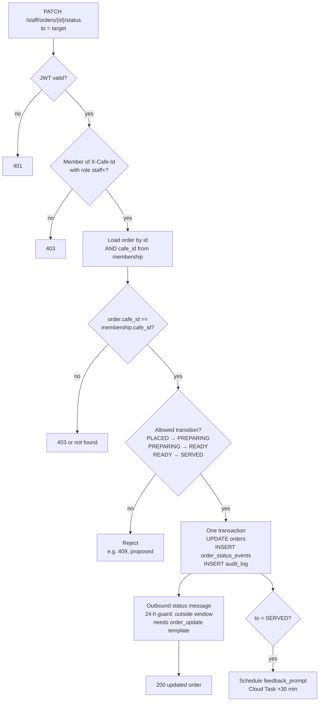

# Staff panel endpoints

> **Area:** API
> **Source:** MVP Architecture v0.1 §4, §6.7, §6.8, §6.9, §6.12, §6.13, §6.15, §8.2, §10 ([source](../_source/mvp-architecture-v0.1.md))
> **Status:** Draft v0.1 · **Owner:** Aman
> **Used by:** [`backend/app/api/CLAUDE.md`](../../backend/app/api/CLAUDE.md), [`backend/app/domain/orders/CLAUDE.md`](../../backend/app/domain/orders/CLAUDE.md), [`frontend/src/features/CLAUDE.md`](../../frontend/src/features/CLAUDE.md)

## Summary

The `/staff/*` routes on the `api` service back the Staff panel: live orders and status changes, cancellation, the waiter/bill queue, human-mode chat, the sold-out toggle, customer quick view and offer redemption. All require a Supabase JWT and `X-Cafe-Id`, and are open to `staff`, `manager` and `owner` unless noted. Many have side effects beyond the database row: a WhatsApp message to the customer, an `order_status_events` row and an `audit_log` row.

## Endpoints (§8.2)

Source table, verbatim:

| Method | Path | Purpose |
|---|---|---|
| GET | `/staff/orders?status=active` | Live orders |
| PATCH | `/staff/orders/{id}/status` | Status transition (validated) |
| POST | `/staff/orders/{id}/cancel` | Cancel with reason (`manager`+) |
| GET | `/staff/waiter-requests?status=open` | Waiter / bill queue |
| POST | `/staff/waiter-requests/{id}/ack` · `/resolve` | Handle requests |
| GET | `/staff/conversations/{id}/messages` | Chat view in human mode |
| POST | `/staff/conversations/{id}/reply` | Reply to customer as staff |
| POST | `/staff/conversations/{id}/takeover` · `/release` | Switch human/bot mode |
| PATCH | `/staff/menu/items/{id}/availability` | Sold-out toggle |
| GET | `/staff/customers/{id}` | Name, past orders, notes (masked number) |
| POST | `/staff/redeem` | Redeem an offer code against an order |

## Min role and side effects

| Method | Path | Min role | Side effects |
|---|---|---|---|
| GET | `/staff/orders?status=active` | `staff` | None (read) |
| PATCH | `/staff/orders/{id}/status` | `staff` | `UPDATE orders`; `INSERT order_status_events (order_id, from, to, actor, at)`; `INSERT audit_log`; customer status message via outbound (inside 24-h window); Realtime `UPDATE orders` to other devices. `PREPARING` blocks customer edits/cancels; `SERVED` schedules the `feedback_prompt` Cloud Task (+30 min) |
| POST | `/staff/orders/{id}/cancel` | `manager` | Order → `CANCELLED`; `order_status_events`; `audit_log`; customer gets "Your order has been cancelled" + reason; excluded from analytics revenue |
| GET | `/staff/waiter-requests?status=open` | `staff` | None (read) |
| POST | `/staff/waiter-requests/{id}/ack` | `staff` | `waiter_requests.status = ACKNOWLEDGED`, `acknowledged_by`; stops the 60-s re-alert |
| POST | `/staff/waiter-requests/{id}/resolve` | `staff` | `status = RESOLVED`, `resolved_at`; `conversation.mode = bot` |
| GET | `/staff/conversations/{id}/messages` | `staff` | None (read) |
| POST | `/staff/conversations/{id}/reply` | `staff` | Sends a staff message in the same WhatsApp thread through outbound (24-h guard applies); `INSERT messages (direction = out, wamid)` |
| POST | `/staff/conversations/{id}/takeover` | `staff` | `conversation.mode = human`; bot goes silent |
| POST | `/staff/conversations/{id}/release` | `staff` | `conversation.mode = bot` |
| PATCH | `/staff/menu/items/{id}/availability` | `staff` | `menu_items.is_available` flipped; `audit_log`; effective on the next AI turn (any cache must be invalidated) |
| GET | `/staff/customers/{id}` | `staff` | None (read); phone number masked |
| POST | `/staff/redeem` | `staff` | Code checked valid, unused, unexpired → `redeemed_at` set, order linked to the campaign; recipient → `REDEEMED`; `audit_log` |

### Request fields

| Endpoint | Field | Meaning |
|---|---|---|
| `PATCH /staff/orders/{id}/status` | `to` | Target status: `PREPARING`, `READY` or `SERVED` |
| `POST /staff/orders/{id}/cancel` | `reason` | Shown to the customer and stored |
| `POST /staff/conversations/{id}/reply` | message text | Staff reply to the customer |
| `PATCH /staff/menu/items/{id}/availability` | availability flag | Sold out or back in stock |
| `POST /staff/redeem` | `code`, `order_id` | Offer code and the order it applies to |

## Status transition validation

The check order matters: identity, then tenant, then the lifecycle rule; only then is anything written, and the customer message goes out after the write.

- Cancellation uses its own endpoint (`/cancel`, `manager`+), not `PATCH .../status`. From `PLACED` the customer can also cancel via WhatsApp; from `PREPARING` only a manager can.
- "Overdue" is a flag set by `overdue_sweep`, not a transition; it cannot be set through this endpoint.

## Rules / invariants

- Every handler loads entities by `id` **and** the membership's `cafe_id`.
- Status changes are only the transitions in [order-lifecycle](../backend/order-lifecycle.md); anything else is rejected.
- Customer-facing messages are sent through the single outbound function, which enforces the 24-hour window.
- State-changing calls write `audit_log`.
- Customer phone numbers are masked in every staff response.

## Open questions

- **Rejection code** for an invalid transition (e.g. `409`) is **(proposed)**; the source says only "validated".
- **Sub-path form** of `/ack` · `/resolve` and `/takeover` · `/release` is read as `/staff/waiter-requests/{id}/resolve` and `/staff/conversations/{id}/release`.
- **Redemption link.** §6.12 says `order.campaign_id`; the §7 data model has `orders.campaign_recipient_id`. See [../retention/redemption.md](../retention/redemption.md).
- **Cancel from `PLACED` by staff.** §6.7 says "staff cancels"; §4/§8.2 say `manager`+.
- **Audit on waiter/chat actions** is not listed explicitly in §10; covered here by the general "every state change is audited" rule.
- **Customer "notes"** in `/staff/customers/{id}` have no column in §7.

## Related

- [README.md](README.md) · [admin.md](admin.md)
- [../frontend/staff-panel.md](../frontend/staff-panel.md)
- [../backend/order-lifecycle.md](../backend/order-lifecycle.md) · [../backend/human-handoff.md](../backend/human-handoff.md) · [../backend/menu-management.md](../backend/menu-management.md)
- [../whatsapp/outbound-sender.md](../whatsapp/outbound-sender.md) · [../retention/redemption.md](../retention/redemption.md)
- Context files: [`backend/app/api/CLAUDE.md`](../../backend/app/api/CLAUDE.md), [`backend/app/domain/orders/CLAUDE.md`](../../backend/app/domain/orders/CLAUDE.md)
