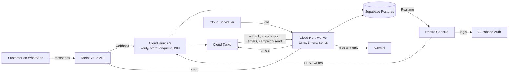

# Architecture

## System



| Component | Does |
|---|---|
| `api` (Cloud Run, public) | Meta webhook and console REST. On inbound it only verifies, stores, enqueues and returns 200 in < 300 ms. Never calls the LLM, sends a message or changes conversation state |
| `worker` (Cloud Run, internal) | Conversation turns, timers, scheduled jobs, campaign sends. Callable only by Cloud Tasks and Cloud Scheduler with an OIDC token for `invoker-sa` |
| Cloud Tasks | Retries, delayed delivery (debounce, timers) and rate limits. Used instead of in-process background work because Cloud Run throttles CPU after the response |
| Cloud Scheduler | Periodic jobs |
| Supabase Postgres | Single source of truth. Every tenant table has `cafe_id`. Advisory locks serialise each conversation (no Redis) |
| Supabase Auth · Realtime · Storage | Console logins · row changes pushed to the console · menu photos |
| Secret Manager | Meta app secret, café tokens and PINs, Supabase keys, LLM key |
| Gemini Flash-Lite / Flash | Reads free text, drafts the reply. Never decides prices, availability or state |
| Restro Console | React SPA on Firebase Hosting. Reads via Supabase (RLS + Realtime), writes via `api` |

- One Python 3.12 + FastAPI image, two services: `main_api` and `main_worker`. Fully async; one shared HTTP client for Meta and Gemini.
- `asia-south1` + Supabase Mumbai. Supabase pooler in transaction mode, small pool per instance.
- Never used: Pub/Sub, GKE, Cloud SQL, Memorystore, load balancers, Cloud Armor, NAT, static IPs. A new resource needs a [decision](decisions.md).
- Local dev: Docker + Supabase CLI + Meta test number + tunnel (cloudflared or ngrok) + local queue shim.

### Latency budget

| Step | Target |
|---|---|
| Meta → `api` → 200 | < 300 ms |
| Mark read + typing (`wa-ack`) | < 1 s after inbound |
| Debounce (free text only) | ~1.2 s |
| Load context / LLM call | < 80 ms / p50 ~1–1.5 s, p95 ≤ 3 s |
| Persist / send | < 100 ms / < 500 ms |
| **Turn total** | **p50 < 3 s, p95 < 5 s**; button turns < 1 s |

Capacity: Cloud Run concurrency ~40–80 per instance, max 3–5 instances per service (also caps a retry storm's bill). Queue rates stay below the number's throughput and the Gemini quota. Slim image, startup CPU boost. Prod `api` min-instances 1 during the pilot; `worker` min 0.

## Message pipeline

```mermaid
sequenceDiagram
    autonumber
    participant M as Meta
    participant A as api
    participant DB as Postgres
    participant Q as Cloud Tasks
    participant W as worker
    participant L as Gemini
    M->>A: POST /webhooks/whatsapp (raw body + X-Hub-Signature-256)
    A->>A: verify signature on raw bytes (bad → 401)
    A->>DB: insert webhook_events
    A->>DB: cafe_id from phone_number_id; upsert customer + conversation
    A->>DB: insert inbound_messages (wamid unique; duplicate → 200, stop)
    A->>Q: enqueue wa-ack (0 s) + wa-process (~1.2 s text, 0 s tap)
    A-->>M: 200 (< 300 ms)
    Q->>W: /internal/tasks/ack → mark read + typing
    Q->>W: /internal/tasks/process
    W->>DB: advisory lock on conversation_id
    W->>DB: read unprocessed inbound_messages, oldest first
    alt free text
        W->>L: one structured call
        L-->>W: intent, cart_ops, reply
        W->>DB: resolve items against live menu, price in code
    end
    W->>DB: persist state + processed_at (one transaction)
    W->>M: reply via domain/outbound
    W->>DB: loop while unprocessed remain; release lock
```

- Signature is checked on raw bytes before any JSON parsing. Insert-or-ignore on `wamid` comes before any side effect.
- The customer upsert sets `last_inbound_at` (the 24-hour window clock).
- Status webhooks update `wa_messages` and `campaign_recipients` forward-only. Routing inside a turn: [conversation](backend.md#routing-order).

| Case | Behaviour |
|---|---|
| Free text | `wa-process` delayed ~1.2 s so "hi" / "i want" / "2 cold coffee" become one turn, one LLM call, one reply |
| Button or list reply | 0 s delay |
| Lock free | Take it, process every unprocessed message, release |
| Lock held | Exit 200 at once; the holder re-reads after each turn |
| Holder crashes | Lock released with its transaction; messages stay unprocessed; `stuck_inbound_check` re-enqueues within 1 min |

The lock is `pg_try_advisory_xact_lock(conversation_id)` (transaction-scoped, because the pooler runs in transaction mode), held for the turn. Only conversation processing takes it; console order actions use `orders.version`.

**Idempotency**

| Duplicate | Guard |
|---|---|
| Meta retries the webhook | `inbound_messages.wamid` unique; duplicate returns 200, nothing enqueued |
| Cloud Tasks retries `wa-process` | Only rows with `processed_at` null are read |
| Double-tap Confirm | `orders.idempotency_key` = `{conversation_id}:{cart_version}` |
| Retried send | Send-layer key; one `wa_messages` row per outbound |
| Out-of-order status webhooks | `sent` → `delivered` → `read`, `failed` final; never backwards |

**Failures**

| Failure | Result |
|---|---|
| Bad signature | 401, logged, metric, nothing enqueued |
| `worker` error or timeout | Cloud Tasks retries with backoff; messages stay unprocessed |
| Crash before commit | Rolled back; retry re-runs the turn |
| Unprocessed > 30 s | `stuck_inbound_check` re-enqueues and alerts |
| LLM error or timeout (6 s) | One retry on the other model → "a team member will help" + handoff `system_error` |
| Send fails | `wa_messages.status = failed` + `error_code`; alert |
| Daily LLM spend over limit | Kill switch |

## Queues, timers and jobs

All queues and jobs call `worker` with an OIDC token for `invoker-sa`. Rates are start values, tuned in Phase 3.

| Queue | Endpoint | Enqueued by | Purpose | Rate / retry |
|---|---|---|---|---|
| `wa-ack` | `/internal/tasks/ack` | `api` | Mark read + typing, immediately | High rate, few retries |
| `wa-process` | `/internal/tasks/process` | `api`, `stuck_inbound_check` | One conversation turn | Below Gemini quota; backoff; deadline covers one turn |
| `timers` | `/internal/tasks/timer` | `api`, `worker` | Every timer, body `{kind, subject_id}` | Backoff |
| `campaign-send` | `/internal/tasks/campaign-send` | `campaign_start`, `campaign_resume` | One task per recipient | Below the number's throughput **[verify]** |

### Timers

Each timer is a Cloud Task; the handler re-reads state and does nothing if the subject moved on.

| `kind` | Created when | Fires after | If still true |
|---|---|---|---|
| `accept_escalation_1` | Order → `NEW` | 60 s | Still `NEW` → escalate to managers (in-app + `new_order_alert`), flag `escalated`, create level 2 |
| `accept_escalation_2` | Level 1 fired | +2 min | Still `NEW` → escalate to owner |
| `help_escalation` | `help` or `allergy` request opened | 2 min | Still `open` → escalate to managers; customer hears "Sorry, the team is busy — someone is coming to you." |
| `overdue` | Order → `ACCEPTED`; re-created on each delay | Due time | Still `ACCEPTED` → flag `overdue` |
| `auto_served` | Order → `READY` | 10 min | Still `READY` → `SERVED`, actor `system` |
| `status_message` | Staff order transition | 5 s | Not undone → send the customer message |
| `feedback` | Order → `SERVED` | Café setting 15 / 30 / 60 min | No rating yet → ask; then opt-in ask if never asked |
| `idle_handback` | Each message in human mode | 15 min | No unanswered customer message → `mode = bot` |

### Scheduled jobs

Cloud Scheduler → `POST /internal/jobs/{job}`, time zone `Asia/Kolkata`.

| Job | Schedule | Does |
|---|---|---|
| `stuck_inbound_check` | 1 min | Unprocessed inbound > 30 s → re-enqueue + alert |
| `campaign_start` | 5 min | Start due campaigns: snapshot audience, issue codes, enqueue sends |
| `llm_spend_check` | 15 min | Daily LLM spend over limit → kill switch |
| `campaign_resume` | Daily 10:00 | Re-enqueue `deferred` recipients |
| `template_sync` | Daily 06:00 + on template webhook | Template status from Meta |
| `token_health` | Daily | Invalid token → `cafes.status = disconnected` + alert |
| `quality_and_limits` | Daily | Quality rating and messaging tier → `cafes.health` |
| `prune_webhook_events` | Daily | Delete `webhook_events` > 30 days |
| `daily_summary` | Daily | Team summary: orders, handoffs, fallbacks, cost per order, errors |
| `refresh_views` | Nightly | Refresh analytics views |
| `weekly_report` | Mon 09:00 | Owner weekly summary |

**Handler rules**

- Every task and job can run twice; each handler is safe to repeat.
- State moved on (wrong status, acknowledged, undone) → 200, do nothing. Non-2xx only for failures worth retrying.
- No timer polls the DB. A delay change re-creates `overdue`; the old task becomes a no-op.
- `campaign-send` re-checks consent and the daily limit before each send.
- Phases 0–2 use a local shim with the same enqueue interface that calls local `worker` endpoints after the delay. Phase 3 swaps only the adapter in `integrations/gcp/`.

## Backend layout

```text
backend/app/
├── core/          config, JSON logging, Supabase JWT + membership + role, Meta signature, internal OIDC
├── api/           thin routers: webhooks.py · staff/ · admin/ · platform/ (on api) · internal/ (on worker)
├── domain/        business rules, one folder per module
├── integrations/  whatsapp (client, parser, builders, errors) · llm (Gemini adapter) · gcp (tasks, secrets)
├── db/            async session via pooler, repositories (only place SQL lives), models
├── main_api.py    → Cloud Run api
└── main_worker.py → Cloud Run worker
tests/             unit · integration · conversations · fixtures
```

Dependencies point one way: `api → domain → integrations | db`; `core` is used by all. Routers hold no rules and never touch `integrations` or `db`. Domain modules call each other only through public service functions and don't know which service they run in. Only `domain/outbound` sends WhatsApp messages; only `domain/ai_agent` calls the LLM.

| Module | Owns | Tables |
|---|---|---|
| `conversation` | One turn: lock, batch, route, steps, deterministic flows | `conversations`, `inbound_messages` |
| `ai_agent` | Prompt, the LLM call, output validation, guardrails, kill switch | `llm_calls` |
| `menu` | Items, availability, allergens, CSV import, menu version | `menu_items`, `menu_item_allergens` |
| `cart` | Cart ops, pricing, GST, confirmation | `conversations.state.cart` |
| `orders` | `transition()`, flags, delay, manual order, table sessions, bills | `orders`, `order_items`, `order_events`, `tables`, `table_sessions` |
| `handoff` | Requests, human mode, escalation | `requests`, `escalations` |
| `outbound` | The only send path | `wa_messages`, `templates` |
| `consent` | Opt-in, opt-out, register | `consents` |
| `campaigns` | Audience, codes, sender, redemption | `campaigns`, `campaign_recipients`, `redemptions` |
| `customers` | Identity, summary, preferences, segments, deletion | `customers`, `customer_preferences`, `data_deletion_requests` |
| `feedback` | Rating ask and answer, low-rating request | `feedback` |
| `timers` | `schedule(kind, subject_id, delay)` and dispatch | — |
| `analytics` | Reads of `v_*` views, reports | `v_*` |
| `audit` | One `audit_log` row per console write | `audit_log` |

All state lives in Postgres. The only in-memory state is the menu prompt prefix keyed by `(cafe_id, menu_version)` and the café token cache (10 min).

## Security and tenancy

| Caller | Authenticated by | `cafe_id` from | Never trusted |
|---|---|---|---|
| Console user | Supabase JWT | Active `memberships` row for the JWT `sub` and the target café | `cafe_id` in body or query |
| `platform_admin` | Supabase JWT + `platform_admins` row | Café chosen in support mode; audited | — |
| Customer / Meta | `X-Hub-Signature-256` with the Meta app secret | `phone_number_id` → `cafes` | Café names or ids in chat text |
| Cloud Tasks / Scheduler | OIDC token for `invoker-sa` | The row the task points at, re-read | Any call without a valid token |

- Repositories always take `cafe_id`. The backend DB role bypasses RLS, so this is the primary guard; RLS is the second layer for console reads.
- Unknown `phone_number_id` → stored, not processed, alert.
- Reply ids come from the customer's phone: handlers check the referenced row belongs to this café and conversation.
- Customer identity is `(cafe_id, wa_id)`; the same person at two cafés is two customers.
- Deactivating a membership blocks the next API call and RLS read at once.

**Support mode.** `POST /platform/support/{cafe_id}/open` shows the café's owner console under a dark bar "Support mode · every action is logged". Every write is audited with `actor_role = platform_admin`, `support = true`. Print ticket, manual order and the service report are not available.

### Controls

| Control | Stops |
|---|---|
| HMAC-SHA256 on raw bytes, constant-time, before parsing; data-deletion signed request verified | Forged webhooks and deletions |
| OIDC for `invoker-sa` on every `/internal/*`; `/internal/*` mounted only on `worker` | Direct calls triggering sends or timers |
| Unique `wamid`, `idempotency_key`, `code`; forward-only statuses | Duplicates from retries |
| Secrets only in Secret Manager; console holds only the anon key | Token theft |
| Logs carry ids only (`cafe_id`, `conversation_id`, `customer_id`, `wamid`, `order_id`, `request_id`) | Number and token leaks |
| RLS read-only; every write through `api` | Cross-café reads or edits |
| Input validated from `openapi.yaml`; unknown fields rejected; length limits; integer paise | Malformed input |
| LLM output is data: one call, no tools, schema + live-menu validation | Prompt injection creating orders or prices |
| CORS: only the environment's console origin | Cross-origin calls |
| Send layer checks 24-hour window and marketing consent | Messaging without consent |
| Per-person logins, immediate deactivation, audit of every write | Unattributable actions |
| 2FA and personal roles on Meta Business, GCP, Supabase, GitHub, registrar | Account takeover |

**Rate limits** (values set from Phase 3 load tests): per-IP on public routes → 429, never on signature-valid webhooks · LLM calls per conversation per minute (counted in `llm_calls`) → deterministic reply with menu and call-a-person buttons · daily LLM spend → kill switch · login → Supabase built-in limits.

### Data protection

Under India's DPDP Act the customer is the data principal, the café the data fiduciary, Restro the processor (never uses one café's data for another). The data-ownership agreement is signed before go-live.

- Phone numbers are shown only masked (`+91 98••• ••421`) — in the console, CSV exports and support mode. The full number never reaches the SPA, the prompt or logs.
- The prompt gets a SQL customer summary (first name, visits, recent items, stated preferences), never the number or other customers.
- Real customer data goes only to Gemini on GCP terms; never the free tier, staging or a laptop.
- `webhook_events` kept 30 days. Orders, consents, redemptions, `llm_calls` (no content), `audit_log` kept for the pilot.

**Customer data deletion** (owner `POST /customers/{id}/delete`, Meta callback `POST /webhooks/meta/data-deletion`, or a chat request routed to the owner). One transaction: clear `name`; replace `wa_id` with a random token; delete `customer_preferences`; purge chat text, conversation state and matching `webhook_events`; clear feedback text (rating kept). Orders, items, redemptions, campaign recipients and consents stay, anonymous. Set `completed_at`, audit `customer.delete`. Irreversible: the same number later is a new customer with no consent.

Meta app review needs a privacy policy, terms and data-deletion instructions on our domain (Firebase Hosting, from Phase 3).

## Infrastructure

| | Local | Staging | Prod |
|---|---|---|---|
| From | Phase 0 | Phase 3 | Phase 6 |
| Backend | `docker compose`, one image | Cloud Run `api` + `worker` | Cloud Run `api` + `worker` |
| Async | Queue shim; jobs by hand | Cloud Tasks + Scheduler | Cloud Tasks + Scheduler |
| Database | Supabase CLI | Supabase Mumbai, free tier | Supabase Mumbai, paid plan with backups |
| Console | Vite, against MSW or local `api` | Firebase Hosting | Firebase Hosting |
| WhatsApp | Meta test number via tunnel | Test number → staging; team phones, load simulator | Pilot café's WABA on the prod Meta app |
| LLM | Gemini free tier, synthetic data | Gemini on GCP | Gemini on GCP |
| Data | Seed generator | Seed + synthetic | Real, never copied out |

Staging and prod are separate GCP projects, Supabase projects and Meta apps; nothing in one points at the other.

| Cloud Run | `api` | `worker` |
|---|---|---|
| Ingress / auth | Public; app checks signature or JWT | Internal; `run.invoker` only for `invoker-sa` **[verify Tasks and Scheduler count as internal]** |
| Service account | `api-sa` | `worker-sa` |
| Min / max instances | 0 staging, 1 prod / 3–5 | 0 / 3–5 |
| Request timeout | Short | One turn: 6 s LLM + one retry + send |

| Service account | Roles |
|---|---|
| `api-sa` | `cloudtasks.enqueuer`, `iam.serviceAccountUser` (on `invoker-sa` only), `secretmanager.secretAccessor` (per secret), `logging.logWriter`, `monitoring.metricWriter` |
| `worker-sa` | Same + `aiplatform.user` if Vertex |
| `invoker-sa` | `run.invoker` on `worker` only |
| `ci-deployer-sa` | `run.developer`, `artifactregistry.writer`, `iam.serviceAccountUser` (on `api-sa`, `worker-sa`), `firebasehosting.admin`; via Workload Identity Federation, no keys, no secret access |

| Secret | Scope | Read by |
|---|---|---|
| `meta-app-secret`, `meta-verify-token` | Per environment | `api-sa` |
| `wa-token-<cafe>` (`cafes.token_ref`) | Per café | `api-sa`, `worker-sa` |
| `wa-pin-<cafe>` (`cafes.pin_ref`) | Per café | Platform team only |
| `supabase-service-key`, `supabase-db-url` | Per environment | `api-sa`, `worker-sa` |
| `gemini-api-key` | Per environment, developer API only | `worker-sa` |

The DB stores secret references only. People use their own Google accounts with 2FA; no shared logins.

### Deploy

PR → CI → merge to `main` → build image once (tag = commit SHA) → migrate staging DB → deploy to staging → smoke test on the test number → manual approval → migrate prod → deploy the same digest to prod.

- `api` and `worker` always run the same digest; prod only runs a digest that ran in staging.
- Migrations run first and stay backward compatible. Rollback = shift traffic to the previous revision.
- Infra scripts (`infra/environments/{dev,prod}`) are applied by hand by a Core team member.

| Workflow | Trigger | Gate |
|---|---|---|
| `ci` | Every PR | Backend + console lint, types, tests (incl. isolation and RLS) green |
| `evals` | PR touching prompts, routing or `evals/cases/` | Below Phase 2 targets blocks merge |
| `deploy-staging` | Merge to `main`, from Phase 3 | Smoke test |
| `deploy-prod` | Manual, from Phase 6 | Core team approval |

## Monitoring

JSON logs, one event per line; errors to Error Reporting; uptime check on `api`. `request_id` is passed from the entry point into Cloud Tasks headers. Never log tokens, secrets, PINs, phone numbers or `wa_id`.

| Alert | Source | When | To |
|---|---|---|---|
| Signature failures | Log metric | Spike | Core team |
| Failed sends | `wa_messages.error_code` | Above hourly threshold | Core team |
| Stuck inbound | `stuck_inbound_check` | Any | Core team |
| Task out of retries | Queue metrics | Any | Core team |
| Order unaccepted | Escalation timers | Owner level fired | Café + Core team |
| LLM latency / errors | `llm_calls` | p95 > 4 s or errors > 2 % | Core team |
| LLM spend | `llm_spend_check` | Over daily limit | Core team |
| Token, quality, tier | `cafes.health` | Invalid token; quality drop | Core team; Disconnected banner |
| GCP budget | Billing | 25 / 50 / 75 / 90 % | Two people |

Café-floor problems reach staff first through console urgency and the escalation chain. All alerts are wired before Phase 6 ends. `daily_summary` stands in for the platform Costs and AI review screens until P3.

## Cost

- LLM tokens are the largest variable cost. Levers: buttons and code for everything deterministic, debounce, code-rendered confirmations, compact cached menu prefix, last ~6 turns only, capped output tokens, model choice.
- WhatsApp is near zero for ordering (inside the 24-hour window); real for campaigns and utility templates outside it **[verify]**.
- Cloud Run idle is small; min-instances 1 only on prod `api`.

| Meter | Written | Fields |
|---|---|---|
| `llm_calls` | Every call incl. failures and retries | `model`, `input_tokens`, `cached_tokens`, `output_tokens`, `latency_ms`, `outcome`, `cost_estimate` |
| `wa_messages` | Every send; status webhooks | `pricing_category`, `billable`, `template_name`, `status` |
| `v_unit_costs` | Nightly | Cost per order, per café, per campaign |

`cost_estimate` = tokens × per-model price from config; WhatsApp cost = billable messages × India price per category from config **[verify]** (Meta gives the category, not the amount).

**Kill switch.** `llm_spend_check` sums today's `cost_estimate` every 15 min. Over the limit an env flag either routes all LLM traffic to the cheaper model (`cheap`) or skips the LLM entirely and hands free text to staff (`handoff`); buttons keep working.

**Cost model.** Cost per order = calls × (input × input price + cached × cached price + output × output price) + infra ÷ orders. Cost per café per month = cost per order × orders + campaign templates + share of fixed infra. Filled from Phase 2–3 measurements, refreshed with pilot data by pilot week 2; it sets the post-trial budget and the price floor.
