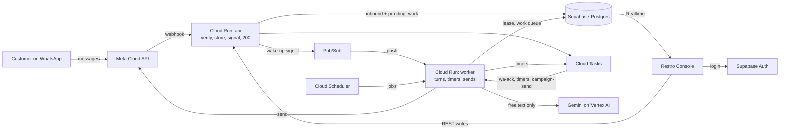

# Architecture

## System



| Component | Does |
|---|---|
| `api` (Cloud Run, public) | Meta webhook and console REST. On inbound it only verifies, records the message and a `pending_work` row, signals and returns 200 in < 300 ms. Never calls the LLM, sends a message or changes conversation state |
| `worker` (Cloud Run, internal) | Conversation turns, timers, scheduled jobs, campaign sends. Callable only by Pub/Sub push, Cloud Tasks and Cloud Scheduler with an OIDC token for `invoker-sa` |
| Pub/Sub | Wake-up signal only: tells `worker` a conversation has pending work. Postgres holds the work, so a lost or duplicate signal is harmless. No ordering keys |
| Cloud Tasks | `wa-ack`, timers (incl. work retries) and campaign sends: delayed delivery and rate limits |
| Cloud Scheduler | Periodic jobs, incl. the stuck-work sweep |
| Supabase Postgres | Single source of truth. Every tenant table has `cafe_id`. `pending_work` is the recoverable work queue; a lease on `conversations` serialises each conversation (no Redis) |
| Supabase Auth · Realtime · Storage | Console logins · row changes pushed to the console · menu photos |
| Secret Manager | Meta app secret, café tokens and PINs, Supabase keys, local-dev LLM key |
| Gemini Flash-Lite / Flash on Vertex AI | Global endpoint. Reads free text, drafts replies and cancellation messages. Never decides prices, availability or state |
| Restro Console | React SPA on Firebase Hosting. Reads via Supabase (RLS + Realtime), writes via `api` |

- One Python 3.12 + FastAPI image, two services: `main_api` and `main_worker`. Fully async; one shared HTTP client for Meta and Gemini.
- `asia-south1` + Supabase Mumbai. Supabase pooler in transaction mode, small pool per instance. Gemini runs on the Vertex AI **global endpoint**, which gives no data-residency guarantee; accepted for the MVP ([decision 13](decisions.md#13-gemini-on-vertex-ai-global-endpoint)).
- Never used: GKE, Cloud SQL, Memorystore, load balancers, Cloud Armor, NAT, static IPs. Pub/Sub carries signals only, never work. A new resource needs a [decision](decisions.md).
- Local dev: Docker + Supabase CLI + Meta test number + tunnel (cloudflared or ngrok) + local queue and signal shims. Without a Meta number, the **WhatsApp simulator** (`simulator/` + the `api` dev router, mounted only when `APP_ENV=local` and `SIMULATOR_ENABLED=true`) posts signed Meta-format webhooks to the real route and receives sends through the `simulator` transport ([ordering slice](ordering-slice.md#simulator)). The local shims are in memory: a restart drops pending timers, while inbound work stays safe in `pending_work`.

### Latency budget

| Step | Target |
|---|---|
| Meta → `api` → 200 | < 300 ms |
| Mark read + typing (`wa-ack`) | < 1 s after inbound |
| Debounce (free text only) | 1 s |
| Load context / LLM call | < 80 ms / p50 ~1–1.5 s, p95 ≤ 3 s |
| Persist / send | < 100 ms / < 500 ms |
| **Turn total** | **p50 < 3 s, p95 < 5 s**; button turns < 1 s |

Capacity: Cloud Run concurrency ~40–80 per instance, max 3–5 instances per service (also caps a retry storm's bill). Queue rates and `worker` concurrency stay below the number's throughput and the Vertex AI quota. Slim image, startup CPU boost. Prod `api` min-instances 1 during the pilot; `worker` min 0.

## Message pipeline

```mermaid
sequenceDiagram
    autonumber
    participant M as Meta
    participant A as api
    participant DB as Postgres
    participant P as Pub/Sub
    participant Q as Cloud Tasks
    participant W as worker
    participant L as Gemini
    M->>A: POST /webhooks/whatsapp (raw body + X-Hub-Signature-256)
    A->>A: verify signature on raw bytes (bad → 401)
    A->>DB: insert webhook_events
    A->>DB: cafe_id from phone_number_id; upsert customer + conversation
    A->>DB: one transaction: insert inbound_messages (wamid unique; duplicate → 200, stop) + upsert pending_work
    A->>P: publish signal {conversation_id}
    A->>Q: enqueue wa-ack (0 s)
    A-->>M: 200 (< 300 ms)
    Q->>W: /internal/tasks/ack → mark read + typing
    P->>W: push /internal/pubsub/inbound
    W-->>P: 2xx (signal acked)
    W->>DB: claim lease on conversation (short transaction)
    W->>W: wait until pending_work is due (1 s debounce for text)
    W->>DB: read unprocessed inbound_messages, oldest first
    alt free text
        W->>L: one structured call (no transaction open)
        L-->>W: intent, cart_ops, reply
        W->>DB: resolve items against live menu, price in code
    end
    W->>DB: if lease still ours: persist state + processed_at + outbound step rows (one short transaction)
    W->>M: send each step via domain/outbound (no transaction open)
    W->>DB: pending_work done; loop while due work remains; release lease
```

- Signature is checked on raw bytes before any JSON parsing. Insert-or-ignore on `wamid` comes before any side effect.
- The message and its `pending_work` row are durable before the 200. If the publish fails, the work is still there and `stuck_inbound_check` signals it.
- The customer upsert sets `last_inbound_at` (the 24-hour window clock).
- Status webhooks update `wa_messages` and `campaign_recipients` forward-only. Routing inside a turn: [conversation](backend.md#routing-order).

| Case | Behaviour |
|---|---|
| Free text | `pending_work.next_attempt_at` = now + 1 s; each new text message moves it to now + 1 s, so "hi" / "i want" / "2 cold coffee" become one turn, one LLM call, one reply |
| Button or list reply | Due now |
| Lease free | Claim it, process every due row, release |
| Lease held | Ack the signal and exit; the holder re-reads pending work before releasing |
| Holder crashes | Lease expires after 30 s; `stuck_inbound_check` re-signals; the next holder reruns unprocessed messages |
| Turn fails | Retried from the `pending_work` row (below) |

**Lease.** Two columns on `conversations`: `lease_owner` (worker instance id + random token) and `lease_expires_at` (30 s, renewed every 10 s during a turn). Claim and release are single-statement transactions; no transaction is open during the Gemini call or a WhatsApp send, so pooled connections are never held across slow I/O. Every commit in a turn checks the lease is still ours (fencing); if it was lost, the turn is dropped and the new holder reruns it. Only conversation processing takes the lease; console order actions use `orders.version`.

**Work queue.** `pending_work` holds one `pending` row per conversation and `kind` (`turn`); a message arriving while a turn runs adds the next row. Postgres decides processing order; Pub/Sub only wakes `worker`. There are no Pub/Sub ordering keys: with push delivery, one failing message on a key would block every later message from that customer.

> **Cloud Run CPU after the ack.** With request-based billing, Cloud Run throttles CPU once the response is sent, so a worker that acks the push and keeps processing can stall mid-turn. Either run `worker` with instance-based billing (CPU always allocated), or have the push handler record the work and hand the turn to a Cloud Task. Default: instance-based billing ([open decision](plan.md#open-decisions)).

**Idempotency**

| Duplicate | Guard |
|---|---|
| Meta retries the webhook | `inbound_messages.wamid` unique; duplicate returns 200, nothing signalled |
| Duplicate or late Pub/Sub signal | Lease; only `processed_at` null rows are read; a row not yet due is left alone |
| Double-tap Confirm | `orders.idempotency_key` = `{conversation_id}:{cart_version}` |
| Retried or re-run send | One `wa_messages` row per outbound step, unique `idempotency_key`, written before the request; an ambiguous send is checked, never blindly resent ([sending](backend.md#sending)) |
| Out-of-order status webhooks | `sent` → `delivered` → `read`, `failed` final; never backwards |

**Failures and retries**

- **Pub/Sub retry and its DLQ cover transport only:** push delivery failing or a non-2xx before the ack. The DLQ holds signals, not work, so nothing is lost while it fills.
- **Application retries live in the `pending_work` row.** An error records `last_error`, increments `attempts` and sets `next_attempt_at` with exponential backoff (2 s, 4 s, 8 s); a `work_retry` timer re-signals. 3 retries.
- **Dead letter** after the third retry: `status = dead_lettered`, `dead_lettered_at` set. The customer gets a standard code-rendered message ("Sorry, something went wrong on our side. Tap below to talk to a person." + Call waiter) and the case escalates to `platform_admin` (alert + [`/platform/dead-letters`](data-and-api.md#endpoints)). Whether it also alerts the shift manager and switches the chat to human mode is **(pending)** ([open decision](plan.md#open-decisions)).

| Failure | Result |
|---|---|
| Bad signature | 401, logged, metric, nothing signalled |
| Publish fails after commit | Work is in `pending_work`; `stuck_inbound_check` signals within 1 min |
| Push delivery fails | Pub/Sub retries with backoff; after 5 attempts → transport DLQ + alert |
| Turn error | `pending_work` retry with backoff; dead letter after 3 retries |
| Crash mid-turn | Nothing committed past the last short transaction; lease expires; rerun |
| Pending work overdue > 30 s or lease expired | `stuck_inbound_check` re-signals and alerts |
| LLM error or timeout (6 s) | One retry on the other model → "a team member will help" + handoff `system_error` |
| Send rejected | `wa_messages.status = failed` + `error_code`; alert |
| Send timed out after the request left | `ambiguous`, checked by `send_check`; never blindly resent |
| Daily LLM spend over limit | Kill switch |

## Queues, timers and jobs

All queues, the push subscription and jobs call `worker` with an OIDC token for `invoker-sa`. Rates are start values, tuned in Phase 3.

| Queue / topic | Endpoint | Sent by | Purpose | Rate / retry |
|---|---|---|---|---|
| Pub/Sub `wa-inbound` | `/internal/pubsub/inbound` | `api`, `stuck_inbound_check`, `work_retry` | Wake-up signal `{conversation_id}`; the work is in `pending_work` | Push; 10 s ack deadline; DLQ `wa-inbound-dlq` after 5 delivery attempts (transport only) |
| `wa-ack` | `/internal/tasks/ack` | `api` | Mark read + typing, immediately | High rate, few retries |
| `timers` | `/internal/tasks/timer` | `api`, `worker` | Every timer, body `{kind, subject_id}` | Backoff |
| `campaign-send` | `/internal/tasks/campaign-send` | `campaign_start`, `campaign_resume` | One task per recipient | Below the number's throughput **[verify]** |

### Timers

Each timer is a Cloud Task; the handler re-reads state and does nothing if the subject moved on.

| `kind` | Created when | Fires after | If still true |
|---|---|---|---|
| `accept_escalation_1` | Order → `NEW` | 60 s | Still `NEW` → escalate to managers (in-app + `new_order_alert`), flag `escalated`, create level 2 |
| `accept_escalation_2` | Level 1 fired | +2 min | Still `NEW` → escalate to owner |
| `help_escalation` | `help` or `allergy` request opened | 2 min | Still `open` → escalate to managers; customer hears "Sorry, the team is busy — someone is coming to you." |
| `overdue` | Order → `ACCEPTED`; re-created on each delay | Due time | Still `ACCEPTED` → flag `overdue` |
| `auto_served` | Order → `READY` | 10 min | Still `READY` → `SERVED`, actor `system` |
| `status_message` | Staff order transition | 5 s | Not undone → send the customer message (cancellation: AI-drafted, [orders](backend.md#transitions)) |
| `work_retry` | A turn fails | 2 s, 4 s, 8 s | `pending_work` still `pending` → re-signal |
| `send_check` | A send turns `ambiguous` | 60 s | Still `ambiguous` → resolve from status webhooks or mark `failed` ([sending](backend.md#sending)) |
| `feedback` | Order → `SERVED` | Café setting 15 / 30 / 60 min | No rating yet → ask; then opt-in ask if never asked |
| `idle_handback` | Each message in human mode | 15 min | No unanswered customer message → `mode = bot` |

### Scheduled jobs

Cloud Scheduler → `POST /internal/jobs/{job}`, time zone `Asia/Kolkata`.

| Job | Schedule | Does |
|---|---|---|
| `stuck_inbound_check` | 1 min | `pending_work` due > 30 s and unclaimed, or a lease expired → re-signal + alert; never-attempted `pending` sends → send |
| `campaign_start` | 5 min | Start due campaigns: snapshot audience, issue codes, enqueue sends |
| `llm_spend_check` | 15 min | Daily LLM spend over limit → kill switch |
| `campaign_resume` | Daily 10:00 | Re-enqueue `deferred` recipients |
| `template_sync` | Daily 06:00 + on template webhook | Template status from Meta |
| `token_health` | Daily | Invalid token → `cafes.status = disconnected` + alert |
| `quality_and_limits` | Daily | Quality rating and messaging tier → `cafes.health` |
| `prune_webhook_events` | Daily | Delete `webhook_events` > 30 days and `done` `pending_work` > 7 days |
| `daily_summary` | Daily | Team summary: orders, handoffs, fallbacks, dead letters, cost per order, errors |
| `refresh_views` | Nightly | Refresh analytics views |
| `weekly_report` | Mon 09:00 | Owner weekly summary |

**Handler rules**

- Every signal, task and job can arrive twice; each handler is safe to repeat.
- State moved on (wrong status, acknowledged, undone) → 200, do nothing. Non-2xx only for failures worth retrying.
- No timer polls the DB. A delay change re-creates `overdue`; the old task becomes a no-op.
- `campaign-send` re-checks consent and the daily limit before each send.
- Phases 0–2 use local shims with the same enqueue and publish interfaces that call local `worker` endpoints (after the delay for tasks). Phase 3 swaps only the adapters in `integrations/gcp/`.

## Backend layout

```text
backend/app/
├── core/          config, JSON logging, Supabase JWT + membership + role, Meta signature, internal OIDC
├── api/           thin routers: webhooks.py · staff/ · admin/ · platform/ (on api) · internal/ (on worker)
├── domain/        business rules, one folder per module
├── integrations/  whatsapp (client, parser, builders, errors) · llm (Gemini adapter) · gcp (pubsub, tasks, secrets)
├── db/            async session via pooler, repositories (only place SQL lives), models
├── main_api.py    → Cloud Run api
└── main_worker.py → Cloud Run worker
tests/             unit · integration · conversations · fixtures
```

Dependencies point one way: `api → domain → integrations | db`; `core` is used by all. Routers hold no rules and never touch `integrations` or `db`. Domain modules call each other only through public service functions and don't know which service they run in. Only `domain/outbound` sends WhatsApp messages; only `domain/ai_agent` calls the LLM.

| Module | Owns | Tables |
|---|---|---|
| `conversation` | Work queue, lease, retries and dead letters; one turn: batch, route, steps, deterministic flows | `conversations`, `inbound_messages`, `pending_work` |
| `ai_agent` | Prompt, the LLM call, output validation, guardrails, cancellation drafts, kill switch | `llm_calls` |
| `menu` | Items, availability, allergens, CSV import, menu version | `menu_items`, `menu_item_allergens` |
| `cart` | Cart ops, pricing, confirmation | `conversations.state.cart` |
| `orders` | `transition()`, flags, delay, manual order, table sessions, bills | `orders`, `order_items`, `order_events`, `tables`, `table_sessions` |
| `handoff` | Requests, human mode, escalation | `requests`, `escalations` |
| `notifications` | In-app notifications for `manager` and `owner` | `notifications` |
| `outbound` | The only send path | `wa_messages`, `templates` |
| `consent` | Opt-in, opt-out, register | `consents` |
| `campaigns` | Audience, codes, sender, redemption | `campaigns`, `campaign_recipients`, `redemptions` |
| `customers` | Identity, summary, profile, staff comments, preferences, segments, deletion | `customers`, `customer_preferences`, `customer_notes`, `data_deletion_requests` |
| `feedback` | Rating ask and answer, low-rating request | `feedback` |
| `timers` | `schedule(kind, subject_id, delay)` and dispatch | — |
| `analytics` | Reads of `v_*` views, reports | `v_*` |
| `audit` | One `audit_log` row per console write | `audit_log` |

All state lives in Postgres. The only in-memory state is the menu prompt prefix keyed by `(cafe_id, menu_version)` and the café token cache (10 min).

## Security and tenancy

| Caller | Authenticated by | `cafe_id` from | Never trusted |
|---|---|---|---|
| Console user | Supabase JWT | Active `memberships` row for the JWT `sub` and the target café | `cafe_id` in body or query |
| `platform_admin` | Supabase JWT + `platform_admins` row | Café chosen in support mode; audited | — |
| Customer / Meta | `X-Hub-Signature-256` with the Meta app secret | `phone_number_id` → `cafes` | Café names or ids in chat text |
| Pub/Sub push / Cloud Tasks / Scheduler | OIDC token for `invoker-sa` | The row the signal or task points at, re-read | Any call without a valid token |

- Repositories always take `cafe_id`. The backend DB role bypasses RLS, so this is the primary guard; RLS is the second layer for console reads.
- Unknown `phone_number_id` → stored, not processed, alert.
- Reply ids come from the customer's phone: handlers check the referenced row belongs to this café and conversation.
- Customer identity is `(cafe_id, wa_id)`; the same person at two cafés is two customers.
- Deactivating a membership blocks the next API call and RLS read at once.

**Support mode.** `POST /platform/support/{cafe_id}/open` shows the café's owner console under a dark bar "Support mode · every action is logged". Every write is audited with `actor_role = platform_admin`, `support = true`. Print ticket, manual order and the service report are not available.

### Controls

| Control | Stops |
|---|---|
| HMAC-SHA256 on raw bytes, constant-time, before parsing; data-deletion signed request verified | Forged webhooks and deletions |
| OIDC for `invoker-sa` on every `/internal/*`; `/internal/*` mounted only on `worker` | Direct calls triggering sends or timers |
| Unique `wamid`, `idempotency_key`, `code`; forward-only statuses | Duplicates from retries |
| Secrets only in Secret Manager; console holds only the anon key | Token theft |
| Logs carry ids only (`cafe_id`, `conversation_id`, `customer_id`, `wamid`, `order_id`, `request_id`); never phone numbers or message text | Number, chat and token leaks |
| RLS read-only; every write through `api` | Cross-café reads or edits |
| Input validated from `openapi.yaml`; unknown fields rejected; length limits; integer paise | Malformed input |
| LLM output is data: one call, no tools, schema + live-menu validation | Prompt injection creating orders or prices |
| CORS: only the environment's console origin | Cross-origin calls |
| Send layer checks 24-hour window and marketing consent | Messaging without consent |
| Per-person logins, immediate deactivation, audit of every write | Unattributable actions |
| 2FA and personal roles on Meta Business, GCP, Supabase, GitHub, registrar | Account takeover |
| Production access only for the two founders and people they explicitly authorise | Wide blast radius |
| CI deploys through Workload Identity Federation; no service-account keys exist | Leaked CI keys |

**Roles.** Café roles are `shift_manager` ⊂ `manager` ⊂ `owner` (`memberships.role`); `platform_admin` is separate (`platform_admins`) and audited in support mode. No other role names exist.

**Production access.** Prod GCP project, prod Supabase project, the prod Meta app and the pilot WABA are accessible only to the two founders and people they explicitly authorise. Each grant is personal (own Google account with 2FA), least-privilege, recorded with who approved it and why, and removed the day it's no longer needed. Nobody else touches prod data; support goes through support mode.

**Secret rotation.** Rotate when someone with access leaves, on any suspected leak, and every 90 days for Supabase keys and the DB password:

1. Create the new credential at its source (Supabase, Meta system user, Meta app).
2. Add it as a new version of the same Secret Manager secret; the reference in the DB never changes.
3. Roll `api` and `worker` (new revision) so they read the new version; café token caches expire within 10 min.
4. Check: smoke test on the test number; `token_health` for café tokens.
5. Disable the old version, then revoke it at the source; destroy after 7 days.

Meta app secret: during the swap `api` accepts signatures from the current and previous version, then drops the previous one. PINs are rotated only through WhatsApp Manager by a founder.

**Rate limits** (values set from Phase 3 load tests): per-IP on public routes → 429, never on signature-valid webhooks · LLM calls per conversation per minute (counted in `llm_calls`) → deterministic reply with menu and call-a-person buttons · daily LLM spend → kill switch · login → Supabase built-in limits.

### Data protection

Under India's DPDP Act the customer is the data principal, the café the data fiduciary, Restro the processor (never uses one café's data for another). The data-ownership agreement is signed before go-live.

- Phone numbers are shown only masked (`+91 98••• ••421`) — in the console, CSV exports and support mode. The full number never reaches the SPA, the prompt or logs.
- The prompt gets a SQL customer summary (first name, visits, recent items, stated preferences except allergies), never the number or other customers. A staff comment goes to the LLM only to read it into profile changes, with the current profile and nothing else.
- Real customer data goes only to Gemini on Vertex AI (GCP terms); never the free tier, staging or a laptop. The global endpoint gives no data-residency guarantee: prompts may be processed outside India. Accepted for the MVP; the privacy policy says so.
- `webhook_events` kept 30 days. Orders, consents, redemptions, `llm_calls` (no content), `audit_log` kept for the pilot.

**Logs and backups**

| Data | Kept | Deleted by |
|---|---|---|
| Cloud Logging (ids only) | 30 days | Log bucket retention |
| Error Reporting | 30 days | GCP default **[verify]** |
| Pub/Sub DLQ (signals, no content) | 7 days | Topic retention |
| `done` `pending_work` rows | 7 days | `prune_webhook_events` |
| Supabase backups (paid plan) | Plan's daily-backup window, ~7 days **[verify]** | Supabase rotation |

A customer deletion doesn't rewrite backups; deleted data ages out with the backup window, and a restore re-runs completed `data_deletion_requests` before the DB goes back into service. Logs never hold numbers or message text, so they need no deletion pass.

**Customer data deletion** (owner `POST /customers/{id}/delete`, Meta callback `POST /webhooks/meta/data-deletion`, or a chat request routed to the owner). One transaction: clear `name`; replace `wa_id` with a random token; delete `customer_preferences` and `customer_notes`; purge chat text (`inbound_messages.payload`, `wa_messages.payload`), conversation state and matching `webhook_events`; clear feedback text (rating kept). Orders, items, redemptions, campaign recipients and consents stay, anonymous. Set `completed_at`, audit `customer.delete`. Irreversible: the same number later is a new customer with no consent.

Meta app review needs a privacy policy, terms and data-deletion instructions on our domain (Firebase Hosting, from Phase 3).

## Infrastructure

| | Local | Staging | Prod |
|---|---|---|---|
| From | Phase 0 | Phase 3 | Phase 6 |
| Backend | `docker compose`, one image | Cloud Run `api` + `worker` | Cloud Run `api` + `worker` |
| Async | Queue and signal shims; jobs by hand | Pub/Sub + Cloud Tasks + Scheduler | Pub/Sub + Cloud Tasks + Scheduler |
| Database | Supabase CLI | Supabase Mumbai, free tier | Supabase Mumbai, paid plan with backups |
| Console | Vite, against the local `api` (MSW only for demo builds) | Firebase Hosting | Firebase Hosting |
| WhatsApp | Meta test number via tunnel | Test number → staging; team phones, load simulator | Pilot café's WABA on the prod Meta app |
| LLM | Gemini free tier, synthetic data | Vertex AI, global endpoint | Vertex AI, global endpoint |
| Data | Seed generator | Seed + synthetic | Real, never copied out |

Staging and prod are separate GCP projects, Supabase projects and Meta apps; nothing in one points at the other.

| Cloud Run | `api` | `worker` |
|---|---|---|
| Ingress / auth | Public; app checks signature or JWT | Internal; `run.invoker` only for `invoker-sa` **[verify Pub/Sub push, Tasks and Scheduler count as internal]** |
| Service account | `api-sa` | `worker-sa` |
| Min / max instances | 0 staging, 1 prod / 3–5 | 0 / 3–5 |
| Billing | Request-based | Instance-based, CPU always allocated (default; [open decision](plan.md#open-decisions)) |
| Request timeout | Short | Push ack is immediate; timer and campaign tasks short |

| Service account | Roles |
|---|---|
| `api-sa` | `pubsub.publisher` (on `wa-inbound`), `cloudtasks.enqueuer`, `iam.serviceAccountUser` (on `invoker-sa` only), `secretmanager.secretAccessor` (per secret), `logging.logWriter`, `monitoring.metricWriter` |
| `worker-sa` | Same + `aiplatform.user` |
| `invoker-sa` | `run.invoker` on `worker` only; identity of the push subscription, tasks and jobs |

**Pub/Sub**

| Setting | Value |
|---|---|
| Topic / subscription | `wa-inbound` / `wa-inbound-push` → `worker` `/internal/pubsub/inbound`, OIDC as `invoker-sa` |
| Delivery | Push, no ordering keys, exponential retry backoff |
| Ack deadline | 10 s (the handler acks before running the turn) |
| Dead letter | `wa-inbound-dlq` after 5 delivery attempts (Pub/Sub's minimum). Transport only; app retries are counted in `pending_work`, separately |
| Service agent | Publisher on the DLQ topic, subscriber on the subscription **[verify]** |
| `ci-deployer-sa` | `run.developer`, `artifactregistry.writer`, `iam.serviceAccountUser` (on `api-sa`, `worker-sa`), `firebasehosting.admin`; via Workload Identity Federation, no keys, no secret access |

| Secret | Scope | Read by |
|---|---|---|
| `meta-app-secret`, `meta-verify-token` | Per environment | `api-sa` |
| `wa-token-<cafe>` (`cafes.token_ref`) | Per café | `api-sa`, `worker-sa` |
| `wa-pin-<cafe>` (`cafes.pin_ref`) | Per café | Platform team only |
| `supabase-service-key`, `supabase-db-url` | Per environment | `api-sa`, `worker-sa` |
| `gemini-api-key` | Local only (developer API, synthetic data) | Developer laptops |

Staging and prod call Vertex AI as `worker-sa`; no LLM key exists there. The DB stores secret references only. People use their own Google accounts with 2FA; no shared logins.

### Deploy

PR → CI → merge to `main` → build image once (tag = commit SHA) → migrate staging DB → deploy to staging → smoke test on the test number → manual approval → migrate prod → deploy the same digest to prod.

- GitHub Actions (`.github/workflows/`) authenticates to GCP with **Workload Identity Federation** as `ci-deployer-sa`, scoped to this repository and branch. No service-account keys are created anywhere.
- `api` and `worker` always run the same digest; prod only runs a digest that ran in staging.
- Migrations run first and stay backward compatible. Rollback = shift traffic to the previous revision.
- Infra is **`gcloud` scripts**, not Terraform: idempotent shell scripts in `infra/environments/{dev,prod}` (create-if-missing, then set), applied by hand by a founder and reviewed line by line.
  - `infra/setup.sh <env>` runs before the first deploy and `infra/wire.sh <env>` after it, because the push subscription, the invoker binding and the jobs need the worker URL.
  - `dev` is the staging environment.
  - Runbook: [infra/README.md](../infra/README.md).
- The image is `backend/Dockerfile`, built from the repo root because the app reads `contracts/llm_output.schema.json` and `contracts/allergens.json`. `RESTRO_SERVICE=api|worker` picks the app.
- The console's `firebase.json` serves the SPA and the static public pages (`/about`, `/privacy`, `/terms`, `/data-deletion`).
- The Cloud Tasks and Pub/Sub adapters (`integrations/gcp`) call the REST APIs with the service's own identity. A Cloud Tasks task name is its dedupe key, and `ALREADY_EXISTS` counts as success.
- The deploy workflows stay inert until the repository variable `DEPLOY_ENABLED` is `true`.

| Workflow | Trigger | Gate |
|---|---|---|
| `ci` | Every PR | Backend + console lint, types, tests (incl. isolation and RLS) green |
| `evals` | PR touching prompts, routing or `evals/cases/` | Below Phase 2 targets blocks merge |
| `deploy-staging` | Merge to `main`, from Phase 3 | Smoke test |
| `deploy-prod` | Manual, from Phase 6 | Core team approval |

## Monitoring

JSON logs, one event per line; errors to Error Reporting; uptime check on `api`. Every entry point starts an ops run; its id travels as a W3C `traceparent` in Pub/Sub attributes and Cloud Tasks headers, so a webhook, the turn it wakes and the timers that turn schedules link up (this replaces the `request_id` planned earlier, which was never built).

**Performance dashboard** ([OPS_PLAN](OPS_PLAN.md), Performance Dashboard Standard v1.0). `backend/app/ops/tracing` records one run per attempt at every unit of work (webhook, staff request, turn, task, timer, job) with its stages, every SQL statement, model call and send, the silent fallbacks, and WARNING+ log lines. It never runs inside a business transaction, never raises, and writes off the request path (one statement per run). `/api/ops/*` on `api` serves it to `/platform/ops` in the console (ops token until platform_admin login exists). Kill switch `OPS_TRACING_ENABLED=false`.

**Logging rule.** Phone numbers and message text never go in logs: not the customer's, not ours, not LLM prompts or output. Ids are fine (`wamid`, `cafe_id`, `conversation_id`, `order_id`, `pending_work` id). Never log tokens, secrets, PINs or `wa_id` either.

| Alert | Source | When | To |
|---|---|---|---|
| Signature failures | Log metric | Spike | Core team |
| Failed sends | `wa_messages.error_code` | Above hourly threshold | Core team |
| Stuck inbound | `stuck_inbound_check` | Any | Core team |
| App dead letter | `pending_work.status = dead_lettered` | Any | Core team (`platform_admin`) |
| Pub/Sub DLQ | Subscription metrics on `wa-inbound-dlq` | Any | Core team |
| Task out of retries | Queue metrics | Any | Core team |
| Order unaccepted | Escalation timers | Owner level fired | Café + Core team |
| LLM latency / errors | `llm_calls` | p95 > 4 s or errors > 2 % | Core team |
| LLM spend | `llm_spend_check` | Over daily limit | Core team |
| Token, quality, tier | `cafes.health` | Invalid token; quality drop | Core team; Disconnected banner |
| GCP budget | Billing | 25 / 50 / 75 / 90 % | Two people |

**Metrics**

| Metric | Source | Watch |
|---|---|---|
| App dead letters | `pending_work` (`dead_lettered_at`) | Any; separate from the Pub/Sub DLQ |
| Pub/Sub DLQ depth | `wa-inbound-dlq` | Any (transport problem) |
| Lease expiries and steals | Log metric from the worker (lease lost at fencing; expired lease re-claimed) | Any steal; expiries above baseline |
| Ambiguous sends | `wa_messages.status = ambiguous`, and how `send_check` resolved them | Any unresolved after 60 s |
| Vertex 429s and timeouts | `llm_calls.outcome` | Above 1 % of calls |
| Console realtime disconnects | Console client events via `POST /telemetry/console` | Per device per evening; Offline banner shown |
| Human-handoff rate | `requests` (`help`, `allergy`) by `reason_tag` ÷ conversations with inbound, per day | Trend; `system_error` share |
| Time to confirm | First inbound of the visit → `orders.created_at` | p50 / p95 per day |
| Turns per order | Customer turns (`pending_work` rows of kind `turn`) per created order | Trend vs the 2–5 LLM-calls target |

Customer-side metrics come from `v_conversation_metrics`; all of them land in `daily_summary`.

Café-floor problems reach staff first through console urgency and the escalation chain. All alerts are wired before Phase 6 ends. `daily_summary` stands in for the platform Costs and AI review screens until P3.

## Cost

- LLM tokens are the largest variable cost. Levers: buttons and code for everything deterministic, debounce, code-rendered confirmations, compact cached menu prefix, last ~6 turns only, capped output tokens, model choice.
- WhatsApp is near zero for ordering (inside the 24-hour window); real for campaigns and utility templates outside it **[verify]**.
- Cloud Run idle is small; min-instances 1 only on prod `api`.

**Metering model.** Every cost is a row, priced when written, in Postgres:

| Meter | Written | Cost fields |
|---|---|---|
| `llm_calls` | Every call incl. failures, retries and cancellation drafts | `cafe_id`, `provider` (`vertex` / `developer_api`), `model`, `input_tokens`, `cached_tokens`, `output_tokens`, `cost`, `currency`, `pricing_version`, links `conversation_id`, `message_id`, `order_id`, `outcome`, `latency_ms` |
| `wa_messages` | Every outbound step; updated by status webhooks | `pricing_category`, `billable`, `cost`, `currency`, `pricing_version`, `cost_basis` (`estimated` → `actual`) |

- `pricing_version` names the price table in config used for the row; a price change adds a version and never rewrites old rows.
- `llm_calls.cost` = input × input price + cached × cached price + output × output price for that model and version.
- `wa_messages.cost` is `estimated` from the category and India rate when the status webhook marks it billable **[verify]**; it becomes `actual` when reconciled against Meta's billing. Meta gives the category, not the amount.
- `cost` is numeric with its `currency`, never mixed with customer money (which stays integer paise).

| View | Gives | Used by |
|---|---|---|
| `v_daily_costs` | Per café per day: AI cost by model, WhatsApp cost by category (estimated vs actual), calls, orders | Kill switch, `daily_summary`, weekly review |
| `v_unit_costs` | Cost per order, per café, per campaign; WhatsApp 7 d, AI 7 d, fallback rate | Platform Costs, cost model |

**Kill switch.** `llm_spend_check` reads today's AI cost from `v_daily_costs` every 15 min. Over the limit an env flag either routes all LLM traffic to the cheaper model (`cheap`) or skips the LLM entirely and hands free text to staff (`handoff`); buttons keep working.

**Cost model.** Cost per order = calls × (input × input price + cached × cached price + output × output price) + infra ÷ orders. Cost per café per month = cost per order × orders + campaign templates + share of fixed infra. Filled from Phase 2–3 measurements, refreshed with pilot data by pilot week 2; it sets the post-trial budget and the price floor.
