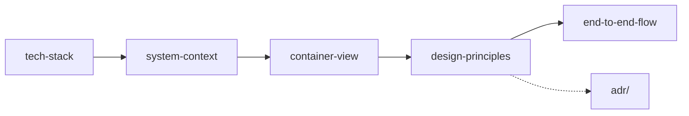

# Architecture

> **Area:** Architecture
> **Source:** MVP Architecture v0.1 §2, §5 ([source](../_source/mvp-architecture-v0.1.md))
> **Status:** Draft v0.1 · **Owner:** Aman
> **Used by:** [/CLAUDE.md](../../CLAUDE.md), [backend/CLAUDE.md](../../backend/CLAUDE.md), [infra/CLAUDE.md](../../infra/CLAUDE.md)

## Summary

The high-level architecture: which technologies, who the system talks to, which containers exist, the eight design principles every change must respect, and how one customer's evening flows through it all. Low-level design per feature lives in the area folders ([backend](../backend/README.md), [ai-agent](../ai-agent/README.md), [whatsapp](../whatsapp/README.md), [retention](../retention/README.md) and so on).

## Docs in this folder

| Doc | What it covers |
|---|---|
| [tech-stack.md](tech-stack.md) | Stack table per layer and the stack notes to decide early (Supabase tier, region, cold starts, Auth MAU) |
| [system-context.md](system-context.md) | Who and what the system talks to |
| [container-view.md](container-view.md) | Deployable pieces, how data moves between them, and the `api` vs `worker` split |
| [design-principles.md](design-principles.md) | The eight principles, what each means in practice and where it is enforced |
| [end-to-end-flow.md](end-to-end-flow.md) | Customer-side and business-side flow, plus a full happy-path evening |

## Reading order

Start broad and narrow down; the principles are backed by the ADRs in [../adr/](../adr/README.md).

## Related

- [../product/README.md](../product/README.md)
- [../backend/module-structure.md](../backend/module-structure.md)
- [../infra/deployment.md](../infra/deployment.md)
- [../adr/README.md](../adr/README.md)
