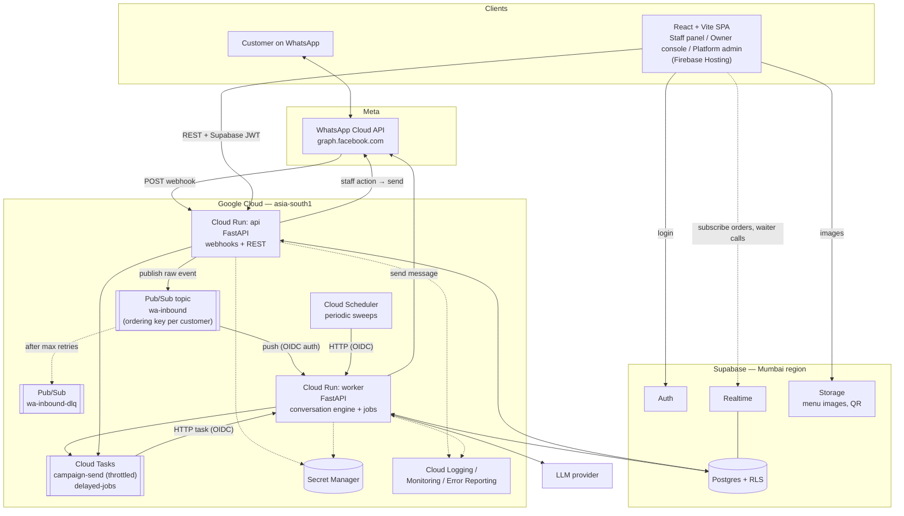

# Container view

> **Area:** Architecture
> **Source:** MVP Architecture v0.1 §5.2, §6.1, §9 ([source](../_source/mvp-architecture-v0.1.md))
> **Status:** Draft v0.1 · **Owner:** Aman
> **Used by:** [/CLAUDE.md](../../CLAUDE.md), [backend/CLAUDE.md](../../backend/CLAUDE.md), [infra/CLAUDE.md](../../infra/CLAUDE.md)

## Summary

The main deployable pieces and how data moves between them. Two Cloud Run services (`api` and `worker`) built from one FastAPI codebase, joined by Pub/Sub and Cloud Tasks, with Supabase as the system of record and one SPA for all panels.

## Container diagram

Follow the inbound path (Meta → `api` → Pub/Sub → `worker` → Meta) and note that the SPA writes only through `api`; its Supabase arrows are login, realtime subscribe and images.

## Containers

| Container | What it is | Called by | Calls |
|---|---|---|---|
| Customer on WhatsApp | The customer's WhatsApp app | — | Meta Cloud API |
| React + Vite SPA | Staff panel, owner console and platform admin in one app, on Firebase Hosting | Staff, owners, us | Supabase Auth (login), `api` (REST + JWT), Realtime (subscribe), Storage (images) |
| WhatsApp Cloud API | Meta's `graph.facebook.com` | Customer app, `api`, `worker` | `api` (webhooks) |
| Cloud Run `api` | Public FastAPI service: webhooks + REST | Meta (webhooks), SPA (REST) | Pub/Sub `wa-inbound`, Postgres, Meta (staff action → send), Cloud Tasks, Secret Manager, Logging |
| Pub/Sub `wa-inbound` | Inbound message queue with an ordering key per customer | `api` (publish) | `worker` (push, OIDC); `wa-inbound-dlq` after max retries |
| Pub/Sub `wa-inbound-dlq` | Dead-letter topic; depth > 0 alerts | `wa-inbound` | — |
| Cloud Run `worker` | Internal FastAPI service: conversation engine + jobs | Pub/Sub, Cloud Tasks, Cloud Scheduler (all OIDC) | Meta (send), LLM, Postgres, Cloud Tasks, Secret Manager, Logging |
| Cloud Tasks | `campaign-send` (throttled) and `delayed-jobs` queues | `worker`, `api` | `worker` (HTTP task, OIDC) |
| Cloud Scheduler | Periodic sweeps | — | `worker` (HTTP, OIDC) |
| Secret Manager | App Secret, WABA tokens, 2FA PINs, Supabase service key, LLM key | `api`, `worker` | — |
| Cloud Logging / Monitoring / Error Reporting | Logs, metrics, alerts | `api`, `worker` | — |
| Supabase Auth | Staff, owner, platform-admin logins | SPA | — |
| Postgres + RLS | System of record | `api`, `worker`; Realtime | — |
| Realtime | Postgres Changes feed of orders and waiter calls | SPA (subscribe) | Postgres |
| Storage | Menu images, menu PDF fallback, QR codes | SPA, backend | — |
| LLM provider | Tool-calling model (open decision) | `worker` | — |

## The `api` vs `worker` split

One FastAPI codebase, deployed twice. `api` mounts the public routers (webhooks, staff, admin, platform); `worker` mounts the internal ones (Pub/Sub push, tasks, scheduler jobs). Domain services don't know which service they run in.

| | `api` | `worker` |
|---|---|---|
| Ingress | Public (`api.yourdomain`) | Internal only, OIDC from `invoker-sa` |
| Scaling (prod) | min 1, max 5 (fast `200` for Meta) | min 0, max 10 |
| Does | Verify signature, store raw event, publish, return `200`; panel REST; staff-action sends | Conversation engine, AI turns, outbound replies, campaign sends, scheduled jobs |
| Service account | `api-sa` | `worker-sa` |

See [ADR 0007](../adr/0007-one-codebase-two-services.md) and [ADR 0002](../adr/0002-ack-fast-process-async.md).

## Rules / invariants

- The webhook handler does no real work: verify, store, publish, `200`.
- `worker` endpoints are never reachable from the public internet.
- The SPA never writes to Supabase; all writes go through `api`.
- Pub/Sub publishes use ordering key `{phone_number_id}:{wa_id}`.

## Related

- [system-context.md](system-context.md)
- [design-principles.md](design-principles.md)
- [../backend/module-structure.md](../backend/module-structure.md)
- [../backend/inbound-pipeline.md](../backend/inbound-pipeline.md)
- [../infra/deployment.md](../infra/deployment.md), [../infra/async-messaging.md](../infra/async-messaging.md)
