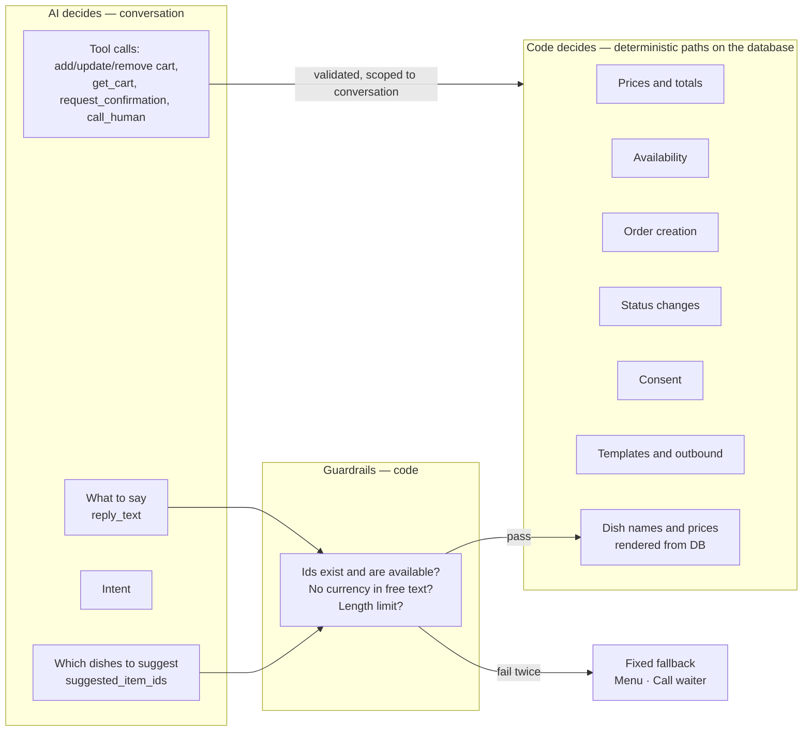

# Design principles

> **Area:** Architecture
> **Source:** MVP Architecture v0.1 §5.3 ([source](../_source/mvp-architecture-v0.1.md))
> **Status:** Draft v0.1 · **Owner:** Aman
> **Used by:** [/CLAUDE.md](../../CLAUDE.md), [backend/CLAUDE.md](../../backend/CLAUDE.md), [backend/app/domain/CLAUDE.md](../../backend/app/domain/CLAUDE.md), [backend/app/domain/ai_agent/CLAUDE.md](../../backend/app/domain/ai_agent/CLAUDE.md), [frontend/CLAUDE.md](../../frontend/CLAUDE.md)

## Summary

Eight principles that every change must respect. They exist because one lost or wrong order costs more trust than ten missing features. When a design choice is unclear, the principle wins.

## The principles

### 1. Acknowledge fast, process later

The webhook verifies the signature, stores the raw event, publishes it and returns `200`. All real work happens in the worker.

- **In practice:** the `POST /webhooks/whatsapp` handler never calls the LLM, never sends a message and never touches conversation state. Target is under 1 s.
- **Enforced in:** [inbound-pipeline.md](../backend/inbound-pipeline.md), [webhooks.md](../whatsapp/webhooks.md), [ADR 0002](../adr/0002-ack-fast-process-async.md).

### 2. One message at a time per customer

Pub/Sub ordering key `{phone_number_id}:{wa_id}` plus a Postgres advisory lock per conversation. Two quick messages from the same person never race each other to create two carts.

- **In practice:** every publish sets the ordering key; the worker takes `pg_advisory_xact_lock` on the conversation key before handling a message.
- **Enforced in:** [async-messaging.md](../infra/async-messaging.md), [inbound-pipeline.md](../backend/inbound-pipeline.md), [ADR 0003](../adr/0003-per-customer-ordering-and-locks.md).

### 3. AI talks, code decides

The AI chooses what to say and which dishes to suggest. Prices, availability, totals, order creation, status changes and consent are fixed code paths reading the database.

- **In practice:** the AI's only route to an order is `request_confirmation()`; it has no tool to set prices, create orders, change status, send templates or record consent.
- **Enforced in:** [tools.md](../ai-agent/tools.md), [guardrails.md](../ai-agent/guardrails.md), [cart-and-confirmation.md](../backend/cart-and-confirmation.md), [ADR 0001](../adr/0001-ai-talks-code-decides.md).

### 4. Menu database is the only source of truth

The AI only ever sees currently available items, and dish names and prices in confirmation messages are rendered by code from the database.

- **In practice:** the prompt builder reads `is_available = true` items every turn; suggested dishes are rendered as a list message from the database, never from AI text.
- **Enforced in:** [prompt-context.md](../ai-agent/prompt-context.md), [menu-management.md](../backend/menu-management.md), [ADR 0005](../adr/0005-full-menu-in-prompt.md).

### 5. Every write goes through FastAPI

The SPA uses Supabase directly only for login and for realtime *reads*. Status changes go through the API, because each one must also send a WhatsApp message and write an audit row.

- **In practice:** no `INSERT/UPDATE/DELETE` RLS policies for `authenticated`; the SPA uses the anon key and the REST API.
- **Enforced in:** [row-level-security.md](../database/row-level-security.md), [app-structure.md](../frontend/app-structure.md), [ADR 0004](../adr/0004-all-writes-through-fastapi.md).

### 6. Tenant from the infrastructure, never from input

On inbound messages the café is resolved from `phone_number_id`; on panel requests from the staff membership behind the JWT.

- **In practice:** repositories take `cafe_id` as a required argument; message text and request bodies never set the tenant.
- **Enforced in:** [auth-and-tenant-isolation.md](../security/auth-and-tenant-isolation.md), [ADR 0006](../adr/0006-tenant-from-infrastructure.md).

### 7. Idempotent everything

Unique `wamid`, unique order per cart version, monotonic message status. Meta retries and duplicates are expected, not exceptional.

- **In practice:** `messages` insert on conflict does nothing; `UNIQUE (cart_id, cart_version)` on `orders`; status only moves forward (sent → delivered → read, or failed).
- **Enforced in:** [constraints-and-indexes.md](../database/constraints-and-indexes.md), [inbound-pipeline.md](../backend/inbound-pipeline.md).

### 8. A human is always one tap away

Any AI failure, low-confidence turn or explicit request lands with staff within a minute.

- **In practice:** "Call waiter" is on the greeting and fallback buttons; `call_human` is always allowed; unacknowledged requests re-alert after 60 s.
- **Enforced in:** [human-handoff.md](../backend/human-handoff.md), [guardrails.md](../ai-agent/guardrails.md), [background-jobs.md](../backend/background-jobs.md).

## The "AI talks, code decides" boundary

The AI's outputs only ever cross into code through guardrails or scoped tools; everything on the right reads the database and never trusts AI text for names, prices or state.

## Rules / invariants

- Never add an AI tool that sets prices, creates orders, changes order status, sends templates, records consent or reads other customers.
- Never derive `cafe_id` from message text or a request body.
- Never let the SPA write to Supabase directly.
- Every handler must be safe to run twice on the same input.

## Related

- [../adr/README.md](../adr/README.md)
- [container-view.md](container-view.md)
- [end-to-end-flow.md](end-to-end-flow.md)
- [../product/purpose-and-scope.md](../product/purpose-and-scope.md)
