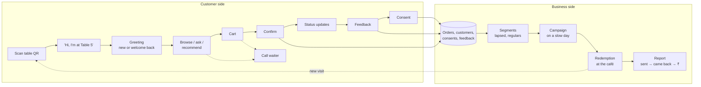
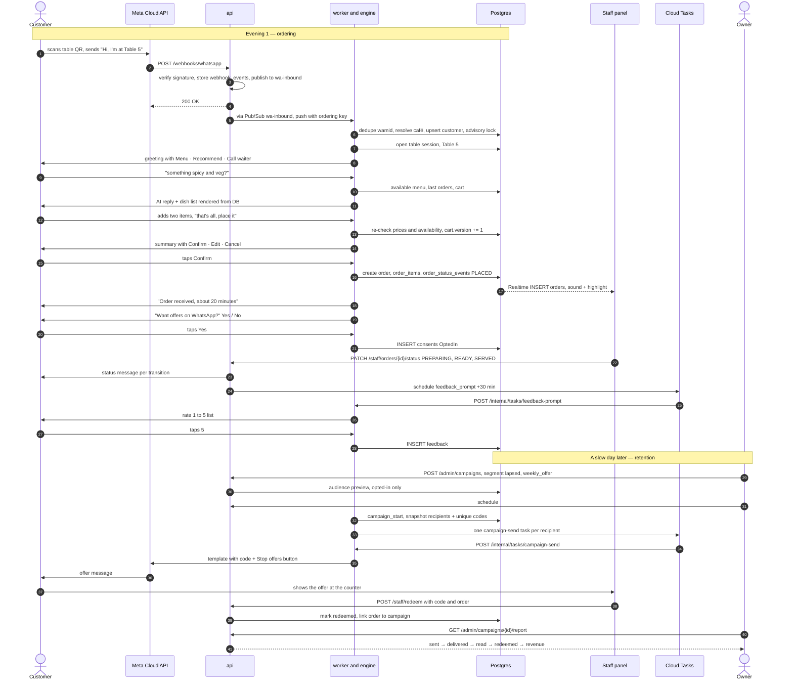

# End-to-end flow

> **Area:** Architecture
> **Source:** MVP Architecture v0.1 §5.4, with steps from §6.2–§6.12 ([source](../_source/mvp-architecture-v0.1.md))
> **Status:** Draft v0.1 · **Owner:** Aman
> **Used by:** [/CLAUDE.md](../../CLAUDE.md), [backend/CLAUDE.md](../../backend/CLAUDE.md)

## Summary

How the customer-side ordering loop feeds the business-side retention loop, and how a redemption turns into a new visit. The second diagram walks one customer through a full happy-path evening and a later campaign, step by step, with a link to the detailed doc for each step.

## Customer-side and business-side flow

Confirm, Feedback and Consent are the three points where the customer side writes into the business side; the dashed "new visit" arrow closes the loop.

## A full happy-path evening, then a campaign

Read it in two halves: the first is one table's evening on the P0 ordering loop, the second is the P1 retention loop that brings the same customer back. Arrows straight to the customer are simplified; every outbound message really goes through the outbound sender and Meta.

## Where each step is designed

| Steps | What happens | Detailed doc |
|---|---|---|
| 1–4 | Webhook verify, store, publish, fast `200` | [webhooks.md](../whatsapp/webhooks.md), [ADR 0002](../adr/0002-ack-fast-process-async.md) |
| 5–6 | Pub/Sub push, dedupe, tenant resolution, customer upsert, advisory lock | [inbound-pipeline.md](../backend/inbound-pipeline.md), [ADR 0003](../adr/0003-per-customer-ordering-and-locks.md) |
| 7–8 | Table session and greeting (new or welcome back) | [conversation-router.md](../backend/conversation-router.md), [conversation-state-machine.md](../backend/conversation-state-machine.md) |
| 9–11 | AI turn with available-menu context and code-rendered dish list | [prompt-context.md](../ai-agent/prompt-context.md), [tools.md](../ai-agent/tools.md), [guardrails.md](../ai-agent/guardrails.md) |
| 12–15 | Cart, priced summary, Confirm with cart version | [cart-and-confirmation.md](../backend/cart-and-confirmation.md) |
| 16–18 | Transactional order creation, live staff alert, confirmation message | [order-lifecycle.md](../backend/order-lifecycle.md), [realtime-and-alerts.md](../frontend/realtime-and-alerts.md) |
| 19–21 | Consent ask after the first order | [consent.md](../retention/consent.md) |
| 22–23 | Staff status changes → customer messages | [order-lifecycle.md](../backend/order-lifecycle.md), [staff-panel.md](../frontend/staff-panel.md), [outbound-sender.md](../whatsapp/outbound-sender.md) |
| 24–28 | Feedback task, rating list, feedback row | [feedback.md](../backend/feedback.md), [background-jobs.md](../backend/background-jobs.md) |
| 29–36 | Campaign draft, audience preview, schedule, recipient snapshot with codes, throttled template send | [campaigns.md](../retention/campaigns.md), [templates.md](../whatsapp/templates.md) |
| 37–39 | Redemption at the café | [redemption.md](../retention/redemption.md) |
| 40–41 | Campaign report | [campaigns.md](../retention/campaigns.md), [analytics-views.md](../database/analytics-views.md) |

The step numbers match the `autonumber` labels in the sequence diagram above.

## Rules / invariants

- The ordering loop works without the retention loop; retention depends on orders, consent and feedback rows existing.
- Campaign audiences include only `OptedIn` customers.
- Every status message to the customer goes through the outbound sender and its 24-hour window guard.

## Related

- [design-principles.md](design-principles.md)
- [container-view.md](container-view.md)
- [../product/purpose-and-scope.md](../product/purpose-and-scope.md)
- [../retention/README.md](../retention/README.md)
