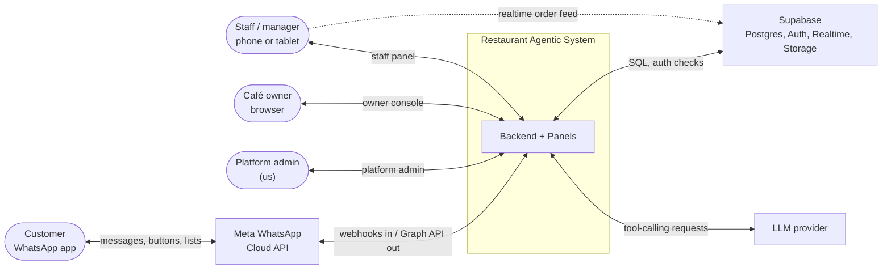

# System context

> **Area:** Architecture
> **Source:** MVP Architecture v0.1 §5.1 ([source](../_source/mvp-architecture-v0.1.md))
> **Status:** Draft v0.1 · **Owner:** Aman
> **Used by:** [/CLAUDE.md](../../CLAUDE.md), [backend/CLAUDE.md](../../backend/CLAUDE.md)

## Summary

Who and what the system talks to. Four human actors, three external systems. Customers only ever touch WhatsApp; everyone else uses the panels in one SPA.

## Context diagram

Note the one dashed line: the staff panel reads the live order feed directly from Supabase Realtime. Every other interaction goes through the backend.

## Actors and external systems

| Actor / system | Kind | Talks to the system via | Detail |
|---|---|---|---|
| Customer | Person | WhatsApp app → Meta Cloud API | Messages, buttons, lists. Never logs in; identified by `wa_id` |
| Staff / manager | Person | Staff panel on a phone or tablet | Live orders, status, sold-out, waiter calls, redeem. See [staff-panel.md](../frontend/staff-panel.md) |
| Café owner | Person | Owner console in a browser | Settings, campaigns, customers, analytics. See [owner-console.md](../frontend/owner-console.md) |
| Platform admin (us) | Person | Platform admin area | Onboarding, templates, health, costs, audit. See [platform-admin.md](../frontend/platform-admin.md) |
| Meta WhatsApp Cloud API | External system | Webhooks in, Graph API out | See [whatsapp/README.md](../whatsapp/README.md) |
| LLM provider | External system | Tool-calling requests | Provider is an open decision. See [llm-provider.md](../ai-agent/llm-provider.md) |
| Supabase | Platform | SQL, auth checks; realtime for the panel | Postgres, Auth, Realtime, Storage. See [database/README.md](../database/README.md) |

## Rules / invariants

- Customers interact only through WhatsApp; there is no customer web app or login.
- The panels never write to Supabase directly; the realtime feed is read-only ([ADR 0004](../adr/0004-all-writes-through-fastapi.md)).

## Related

- [container-view.md](container-view.md)
- [../product/roles-and-permissions.md](../product/roles-and-permissions.md)
- [tech-stack.md](tech-stack.md)
