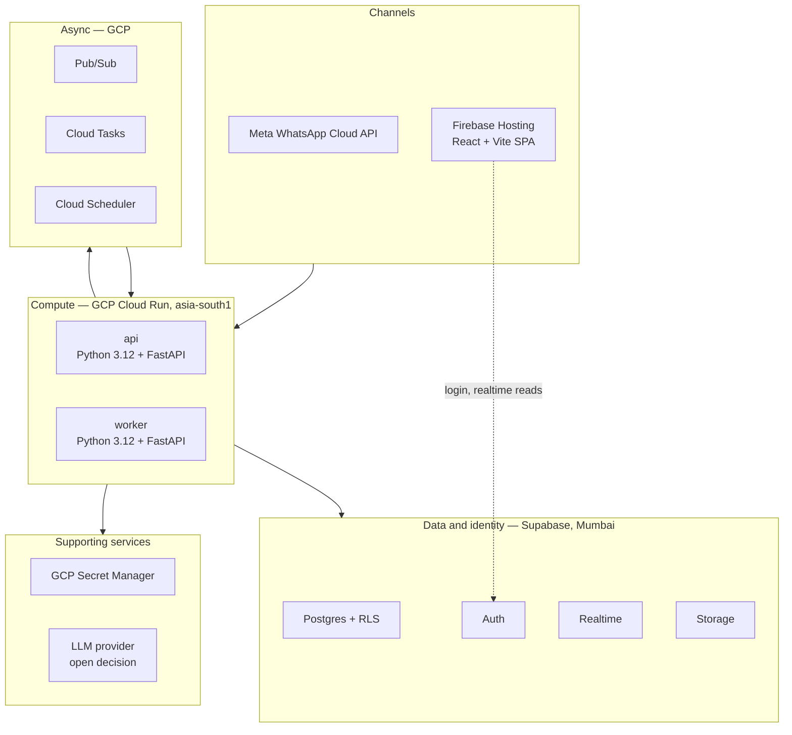

# Technology stack

> **Area:** Architecture
> **Source:** MVP Architecture v0.1 §2 ([source](../_source/mvp-architecture-v0.1.md))
> **Status:** Draft v0.1 · **Owner:** Aman
> **Used by:** [/CLAUDE.md](../../CLAUDE.md), [backend/CLAUDE.md](../../backend/CLAUDE.md), [frontend/CLAUDE.md](../../frontend/CLAUDE.md), [supabase/CLAUDE.md](../../supabase/CLAUDE.md), [infra/CLAUDE.md](../../infra/CLAUDE.md)

## Summary

Python/FastAPI on GCP Cloud Run, a React + Vite SPA on Firebase Hosting, Supabase for Postgres, Auth, Realtime and Storage, and the Meta WhatsApp Cloud API called directly. The LLM provider is still an open decision. Meta and Supabase facts are as of mid-2026; verify limits and pricing before building against them.

## Stack by layer

| Layer | Choice | Role in this system |
|---|---|---|
| Backend | Python 3.12 + FastAPI | Webhook receiver, REST API for the panels, conversation engine, workers |
| Frontend | React + Vite (TypeScript) | One SPA with role-based areas: Staff panel, Owner console, Platform admin |
| Database | Supabase Postgres | System of record; Row Level Security (RLS) for anything the frontend reads directly |
| Auth | Supabase Auth | Staff, owner and platform-admin logins only. Customers never log in: their identity is their WhatsApp number (`wa_id`) |
| Realtime | Supabase Realtime (Postgres Changes) | Live order feed and waiter-call alerts in the staff panel |
| File storage | Supabase Storage | Menu images, menu PDF fallback, generated QR codes |
| Compute | GCP Cloud Run | `api` service (public) and `worker` service (internal) from one codebase |
| Async | GCP Pub/Sub + Cloud Tasks + Cloud Scheduler | Inbound message queue, delayed/throttled jobs, periodic sweeps |
| Secrets | GCP Secret Manager | Meta App Secret, WABA tokens, 2FA PINs, Supabase service key, LLM key |
| Frontend hosting | Firebase Hosting (GCP) | Static Vite build behind a CDN |
| WhatsApp | Meta WhatsApp Cloud API (direct) | Messages, interactive messages, templates, webhooks |
| LLM | **Open decision** (see [open-decisions.md](../delivery/open-decisions.md)) | Recommendations and Q&A via tool calling. Gemini on Vertex AI would draw on the GCP credit |

## Layered view

Top to bottom: channels reach compute, compute fans out through async queues back into itself, and all state lives in Supabase. The SPA's only direct Supabase use is login and realtime reads.

## Stack notes worth deciding early

- **Supabase free tier.** Free projects have historically been paused after about a week of inactivity and have a small database size cap. That is fine for development; for a live pilot café, plan on the paid tier so the database never pauses on a quiet week. Check current Supabase limits.
- **Region alignment.** Put Cloud Run in `asia-south1` (Mumbai) and the Supabase project in its Mumbai region. Every inbound message touches the database several times, so cross-region latency adds up.
- **Cloud Run cold starts.** Meta expects a fast `200` on webhooks. Keep `min-instances=1` on the `api` service in production. This is a small but real cost against the $300 credit.
- **Supabase Auth MAU.** Only staff and owners count toward Auth MAU. Customers are rows in `customers`, not Auth users, so the 50,000 MAU limit is not a constraint.

## Rules / invariants

- Customers are never Supabase Auth users.
- Cloud Run and Supabase stay in the same region (Mumbai).
- `api` runs with `min-instances=1` in production.
- The pilot café runs on a paid Supabase tier; free tier is for `dev` only.
- All secrets live in Secret Manager; the database stores only references.

## Open questions

- LLM provider — benchmark two candidates on 50 scripted conversations ([open-decisions.md](../delivery/open-decisions.md), [llm-provider.md](../ai-agent/llm-provider.md)).
- Supabase tier for the pilot ([open-decisions.md](../delivery/open-decisions.md)).

## Related

- [container-view.md](container-view.md)
- [../infra/deployment.md](../infra/deployment.md), [../infra/environments.md](../infra/environments.md)
- [../infra/iam-and-secrets.md](../infra/iam-and-secrets.md)
- [../ai-agent/llm-provider.md](../ai-agent/llm-provider.md)
