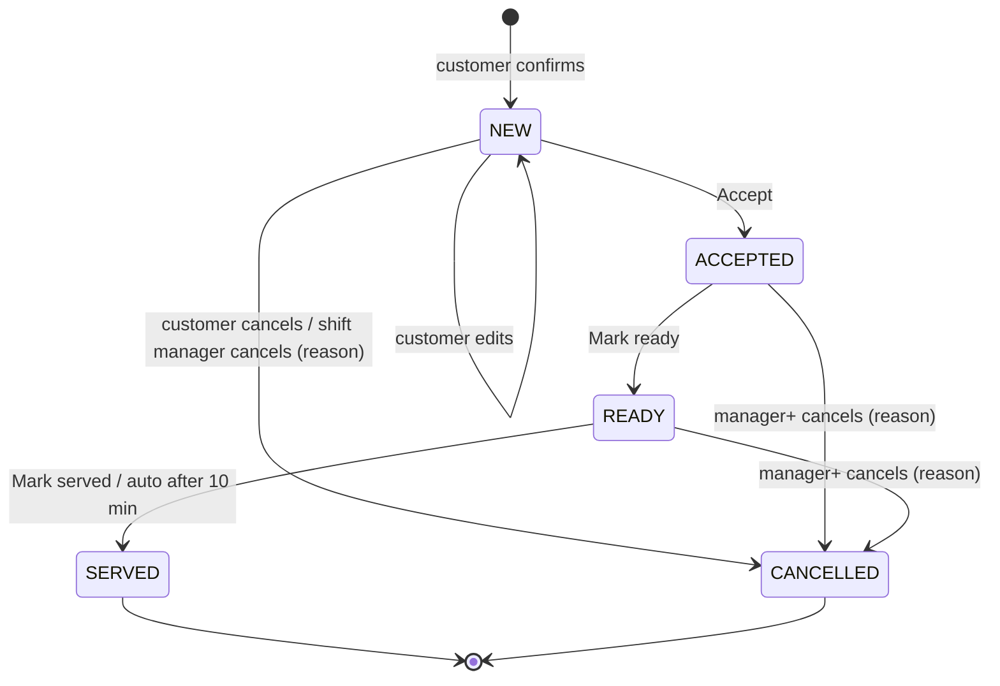

# Backend behaviour

The domain rules for every customer turn and console action. Code layout and module ownership: [architecture](architecture.md#backend-layout).

## Conversation

### Steps and state

`greeting` → `browsing` (name known) → `building_cart` (item added) → `confirming` (summary sent) → `order_placed` (Confirm, order `NEW`) → `post_order` (order `SERVED`).

Back-edges: cart cleared or Cancel → `browsing`; Edit or any change at `confirming` → `building_cart`; ordering more after `order_placed` or from `post_order` → `building_cart` (new order); next visit → `greeting`.

`mode` is an overlay, `bot` or `human`. In `human` the bot is silent and `assigned_to` is set; it never changes `step`.

| `mode` change | Triggers |
|---|---|
| `bot` → `human` | A [handoff](#handoff) (incl. AI failure) · staff Take over, reply or Message a table · a dead-lettered turn **(pending)** ([open decision](plan.md#open-decisions)) |
| `human` → `bot` | Hand back · resolving the conversation's help or allergy request · `idle_handback` |

| `conversations.state` | Meaning |
|---|---|
| `step` | Current step |
| `awaiting` | `null` · `name` · `table` · `rating` · `feedback_text`. The next text answers it, no LLM |
| `cart` | `{items: [{item_id, qty, note}], version}` |
| `order_edit` | `{order_id, order_version, items}` while editing a `NEW` order |
| `clarify_strikes` | 0–2; 2 → handoff `repeated_unclear`; reset by any valid action (picks included; intent `recommend` never adds one) |
| `allergy_note` | Allergy mentioned this visit; copied to the order |
| `feedback_order_id` | Order a pending rating belongs to |
| `rec` | The last picks, ids only: `{shown: [item_id] (≤ 12), mood: light\|energy\|cool\|comfort\|sweet\|null, mood_text: ≤ 60 sanitised \| null, llm_calls, at}`. Reset with the visit. See [Recommendations](#recommendations) |

### Routing order

First match wins.

1. `optout` button or `STOP` → opt out, in any step and mode.
2. `mode = human` → store, show in Chats, re-arm `idle_handback`. No bot reply.
3. QR text (matches `tables.qr_text` after normalising) → join or open the table session → greeting.
4. Interactive reply → handler by reply id. `menu` alone → categories; `recommend` · `rec_mood:{code}` · `rec_more` → the [recommend flow](#recommendations), after the paused / closed check.
5. Non-text → "Sorry, I can only read text. Please type your order." + Menu · Call waiter.
6. `awaiting` set → save the answer.
7. Keyword (call waiter, bill) → deterministic handler.
8. Paused or closed → fixed reply. Status, help, bill and STOP still work.
9. Free text → one [LLM call](#ai-agent).

In a batch each interactive reply is its own turn; consecutive free-text messages (1 s debounce) join into one LLM turn. The turn runs under the conversation [lease](architecture.md#message-pipeline): the LLM call and sends happen with no transaction open, and state changes, `processed_at` and the outbound step rows commit in one short transaction that first checks the lease is still held. Keywords match the whole normalised message against a short per-language list, never a substring.

### Deterministic flows

Reply ids are `action[:arg[:arg]]`. Handlers act on the id, never the title, and validate every argument against the DB for this café and conversation. Code renders every reply.

| Flow | Trigger | Reply | Stale or invalid |
|---|---|---|---|
| New customer | First message, no name | "Hi! Welcome to <café>. What should we call you?" → Menu · Recommend · Call waiter (Recommend sends [picks](#recommendations)) | Answer > 3 words or a dish → free text; ask the name after the order |
| Returning | Name known | "Hi <name>! Last time: <items>. Same again?" → Same again · Menu · Call waiter | — |
| Same again | `reorder:{order_id}` | Available items to cart, sold-out named → summary | Not this customer's → menu |
| Menu / category | `menu` · `cat:{slug}[:{page}]` | Categories with ≥ 1 available item, led by a "For you" row (`recommend` "✨ Suggest for me") when there are ≤ 9 categories / items with name, price, veg mark | Empty → menu |
| Item | `item:{item_id}` (`item:{item_id}:rec` from the picks, counted as `rec_added`) | +1 to cart (or to the `NEW` order being edited) → summary | Sold out → "<dish> is sold out today" + menu |
| Recommend | `recommend` · `rec_mood:{light\|energy\|cool\|comfort\|sweet}` · `rec_more` · intent `recommend` | Up to 3 picks with code-rendered names and prices + mood rows + Other ideas · Full menu ([Recommendations](#recommendations)) | No safe dish → "I couldn't find a dish on our menu that fits your preferences…" + Menu · Call waiter; Other ideas used up → "That's everything I'd suggest right now." + categories; unknown mood code → no mood |
| Cart summary | Cart changed | [Confirmation](#confirmation) with `confirm:` · `edit:` · `cancel:{cart_version}` | Old version → latest summary; already ordered → "Already placed — order #N" |
| Table | Confirm without a table session | "Which table are you at?" (`table:{table_id}`) | Unknown → ask again |
| Order received | Order created | "Order #N received — about X min" → Edit order · Cancel order · Call waiter | — |
| Edit / cancel order | `edit_order:` · `cancel_order:{order_id}:{version}` · `apply_edit:` · `keep_order:` | [Edits while NEW](#edits-while-new) | Not `NEW` → "The kitchen has already accepted #N, so I can't change it." + Call waiter |
| Status | `status` or intent `order_status` | "Order #N — being made, about 6 min left" | "You have no open orders." |
| Call waiter / bill | `help` / `bill` or keyword | Opens a request → "Someone from our team will be with you shortly." / "Your bill is on its way." | Already open → "Someone is already on the way." |
| Consent | `optout`, `STOP`, `optin:{yes\|no}:{wording_version}` | [Consent](#consent) | Always applied |
| Feedback | `fb:{order_id}:{n}` or leading digit while `awaiting = rating` | [Feedback](#feedback) | "Thanks, we already have your rating." |
| Paused / closed | Ordering action | "We're not taking WhatsApp orders right now — please ask a waiter." / "We're closed now. We open at <time> <day>." | — |

## AI agent

One structured Gemini call (Vertex AI, global endpoint) per free-text turn, only in `bot` mode, at most once per turn (plus one retry). No tools, no loop. The LLM interprets and drafts; code decides. The only other calls are the Recommend tap's `recommend` call (one per Recommend, mood or Other ideas tap; one attempt, 4 s, code picks on failure, never a handoff; see [Recommendations](#recommendations)), the [cancellation message](#transitions) draft and reading a [staff comment](#customer-profile-and-staff-comments) into profile changes. A typed mood never makes a second call: its picks ride the turn output.

### Output

Contract `contracts/llm_output.schema.json`, JSON-schema output mode. Output that doesn't parse is a failed call.

| Field | Values | Code does |
|---|---|---|
| `intent` | `browse` · `ask_question` · `add_items` · `modify_cart` · `confirm` · `cancel` · `order_status` · `human` · `smalltalk` · `unclear` · `recommend` | Picks the handler (below) |
| `cart_ops[]` | `{op: add\|remove\|set_qty\|set_note, item_ref, qty, note}` | Resolves each `item_ref` against the live menu, rejects unknown and sold-out, applies the rest |
| `allergen_question` | `{allergen, item_ref}` or null | Answers from `menu_item_allergens` |
| `needs_human` | `{flag, reason: asked\|frustration\|complaint\|allergen_unknown\|repeated_unclear}` | Handoff with that reason |
| `clarify` | string or null | Sent instead of acting; +1 strike |
| `reply` | string | Checked (no amounts, length) and sent with code-rendered blocks |
| `recommend` | `{mood (≤ 60) or null, picks: ≤ 3 [{item_ref, why (≤ 80)}]}` with intent `recommend`, else null (required and nullable) | Sanitises the mood; resolves each pick to an available dish on the turn view (unresolved → dropped, `rec_ref_unresolved`); every `why` through `clean_why`, and dropped when it names a dish that is not a pick; then re-filters and tops up ([Recommendations](#recommendations)) |

`item_ref` is the menu `id` from the prompt; when nothing fits it is the customer's words, so code can tell "sold out" from "not on the menu". `qty` 1–20.

| `intent` | Code does |
|---|---|
| `add_items`, `modify_cart` | Apply `cart_ops` (to `order_edit` if editing a `NEW` order) → summary |
| `confirm` | At `confirming` with an unchanged cart → same as the Confirm tap; else summary |
| `cancel` | Clear cart; with a `NEW` order → send its Cancel order button to tap |
| `order_status` | Status flow |
| `ask_question` | `reply`; allergen questions answered by code |
| `browse`, `smalltalk` | `reply`; named dishes shown as a code-rendered list; smalltalk gets one line + Menu button |
| `unclear` | Send `clarify`, +1 strike |
| `recommend` | Apply any `cart_ops` first (summary), then the picks from the same call; never a clarify strike, no second call |
| `human` or `needs_human.flag` | [Handoff](#handoff) |

An order is created only by `confirm:{cart_version}` or `confirm` on an unchanged cart.

### Prompt

| Part | Contents | Cached |
|---|---|---|
| Prefix: rules | Role; hard rules (never state a price, total, discount or time; never invent dishes); reply in the customer's language (Hinglish first-class); café name; tone; the recommendation rule (suggestions or a mood without naming dishes → intent `recommend` with ≤ 3 picks and a short `why` with no price, number or claim; a named dish with a quantity, or "the second one", is `add_items`); Hinglish few-shots (each with `"recommend": null`, plus one recommend shot) | Yes |
| Prefix: menu | One line per available item `id\|name\|price\|veg\|spice\|tags`; sold-out excluded | Yes |
| Suffix: customer | First name, visit count, recent orders (90 days), favourites, profile diet / likes / dislikes / other preferences — from SQL. Never profile allergies | No |
| Suffix: state | Open / closed / paused / near closing and the café's local day and time; cart lines; step | No |
| Suffix: history | Last ~6 turns | No |

- Prefix cached in worker memory per `(cafe_id, menu_version)`; one tiny query per turn checks the version, so a sold-out toggle applies on the next message. A settings change drops the cache.
- Stable prefix first so Gemini context caching applies **[verify minimum size]**. Low temperature, capped output tokens.
- Never in the prompt: phone numbers, `wa_id`, other customers, secrets, full history.
- Tone (café setting, wording only): `warm` "Welcome back! The usual?" · `crisp` "Hi. What can I get you?" · `playful` "Back for more? Excellent taste."
- Model is a per-café config value; `platform_admin` changes it without a deploy. Routing options decided in Phase 2 from evals: Flash only · Flash-Lite only · router (Flash-Lite default; Flash for recommendations, allergen questions, multi-item, Hindi script, after a failed clarify).
- The Recommend tap has its own prompt (no prices, ids only, the same short ids as this view, cached on the view per language): see [Recommendations](#recommendations).

### Failures

Timeout 6 s. Error, timeout, Vertex 429 or invalid output → one retry on the other model. Second failure → "Sorry, I'm having trouble — a team member will help you." + handoff `system_error`. Every call, including failures, writes `llm_calls` with its cost. Kill switch: [cost](architecture.md#cost).

### Guardrails

- **Items.** Available → applied. Sold out → "<Item> is sold out right now" + up to 3 available items from the same category. Not on the menu → "I couldn't find <words> on our menu" + categories, +1 strike. Any rejected op discards the LLM `reply`; code says what was added and what wasn't. Lists, summaries and orders come only from the DB, so an invented dish can't appear.
- **Prices.** `reply`, `clarify` and every `note` are scanned for amounts (₹, Rs, INR, rupees, /-, number + currency, and in Devanagari रुपये / रुपए / रुपया / रु with ASCII or Devanagari digits). A hit drops the model text, sends the code-rendered message and flags the turn for AI review.
- **Recommendation text.** Every model `intro` and `why` that can reach the customer, from the `recommend` call and from the turn output, goes through `clean_why`. It is dropped on any digit (ASCII or Devanagari), any amount, a claim (vegan, Jain, healthy, nutrition, protein, allergen, safe, diet, low-cal, discount, offer, deal, coupon, cashback and their Hindi forms), a URL, or "free" / "muft". It is also dropped when it names a menu dish that is not one of the picks shown (whole name, any case): that dish may have been filtered out for an allergy, diet, dislike or the cart. Code then writes the `why` ("Popular here this week" and so on) or its own intro.
- **Allergens.** See [allergens](#allergens). The LLM only detects the question; `unknown` always reaches a person.
- **Clarify strikes.** +1 for `unclear`, `clarify`, or every op rejected as not on the menu. Valid action resets to 0. Two → handoff `repeated_unclear`. Intent `recommend` and every Recommend tap never add a strike, even when one of their ops is not on the menu.
- **Injection.** Customer text is data. With no tools, injection can at most change `reply` wording.
- **Off-topic.** One short friendly line and back to the menu. No general knowledge, no other businesses.
- **Free-tier rule.** Until Gemini runs on Vertex AI (Phase 3), prompts contain synthetic data only.

### Recommendations

The Recommend button, the "✨ Suggest for me" row, the five mood rows, "Other ideas" and a typed mood all end in one picks message. Code decides which dishes may be suggested and renders every name and price. The model only orders the allowed dishes and writes a short reason ([decision 20](decisions.md#20-ai-recommendations-from-code-filtered-candidates)).

| Way in | Path | LLM |
|---|---|---|
| `recommend` (greeting button, "For you" row in the category list when ≤ 9 categories) | Tap → `conversation/recommend.on_tap` | One `recommend` call |
| `rec_mood:{light\|energy\|cool\|comfort\|sweet}` | Tap; the prompt gets a fixed phrase ("something cold and refreshing") | One `recommend` call |
| `rec_more` "Other ideas" | Tap; excludes `state.rec.shown`, keeps the mood or the sanitised `mood_text` | One `recommend` call |
| Typed ("what do you recommend", "kuch thanda") | Routing rule 9 → turn call → intent `recommend` → `recommend.from_turn` | None extra: the picks ride the turn call |

Taps sit below the paused / closed check (fixed reply, no call); `mode = human` stays silent. Tap-path language is English unless the customer's last typed message has Devanagari.

**Candidates (code, `domain/recommend`).** Hard filters, in order:
1. Available only.
2. Allergies: profile `allergy` (stored as the allergen id, e.g. `tree_nuts`, or as a free word) plus this visit's `allergy_note`. A known allergen (id, label or alias) keeps only dishes marked `free_from`, so `contains` and `unknown` both leave. Any other word removes dishes whose name or description holds it as a whole word. Either case adds the caveat "I've left out dishes our menu doesn't mark free from your allergy. Please tell our team about severe allergies."
3. Diet: veg / vegetarian / vegan / jain / eggetarian keep `veg = true`; vegan also drops milk or eggs `contains`; Jain drops root-vegetable words.
4. Dislikes: whole word, plurals included.
5. Spice: profile 0 keeps ≤ 1, profile 1 keeps ≤ 2.
6. Cart (or the order being edited) and, on Other ideas, the dishes already shown.
7. At most 60, by history then popularity.

Nothing claims a dish is vegan, Jain or allergen-free. Allergies never reach a prompt.

**Code ranking** (the fallback, and the top-up after the model):
- Favourites first: ≤ 2 from the customer's last 180 days, by times then recency.
- Then popular dishes (30 days, cached per café for 10 min), then one per category in name order.
- At most 2 picks per category.
- A mood puts matching categories and names first (`cool` → cold / iced / shake / cooler…, `sweet` → dessert / bake / chocolate…).
- Near closing, dishes with `prep_minutes ≤ 10` lead within each tier.
- Code `why`: "You've had this N times" · "You had this last time" · "Popular here this week" · "From our <category>".

**The `recommend` call** (`ai_agent/recommend.py`, `llm_calls.purpose = recommend`):
- System prompt: rules plus one line per available dish, `id|name|veg|spice|category|prep|description`, with **no price**. It uses the same short ids as the turn prompt and is cached on the menu view per language.
- Suffix: CUSTOMER (first name only if it is letters ≤ 20) · PREFERENCES (never allergy; values kept only if letters-only ≤ 40) · HISTORY (ids) · POPULAR HERE · NOW (local day and time, near closing) · CART · ALREADY SHOWN · MOOD (the fixed phrase, or the sanitised model summary on Other ideas) · ALLOWED. No customer free text, phone, `wa_id` or price.
- Output `$defs.recommend`: `{intro ≤ 160, picks ≤ 3 [{item_ref, why ≤ 80}]}`.
- Model: `llm_recommend_model`, else the café model, else the primary (not Flash-Lite). The `cheap` kill switch still forces Flash-Lite.
- One attempt, `llm_recommend_timeout_seconds` (4 s), 300 output tokens.
- Validation: refs that are unknown or outside ALLOWED are dropped (`recommend_pick_dropped`); picks are deduped and capped at 3; the intro and each `why` go through `clean_why`; an intro or `why` that names a menu dish that is not one of the picks is dropped (`rec_intro_names_dish`, `rec_why_names_dish`).

**Code picks alone (no handoff, no strike):**
- ≤ 3 candidates (no call)
- kill switch `handoff`
- the per-visit cap reached (`recommend_llm_per_visit`, 6, counted in `state.rec.llm_calls`; `recommend_capped`)
- timeout, error or invalid output, or no valid model pick (`recommend_fallback`)

The intro is then "Here are a few favourites:" or "For <mood phrase>, try:".

**Before render.**
- The candidates are re-read (availability and allergen states) and re-filtered.
- Model picks that are still valid are kept and topped up from the code ranking to min(3, candidates).
- A last check runs against the final picks: a model intro or `why` that names any available dish not shown is replaced by code text (the code intro or the code `why`). This covers dishes that were filtered out, sold out on the re-read, in the cart, or just not picked.

**Typed moods.**
- The turn output's picks resolve to available dishes and go through the same hard filters.
- Each `why` goes through `clean_why`. The turn prompt shows prices, so a `why` with any digit is replaced by the code `why`. So is a `why` that names a dish that is not a pick.
- Picks are then topped up from the code ranking. The turn `reply` is used as the intro only after the same `clean_why` and dish-name checks; otherwise code writes it.
- Cart ops in the same message apply first (summary), then the picks with a code intro.
- "2 cold coffee" or "the second one" after the picks is `add_items`; there is no awaiting step.

**Message.** One list message, ≤ 10 rows, button "See picks":
- Body (code, ≤ 1024): the intro, then "1. <name> · ₹<price>" with the `why` under each pick, the allergy caveat when a filter applied, and "Tap a dish to add it, or pick a mood." (while editing: "Tap a dish to add it to order #N.").
- Section Picks for you: `item:{id}:rec`, "₹190 · veg · Tap to add".
- Section Pick by mood: every mood except the active one.
- Section More: `rec_more` Other ideas (only while candidates remain) and `menu` Full menu.

| Case | Reply |
|---|---|
| No candidate after the filters | "I couldn't find a dish on our menu that fits your preferences[ and allergies]. You can browse everything or ask our team." + Menu · Call waiter; nothing escalated |
| No available dish | The paused reply |
| Other ideas used up | "That's everything I'd suggest right now." + categories |
| A pick sold out before the tap | The sold-out reply |

**State, tracing, privacy.**
- `state.rec` holds ids only, and strikes reset.
- Counters `rec_shown`, `rec_llm`, `rec_added`. Degradations `recommend_fallback`, `recommend_capped`, `recommend_pick_dropped`.
- The log line `recommend` holds ids and counts only.
- These are customer actions, so there is no audit.
- Reads and the call run with no transaction open. State and outbound rows commit in the turn's fenced transaction. A retried turn may make a second, metered call; the message is still sent once.
- Cost is about $0.0006 per call on Flash **[verify pricing]**.

## Cart

`state.cart = {items: [{item_id, qty, note}], version}`. A line is keyed by `(item_id, note)`. No prices are stored; they are read from `menu_items` at every render. `version` + 1 on every change.

| `op` | Rejected when |
|---|---|
| `add` (`item_ref`, `qty` default 1, `note`) | Unknown, other café, or `available = false`; `qty` not 1–20 |
| `remove` | Not in cart |
| `set_qty` (0 removes) | `qty` not 0–20 |
| `set_note` (≤ 120 chars) | Not in cart |

| Value | Rule |
|---|---|
| Line | `price_paise × qty` |
| Total | Sum of lines. Menu prices are final (GST included); shown as "Total (incl. GST)". No GST setting, no separate GST line ([decisions](decisions.md#smaller-decisions)) |
| `expected_minutes` | Max `prep_minutes` of the items |

Notes never change the price. No discounts in the cart; codes are redeemed at the [bill](#bill-sheet). Availability is checked at every op, every summary and again at Confirm.

### Confirmation

Rendered by code: `Your order · Table 7`, one line per item `2 × Cold Brew Tonic ₹480` with its note, "Allergy noted: nuts — the team will check", "Total (incl. GST) ₹ 760", "Ready in about 10 min". Buttons Confirm · Edit · Cancel, each carrying the cart version.

Confirm runs:

1. Version matches and cart not empty; else send the latest summary.
2. Not paused or closed; else the fixed reply.
3. Re-check availability; a newly sold-out item is removed, version + 1, "Sorry, <dish> just sold out" + summary. No order.
4. No table session → ask for the table.
5. One transaction: `orders` (`NEW`, next café `number`, totals, `expected_minutes`, `table_session_id`, `allergy_note`, `source`, `near_closing` flag, `idempotency_key = {conversation_id}:{cart_version}`) + `order_items` (name and price snapshots) + `order_events`; clear cart; step `order_placed`.
6. After commit: schedule `accept_escalation_1`; send "Order #N received — about X min".

A second tap hits the unique key → "Already placed — order #N". `source` is `qr`, or `campaign` (with `campaign_recipient_id`) when the visit started from a campaign button.

### Edits while NEW

- **Edit** (button or free text with an open `NEW` order): ops apply to `order_edit` → "Updated order #N" with Save changes · Keep order.
- **Save:** `transition()` `NEW → NEW` with the customer's expected version; items replaced, totals and `expected_minutes` recomputed, flag `edited`.
- **Cancel:** Cancel order button (typed "cancel" gets the button) → `CANCELLED` (`cancel_reason_code = customer`) → "Order #N cancelled."
- **Race:** staff accepted first → customer gets "already accepted" + Call waiter. Customer first → staff Accept gets 409 `version_conflict` and the card reloads.

## Orders

### Transitions

| From → To | Who | Guard | Customer hears |
|---|---|---|---|
| — → `NEW` | Customer Confirm | Unique `idempotency_key` | "Order #N received — about X min" |
| `NEW` → `NEW` | Customer edit | Version check; flag `edited` | "Updated order #N" |
| `NEW` → `CANCELLED` | Customer | Only `NEW` | "Order #N cancelled." |
| `NEW` → `ACCEPTED` | `shift_manager`+ | 409 if the customer changed it first | "Your order is being made" |
| `NEW` → `CANCELLED` | `shift_manager`+ | Reason required (fixed list + custom text) | AI-written cancellation message (below) |
| `ACCEPTED` / `READY` → `CANCELLED` | `manager`+ | Reason required (fixed list + custom text) | AI-written cancellation message (below) |
| `ACCEPTED` → `READY` | `shift_manager`+ | — | "Your order is ready and on its way" |
| `READY` → `SERVED` | `shift_manager`+, or system after 10 min | — | Nothing; schedules `feedback` |
| Any → previous | Same actor within 5 s | Undo | The queued message is never sent |

Statuses never skip and nothing follows `SERVED`. Staff-transition messages wait 5 s (`status_message`) so Undo can stop them; customer-initiated changes reply at once. Inside the 24-hour window the message is free-form, otherwise the `order_update` template.

**Staff cancel** (`POST /orders/{id}/cancel`):

- Reason: fixed list Out of stock (`out_of_stock`) · Kitchen issue (`kitchen_issue`) · Customer asked (`customer_asked`) · Other (`other`, custom text required). Stored in `cancel_reason_code`, `cancel_reason_text`, `cancelled_by`, `cancelled_at`.
- **Customer message:** written by the AI with the right intent (apologise, say the order is cancelled, offer Call waiter) in the café's tone, under guardrails. Input: the reason code, order number, first name, tone. Code adds the order number line and the Call waiter button, runs the amount scan, and falls back to the fixed "Sorry, order #N has been cancelled." on any LLM failure or guardrail hit. Outside the 24-hour window it goes as `order_update`. **(pending)** further guardrails: no refund or compensation promises, and the custom `reason_text` is never passed to the LLM or the customer ([open decision](plan.md#open-decisions)).
- **Side effects:** one `notifications` row (`order_cancelled`) per active `manager` and `owner`, in the same transaction; in-app only, no WhatsApp message. Plus `order_events` and `audit_log` as for every transition.

### transition()

`transition(order_id, to, actor, expected_version)` is the only way an order changes.

1. Load with `cafe_id`; disallowed move → 422 `invalid_transition`.
2. Update where `id` and `version = expected_version`; 0 rows → 409 `version_conflict`.
3. Same transaction: status timestamp, `version` + 1, one `order_events` row (from, to, actor type and id, reason); staff actions also write `audit_log`.
4. After commit: schedule the next timer (`accept_escalation_1`, `overdue`, `auto_served`, `feedback`) and, for staff actions, `status_message` at +5 s.

Undo = `transition()` back to the previous status with reason `undo`; the undone step's timers no-op.

### Flags

Flags are attributes, not statuses.

| Flag | Set when |
|---|---|
| `escalated` | `accept_escalation_1` fired |
| `overdue` | `overdue` timer fired (still `ACCEPTED` past due) |
| `delayed` | Staff sent a delay |
| `edited` | Customer edited while `NEW` |
| `item_sold_out` | An item of this `NEW` / `ACCEPTED` order was marked sold out (same transaction). Nothing automatic happens: staff message the customer or cancel |
| `near_closing` | Placed within `cutoff_minutes` of closing |

Due = `accepted_at` + `expected_minutes` + `delay_minutes`. `allergy_note` is a separate field shown as the Allergy chip.

- **Delay** (`NEW` or `ACCEPTED`): +2 / +5 / +10 / custom minutes, optional note ≤ 120 chars. Adds to `delay_minutes`, sets `delayed`, clears `overdue`, re-creates the `overdue` timer, sends "Sorry for the wait — your order needs about N more minutes. <note>" at once.
- **Cancel reasons:** Out of stock · Kitchen issue · Customer asked · Other (custom text). See [staff cancel](#transitions). Cancelled orders are excluded from revenue, visits and spend.
- **Manual order** (`shift_manager`+, offline fallback): table, items, optional allergy note; cart pricing rules; `source = manual`; no customer messages. Open: created as `NEW` or `ACCEPTED` ([plan](plan.md#open-decisions)).
- **Print ticket:** browser print, no endpoint. Number, table, time, first name, `qty × name` + note, allergy (this visit's `allergy_note` and profile allergies) boxed at the top in large type, Edited / Near closing marks, expected time. No prices.
- **Table sessions:** QR text "Hi, I'm at Table N" joins the table's open session or opens one. Several customers at one table share the session and one bill. A session closes on "Bill delivered" or after 3 h with no order.

## Human help

### Requests

| `kind` | Opened by | Seen by | Customer hears |
|---|---|---|---|
| `help` | Call waiter, keyword, any handoff | `shift_manager`+ | "Someone from our team will be with you shortly." |
| `allergy` | Allergen state `unknown` | `shift_manager`+ | "Let me get a team member to check that for you." |
| `bill` | Bill button or keyword | `shift_manager`+ | "Your bill is on its way." |
| `low_rating` | 1–2★ feedback | `manager`+ | Apology |

Status `open` → `acknowledged` (`acknowledged_by`) → `resolved`. One open request per conversation and kind. Nothing — guardrail, pause or closed state — can block `help`.

### Handoff

| Trigger | `reason_tag` | Opens |
|---|---|---|
| Call waiter, keyword, intent `human` | `asked` | `help` |
| Two failed clarifications | `repeated_unclear` | `help` |
| Complaint | `complaint` | `help` |
| LLM flags frustration | `frustration` | `help` |
| Allergen state `unknown` | `allergen_unknown` | `allergy` |
| LLM failure after retry | `system_error` | `help` |
| Turn dead-lettered after 3 retries **(pending)** | `system_error` | `help` |

Every handoff sets `mode = human`. A `bill` request never stops the bot.

**Dead-lettered turn.** The customer always gets the standard "Sorry, something went wrong on our side. Tap below to talk to a person." + Call waiter, and `platform_admin` is alerted. Whether it also opens a `help` request for the shift manager and switches to human mode is pending; default yes, per invariant 11 ([open decision](plan.md#open-decisions)).

**Human mode.** Entered by a handoff, Take over, a staff reply, Message a table or (pending) a dead-lettered turn. The bot sends nothing (STOP still works); staff replies go through `outbound`. Exits on Hand back, on resolving the conversation's help or allergy request, or after 15 min with no unanswered customer message (`idle_handback`).

### Escalation

| Level | Target | When | Channel |
|---|---|---|---|
| 0 | Whoever is on the console | Immediately | In-app sound and card |
| 1 | Managers | Order still `NEW` at 60 s; help or allergy open at 2 min | In-app + `new_order_alert` to the café alert number and each manager's `alert_phone` |
| 2 | Owner | Order still `NEW` 2 min after level 1 | In-app + `new_order_alert` to the owner's `alert_phone` |

Each level writes an `escalations` row; orders also get `escalated`. Handlers stop once the item is accepted, acknowledged or resolved.

### Bill sheet

One bill per table session: all its non-cancelled orders, their sum, one offer code ([redemption](#redemption)), discount, "Total (incl. GST)". "Bill delivered" resolves the `bill` request and closes the session. Open: whole table vs per person; counter vs café POS for payment.

## Menu

- **Item fields:** `name` 1–60, unique per café (case-insensitive) · `description` ≤ 200 · `category` (categories are distinct values) · `price_paise` > 0 (console enters rupees) · `prep_minutes` · `veg` · `spice` 0–3 · `available` · `photo_path` (Storage) · `version`.
- Items are never hard-deleted; retired items stay `available = false`.
- **Sold-out toggle** (`shift_manager`+, two taps): one transaction sets `available`, raises `version`, audits, flags open orders `item_sold_out`. The agent stops offering it on the next message; carts lose the line at the next summary.
- **Edit / new** (`manager`+): validates, raises `version`, audits. Changes reach the agent on the customer's next message.
- **Menu version** = highest `menu_items.version` from a per-café counter (only increases). It is the prompt cache key.
- **QR sheet:** `https://wa.me/<display number>?text=<qr_text>`, `qr_text` "Hi, I'm at Table N"; card shows café, table, "Scan to order on WhatsApp" and the fallback "Can't scan? Send 'Hi, I'm at Table N' to <number> on WhatsApp, or ask a waiter."

### Allergens

`menu_item_allergens(item_id, allergen, state)`, `state` `contains` · `free_from` · `unknown` (default, also when no row). Fixed list in `contracts/`: gluten, milk, eggs, peanuts, tree nuts, soy, sesame, fish, shellfish, mustard, sulphites.

| State | Customer gets |
|---|---|
| `contains` | "<Item> contains <allergen>." + available `free_from` alternatives in the same category |
| `free_from` | "<Item> is marked free from <allergen>. Please tell our team about severe allergies." |
| `unknown` | "Let me check with the team." + handoff `allergen_unknown` (`allergy` request, critical) |
| No item named | Available items marked `free_from`; none → handoff |

Allergies mentioned in chat go to `state.allergy_note` and then `orders.allergy_note`. They are never inferred from past orders and never stored as preferences unless stated.

**Profile allergies** (`customer_preferences` kind `allergy`, from a [staff comment](#customer-profile-and-staff-comments)) are for staff: "On profile: <allergen>" in the order card's allergy banner and boxed on the print ticket. They never go to the LLM and never answer an allergen question; only `menu_item_allergens` does.

### CSV import

Owner only; validated in the console and again in the backend. Required `name`, `category`, `price` (rupees), `prep_minutes`, `veg` (yes/no). Optional `description`, `spice`, `contains`, `free_from`, `available`. All or nothing: any invalid row rejects the file with row and column errors. Rows match by name: update matches, insert new, leave missing items alone; unlisted allergens stay `unknown`.

## Customers and feedback

- Key `(cafe_id, wa_id)`. Upserted on every inbound (`first_seen_at`, `last_inbound_at`); `last_visit_at` set on order creation. One conversation per customer.
- Name asked once; only the first name goes to the LLM.
- Returning summary (SQL, never the LLM): first name, visits, last order's items, top 3 items (90 days), stated preferences except allergies. Never phone, spend or ratings.
- `customer_preferences` only when stated by the customer, in chat or to staff (e.g. `diet = vegan`, `milk = oat`). A stored allergy is shown to staff and removes dishes from [recommendations](#recommendations), in code only (never in a prompt). It is never used to answer allergen questions.
- Segments: **Lapsed** no order in 30 days · **Regular** 3+ orders in 60 days · **New** exactly 1 visit (checked in that order).

### Customer profile and staff comments

Staff (`shift_manager`+) open a customer's profile from an order card, Chats or Calls and bills ([console](console.md#customer-profile)) and add comments about what the customer told them. The AI turns each comment into profile changes; code validates and applies them.

| Kind | Values | Single or list |
|---|---|---|
| `diet` | `veg` · `vegan` · `jain` · `eggetarian` · `non_veg` | single |
| `milk` · `sugar` · `seating` | short text, e.g. `oat`, `less`, `window` | single |
| `spice` | `0`–`3` | single |
| `allergy` | one of the [allergens](#allergens) where it fits, else as written | list |
| `dislike` · `like` · `other` | short text ≤ 40, e.g. `mushrooms` | list |

Fixed list in `contracts/preference_kinds.json`. `source` is `chat` (stated on WhatsApp) or `staff_note` (with `note_id`).

1. `POST /customers/{id}/notes` stores the comment word for word in `customer_notes` (`ai_status = pending`) and enqueues a `profile_note` task. `api` never calls the LLM.
2. The worker makes one structured call: the comment, the customer's current profile values, the fixed kinds and allergens. Never the phone, `wa_id`, orders or other customers.
3. Output `{ops: [{op: set | add | remove, kind, value}], summary}`. Code drops any op with an unknown kind, a value over 40 chars, or anything about consent, offers, prices or orders. Single kinds are set; list kinds add or remove.
4. One transaction applies the valid ops (allergies included, no confirmation step), stores them on the note (`ai_status = applied`, or `no_changes`), writes `audit_log` `customer.profile_update`. LLM failure after one retry → `failed`, profile unchanged, comment kept.
5. **Undo** (`POST /customer-notes/{id}/undo`) reverses that note's ops, unless a later note changed the same value (409). Staff can also remove one value by hand (`POST /customers/{id}/preferences/remove`). Both audited.
6. A comment never changes marketing consent; only the customer can ([consent](#consent)).

Every call writes `llm_calls`. Comment text is never logged and is removed by [customer data deletion](architecture.md#data-protection).

### Feedback

| Step | Rule |
|---|---|
| Trigger | `feedback` timer after `SERVED`; nothing if already rated or no longer `SERVED` |
| Ask | "How was your order? Rate 1–5." list inside 24 h, else `feedback_request` template; `awaiting = rating` |
| Typed answer | Leading digit 1–5 ("2. Food took 25 minutes" → 2, text kept) |
| 4–5★ / 3★ | "Thank you!" / "Thanks! Anything we could do better?" |
| 1–2★ | "Sorry about that — what went wrong? We've passed this on to the team." + `low_rating` request |
| Text | Next message saved as `feedback.text`; an order typed instead is a normal turn |
| Opt-in | Asked next if never asked, whatever the rating |

## WhatsApp

Meta field names, error codes and limits change; verify against current Meta docs before building.

### Webhook

| Endpoint | Auth |
|---|---|
| `GET /webhooks/whatsapp` | `hub.verify_token` → echo `hub.challenge`, else 403 |
| `POST /webhooks/whatsapp` | `X-Hub-Signature-256` |
| `POST /webhooks/meta/data-deletion` | Meta signed request |

One Meta app per environment, each with its own app secret and verify token.

1. HMAC-SHA256 of the raw bytes, constant-time compare. Mismatch → 401, logged, never processed.
2. Insert `webhook_events` (raw payload, `signature_valid`).
3. Café from `metadata.phone_number_id`; account events by `waba_id`. Unknown → 200, alert, stop.
4. Handle every entry and change (one POST can carry several).
5. 200 within 300 ms.

| Payload | We do |
|---|---|
| `messages` | Upsert customer + conversation; insert `inbound_messages` (unique `wamid`) and upsert `pending_work` in one transaction; set `last_inbound_at`; publish the `wa-inbound` signal; enqueue `wa-ack` |
| `statuses` | Forward-only update of `wa_messages` (+ `pricing_category`, `billable`, `error_code`); mirror to `campaign_recipients` |
| `message_template_status_update` / `_quality_update` | Update `templates`; trigger `template_sync` |
| `phone_number_quality_update` | Update `cafes.health` |
| `account_update` | Update `cafes.health`; restriction → alert; ban or deregistration → `disconnected` |

### Sending

Every outbound goes through `domain/outbound`. Callers pass café, recipient, message and an idempotency key.

| Kind | Allowed when | Otherwise |
|---|---|---|
| Free-form (text, buttons, list) | `now − customers.last_inbound_at < 24 h` | Order status → `order_update`; staff reply → Chats shows window closed; others dropped and logged |
| Utility template | Template `approved` | Alert; caller logs the miss |
| Marketing template | Latest consent `opted_in` and template `approved` | Not sent |

**Outbound step records.** Every outbound step (a turn's reply, its list, a status message) is its own `wa_messages` row with an idempotency key from the subject: `order:{id}:ACCEPTED`, `campaign_recipient:{id}`, `turn:{inbound_message_id}:{step}` (the message that started the turn, so a re-run after a crash or a merged retry reuses the same keys). The row is written first (`pending`, `wamid` null), unique on the key, so a re-run never resends.

| Outcome of the request | Row becomes | Then |
|---|---|---|
| Accepted by Meta | `sent` + `wamid` | Status webhooks move it forward |
| Not sent: connection failed before the request left, 429, `130429` | stays `pending` | Retry with backoff; still failing → `failed` + alert |
| Timeout or 5xx after the request left | `ambiguous` | Not retried. `send_check` at 60 s: a status webhook carrying the row id (`biz_opaque_callback_data` **[verify]**) → `sent` with its `wamid`; none → `failed` + alert, shown "Not delivered" in Chats so staff can resend by hand |
| `190` | `failed` | Drop cached token, `disconnected`, alert |
| Other 4xx | `failed` + `error_code` | — |

`attempted_at` is set just before the request. After a crash, `pending` rows never attempted are sent by recovery; attempted ones become `ambiguous`. This is what prevents duplicate messages: nothing is resent unless it certainly didn't go.
- Token from Secret Manager via `cafes.token_ref`, cached 10 min.
- `wa-ack` marks the inbound read and shows typing; same client, no `wa_messages` row.
- Dish names and prices in any message come from the DB.

| Error | Meaning | We do |
|---|---|---|
| `131049` | Per-user marketing cap | Recipient `held`; no retry; normal |
| `131050` | User stopped marketing | Opt out now |
| `131047` | Window closed | Template, or drop non-essential |
| `131026` | Undeliverable | `failed`, no retry |
| `131042` | WABA payment problem | Alert; health payment = missing |
| `131048`, `131056` | Spam rate limit | Slow `campaign-send`; alert |
| `130429` | Throughput limit | Backoff |
| `132000`–`132016` | Template problem | Alert; `template_sync` |
| `190` | Token invalid | `disconnected`; Disconnected banner |

**Limits:** text ≤ 4096 chars · interactive body ≤ 1024 · ≤ 3 reply buttons, title ≤ 20 · list ≤ 10 rows, row title ≤ 24, description ≤ 72. Code truncates names and splits long categories; prices go in the row description. We send only text, interactive and templates.

### Templates

| Name | Category | Used for | Needed |
|---|---|---|---|
| `order_update` | utility | Order status when the window is closed | Phase 4 |
| `new_order_alert` | utility | Escalation to alert numbers | Phase 4 |
| `feedback_request` | utility | Rating ask, quick replies 1–5 | Phase 5 |
| `weekly_offer` | marketing | Campaign to all opted-in or regulars; buttons "Order now", "Stop offers" | Phase 5 |
| `winback` | marketing | Campaign to lapsed; same buttons | Phase 5 |

- One set per café WABA; language `en` for the pilot. Marketing footer "Reply STOP to opt out".
- The Restro team drafts and submits them. Owners never create templates; the AI never chooses or sends one.
- Utility wording is transactional only: no offers, discounts or calls to buy (Meta re-categorises to marketing). No variable at the start or end of the body or side by side.
- Status `approved` (send) · `pending` (in review or paused) · `rejected` (or disabled). Synced by webhook, `template_sync` daily 06:00, and the platform "Sync with Meta" button.

### Number health

- **Onboarding** is Hosted only: Restro sets up a dedicated number on the café's own WABA with a system-user token. Token → `cafes.token_ref`, PIN → `cafes.pin_ref`.
- **Signals** in `cafes.health`: access token (valid / invalid), quality (High / Medium / Low), messaging tier (= campaign daily limit), payment method (added / missing), webhook errors in 24 h.
- **Disconnected** (invalid token, restriction, ban): no sends; inbound still stored. Owner banner "WhatsApp is disconnected — customers can't order or get updates. The Restro team has been alerted." `platform_admin` stores a new token under the same reference and re-checks.
- **Go-live checklist** (`cafes.checklist`, café goes `live` only at 10/10): data-ownership agreement · number registered · display name approved · payment method · utility templates approved · marketing templates approved · menu with allergens checked · table QRs printed with fallback notice · staff trained · dry run done.
- **Meta business verification** (GST or incorporation, domain with email) gates display names, tiers and go-live. Start now.

## Retention

### Consent

| When | Condition | `source` |
|---|---|---|
| After `SERVED`, right after the feedback ask | Never asked; any rating | `feedback_flow` |
| Counter QR | Customer taps Yes | `counter_qr` |
| A later visit | Allowed by the re-ask rule | `order_flow` |

- Reply buttons Yes / No with fixed text and a `wording_version`. A used version is never edited.
- The AI never asks for, interprets or records consent.
- `consents` is append-only; the latest row per customer is the state. No row = not opted in. "No" is stored as `opted_out`.
- Opt-out triggers: `STOP` · "Stop offers" button · error `131050`. Immediate, any step, any mode; STOP and the button get "You won't get offers from <café>. Ordering still works."
- Re-ask: never after an opt-out (only the customer opts back in); after "No" not within 30 days by default.
- Owner sees a read-only register and can export it (audited).

### Campaigns

Owner only. Audience = segment ∩ latest consent `opted_in`: `all_opted_in` · `lapsed` (no order in 30 days) · `regulars` (3+ orders in 60 days).

**Wizard:** 1 audience → 2 approved marketing template → 3 offer text, code prefix, valid until → 4 date and time → 5 review (in segment, excluded, will receive, daily limit from the messaging tier, days needed, estimated cost, quality warning if Medium or Low) → Schedule. Every draft save (`POST /campaigns`, `PUT /campaigns/{id}`) writes `campaign.draft` with `campaign_id`, `new`, `fields` (sorted names of the changed fields) and `discount_percent`. It never includes the offer text.

**Sender**

- `campaign_start` (every 5 min) snapshots one `campaign_recipients` row per eligible customer with a unique code (`BACK20-7KQ` = prefix + 3 random chars); campaign → `sending`. Later opt-ins are not added.
- One `campaign-send` task per recipient, below the number's throughput. Consent and template re-checked at each send.
- The message says "valid till" with the café-local date of `valid_until` (`cafes.timezone`). That is the last day the code works, and the verdict uses the same date ([redemption](#redemption)).
- Over the daily limit → `deferred`, never dropped; `campaign_resume` re-queues at 10:00.
- `131049` → `held` ("Held by WhatsApp"), not retried.
- `completed` when nothing is `queued` or `deferred`.

Campaign status: `draft` → `scheduled` → `sending` → `completed`, or `cancelled`. Recipient status: `queued` → `sent` → `delivered` → `read`; `queued` ⇄ `deferred`; `sent` → `held` or `failed`; never backwards.

**Report** (`v_campaign_insights` per campaign, `v_campaign_recipients` per recipient; owner only through base-table RLS). `v_campaign_funnel` is unchanged; Today and Platform Costs still use it.

- **Offer window:** from the send (`wa_messages.sent_at`, else the attempt or the row time) to `valid_until`, or to send + 30 days when `valid_until` is empty, and never later than now. Replies, orders and opt-outs count only inside it.
- **Ladder:** Sent (incl. held) → Delivered → Read → **Replied** (any inbound in the window, an opt-out tap included) → **Came back** (a non-cancelled WhatsApp order in the window, **or** a redemption on either channel, so walk-ins who redeem at the counter count) → **Redeemed** (a `redemptions` row, table bill or counter). Redeemed is the headline because it is the only hard proof.
- **Came-back revenue:** the orders in the window plus the counter bills that carried a code (`bill_paise`). It is summed per campaign, so one visit can count for two overlapping campaigns, and cross-campaign totals say so.
- **Discount given**, **Opted out after** (the first opt-out in the window, with its `source`) and **WhatsApp cost**.
- The discount comes from the redemption; "came back" comes from the window. Table-bill rows from before `bill_paise` existed fall back to the session subtotal.

**Recipients CSV:** `GET /campaigns/{id}/recipients/export` (owner, `domain/campaigns/export.py`).

- Columns: `first_name, masked_phone, code, status, sent_at, delivered_at, read_at, replied_at, orders_in_window, spent_inr, redeemed_at, redemption_channel, bill_inr, discount_inr, redeemed_by, opted_out_at, opted_out_source`.
- First names and masked numbers only. A deleted customer gets a blank name and `deleted`.
- Times are in the café timezone. Rupees use integer maths.
- A cell starting with `= + - @`, a tab or a carriage return gets a leading `'`.
- Another café's campaign returns 404.
- After the read, `campaign.export` (`campaign_id`, `rows`) is written in its own transaction.

### Redemption

A code is redeemed once, through one of two channels. On the **table bill**, the shift manager types it on the bill sheet (`POST /bills/{id}/apply-code`, `domain/bills`). At the **counter**, the Redeem screen applies it to the amount paid (`POST /offers/redeem`) when there is no WhatsApp bill. Both channels ask `domain/campaigns/redemption.check_code` for the verdict, so there is one rule, and the console never decides eligibility. Both are recorded in `redemptions` (`channel` `table_bill` / `counter`), and `campaign_recipient_id` stays unique across them.

**Verdict** (first match wins):

| Verdict | When | Reason shown to staff |
|---|---|---|
| `not_found` | Not a code of this café (another café's code included) | "This isn't a valid code, or it has expired." |
| `redeemed` | Already redeemed, either channel | "Used today at 12:41 at the counter by Ravi" / "Used on 12 Oct on the T7 bill (#1041) by Ravi" (" by …" when the staff name is known) |
| `campaign_cancelled` | The campaign was cancelled, even if the code was already sent | "The café cancelled this offer." |
| `not_sent` | Recipient `queued` or `deferred` | "Not sent yet: the customer hasn't received this code." |
| `not_delivered` | Recipient `failed` (incl. blocked at send) | "This message failed: the customer never got the code." |
| `expired` | The café-local date now is after the café-local date of `valid_until` | "Expired on 12 Oct." |
| `eligible` | Otherwise; `held` counts as sent | "20 % off the bill · valid till 12 Oct" / "Offer: <offer_text> · no bill discount" |

A code works through the end of the café-local day of `valid_until` (`cafes.timezone`), on both channels. Without `valid_until` it never expires. Times and dates in reasons are café-local.

An eligible code can carry one warning, the first that applies:

1. `held`: "WhatsApp held this message; the customer may not have seen it."
2. Another code redeemed by this customer in the last 60 minutes, either channel: "Riya used BACK20-7KQ at 12:41. One offer per visit at the counter."
3. Latest consent `opted_out`: "Opted out of offers since; this code still works." Consent governs messages, not an offer already made.

**Errors.** `422 invalid_code` with `details.verdict`. For `not_found` and `expired` the message is the generic "This isn't a valid code, or it has expired."; for the other verdicts it is the reason above. `409 code_already_used` carries `details` `redeemed_at`, `channel`, `redeemed_by_name`, `order_number` and `table_label`. The counter's message is the "Used …" reason. The table bill keeps "This code was already used today on #1041.", "…used on 12 Oct." and "…used today at the counter.", with "today" judged in the café timezone.

These messages can name the customer, the code or a staff member, so they appear only in the response body. The errors (`StaffMessage`: `InvalidCode`, `CodeAlreadyUsed`, `AlreadyRedeemedThisVisit`, and the bill's `OneCodePerBill`) record only their error code in traces (`ops_runs.failure_reason` and the failure fingerprint).

**Lookup** (`POST /offers/lookup`, shift manager and up, read only, never audited):

- `q` is a name (matched anywhere; `%` and `_` escaped), exactly the last 4 digits of the number, or a code (any case, spaces dropped). A code typed without its dash is a name query that also matches codes. A code-shaped query that finds nothing is retried as a name ("Jo-Ann").
- 1–3 or 5+ digits, or fewer than 2 characters, return 400.
- Deleted customers are found only by code, which works as a bearer code.
- Results: up to 20 customers (`truncated` beyond), with an eligible offer first, then by last visit. Each customer shows up to 10 offers, newest first, with the searched code always kept.
- Each customer also shows the open table bill: the latest non-cancelled order's open session, its subtotal and any code already on it.
- Masked numbers only; `wa_id` is never returned. Logs hold ids and the query kind, never the query.

**Counter** (`POST /offers/redeem`, shift manager and up). One transaction, no LLM, no WhatsApp:

- The amount is paid before the discount, ₹ 1 to ₹ 1,00,000 (100 to 10 000 000 paise); anything else is a 400 "Check the amount".
- Discount = the campaign's `discount_percent` of the amount, rounded down to the paisa; 0 (recorded) without a percentage.
- The `Idempotency-Key` header (8 to 80 characters) is required. The same key returns the same redemption (200, no second audit row), even when two sends arrive at once. The same key with another code or amount is a 400.
- **One offer per visit:** a customer with any redemption in the last 60 minutes, either channel, gets `409 already_redeemed_this_visit`. The table bill keeps "one code per bill" only and doesn't apply the 60-minute rule.
- The response includes `total_paise` ("Collect") = bill − discount.
- A counter redemption doesn't change `customers.last_visit_at`.

**Lock order:**

1. The table bill only: lock the bill's `table_sessions` row (`for no key update`). A double tap or two codes on one bill run one after the other. The counter never locks a session, so the two paths keep one order and cannot deadlock. A new order can still reference the session, and delivering the bill waits for an in-flight apply.
2. Read the code without a lock.
3. Lock the customer row (`for no key update`).
4. Take `for share` on the recipient and campaign.
5. Re-check the verdict. The table bill reads the bill (orders, the code already on it) only now.

Two tills, or a till and a table bill, are serialised: the second sees the first's committed row and gets 409. On one bill, a repeated tap returns the discounted bill, and a second code gets 400 "This bill already has a code (…). One code per bill." A campaign cancel waits for an in-flight redemption to commit. The unique `campaign_recipient_id` and `(cafe_id, idempotency_key)` indexes, with `on conflict do nothing`, are the backstop.

**Table bill:**

- One code per bill.
- Applying the code already on this bill is a no-op that returns the current bill.
- The insert records `bill_paise` = the subtotal at redemption.
- It links the session's latest non-cancelled order (`source = campaign`, `campaign_recipient_id`).

**Audit:** `offer.redeem` has one payload for both channels: `table_session_id`, `order_id`, `order_number`, `campaign_id`, `recipient_id`, `customer_id`, `code`, `channel`, `discount_percent`, `bill_paise` and `discount_paise`. Keys may be null; there is no name and no number.

There is no undo or void: `redemptions` is append-only, and mistakes show in the audit log and the Redemptions tab. Voiding is an open decision.

## Audit

One `audit_log` row per console write, written by `app.domain.audit.write(conn, cafe_id, actor, action, change)` in the caller's transaction. The owner reads it through `/audit/*` and `GET /orders/{id}/history` (decision 19); `audit_log` RLS is unchanged (platform read only). Design: [retention-audit-recommend.md](retention-audit-recommend.md#feature-2-audit-log).

### Write contract

- `change` holds changed fields, ids, codes and counts only. `FORBIDDEN_KEYS` (`phone`, `wa_id`, `email`, `text`, `body`, `message`, `token`, `secret`, `password`, `alert_phone`, `cancel_reason_text`, `note`, `allergy_note`) are refused at any depth (nested dicts and lists such as `ops[*]`) with a `ValueError`, so the caller's transaction rolls back. `settings.update` keeps the names of changed fields (`fields: ["alert_phone"]`), never a value.
- Severity is computed at write time by `catalog.classify(action, actor_role, support, change)` and stored in `audit_log.severity` (not null since `20261101000002`). A row keeps the classification it was written with; reads re-run `classify` only for the reason text.
- Subjects: `order_id`, `customer_id`, `conversation_id` are copied from `change` when they are valid UUIDs (`catalog.subjects`). No FK, so append-only rows never block or cascade. `actor_name` snapshots the member's display name inside the INSERT, so a removed member keeps a name.
- Every action written anywhere in `backend/app` must be in `CATALOG` (`test_every_written_action_is_in_catalog`, an AST scan).
- Not audited: reads other than exports, telemetry, print ticket, sign-ins (Supabase Auth), and customer and system actions (they are in `order_events` / `escalations` and appear in the order history).
- **Support mode (follow-up):** call sites build `audit.Actor(p.user_id, p.role)` today. When support mode ships they must pass `support=p.support`; `classify` then floors the row at `warning` ("Restro support acted in your café").

### Catalogue

`backend/app/domain/audit/catalog.py`. Rules apply top to bottom; the first match wins. Restro support (or `platform_admin`) is always at least `warning`.

| Action | Category | Severity |
|---|---|---|
| `order.transition` | orders | info |
| `order.cancel` | orders | **critical** always: "Cancelled after the kitchen accepted it" from ACCEPTED / READY, else "Cancelled by staff" |
| `order.undo` | orders | warning "Status was reversed" |
| `order.delay` | orders | warning "Long delay" from 15 min, else info |
| `order.manual`, `notification.ack` | orders | info |
| `request.ack`, `request.resolve`, `bill.deliver` | calls | info |
| `chat.takeover` | chats | warning "Took the chat from a teammate" when `from_assigned_to` is someone else, else info |
| `chat.reply`, `chat.handback` | chats | info |
| `menu.availability` | menu | warning "Open orders contain this dish" when sold out with flagged orders |
| `menu.update` | menu | **critical** "An allergen was marked absent" (`contains → free_from`); warning for other allergen changes, a price change, or sold out with flagged orders |
| `menu.import` | menu | warning "Bulk change to prices and dishes" |
| `ordering.pause` / `ordering.resume` | settings | warning "Customers can't order" / info |
| `settings.update` | settings | warning "Alert number changed" when `alert_phone` is in `fields` |
| `table.update`, `audit.export` | settings | info |
| `team.invite` | team | **critical** "New owner" for `role = owner` |
| `team.update` | team | **critical** "Access level changed" when `from_role` ≠ `role`; warning "Deactivated"; legacy rows without `from_role` → warning |
| `customer.note` | customers | info |
| `customer.profile_update` | customers | **critical** when an allergy is removed ("AI removed an allergy from a staff comment" for `staff_via_ai`) |
| `customer.profile_undo` | customers | **critical** "Undo removed an allergy" when the undone ops added an allergy |
| `customer.delete`, `consent.export` | customers | **critical** |
| `campaign.draft` | campaigns | info |
| `campaign.schedule`, `campaign.cancel`, `campaign.export` | campaigns | warning |
| `offer.redeem` | offers | warning "Large discount" from ₹ 500 (`discount_paise ≥ 50 000`); critical with `override` (reserved) |
| `offer.void` (reserved, never written) | offers | critical |
| `support.open`, `support.exit` | platform | warning |
| `cafe.create`, `cafe.checklist`, `template.sync`, `dead_letter.retry`, `dead_letter.resolve` | platform | info (the support floor applies) |
| anything else | other | info, labelled with the action string |

**Filter aliases (D28a).** Accept, ready and serve stay stored as `order.transition`. `order.accept`, `order.ready` and `order.serve` are filter-only: `order.transition` with `change->>'to'` = `ACCEPTED` / `READY` / `SERVED`. Facets count them separately (an accept counts as "Order accepted", not "Order status changed"), and an entry's label follows its `to`. The catalogue marks them `filter_only`.

**Sentences** (`describe`). The actor comes first: "Priya (Shift manager)", "Restro support", "AI, from Ravi's comment,", "Restro (automatic)" or "A former team member (Manager)". Customers are named by first name only, "a customer (data deleted)" or "a guest" (D21). Money goes through `rupees()`, which matches the console's `inr()`. `details()` adds Reason, Staff note (joined from `orders.cancel_reason_text` at read time, never copied into `change`), Was / Now, Discount, Bill total, Fields changed, Allergen changes, Taken from, Via, Table, Campaign, Code, Audience and Scheduled for.

### Payload per action

| Action | `change` |
|---|---|
| `order.transition`, `order.cancel`, `order.undo` | `order_id`, `number`, `from`, `to`, `customer_id` (when set); cancel adds `reason_code` (the note stays on the order) |
| `order.delay` | `order_id`, `number`, `minutes`, `has_note`, `customer_id` |
| `order.manual` | `order_id`, `number`, `table`, `lines` (`item_id`, `name`, `qty`, `price_paise`), `total_paise`, `has_allergy_note` |
| `chat.takeover` | `conversation_id`, `customer_id`, `via` (`takeover` · `reply` · `table`), `from_mode`, `from_assigned_to` (read under a row lock, `select … for update`, before the mode changes, so when two staff take over at once the second row names the first), `table_session_id` (via `table`) |
| `chat.reply` | `conversation_id`, `customer_id`, `chars` (never the text) |
| `chat.handback` | `conversation_id`, `customer_id` |
| `request.ack`, `request.resolve` | `request_id`, `kind`, plus `order_id`, `conversation_id`, `table_session_id` when set |
| `bill.deliver` | `table_session_id`, `total_paise`, `orders` (numbers), `subtotal_paise`, `discount_paise`, `code` |
| `menu.availability` | `item_id`, `name`, `available`, `orders_flagged` |
| `menu.update` | `item_id`, `name`, `new`, `fields`, `allergens` (count), `orders_flagged`, `price_paise_from` / `to`, `available_from` / `to`, `allergens_changed` (`allergen`, `from`, `to`; edits only, read before the allergens are replaced, same transaction) |
| `menu.import` | `created`, `updated`, `rows` |
| `settings.update` | `fields` (names only) |
| `table.update` | `table_id`, `label`, `new` |
| `team.invite` | `membership_id`, `user_id`, `role` (never the email) |
| `team.update` | `membership_id`, `user_id`, `from_role`, `role`, `from_active`, `active` |
| `customer.note` | `customer_id`, `note_id`, `chars` |
| `customer.profile_update` | `customer_id`, `note_id` (AI) or `by_hand`, `ops` (`op`, `kind`, `value`) |
| `customer.profile_undo` | `customer_id`, `note_id`, `ops` (the comment's ops that were undone) |
| `customer.delete` | `customer_id`, `request_id` |
| `consent.export`, `campaign.export`, `audit.export` | `rows` (+ `campaign_id`; `filters` names for `audit.export`) |
| `campaign.draft` | `campaign_id`, `new`, `fields`, `discount_percent` (no offer text) |
| `campaign.schedule` / `campaign.cancel` | `campaign_id` (+ `scheduled_at`, `audience`) |
| `offer.redeem` | D28, both channels: `table_session_id`, `order_id`, `order_number`, `campaign_id`, `recipient_id`, `customer_id`, `code`, `channel`, `discount_percent`, `bill_paise`, `discount_paise` |

### Reads

- Owner only (D15); `shift_manager` and `manager` get 403. Routes: `GET /audit/entries`, `/audit/facets`, `/audit/catalog`, `/audit/export` and `GET /orders/{id}/history` (`api/staff/audit.py` → `domain/audit/viewer.py`).
- Window (D23): with no `from`, the last 7 days; an order, customer or chat filter searches all time; `from ≥ to` or more than 366 days → 400. `to` is exclusive and defaults to now.
- A `q` such as `#42` or `42` becomes the order-number filter. Any other `q` matches the staff name, `change.name` / `label` / `table`, or the customer's name (`ilike`, with `%` and `_` escaped). It also matches an action or category label (`catalog.match_labels`), but only at the start of a word: "served" finds "Order served" and never "Redemption reversed (reserved)". The alias labels the owner sees on accept, ready and serve rows ("Order accepted", "Order marked ready", "Order served") match through `catalog.match_aliases`, which returns `order.transition` rows with that `to`. The log line `audit_read` has filter names, the row count and `q_present`, never `q`.
- Categories intersect actions. The customer filter also matches rows on that customer's chat. "Critical only" adds a literal `severity <> 'info'`, so the partial index `audit_log_cafe_flagged` applies.
- Keyset paging on `(at, id)` descending. `next` is base64url `iso|uuid`, sent back as `before`; a bad one gives 400. A page's names come from at most 5 batched queries, each filtered by `cafe_id`.
- Export: the same filters, at most 10 000 rows (else 400 "Too many rows — narrow the dates or filters."). A cell starting with `=`, `+`, `-`, `@`, tab or CR is prefixed with `'`. The file is named `audit-log-<café-local date>.csv`, and `audit.export` is written in its own transaction.
- Order history merges four sources: customer and system `order_events` (staff ones come from `audit_log`, so nothing is duplicated), escalations (warning: "No one accepted in 60 s — sent to managers", then "Still not accepted — sent to the owner"), the order's `audit_log` rows, and `bill.deliver` / `offer.redeem` rows on its table session from the order's creation. Oldest first, at most 200 events; 404 for another café's order.
- Migrations: `20261101000001` added the columns, with severity nullable, plus a one-time backfill of the derived columns (the append-only trigger is off for that UPDATE only). `20261101000002` re-ran the backfill, made `severity` not null and dropped the function.
