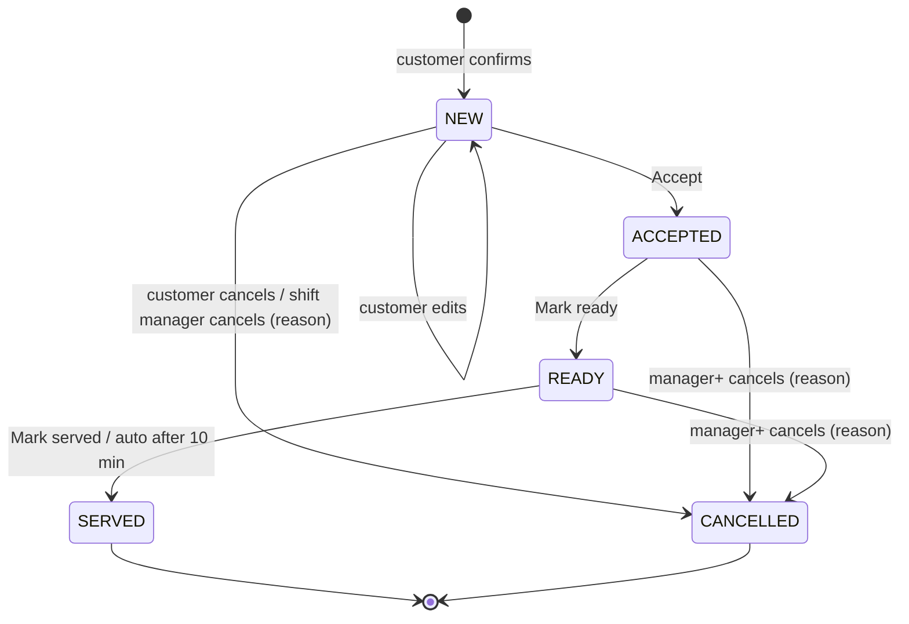

# Backend behaviour

The domain rules for every customer turn and console action. Code layout and module ownership: [architecture](architecture.md#backend-layout).

## Conversation

### Steps and state

`greeting` → `browsing` (name known) → `building_cart` (item added) → `confirming` (summary sent) → `order_placed` (Confirm, order `NEW`) → `post_order` (order `SERVED`).

Back-edges: cart cleared or Cancel → `browsing`; Edit or any change at `confirming` → `building_cart`; ordering more after `order_placed` or from `post_order` → `building_cart` (new order); next visit → `greeting`.

`mode` is an overlay, `bot` or `human`. In `human` the bot is silent and `assigned_to` is set; it never changes `step`.

| `mode` change | Triggers |
|---|---|
| `bot` → `human` | A [handoff](#handoff) (incl. AI failure) · staff Take over, reply or Message a table · a dead-lettered turn **(pending)** ([open decision](plan.md#open-decisions)) |
| `human` → `bot` | Hand back · resolving the conversation's help or allergy request · `idle_handback` |

| `conversations.state` | Meaning |
|---|---|
| `step` | Current step |
| `awaiting` | `null` · `name` · `table` · `rating` · `feedback_text`. The next text answers it, no LLM |
| `cart` | `{items: [{item_id, qty, note}], version}` |
| `order_edit` | `{order_id, order_version, items}` while editing a `NEW` order |
| `clarify_strikes` | 0–2; 2 → handoff `repeated_unclear`; reset by any valid action |
| `allergy_note` | Allergy mentioned this visit; copied to the order |
| `feedback_order_id` | Order a pending rating belongs to |

### Routing order

First match wins.

1. `optout` button or `STOP` → opt out, in any step and mode.
2. `mode = human` → store, show in Chats, re-arm `idle_handback`. No bot reply.
3. QR text (matches `tables.qr_text` after normalising) → join or open the table session → greeting.
4. Interactive reply → handler by reply id.
5. Non-text → "Sorry, I can only read text. Please type your order." + Menu · Call waiter.
6. `awaiting` set → save the answer.
7. Keyword (call waiter, bill) → deterministic handler.
8. Paused or closed → fixed reply. Status, help, bill and STOP still work.
9. Free text → one [LLM call](#ai-agent).

In a batch each interactive reply is its own turn; consecutive free-text messages (1 s debounce) join into one LLM turn. The turn runs under the conversation [lease](architecture.md#message-pipeline): the LLM call and sends happen with no transaction open, and state changes, `processed_at` and the outbound step rows commit in one short transaction that first checks the lease is still held. Keywords match the whole normalised message against a short per-language list, never a substring.

### Deterministic flows

Reply ids are `action[:arg[:arg]]`. Handlers act on the id, never the title, and validate every argument against the DB for this café and conversation. Code renders every reply.

| Flow | Trigger | Reply | Stale or invalid |
|---|---|---|---|
| New customer | First message, no name | "Hi! Welcome to <café>. What should we call you?" → Menu · Recommend · Call waiter | Answer > 3 words or a dish → free text; ask the name after the order |
| Returning | Name known | "Hi <name>! Last time: <items>. Same again?" → Same again · Menu · Call waiter | — |
| Same again | `reorder:{order_id}` | Available items to cart, sold-out named → summary | Not this customer's → menu |
| Menu / category | `menu` · `cat:{slug}[:{page}]` | Categories with ≥ 1 available item / items with name, price, veg mark | Empty → menu |
| Item | `item:{item_id}` | +1 to cart → summary | Sold out → "<dish> is sold out today" + menu |
| Cart summary | Cart changed | [Confirmation](#confirmation) with `confirm:` · `edit:` · `cancel:{cart_version}` | Old version → latest summary; already ordered → "Already placed — order #N" |
| Table | Confirm without a table session | "Which table are you at?" (`table:{table_id}`) | Unknown → ask again |
| Order received | Order created | "Order #N received — about X min" → Edit order · Cancel order · Call waiter | — |
| Edit / cancel order | `edit_order:` · `cancel_order:{order_id}:{version}` · `apply_edit:` · `keep_order:` | [Edits while NEW](#edits-while-new) | Not `NEW` → "The kitchen has already accepted #N, so I can't change it." + Call waiter |
| Status | `status` or intent `order_status` | "Order #N — being made, about 6 min left" | "You have no open orders." |
| Call waiter / bill | `help` / `bill` or keyword | Opens a request → "Someone from our team will be with you shortly." / "Your bill is on its way." | Already open → "Someone is already on the way." |
| Consent | `optout`, `STOP`, `optin:{yes\|no}:{wording_version}` | [Consent](#consent) | Always applied |
| Feedback | `fb:{order_id}:{n}` or leading digit while `awaiting = rating` | [Feedback](#feedback) | "Thanks, we already have your rating." |
| Paused / closed | Ordering action | "We're not taking WhatsApp orders right now — please ask a waiter." / "We're closed now. We open at <time> <day>." | — |

## AI agent

One structured Gemini call (Vertex AI, global endpoint) per free-text turn, only in `bot` mode, at most once per turn (plus one retry). No tools, no loop. The LLM interprets and drafts; code decides. The only other calls are the [cancellation message](#transitions) draft and reading a [staff comment](#customer-profile-and-staff-comments) into profile changes.

### Output

Contract `contracts/llm_output.schema.json`, JSON-schema output mode. Output that doesn't parse is a failed call.

| Field | Values | Code does |
|---|---|---|
| `intent` | `browse` · `ask_question` · `add_items` · `modify_cart` · `confirm` · `cancel` · `order_status` · `human` · `smalltalk` · `unclear` | Picks the handler (below) |
| `cart_ops[]` | `{op: add\|remove\|set_qty\|set_note, item_ref, qty, note}` | Resolves each `item_ref` against the live menu, rejects unknown and sold-out, applies the rest |
| `allergen_question` | `{allergen, item_ref}` or null | Answers from `menu_item_allergens` |
| `needs_human` | `{flag, reason: asked\|frustration\|complaint\|allergen_unknown\|repeated_unclear}` | Handoff with that reason |
| `clarify` | string or null | Sent instead of acting; +1 strike |
| `reply` | string | Checked (no amounts, length) and sent with code-rendered blocks |

`item_ref` is the menu `id` from the prompt; when nothing fits it is the customer's words, so code can tell "sold out" from "not on the menu". `qty` 1–20.

| `intent` | Code does |
|---|---|
| `add_items`, `modify_cart` | Apply `cart_ops` (to `order_edit` if editing a `NEW` order) → summary |
| `confirm` | At `confirming` with an unchanged cart → same as the Confirm tap; else summary |
| `cancel` | Clear cart; with a `NEW` order → send its Cancel order button to tap |
| `order_status` | Status flow |
| `ask_question` | `reply`; allergen questions answered by code |
| `browse`, `smalltalk` | `reply`; named dishes shown as a code-rendered list; smalltalk gets one line + Menu button |
| `unclear` | Send `clarify`, +1 strike |
| `human` or `needs_human.flag` | [Handoff](#handoff) |

An order is created only by `confirm:{cart_version}` or `confirm` on an unchanged cart.

### Prompt

| Part | Contents | Cached |
|---|---|---|
| Prefix: rules | Role; hard rules (never state a price, total, discount or time; never invent dishes); reply in the customer's language (Hinglish first-class); café name; tone; Hinglish few-shots | Yes |
| Prefix: menu | One line per available item `id\|name\|price\|veg\|spice\|tags`; sold-out excluded | Yes |
| Suffix: customer | First name, visit count, recent orders (90 days), favourites, profile diet / likes / dislikes / other preferences — from SQL. Never profile allergies | No |
| Suffix: state | Open / closed / paused / near closing; cart lines; step | No |
| Suffix: history | Last ~6 turns | No |

- Prefix cached in worker memory per `(cafe_id, menu_version)`; one tiny query per turn checks the version, so a sold-out toggle applies on the next message. A settings change drops the cache.
- Stable prefix first so Gemini context caching applies **[verify minimum size]**. Low temperature, capped output tokens.
- Never in the prompt: phone numbers, `wa_id`, other customers, secrets, full history.
- Tone (café setting, wording only): `warm` "Welcome back! The usual?" · `crisp` "Hi. What can I get you?" · `playful` "Back for more? Excellent taste."
- Model is a per-café config value; `platform_admin` changes it without a deploy. Routing options decided in Phase 2 from evals: Flash only · Flash-Lite only · router (Flash-Lite default; Flash for recommendations, allergen questions, multi-item, Hindi script, after a failed clarify).

### Failures

Timeout 6 s. Error, timeout, Vertex 429 or invalid output → one retry on the other model. Second failure → "Sorry, I'm having trouble — a team member will help you." + handoff `system_error`. Every call, including failures, writes `llm_calls` with its cost. Kill switch: [cost](architecture.md#cost).

### Guardrails

- **Items.** Available → applied. Sold out → "<Item> is sold out right now" + up to 3 available items from the same category. Not on the menu → "I couldn't find <words> on our menu" + categories, +1 strike. Any rejected op discards the LLM `reply`; code says what was added and what wasn't. Lists, summaries and orders come only from the DB, so an invented dish can't appear.
- **Prices.** `reply`, `clarify` and every `note` are scanned for amounts (₹, Rs, INR, rupees, /-, number + currency). A hit drops the model text, sends the code-rendered message and flags the turn for AI review.
- **Allergens.** See [allergens](#allergens). The LLM only detects the question; `unknown` always reaches a person.
- **Clarify strikes.** +1 for `unclear`, `clarify`, or every op rejected as not on the menu. Valid action resets to 0. Two → handoff `repeated_unclear`.
- **Injection.** Customer text is data. With no tools, injection can at most change `reply` wording.
- **Off-topic.** One short friendly line and back to the menu. No general knowledge, no other businesses.
- **Free-tier rule.** Until Gemini runs on Vertex AI (Phase 3), prompts contain synthetic data only.

## Cart

`state.cart = {items: [{item_id, qty, note}], version}`. A line is keyed by `(item_id, note)`. No prices are stored; they are read from `menu_items` at every render. `version` + 1 on every change.

| `op` | Rejected when |
|---|---|
| `add` (`item_ref`, `qty` default 1, `note`) | Unknown, other café, or `available = false`; `qty` not 1–20 |
| `remove` | Not in cart |
| `set_qty` (0 removes) | `qty` not 0–20 |
| `set_note` (≤ 120 chars) | Not in cart |

| Value | Rule |
|---|---|
| Line | `price_paise × qty` |
| Total | Sum of lines. Menu prices are final (GST included); shown as "Total (incl. GST)". No GST setting, no separate GST line ([decisions](decisions.md#smaller-decisions)) |
| `expected_minutes` | Max `prep_minutes` of the items |

Notes never change the price. No discounts in the cart; codes are redeemed at the [bill](#bill-sheet). Availability is checked at every op, every summary and again at Confirm.

### Confirmation

Rendered by code: `Your order · Table 7`, one line per item `2 × Cold Brew Tonic ₹480` with its note, "Allergy noted: nuts — the team will check", "Total (incl. GST) ₹ 760", "Ready in about 10 min". Buttons Confirm · Edit · Cancel, each carrying the cart version.

Confirm runs:

1. Version matches and cart not empty; else send the latest summary.
2. Not paused or closed; else the fixed reply.
3. Re-check availability; a newly sold-out item is removed, version + 1, "Sorry, <dish> just sold out" + summary. No order.
4. No table session → ask for the table.
5. One transaction: `orders` (`NEW`, next café `number`, totals, `expected_minutes`, `table_session_id`, `allergy_note`, `source`, `near_closing` flag, `idempotency_key = {conversation_id}:{cart_version}`) + `order_items` (name and price snapshots) + `order_events`; clear cart; step `order_placed`.
6. After commit: schedule `accept_escalation_1`; send "Order #N received — about X min".

A second tap hits the unique key → "Already placed — order #N". `source` is `qr`, or `campaign` (with `campaign_recipient_id`) when the visit started from a campaign button.

### Edits while NEW

- **Edit** (button or free text with an open `NEW` order): ops apply to `order_edit` → "Updated order #N" with Save changes · Keep order.
- **Save:** `transition()` `NEW → NEW` with the customer's expected version; items replaced, totals and `expected_minutes` recomputed, flag `edited`.
- **Cancel:** Cancel order button (typed "cancel" gets the button) → `CANCELLED` (`cancel_reason_code = customer`) → "Order #N cancelled."
- **Race:** staff accepted first → customer gets "already accepted" + Call waiter. Customer first → staff Accept gets 409 `version_conflict` and the card reloads.

## Orders

### Transitions

| From → To | Who | Guard | Customer hears |
|---|---|---|---|
| — → `NEW` | Customer Confirm | Unique `idempotency_key` | "Order #N received — about X min" |
| `NEW` → `NEW` | Customer edit | Version check; flag `edited` | "Updated order #N" |
| `NEW` → `CANCELLED` | Customer | Only `NEW` | "Order #N cancelled." |
| `NEW` → `ACCEPTED` | `shift_manager`+ | 409 if the customer changed it first | "Your order is being made" |
| `NEW` → `CANCELLED` | `shift_manager`+ | Reason required (fixed list + custom text) | AI-written cancellation message (below) |
| `ACCEPTED` / `READY` → `CANCELLED` | `manager`+ | Reason required (fixed list + custom text) | AI-written cancellation message (below) |
| `ACCEPTED` → `READY` | `shift_manager`+ | — | "Your order is ready and on its way" |
| `READY` → `SERVED` | `shift_manager`+, or system after 10 min | — | Nothing; schedules `feedback` |
| Any → previous | Same actor within 5 s | Undo | The queued message is never sent |

Statuses never skip and nothing follows `SERVED`. Staff-transition messages wait 5 s (`status_message`) so Undo can stop them; customer-initiated changes reply at once. Inside the 24-hour window the message is free-form, otherwise the `order_update` template.

**Staff cancel** (`POST /orders/{id}/cancel`):

- Reason: fixed list Out of stock (`out_of_stock`) · Kitchen issue (`kitchen_issue`) · Customer asked (`customer_asked`) · Other (`other`, custom text required). Stored in `cancel_reason_code`, `cancel_reason_text`, `cancelled_by`, `cancelled_at`.
- **Customer message:** written by the AI with the right intent (apologise, say the order is cancelled, offer Call waiter) in the café's tone, under guardrails. Input: the reason code, order number, first name, tone. Code adds the order number line and the Call waiter button, runs the amount scan, and falls back to the fixed "Sorry, order #N has been cancelled." on any LLM failure or guardrail hit. Outside the 24-hour window it goes as `order_update`. **(pending)** further guardrails: no refund or compensation promises, and the custom `reason_text` is never passed to the LLM or the customer ([open decision](plan.md#open-decisions)).
- **Side effects:** one `notifications` row (`order_cancelled`) per active `manager` and `owner`, in the same transaction; in-app only, no WhatsApp message. Plus `order_events` and `audit_log` as for every transition.

### transition()

`transition(order_id, to, actor, expected_version)` is the only way an order changes.

1. Load with `cafe_id`; disallowed move → 422 `invalid_transition`.
2. Update where `id` and `version = expected_version`; 0 rows → 409 `version_conflict`.
3. Same transaction: status timestamp, `version` + 1, one `order_events` row (from, to, actor type and id, reason); staff actions also write `audit_log`.
4. After commit: schedule the next timer (`accept_escalation_1`, `overdue`, `auto_served`, `feedback`) and, for staff actions, `status_message` at +5 s.

Undo = `transition()` back to the previous status with reason `undo`; the undone step's timers no-op.

### Flags

Flags are attributes, not statuses.

| Flag | Set when |
|---|---|
| `escalated` | `accept_escalation_1` fired |
| `overdue` | `overdue` timer fired (still `ACCEPTED` past due) |
| `delayed` | Staff sent a delay |
| `edited` | Customer edited while `NEW` |
| `item_sold_out` | An item of this `NEW` / `ACCEPTED` order was marked sold out (same transaction). Nothing automatic happens: staff message the customer or cancel |
| `near_closing` | Placed within `cutoff_minutes` of closing |

Due = `accepted_at` + `expected_minutes` + `delay_minutes`. `allergy_note` is a separate field shown as the Allergy chip.

- **Delay** (`NEW` or `ACCEPTED`): +2 / +5 / +10 / custom minutes, optional note ≤ 120 chars. Adds to `delay_minutes`, sets `delayed`, clears `overdue`, re-creates the `overdue` timer, sends "Sorry for the wait — your order needs about N more minutes. <note>" at once.
- **Cancel reasons:** Out of stock · Kitchen issue · Customer asked · Other (custom text). See [staff cancel](#transitions). Cancelled orders are excluded from revenue, visits and spend.
- **Manual order** (`shift_manager`+, offline fallback): table, items, optional allergy note; cart pricing rules; `source = manual`; no customer messages. Open: created as `NEW` or `ACCEPTED` ([plan](plan.md#open-decisions)).
- **Print ticket:** browser print, no endpoint. Number, table, time, first name, `qty × name` + note, allergy (this visit's `allergy_note` and profile allergies) boxed at the top in large type, Edited / Near closing marks, expected time. No prices.
- **Table sessions:** QR text "Hi, I'm at Table N" joins the table's open session or opens one. Several customers at one table share the session and one bill. A session closes on "Bill delivered" or after 3 h with no order.

## Human help

### Requests

| `kind` | Opened by | Seen by | Customer hears |
|---|---|---|---|
| `help` | Call waiter, keyword, any handoff | `shift_manager`+ | "Someone from our team will be with you shortly." |
| `allergy` | Allergen state `unknown` | `shift_manager`+ | "Let me get a team member to check that for you." |
| `bill` | Bill button or keyword | `shift_manager`+ | "Your bill is on its way." |
| `low_rating` | 1–2★ feedback | `manager`+ | Apology |

Status `open` → `acknowledged` (`acknowledged_by`) → `resolved`. One open request per conversation and kind. Nothing — guardrail, pause or closed state — can block `help`.

### Handoff

| Trigger | `reason_tag` | Opens |
|---|---|---|
| Call waiter, keyword, intent `human` | `asked` | `help` |
| Two failed clarifications | `repeated_unclear` | `help` |
| Complaint | `complaint` | `help` |
| LLM flags frustration | `frustration` | `help` |
| Allergen state `unknown` | `allergen_unknown` | `allergy` |
| LLM failure after retry | `system_error` | `help` |
| Turn dead-lettered after 3 retries **(pending)** | `system_error` | `help` |

Every handoff sets `mode = human`. A `bill` request never stops the bot.

**Dead-lettered turn.** The customer always gets the standard "Sorry, something went wrong on our side. Tap below to talk to a person." + Call waiter, and `platform_admin` is alerted. Whether it also opens a `help` request for the shift manager and switches to human mode is pending; default yes, per invariant 11 ([open decision](plan.md#open-decisions)).

**Human mode.** Entered by a handoff, Take over, a staff reply, Message a table or (pending) a dead-lettered turn. The bot sends nothing (STOP still works); staff replies go through `outbound`. Exits on Hand back, on resolving the conversation's help or allergy request, or after 15 min with no unanswered customer message (`idle_handback`).

### Escalation

| Level | Target | When | Channel |
|---|---|---|---|
| 0 | Whoever is on the console | Immediately | In-app sound and card |
| 1 | Managers | Order still `NEW` at 60 s; help or allergy open at 2 min | In-app + `new_order_alert` to the café alert number and each manager's `alert_phone` |
| 2 | Owner | Order still `NEW` 2 min after level 1 | In-app + `new_order_alert` to the owner's `alert_phone` |

Each level writes an `escalations` row; orders also get `escalated`. Handlers stop once the item is accepted, acknowledged or resolved.

### Bill sheet

One bill per table session: all its non-cancelled orders, their sum, one offer code ([redemption](#redemption)), discount, "Total (incl. GST)". "Bill delivered" resolves the `bill` request and closes the session. Open: whole table vs per person; counter vs café POS for payment.

## Menu

- **Item fields:** `name` 1–60, unique per café (case-insensitive) · `description` ≤ 200 · `category` (categories are distinct values) · `price_paise` > 0 (console enters rupees) · `prep_minutes` · `veg` · `spice` 0–3 · `available` · `photo_path` (Storage) · `version`.
- Items are never hard-deleted; retired items stay `available = false`.
- **Sold-out toggle** (`shift_manager`+, two taps): one transaction sets `available`, raises `version`, audits, flags open orders `item_sold_out`. The agent stops offering it on the next message; carts lose the line at the next summary.
- **Edit / new** (`manager`+): validates, raises `version`, audits. Changes reach the agent on the customer's next message.
- **Menu version** = highest `menu_items.version` from a per-café counter (only increases). It is the prompt cache key.
- **QR sheet:** `https://wa.me/<display number>?text=<qr_text>`, `qr_text` "Hi, I'm at Table N"; card shows café, table, "Scan to order on WhatsApp" and the fallback "Can't scan? Send 'Hi, I'm at Table N' to <number> on WhatsApp, or ask a waiter."

### Allergens

`menu_item_allergens(item_id, allergen, state)`, `state` `contains` · `free_from` · `unknown` (default, also when no row). Fixed list in `contracts/`: gluten, milk, eggs, peanuts, tree nuts, soy, sesame, fish, shellfish, mustard, sulphites.

| State | Customer gets |
|---|---|
| `contains` | "<Item> contains <allergen>." + available `free_from` alternatives in the same category |
| `free_from` | "<Item> is marked free from <allergen>. Please tell our team about severe allergies." |
| `unknown` | "Let me check with the team." + handoff `allergen_unknown` (`allergy` request, critical) |
| No item named | Available items marked `free_from`; none → handoff |

Allergies mentioned in chat go to `state.allergy_note` and then `orders.allergy_note`. They are never inferred from past orders and never stored as preferences unless stated.

**Profile allergies** (`customer_preferences` kind `allergy`, from a [staff comment](#customer-profile-and-staff-comments)) are for staff: "On profile: <allergen>" in the order card's allergy banner and boxed on the print ticket. They never go to the LLM and never answer an allergen question; only `menu_item_allergens` does.

### CSV import

Owner only; validated in the console and again in the backend. Required `name`, `category`, `price` (rupees), `prep_minutes`, `veg` (yes/no). Optional `description`, `spice`, `contains`, `free_from`, `available`. All or nothing: any invalid row rejects the file with row and column errors. Rows match by name: update matches, insert new, leave missing items alone; unlisted allergens stay `unknown`.

## Customers and feedback

- Key `(cafe_id, wa_id)`. Upserted on every inbound (`first_seen_at`, `last_inbound_at`); `last_visit_at` set on order creation. One conversation per customer.
- Name asked once; only the first name goes to the LLM.
- Returning summary (SQL, never the LLM): first name, visits, last order's items, top 3 items (90 days), stated preferences except allergies. Never phone, spend or ratings.
- `customer_preferences` only when stated by the customer, in chat or to staff (e.g. `diet = vegan`, `milk = oat`). A stored allergy is shown to staff, never used to answer allergen questions.
- Segments: **Lapsed** no order in 30 days · **Regular** 3+ orders in 60 days · **New** exactly 1 visit (checked in that order).

### Customer profile and staff comments

Staff (`shift_manager`+) open a customer's profile from an order card, Chats or Calls and bills ([console](console.md#customer-profile)) and add comments about what the customer told them. The AI turns each comment into profile changes; code validates and applies them.

| Kind | Values | Single or list |
|---|---|---|
| `diet` | `veg` · `vegan` · `jain` · `eggetarian` · `non_veg` | single |
| `milk` · `sugar` · `seating` | short text, e.g. `oat`, `less`, `window` | single |
| `spice` | `0`–`3` | single |
| `allergy` | one of the [allergens](#allergens) where it fits, else as written | list |
| `dislike` · `like` · `other` | short text ≤ 40, e.g. `mushrooms` | list |

Fixed list in `contracts/preference_kinds.json`. `source` is `chat` (stated on WhatsApp) or `staff_note` (with `note_id`).

1. `POST /customers/{id}/notes` stores the comment word for word in `customer_notes` (`ai_status = pending`) and enqueues a `profile_note` task. `api` never calls the LLM.
2. The worker makes one structured call: the comment, the customer's current profile values, the fixed kinds and allergens. Never the phone, `wa_id`, orders or other customers.
3. Output `{ops: [{op: set | add | remove, kind, value}], summary}`. Code drops any op with an unknown kind, a value over 40 chars, or anything about consent, offers, prices or orders. Single kinds are set; list kinds add or remove.
4. One transaction applies the valid ops (allergies included, no confirmation step), stores them on the note (`ai_status = applied`, or `no_changes`), writes `audit_log` `customer.profile_update`. LLM failure after one retry → `failed`, profile unchanged, comment kept.
5. **Undo** (`POST /customer-notes/{id}/undo`) reverses that note's ops, unless a later note changed the same value (409). Staff can also remove one value by hand (`POST /customers/{id}/preferences/remove`). Both audited.
6. A comment never changes marketing consent; only the customer can ([consent](#consent)).

Every call writes `llm_calls`. Comment text is never logged and is removed by [customer data deletion](architecture.md#data-protection).

### Feedback

| Step | Rule |
|---|---|
| Trigger | `feedback` timer after `SERVED`; nothing if already rated or no longer `SERVED` |
| Ask | "How was your order? Rate 1–5." list inside 24 h, else `feedback_request` template; `awaiting = rating` |
| Typed answer | Leading digit 1–5 ("2. Food took 25 minutes" → 2, text kept) |
| 4–5★ / 3★ | "Thank you!" / "Thanks! Anything we could do better?" |
| 1–2★ | "Sorry about that — what went wrong? We've passed this on to the team." + `low_rating` request |
| Text | Next message saved as `feedback.text`; an order typed instead is a normal turn |
| Opt-in | Asked next if never asked, whatever the rating |

## WhatsApp

Meta field names, error codes and limits change; verify against current Meta docs before building.

### Webhook

| Endpoint | Auth |
|---|---|
| `GET /webhooks/whatsapp` | `hub.verify_token` → echo `hub.challenge`, else 403 |
| `POST /webhooks/whatsapp` | `X-Hub-Signature-256` |
| `POST /webhooks/meta/data-deletion` | Meta signed request |

One Meta app per environment, each with its own app secret and verify token.

1. HMAC-SHA256 of the raw bytes, constant-time compare. Mismatch → 401, logged, never processed.
2. Insert `webhook_events` (raw payload, `signature_valid`).
3. Café from `metadata.phone_number_id`; account events by `waba_id`. Unknown → 200, alert, stop.
4. Handle every entry and change (one POST can carry several).
5. 200 within 300 ms.

| Payload | We do |
|---|---|
| `messages` | Upsert customer + conversation; insert `inbound_messages` (unique `wamid`) and upsert `pending_work` in one transaction; set `last_inbound_at`; publish the `wa-inbound` signal; enqueue `wa-ack` |
| `statuses` | Forward-only update of `wa_messages` (+ `pricing_category`, `billable`, `error_code`); mirror to `campaign_recipients` |
| `message_template_status_update` / `_quality_update` | Update `templates`; trigger `template_sync` |
| `phone_number_quality_update` | Update `cafes.health` |
| `account_update` | Update `cafes.health`; restriction → alert; ban or deregistration → `disconnected` |

### Sending

Every outbound goes through `domain/outbound`. Callers pass café, recipient, message and an idempotency key.

| Kind | Allowed when | Otherwise |
|---|---|---|
| Free-form (text, buttons, list) | `now − customers.last_inbound_at < 24 h` | Order status → `order_update`; staff reply → Chats shows window closed; others dropped and logged |
| Utility template | Template `approved` | Alert; caller logs the miss |
| Marketing template | Latest consent `opted_in` and template `approved` | Not sent |

**Outbound step records.** Every outbound step (a turn's reply, its list, a status message) is its own `wa_messages` row with an idempotency key from the subject: `order:{id}:ACCEPTED`, `campaign_recipient:{id}`, `turn:{pending_work_id}:{step}`. The row is written first (`pending`, `wamid` null), unique on the key, so a re-run never resends.

| Outcome of the request | Row becomes | Then |
|---|---|---|
| Accepted by Meta | `sent` + `wamid` | Status webhooks move it forward |
| Not sent: connection failed before the request left, 429, `130429` | stays `pending` | Retry with backoff; still failing → `failed` + alert |
| Timeout or 5xx after the request left | `ambiguous` | Not retried. `send_check` at 60 s: a status webhook carrying the row id (`biz_opaque_callback_data` **[verify]**) → `sent` with its `wamid`; none → `failed` + alert, shown "Not delivered" in Chats so staff can resend by hand |
| `190` | `failed` | Drop cached token, `disconnected`, alert |
| Other 4xx | `failed` + `error_code` | — |

`attempted_at` is set just before the request. After a crash, `pending` rows never attempted are sent by recovery; attempted ones become `ambiguous`. This is what prevents duplicate messages: nothing is resent unless it certainly didn't go.
- Token from Secret Manager via `cafes.token_ref`, cached 10 min.
- `wa-ack` marks the inbound read and shows typing; same client, no `wa_messages` row.
- Dish names and prices in any message come from the DB.

| Error | Meaning | We do |
|---|---|---|
| `131049` | Per-user marketing cap | Recipient `held`; no retry; normal |
| `131050` | User stopped marketing | Opt out now |
| `131047` | Window closed | Template, or drop non-essential |
| `131026` | Undeliverable | `failed`, no retry |
| `131042` | WABA payment problem | Alert; health payment = missing |
| `131048`, `131056` | Spam rate limit | Slow `campaign-send`; alert |
| `130429` | Throughput limit | Backoff |
| `132000`–`132016` | Template problem | Alert; `template_sync` |
| `190` | Token invalid | `disconnected`; Disconnected banner |

**Limits:** text ≤ 4096 chars · interactive body ≤ 1024 · ≤ 3 reply buttons, title ≤ 20 · list ≤ 10 rows, row title ≤ 24, description ≤ 72. Code truncates names and splits long categories; prices go in the row description. We send only text, interactive and templates.

### Templates

| Name | Category | Used for | Needed |
|---|---|---|---|
| `order_update` | utility | Order status when the window is closed | Phase 4 |
| `new_order_alert` | utility | Escalation to alert numbers | Phase 4 |
| `feedback_request` | utility | Rating ask, quick replies 1–5 | Phase 5 |
| `weekly_offer` | marketing | Campaign to all opted-in or regulars; buttons "Order now", "Stop offers" | Phase 5 |
| `winback` | marketing | Campaign to lapsed; same buttons | Phase 5 |

- One set per café WABA; language `en` for the pilot. Marketing footer "Reply STOP to opt out".
- The Restro team drafts and submits them. Owners never create templates; the AI never chooses or sends one.
- Utility wording is transactional only: no offers, discounts or calls to buy (Meta re-categorises to marketing). No variable at the start or end of the body or side by side.
- Status `approved` (send) · `pending` (in review or paused) · `rejected` (or disabled). Synced by webhook, `template_sync` daily 06:00, and the platform "Sync with Meta" button.

### Number health

- **Onboarding** is Hosted only: Restro sets up a dedicated number on the café's own WABA with a system-user token. Token → `cafes.token_ref`, PIN → `cafes.pin_ref`.
- **Signals** in `cafes.health`: access token (valid / invalid), quality (High / Medium / Low), messaging tier (= campaign daily limit), payment method (added / missing), webhook errors in 24 h.
- **Disconnected** (invalid token, restriction, ban): no sends; inbound still stored. Owner banner "WhatsApp is disconnected — customers can't order or get updates. The Restro team has been alerted." `platform_admin` stores a new token under the same reference and re-checks.
- **Go-live checklist** (`cafes.checklist`, café goes `live` only at 10/10): data-ownership agreement · number registered · display name approved · payment method · utility templates approved · marketing templates approved · menu with allergens checked · table QRs printed with fallback notice · staff trained · dry run done.
- **Meta business verification** (GST or incorporation, domain with email) gates display names, tiers and go-live. Start now.

## Retention

### Consent

| When | Condition | `source` |
|---|---|---|
| After `SERVED`, right after the feedback ask | Never asked; any rating | `feedback_flow` |
| Counter QR | Customer taps Yes | `counter_qr` |
| A later visit | Allowed by the re-ask rule | `order_flow` |

- Reply buttons Yes / No with fixed text and a `wording_version`. A used version is never edited.
- The AI never asks for, interprets or records consent.
- `consents` is append-only; the latest row per customer is the state. No row = not opted in. "No" is stored as `opted_out`.
- Opt-out triggers: `STOP` · "Stop offers" button · error `131050`. Immediate, any step, any mode; STOP and the button get "You won't get offers from <café>. Ordering still works."
- Re-ask: never after an opt-out (only the customer opts back in); after "No" not within 30 days by default.
- Owner sees a read-only register and can export it (audited).

### Campaigns

Owner only. Audience = segment ∩ latest consent `opted_in`: `all_opted_in` · `lapsed` (no order in 30 days) · `regulars` (3+ orders in 60 days).

**Wizard:** 1 audience → 2 approved marketing template → 3 offer text, code prefix, valid until → 4 date and time → 5 review (in segment, excluded, will receive, daily limit from the messaging tier, days needed, estimated cost, quality warning if Medium or Low) → Schedule.

**Sender**

- `campaign_start` (every 5 min) snapshots one `campaign_recipients` row per eligible customer with a unique code (`BACK20-7KQ` = prefix + 3 random chars); campaign → `sending`. Later opt-ins are not added.
- One `campaign-send` task per recipient, below the number's throughput. Consent and template re-checked at each send.
- Over the daily limit → `deferred`, never dropped; `campaign_resume` re-queues at 10:00.
- `131049` → `held` ("Held by WhatsApp"), not retried.
- `completed` when nothing is `queued` or `deferred`.

Campaign status: `draft` → `scheduled` → `sending` → `completed`, or `cancelled`. Recipient status: `queued` → `sent` → `delivered` → `read`; `queued` ⇄ `deferred`; `sent` → `held` or `failed`; never backwards.

**Report:** Sent (incl. held) → Held → Delivered → Read → Came back (has a redemption). Results: they spent (linked orders, cancelled excluded), discount given, WhatsApp cost.

### Redemption

The shift manager types the code on the bill sheet.

- Valid when the code exists in this café, `valid_until` hasn't passed and it isn't redeemed. Errors: "This isn't a valid code, or it has expired." · "This code was already used today on #1041."
- One transaction: insert `redemptions`; link the session's latest non-cancelled order (`source = campaign`, `campaign_recipient_id`); audit `offer.redeem`.
- One code per bill, one redemption per code, never across cafés. Attribution is by redemption only.
