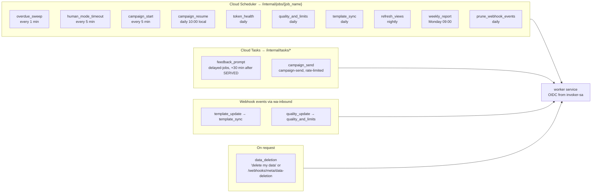

# Background and scheduled jobs

> **Area:** Backend
> **Source:** MVP Architecture v0.1 §6.17 (also §5.2, §8.5, §9) ([source](../_source/mvp-architecture-v0.1.md))
> **Status:** Draft v0.1 · **Owner:** Aman
> **Used by:** [`backend/CLAUDE.md`](../../backend/CLAUDE.md), [`backend/app/api/CLAUDE.md`](../../backend/app/api/CLAUDE.md), [`backend/app/domain/campaigns/CLAUDE.md`](../../backend/app/domain/campaigns/CLAUDE.md), [`infra/CLAUDE.md`](../../infra/CLAUDE.md)

## Summary

All periodic and delayed work runs in the `worker` service, triggered by Cloud Scheduler, Cloud Tasks, webhooks or an explicit request. Each job is an internal endpoint authenticated with OIDC and not reachable from the public internet. Jobs must be safe to run twice.

## Job table (§6.17)

| Job | Trigger | What it does |
|---|---|---|
| `overdue_sweep` | Scheduler, every 1 min | Flags orders past `expected_ready_at`, sends one delay message, re-alerts unacknowledged orders and waiter calls (> 60 s) |
| `human_mode_timeout` | Scheduler, every 5 min | Returns idle human-mode conversations to bot mode |
| `feedback_prompt` | Cloud Task, +30 min after SERVED | Sends the 1–5 rating list if the window is open |
| `campaign_start` | Scheduler, every 5 min | Starts campaigns whose `scheduled_at` has passed |
| `campaign_resume` | Scheduler, daily 10:00 local | Re-queues DEFERRED recipients |
| `campaign_send` | Cloud Task (rate-limited queue) | Sends one template to one recipient |
| `token_health` | Scheduler, daily | Debug-token check per café; alerts and flags "Reconnect" |
| `quality_and_limits` | Scheduler, daily + webhooks | Reads quality rating and messaging tier, stores for the owner and platform screens |
| `template_sync` | Webhook + daily | Keeps template status in sync with Meta |
| `refresh_views` | Scheduler, nightly | Refreshes materialised analytics views |
| `weekly_report` | Scheduler, Monday 09:00 | Generates the owner's weekly summary |
| `data_deletion` | On request / Meta callback | Anonymises a customer |
| `prune_webhook_events` | Scheduler, daily | Deletes raw webhook logs older than 30 days |

## Jobs by trigger

`template_sync` and `quality_and_limits` appear twice on purpose: a daily safety-net run plus an immediate run when Meta sends the matching webhook.

## Endpoints and queues

| Path | Caller |
|---|---|
| `/internal/pubsub/inbound` | Pub/Sub push (`wa-inbound`) |
| `/internal/tasks/campaign-send` · `/feedback-prompt` | Cloud Tasks (`campaign-send`, `delayed-jobs`) |
| `/internal/jobs/{job_name}` | Cloud Scheduler |

The `campaign-send` queue rate is set to the number's throughput; daily messaging limits are handled by `DEFERRED` recipients and `campaign_resume` ([../retention/campaigns.md](../retention/campaigns.md)).

## Authentication

Scheduler and Cloud Tasks call internal worker endpoints authenticated with OIDC; those endpoints are not reachable from the public internet. The worker has internal ingress and requires OIDC tokens from `invoker-sa` (Cloud Run invoker on `worker` only), verified by `app/core/internal_auth.py`. See [../infra/async-messaging.md](../infra/async-messaging.md) and [../infra/iam-and-secrets.md](../infra/iam-and-secrets.md).

## Rules / invariants

- Jobs run only in `worker` and only behind OIDC; never expose them via `api`.
- Jobs are idempotent: a rerun must not double-send (e.g. `orders.overdue` guards the delay message; feedback is asked once per order; campaign recipients are re-checked for opt-in and limit before each send).
- Any customer message sent by a job goes through the outbound service and its 24-hour / consent rules.
- "Local" times (`campaign_resume` 10:00, `weekly_report` Monday 09:00) are in the café's `timezone` **(proposed interpretation)**.

## Open questions

- Whether `data_deletion` runs inline, as a Cloud Task, or via `/internal/jobs/data_deletion` is not specified.
- With several cafés in different timezones, one Scheduler entry per café or one global job that checks local time is not decided.
- Retry and dead-letter settings for Cloud Tasks queues are not specified.

## Related

- [order-lifecycle.md](order-lifecycle.md) · [human-handoff.md](human-handoff.md) · [feedback.md](feedback.md) · [inbound-pipeline.md](inbound-pipeline.md)
- [../infra/async-messaging.md](../infra/async-messaging.md) · [../api/internal.md](../api/internal.md) · [../whatsapp/number-health.md](../whatsapp/number-health.md)
