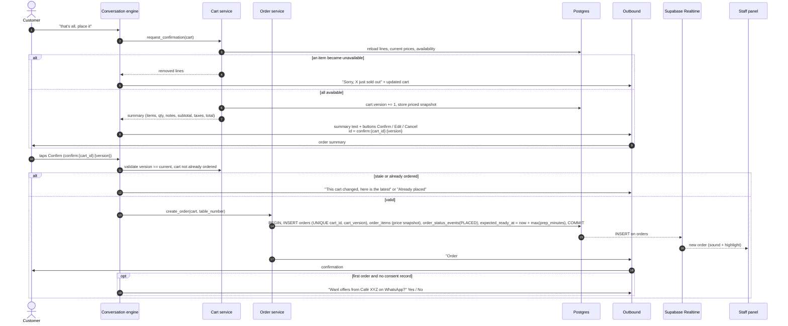
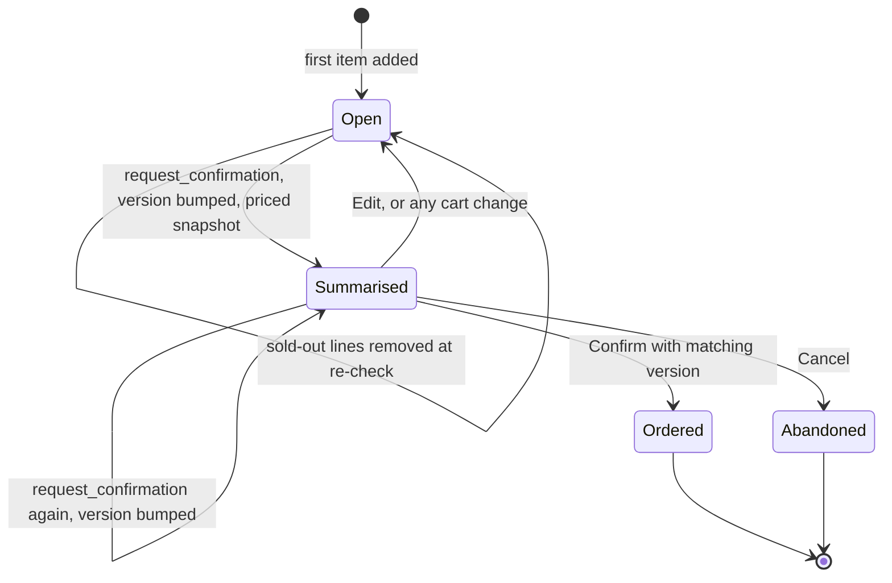

# Cart and order confirmation

> **Area:** Backend
> **Source:** MVP Architecture v0.1 §6.6 (also §5.3, §6.5, §7, §14) ([source](../_source/mvp-architecture-v0.1.md))
> **Status:** Draft v0.1 · **Owner:** Aman
> **Used by:** [`backend/app/domain/cart/CLAUDE.md`](../../backend/app/domain/cart/CLAUDE.md), [`backend/app/domain/orders/CLAUDE.md`](../../backend/app/domain/orders/CLAUDE.md), [`backend/app/domain/conversation/CLAUDE.md`](../../backend/app/domain/conversation/CLAUDE.md)

## Summary

Confirmation is fixed code. This is the step that must never be wrong. The AI can fill the cart through tools, but only the cart service computes totals, and only the deterministic Confirm handler, validated against a cart version, creates an order. A double-tapped or outdated Confirm button can never create a second or wrong order.

## Sequence (§6.6)

Two phases: the summary phase bumps the version and snapshots prices; the Confirm phase only accepts the exact version that was shown.

## Cart versioning

`carts` has `version`, `status` and `priced_snapshot`. Every time a summary is produced, `version` goes up by one and the priced snapshot is stored. The Confirm button embeds that version: `confirm:{cart_id}:{version}`. Any edit after the summary means the next summary has a new version, so the old button is stale.

Look at the `Summarised` state: only a Confirm carrying the current version leaves it towards `Ordered`; everything else either stays or goes back to `Open`.

The state names above (`Open`, `Summarised`, `Ordered`, `Abandoned`) are **(proposed)** values for `carts.status`; the source names the column but not its values.

## What the summary contains

Items, qty, notes, subtotal, taxes, total. Names and prices are rendered by code from the database; the AI never writes them ([../ai-agent/guardrails.md](../ai-agent/guardrails.md)).

## Order creation (single transaction)

| Step | Detail |
|---|---|
| `INSERT orders` | `cart_id`, `cart_version`, `table_label`, `subtotal`, `tax`, `total`, `status = PLACED`, `order_number` from the per-café sequence |
| `INSERT order_items` | `name_snapshot`, `unit_price_snapshot`, `qty`, `note` from the priced snapshot |
| `INSERT order_status_events` | `PLACED`, actor = customer |
| `expected_ready_at` | `now + max(prep_minutes)` over the ordered items |
| Commit | Then Realtime emits the `INSERT` on `orders` to the staff panel (sound + highlight) |
| Customer message | "Order #123 received, about 20 minutes" |
| Consent ask | Only on the first order and only if there is no consent record ([../retention/consent.md](../retention/consent.md)) |

## Idempotency rules

| Guard | Protects against |
|---|---|
| `UNIQUE (cart_id, cart_version)` on `orders` | A double-tapped Confirm, or a Pub/Sub redelivery, creating two orders |
| Version check (`version == current`) | Confirming a cart that changed after the summary was shown |
| "Cart not already ordered" check | Re-confirming a cart that already became an order ("Already placed") |
| Availability re-check at summary | A sold-out item in someone's cart reaching the kitchen |
| `wamid` dedupe in the pipeline | A retried webhook re-running the Confirm handler ([inbound-pipeline.md](inbound-pipeline.md)) |
| One transaction for order + items + status event | A half-created order |

## Tax and totals

Tax is computed only in the cart service. Whether GST is inclusive or exclusive, and whether there is a service charge, is a per-café setting (`/admin/settings` holds tax). The AI's `get_cart()` tool returns code-computed totals; nothing else computes money.

## Rules / invariants

- `request_confirmation()` is the only route from the AI to placing an order.
- Totals, taxes and prices come from the cart service reading the database, never from the AI.
- The Confirm handler accepts only `confirm:{cart_id}:{version}` where `version` is current and the cart is not already ordered.
- `orders` has `UNIQUE (cart_id, cart_version)`.
- Order rows store price and name snapshots; later menu edits never change a placed order.
- Order, order items and the first `order_status_events` row are written in one transaction.
- Unavailable items are removed at the summary re-check and the customer is told ("Sorry, X just sold out").

## Open questions

- GST inclusive or exclusive per café, and service charge: café setting, computed only in the cart service. Tracked in [../delivery/open-decisions.md](../delivery/open-decisions.md).
- `carts.status` values are not defined in the source; the state names above are proposals.
- After an order, "adds more items (new order)" (§6.4): it is not stated whether this reuses the same cart with a new version (allowed by `UNIQUE (cart_id, cart_version)`) or opens a new cart (implied by `CARTS ||--o| ORDERS` in §7).
- Whether the availability re-check also runs at Confirm time (between summary and tap) is not stated; the source re-checks when building the summary.
- "About 20 minutes" is derived from `expected_ready_at`; rounding and wording are not specified.

## Related

- [order-lifecycle.md](order-lifecycle.md) · [conversation-state-machine.md](conversation-state-machine.md) · [menu-management.md](menu-management.md)
- [../ai-agent/tools.md](../ai-agent/tools.md) · [../database/constraints-and-indexes.md](../database/constraints-and-indexes.md)
- [../adr/0001-ai-talks-code-decides.md](../adr/0001-ai-talks-code-decides.md)
