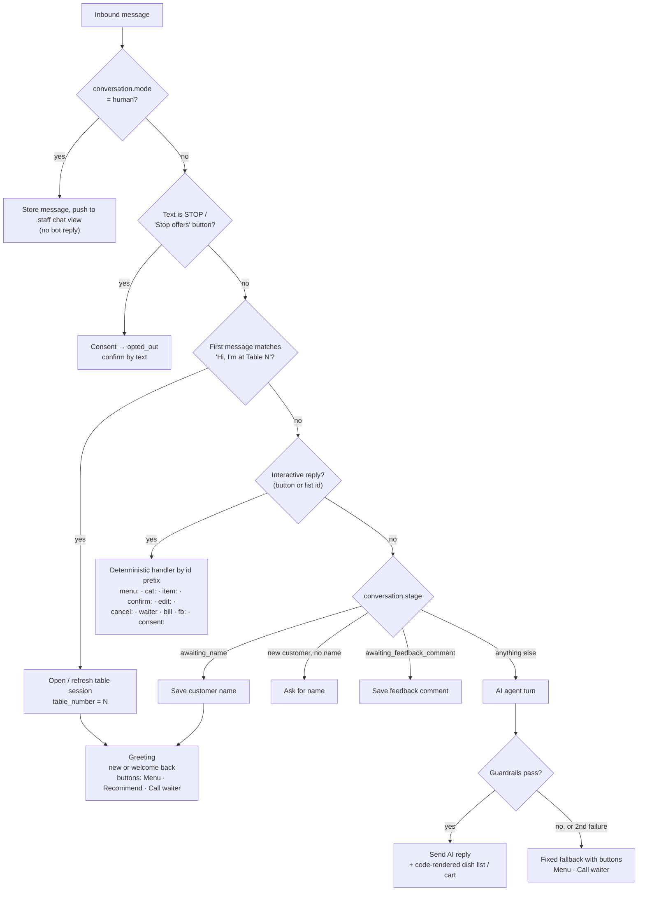

# Conversation router

> **Area:** Backend
> **Source:** MVP Architecture v0.1 §6.3 (also §6.4, §6.6, §6.9, §6.10, §6.11) ([source](../_source/mvp-architecture-v0.1.md))
> **Status:** Draft v0.1 · **Owner:** Aman
> **Used by:** [`backend/app/domain/conversation/CLAUDE.md`](../../backend/app/domain/conversation/CLAUDE.md), [`backend/app/domain/CLAUDE.md`](../../backend/app/domain/CLAUDE.md), [`backend/app/integrations/whatsapp/CLAUDE.md`](../../backend/app/integrations/whatsapp/CLAUDE.md)

## Summary

Most turns never reach the AI. Button and list taps, keywords and fixed steps are handled by code; only free text in an open stage becomes an AI agent turn. The router runs inside the worker, after dedupe and the per-conversation lock ([inbound-pipeline.md](inbound-pipeline.md)).

## Routing flowchart (§6.3)

Read it top-down: the checks are ordered by priority, so human mode beats everything, STOP beats ordering, and the AI is the last resort.

## Check order

| # | Check | Handled by | Reaches AI? |
|---|---|---|---|
| 1 | `conversation.mode = human` | Store and show in staff chat view; bot silent ([human-handoff.md](human-handoff.md)) | No |
| 2 | Text `STOP` or "Stop offers" button | Consent → `opted_out`, confirm by text ([../retention/consent.md](../retention/consent.md)) | No |
| 3 | "Hi, I'm at Table N" (the QR prefilled text) | Open / refresh table session, then greeting ([customers.md](customers.md)) | No |
| 4 | Interactive reply (button or list id) | Deterministic handler by id prefix (table below) | No |
| 5 | Stage `awaiting_name` | Save name, then greeting | No |
| 6 | New customer, no name | Ask for name | No |
| 7 | Stage `awaiting_feedback_comment` | Save comment ([feedback.md](feedback.md)) | No |
| 8 | Anything else | AI agent turn with guardrails ([../ai-agent/guardrails.md](../ai-agent/guardrails.md)) | Yes |

## Interactive ID format

Interactive IDs follow `action:arg1:arg2`, for example `confirm:{cart_id}:{cart_version}` or `item:{menu_item_id}`. Handlers act on the ID, never on the visible title, so old buttons still resolve correctly (and stale ones, like an outdated cart version, are rejected politely).

| Prefix | Args | What it does | Source |
|---|---|---|---|
| `menu:` | none or a page **(proposed)** | Opens menu browsing: sends the category list built from `menu_categories` and available `menu_items` | §6.3, §6.15 |
| `cat:` | `{category_id}` **(proposed)** | Sends the available items of one category as a list message | §6.3 |
| `item:` | `{menu_item_id}` | Shows one dish (code-rendered name and price from the DB) with an add option; re-checks availability | §6.3, §6.5 |
| `confirm:` | `{cart_id}:{cart_version}` | Validates version is current and cart not already ordered, then creates the order ([cart-and-confirmation.md](cart-and-confirmation.md)) | §6.6 |
| `edit:` | `{cart_id}:{cart_version}` **(proposed)** | From the order summary: back to `CartOpen` so the customer can change lines; from an active order (P2): edit before `PREPARING` | §6.4, §6.7 |
| `cancel:` | `{cart_id}:{cart_version}` or `{order_id}` **(proposed)** | From the summary: drop to `Browsing`. On a placed order (P2): cancel while still `PLACED` | §6.4, §6.7 |
| `waiter` | none | Call waiter: `mode = human`, `waiter_requests` row ([human-handoff.md](human-handoff.md)) | §6.9 |
| `bill` | none | Request bill: same path as `waiter` with `reason = BILL` | §6.9 |
| `fb:` | `{order_id}:{n}` | Records rating `n` (1–5) for the order and branches by rating ([feedback.md](feedback.md)) | §6.10 |
| `consent:` | yes / no **(proposed)** | Records an append-only consent row with `wording_version` and `source` ([../retention/consent.md](../retention/consent.md)) | §6.6, §6.11 |

## Rejecting stale IDs

| Situation | Response |
|---|---|
| `confirm:` with an old `cart_version` | "This cart changed, here is the latest" + current summary |
| `confirm:` on a cart already ordered | "Already placed" |
| `item:` for a sold-out or unknown item | Polite "not available right now" + menu button **(proposed wording)** |
| `fb:` for an order that already has feedback | Ignore politely **(proposed)** |
| `edit:` / `cancel:` on an order now `PREPARING` or later | "The kitchen has already started" **(proposed wording)** |

## Rules / invariants

- Handlers act on the interactive **ID**, never on the visible button or row title.
- Every ID carries enough to validate itself against the database (cart version, order id, item id).
- Mode check comes first: in human mode the bot never replies.
- STOP is checked before any ordering logic.
- Free text reaches the AI only after all deterministic checks miss.
- The AI reply is always followed by a code-rendered dish list or cart, never AI-written prices.
- On a guardrail failure (or the second failure after a retry) send the fixed fallback with Menu · Call waiter buttons.

## Open questions

- Exact argument formats for `menu:`, `cat:`, `edit:`, `cancel:` and `consent:` are not given in the source; the ones above are proposals.
- `cancel:` covers two meanings (cancel the pending cart vs cancel a placed order); confirm whether they share a prefix.
- The greeting's **Recommend** button has no prefix in the list; assumed it starts an AI turn with a recommendation intent.
- The "Stop offers" button ID is not specified; it is matched by check 2, before interactive dispatch.
- With human mode checked first, a `STOP` sent while in human mode is only forwarded to staff. Confirm whether STOP should bypass human mode.
- Whether the AI fallback switches `mode` to human (§6.4, §6.9) or only shows a Call waiter button (§6.3) — see [conversation-state-machine.md](conversation-state-machine.md).
- Data deletion ("delete my data") keyword detection is not drawn in the router; see [../retention/data-deletion.md](../retention/data-deletion.md).

## Related

- [conversation-state-machine.md](conversation-state-machine.md) · [inbound-pipeline.md](inbound-pipeline.md) · [cart-and-confirmation.md](cart-and-confirmation.md)
- [../whatsapp/interactive-messages.md](../whatsapp/interactive-messages.md) · [../ai-agent/README.md](../ai-agent/README.md)
