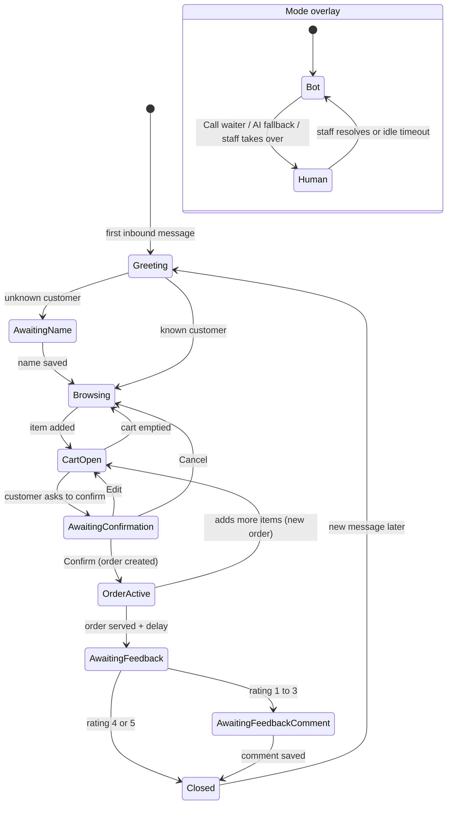
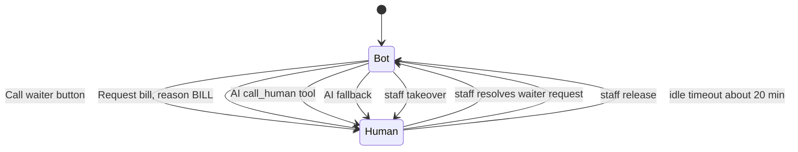

# Conversation state machine

> **Area:** Backend
> **Source:** MVP Architecture v0.1 §6.4 (also §6.3, §6.9, §6.17) ([source](../_source/mvp-architecture-v0.1.md))
> **Status:** Draft v0.1 · **Owner:** Aman
> **Used by:** [`backend/app/domain/conversation/CLAUDE.md`](../../backend/app/domain/conversation/CLAUDE.md), [`backend/app/domain/CLAUDE.md`](../../backend/app/domain/CLAUDE.md)

## Summary

Each conversation has two independent fields: `stage` tracks where the customer is in the ordering loop, and `mode` (bot or human) decides who answers. `mode` is separate and can switch at any stage. Both live in Postgres (`conversations.stage`, `conversations.mode`), not in worker memory, so any worker instance can pick up the next message.

## Stage diagram (§6.4)

Follow the main loop Greeting → Browsing → CartOpen → AwaitingConfirmation → OrderActive; the mode overlay is drawn inside the same diagram but runs independently of the stage.

## Stages

| Stage (diagram) | `conversations.stage` value | Entered when | Leaves when | Who handles input |
|---|---|---|---|---|
| Greeting | `greeting` **(proposed)** | First inbound message, or a new message after `Closed`; QR "Hi, I'm at Table N" | Customer known → Browsing; unknown → AwaitingName | Router (fixed greeting with Menu · Recommend · Call waiter) |
| AwaitingName | `awaiting_name` | Unknown customer | Name saved | Router saves the text as the name |
| Browsing | `browsing` **(proposed)** | Name saved, known customer, cart emptied, or Cancel at confirmation | Item added | Interactive handlers + AI turn |
| CartOpen | `cart_open` **(proposed)** | Item added, Edit at confirmation, or more items after an order | Cart emptied, or customer asks to confirm | Interactive handlers + AI turn (cart tools) |
| AwaitingConfirmation | `awaiting_confirmation` **(proposed)** | `request_confirmation()` produced a summary with Confirm / Edit / Cancel | Confirm, Edit or Cancel tapped | Deterministic `confirm:` / `edit:` / `cancel:` handlers |
| OrderActive | `order_active` **(proposed)** | Order created (`PLACED`) | Order served + feedback delay, or customer adds more items (new order) | AI turn (`get_order_status`), status messages |
| AwaitingFeedback | `awaiting_feedback` **(proposed)** | Feedback list sent after SERVED + delay | Rating tapped | `fb:{order_id}:{n}` handler |
| AwaitingFeedbackComment | `awaiting_feedback_comment` | Rating 1 to 3 | Comment saved | Router saves the text as the comment |
| Closed | `closed` **(proposed)** | Rating 4 or 5, or comment saved | Any new message later | — |

Only `awaiting_name` and `awaiting_feedback_comment` appear as literal values in the source (§6.3); the other snake_case values are proposed names for the diagram states.

## Mode (bot / human)

Every trigger into `Human` comes from the customer, the AI or staff; the way back is always a staff action or the idle timeout.

| Trigger | Direction | Mechanism |
|---|---|---|
| Customer taps Call waiter | Bot → Human | `waiter` handler; `INSERT waiter_requests` (PENDING) |
| Customer taps Request bill | Bot → Human | `bill` handler; same path with `reason = BILL` |
| AI calls `call_human(reason)` | Bot → Human | Tool, always allowed |
| AI fallback | Bot → Human | §6.4, §6.9 (see open questions) |
| Staff takes over | Bot → Human | `POST /staff/conversations/{id}/takeover` |
| Staff resolves the request | Human → Bot | `POST /staff/waiter-requests/{id}/resolve` sets `RESOLVED`, `conversation.mode = bot` |
| Staff releases | Human → Bot | `POST /staff/conversations/{id}/release` |
| Idle timeout (e.g. 20 min) | Human → Bot | `human_mode_timeout` job, Scheduler every 5 min |

While `mode = human`, inbound messages are stored and shown in the staff chat view, and the bot stays silent. The `stage` does not change because of a mode switch.

## Rules / invariants

- `stage` and `mode` are persisted on `conversations`; never keep them only in memory.
- `stage` changes happen under the per-conversation advisory lock taken in the inbound pipeline.
- `mode` can switch at any stage and does not reset the stage.
- In `human` mode the bot never replies to the customer.
- Order creation only happens on the `AwaitingConfirmation → OrderActive` edge via the deterministic Confirm handler.
- `last_activity_at` on `conversations` is the clock used for the human-mode idle timeout **(proposed)**.

## Open questions

- Snake_case values for most stages are proposals (see table).
- §6.3 shows the AI fallback as a fixed message with a Call waiter button, while §6.4 and §6.9 list "AI fallback" as a trigger to human mode. Decide whether every fallback switches mode or only after the customer taps Call waiter.
- If the feedback prompt is skipped (24-h window closed), the path from OrderActive to Closed is not drawn.
- "New message later" from Closed: how much later, and whether a still-active order keeps the stage at OrderActive, is not specified.
- The idle timeout is "e.g. 20 min"; final value and whether it is per café are open.

## Related

- [conversation-router.md](conversation-router.md) · [human-handoff.md](human-handoff.md) · [cart-and-confirmation.md](cart-and-confirmation.md) · [feedback.md](feedback.md)
- [../database/schema-by-domain.md](../database/schema-by-domain.md) · [../adr/0003-per-customer-ordering-and-locks.md](../adr/0003-per-customer-ordering-and-locks.md)
