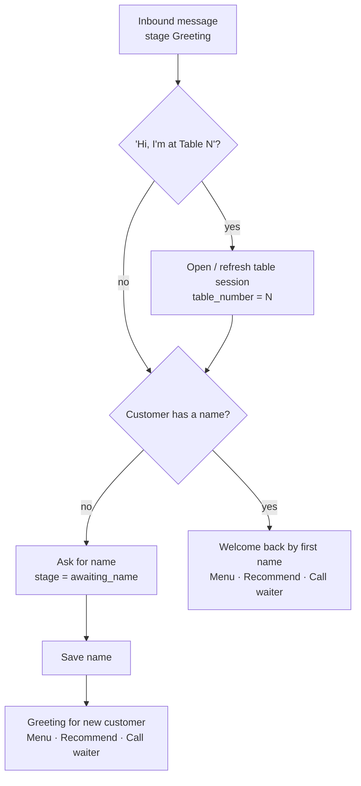
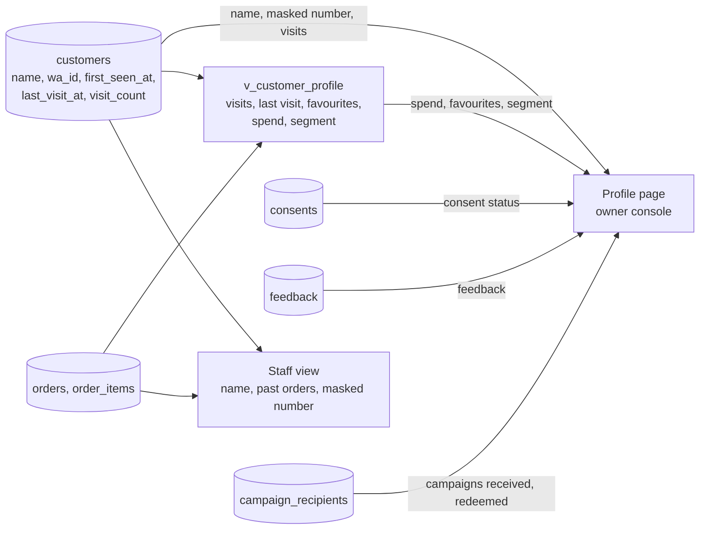

# Customers

> **Area:** Backend
> **Source:** MVP Architecture v0.1 §6.16 (also §2, §3.3, §5.4, §6.2, §6.3, §6.4, §6.5, §7, §8) ([source](../_source/mvp-architecture-v0.1.md))
> **Status:** Draft v0.1 · **Owner:** Aman
> **Used by:** [`backend/app/domain/CLAUDE.md`](../../backend/app/domain/CLAUDE.md), [`backend/app/domain/conversation/CLAUDE.md`](../../backend/app/domain/conversation/CLAUDE.md)

## Summary

Customers never log in: their identity is their WhatsApp number (`wa_id`), scoped to a café. Every café owns its own customer list, so the same person ordering at two cafés is two customer rows. The customers module handles greeting (new vs welcome back), name capture, visit history, the "same again" reorder and the profile the owner sees as customer intelligence.

## Identity

| Fact | Detail |
|---|---|
| Key | `UNIQUE (cafe_id, wa_id)` on `customers` |
| Created | Upserted by the worker on every new inbound message, with `last_inbound_at = now()` ([inbound-pipeline.md](inbound-pipeline.md)) |
| Not an Auth user | Customers are rows in `customers`, not Supabase Auth users, so they never count toward Auth MAU |
| Fields | `name`, `language_hint`, `first_seen_at`, `last_inbound_at`, `last_visit_at`, `visit_count`, `anonymised_at` |
| Tenant | `cafe_id` comes from `phone_number_id`, never from text |

`last_inbound_at` drives the 24-hour window guard ([../whatsapp/outbound-sender.md](../whatsapp/outbound-sender.md)). `anonymised_at` is set by the data-deletion job ([../retention/data-deletion.md](../retention/data-deletion.md)).

## Greeting decision

The only branch is whether the café already knows the customer's name; both paths end in the same three buttons.

"Welcome back" is a P1 retention feature. A reorder button on the welcome-back greeting is **(proposed)**.

## Name capture

When the stage is `awaiting_name`, the router saves the next text as `customers.name` and continues to the greeting. The AI later sees only the **first name** ([../ai-agent/prompt-context.md](../ai-agent/prompt-context.md)).

## Visits

`visit_count` and `last_visit_at` feed the AI context (visit count), segments (lapsed, regular) and the profile.

## Reorder "same again" (P2)

Listed as an addition in the feature map and P2 in priority. The source gives no mechanism; the proposed design is: take the customer's last order's items, add the still-available ones to a new cart through the cart service, then run the normal deterministic confirmation **(proposed)**. Unavailable items are dropped and mentioned, exactly as at the confirmation re-check.

## Customer profile and intelligence (§6.16)

**Customer intelligence in the MVP** means a searchable customer list and a profile page: name, masked number, first and last visit, visit count, total spend, favourite dishes, consent status, feedback, campaigns received and redeemed, and a segment label (new, regular, lapsed). That is what the owner needs to believe the "you now own your customer list" pitch.

The `v_customer_profile` view (refreshed nightly) does the heavy aggregation; the other facts are read directly.

| Surface | Endpoint | Role | Shows |
|---|---|---|---|
| Staff panel | `GET /staff/customers/{id}` | `staff`+ | Name, past orders, notes, masked number |
| Owner console | `GET /admin/customers` · `/admin/customers/{id}` | `owner` | Searchable list and full profile |

Segments in the MVP: new, regular (≥ K orders in 60 days), lapsed (no order in N days).

## Rules / invariants

- Customer identity is `(cafe_id, wa_id)`; never share customer rows across cafés.
- Phone numbers are masked in the staff panel and never sent to the AI.
- Only `owner` sees customer intelligence and exports; `staff` sees name and past orders.
- Every customer query is filtered by `cafe_id`.

## Open questions

- What counts as a "visit" (each order, each table session, or each day with an order), and where `visit_count` / `last_visit_at` are updated, is not specified.
- "Notes" in `GET /staff/customers/{id}` has no column in the data model.
- `language_hint` exists on `customers` but how it is set and used is not described.
- Reorder "same again" mechanism and button ID are proposals (P2).
- N and K for segments are not fixed.

## Related

- [conversation-router.md](conversation-router.md) · [conversation-state-machine.md](conversation-state-machine.md) · [cart-and-confirmation.md](cart-and-confirmation.md)
- [../database/analytics-views.md](../database/analytics-views.md) · [../frontend/owner-console.md](../frontend/owner-console.md) · [../retention/campaigns.md](../retention/campaigns.md)
- [../security/data-protection.md](../security/data-protection.md)
