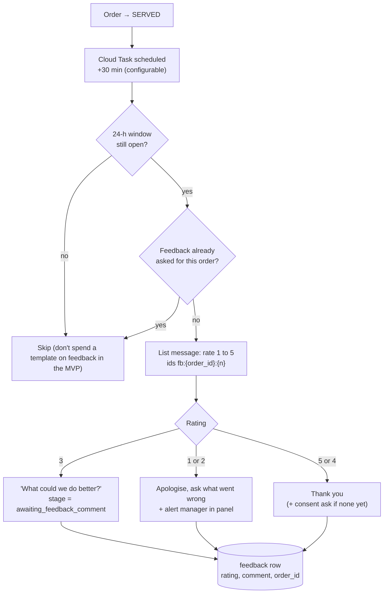

# Feedback

> **Area:** Backend
> **Source:** MVP Architecture v0.1 §6.10 (also §6.4, §6.11, §6.17, §14) ([source](../_source/mvp-architecture-v0.1.md))
> **Status:** Draft v0.1 · **Owner:** Aman
> **Used by:** [`backend/app/domain/CLAUDE.md`](../../backend/app/domain/CLAUDE.md), [`backend/app/domain/conversation/CLAUDE.md`](../../backend/app/domain/conversation/CLAUDE.md), [`backend/app/domain/outbound/CLAUDE.md`](../../backend/app/domain/outbound/CLAUDE.md)

## Summary

After an order is served, a delayed Cloud Task asks the customer to rate it 1 to 5 with a list message. The prompt is only sent inside the 24-hour window and only once per order. High ratings get a thank-you (and a consent ask if none yet); low ratings ask what went wrong and alert the manager. Feedback is P1 in the retention set.

## Flow (§6.10)

Two gates before asking (window and duplicate), then three branches by rating that all end in one `feedback` row.

## Details

| Item | Value |
|---|---|
| Trigger | `READY → SERVED` schedules the `feedback_prompt` Cloud Task |
| Delay | 30 min after SERVED, configurable per café (feedback delay in `/admin/settings`) |
| Endpoint | `/internal/tasks/feedback-prompt` on the worker (OIDC) |
| Message | List message, rows 1 to 5, row IDs `fb:{order_id}:{n}` |
| Stage | Conversation goes to `AwaitingFeedback`; ratings 1 to 3 move to `awaiting_feedback_comment` (§6.4) |
| Storage | `feedback (order_id, rating, comment, created_at)`; at most one per order (`ORDERS ||--o| FEEDBACK`) |
| Reporting | `v_feedback_summary` (avg rating, low-rating comments); low ratings also surface in `/platform/conversations` review |

## Rating branches

| Rating | Reply | Then |
|---|---|---|
| 5 or 4 | Thank you | Consent ask if no consent record yet (consent `source = feedback_flow`); stage → `Closed` |
| 3 | "What could we do better?" | `stage = awaiting_feedback_comment`; next text saved as comment; → `Closed` |
| 1 or 2 | Apologise, ask what went wrong | Alert manager in panel; comment captured as for 3; → `Closed` |

## Rules / invariants

- Never send a template for feedback in the MVP: if the 24-hour window is closed, skip.
- Ask at most once per order.
- The handler acts on `fb:{order_id}:{n}` (the ID), not the row title.
- Consent asks follow the consent rules (no re-ask within 30 days after a "No") ([../retention/consent.md](../retention/consent.md)).

## Open questions

- §6.10 sets `stage = awaiting_feedback_comment` only for rating 3; §6.4 says ratings 1 to 3 go to the comment stage. Assumed 1 and 2 also capture a comment.
- How "alert manager in panel" is delivered is not specified (`feedback` is not in the RLS realtime table list in §7).
- Whether a stale or repeated `fb:` tap updates or is ignored is not specified.

## Related

- [order-lifecycle.md](order-lifecycle.md) · [conversation-state-machine.md](conversation-state-machine.md) · [background-jobs.md](background-jobs.md)
- [../retention/consent.md](../retention/consent.md) · [../database/analytics-views.md](../database/analytics-views.md) · [../whatsapp/interactive-messages.md](../whatsapp/interactive-messages.md)
