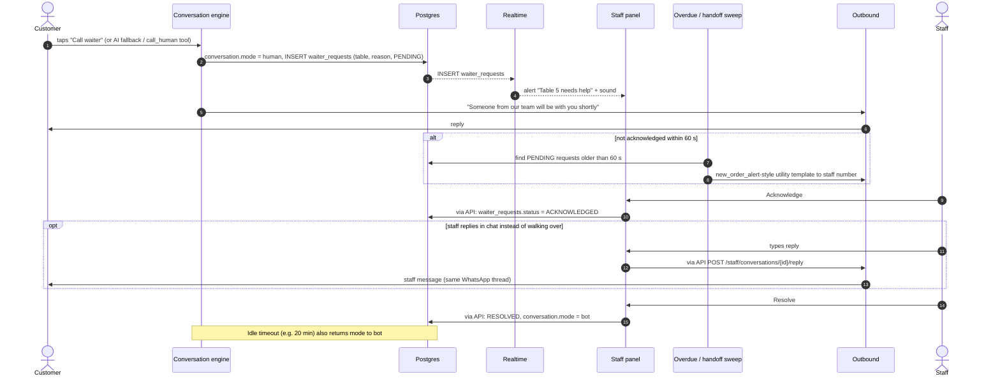
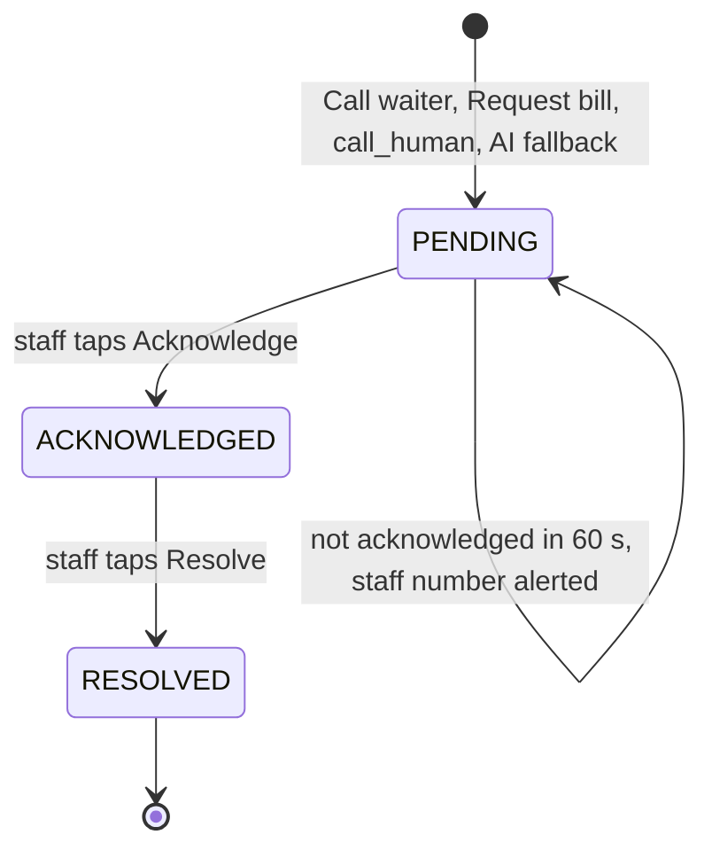

# Human help: call waiter and human mode

> **Area:** Backend
> **Source:** MVP Architecture v0.1 §6.9 (also §5.3, §6.17, §8.2, §11) ([source](../_source/mvp-architecture-v0.1.md))
> **Status:** Draft v0.1 · **Owner:** Aman
> **Used by:** [`backend/app/domain/conversation/CLAUDE.md`](../../backend/app/domain/conversation/CLAUDE.md), [`backend/app/domain/outbound/CLAUDE.md`](../../backend/app/domain/outbound/CLAUDE.md), [`backend/app/api/CLAUDE.md`](../../backend/app/api/CLAUDE.md), [`frontend/src/features/CLAUDE.md`](../../frontend/src/features/CLAUDE.md)

## Summary

A human is always one tap away. "Call waiter", the AI's `call_human` tool and AI fallbacks switch the conversation to human mode and raise a `waiter_requests` row that alerts the staff panel in realtime. If nobody acknowledges within 60 s, a WhatsApp utility template goes to the staff number. "Request bill" reuses the same path with `reason = BILL`.

## Sequence (§6.9)

Note the "via API" on every panel write: the SPA never writes to the database directly; it only receives the realtime alert.

While `mode = human`, inbound messages are stored and shown in the staff chat view, and the bot stays silent. The **"Request bill"** button reuses the same path with `reason = BILL`, so it costs almost nothing extra to build.

## Waiter request states

The self-loop on `PENDING` is the escalation: the request stays pending, but the sweep sends the backup alert.

| Field | Meaning |
|---|---|
| `table_label` | From the conversation's table session |
| `reason` | Why help was requested; `BILL` for Request bill, otherwise a call-waiter or AI reason **(proposed values)** |
| `status` | `PENDING` → `ACKNOWLEDGED` → `RESOLVED` |
| `acknowledged_by` | Staff user who acknowledged |
| `created_at`, `resolved_at` | Timing for alerts and reporting |

## Staff endpoints

| Endpoint | Purpose |
|---|---|
| `GET /staff/waiter-requests?status=open` | Waiter / bill queue |
| `POST /staff/waiter-requests/{id}/ack` · `/resolve` | Acknowledge or resolve (resolve returns `mode` to bot) |
| `GET /staff/conversations/{id}/messages` | Chat view in human mode |
| `POST /staff/conversations/{id}/reply` | Reply to the customer as staff, in the same WhatsApp thread |
| `POST /staff/conversations/{id}/takeover` · `/release` | Switch human / bot mode manually |

## Timers

| Timer | Value | Mechanism |
|---|---|---|
| Escalation | 60 s unacknowledged | `overdue_sweep` (Scheduler, every 1 min) sends a `new_order_alert`-style utility template to the staff WhatsApp number |
| Metric alert | Waiter requests unacknowledged > 60 s → any | Monitoring ([../observability/logging-and-metrics.md](../observability/logging-and-metrics.md)) |
| Idle timeout | e.g. 20 min | `human_mode_timeout` (Scheduler, every 5 min) returns idle human-mode conversations to bot |

## Rules / invariants

- Calling a human is always allowed; `call_human(reason)` has no guardrail that can block it.
- In human mode the bot never replies; messages are stored and shown in the staff chat view.
- Staff replies go through the outbound service, so the 24-hour window guard and message logging still apply.
- All panel actions (ack, resolve, reply, takeover, release) go through FastAPI and are role- and café-checked.
- Realtime subscriptions on `waiter_requests` and `messages` are read-only under RLS.
- Request bill is not a separate feature: same path, `reason = BILL`. Payment links are out of scope for the MVP.

## Open questions

- Reason values other than `BILL` are not enumerated.
- Whether every AI fallback creates a waiter request, or only when the customer taps Call waiter, is inconsistent between §6.3 and §6.9.
- Which staff WhatsApp number receives the escalation (per café setting) and which template is used ("`new_order_alert`-style") is not fixed. See [../whatsapp/templates.md](../whatsapp/templates.md).
- Whether the escalation repeats if still pending after the first alert is not stated.
- Idle timeout value (e.g. 20 min) is not final.

## Related

- [conversation-state-machine.md](conversation-state-machine.md) · [conversation-router.md](conversation-router.md) · [background-jobs.md](background-jobs.md)
- [../frontend/staff-panel.md](../frontend/staff-panel.md) · [../frontend/realtime-and-alerts.md](../frontend/realtime-and-alerts.md) · [../api/staff.md](../api/staff.md)
