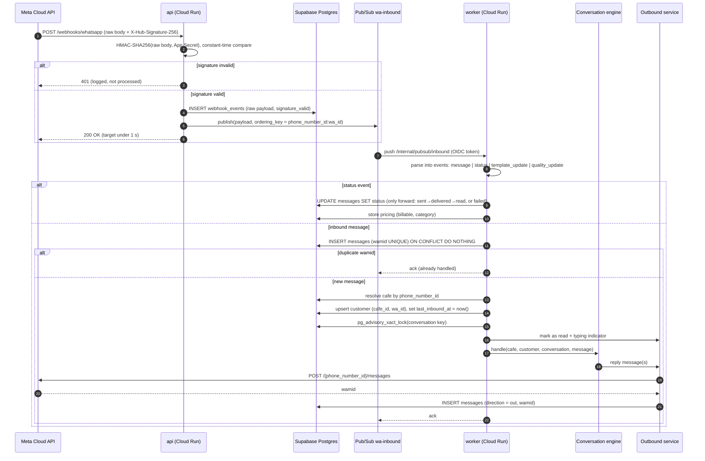
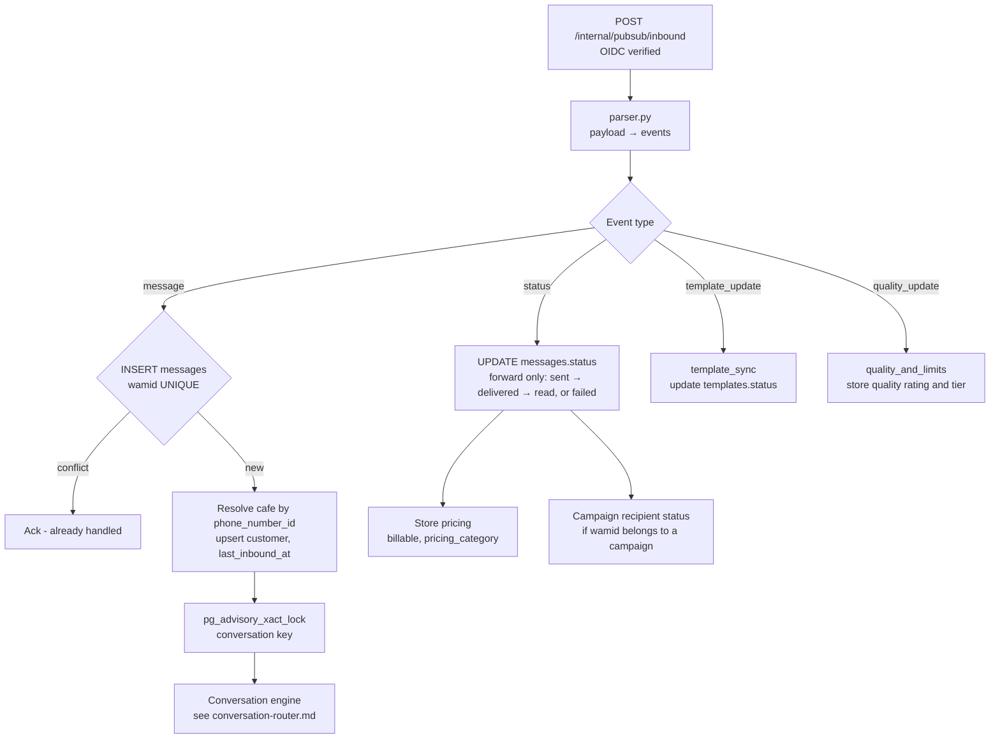
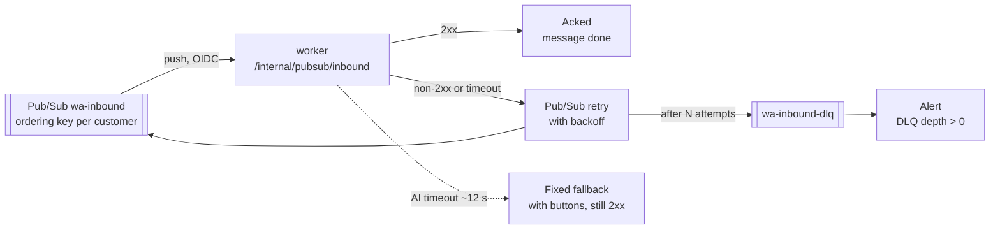
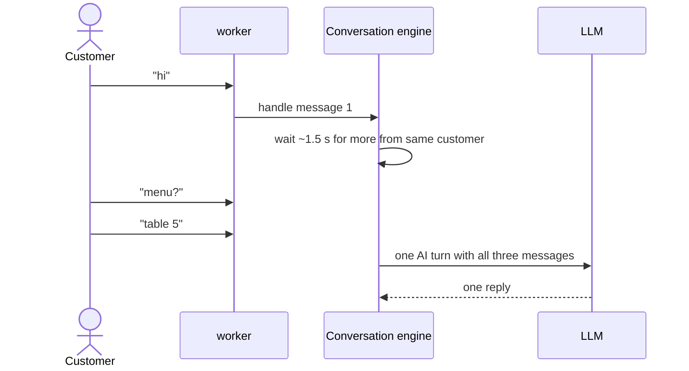

# Inbound message pipeline

> **Area:** Backend
> **Source:** MVP Architecture v0.1 §6.2 (also §5.3, §6.17, §11) ([source](../_source/mvp-architecture-v0.1.md))
> **Status:** Draft v0.1 · **Owner:** Aman
> **Used by:** [`backend/CLAUDE.md`](../../backend/CLAUDE.md), [`backend/app/api/CLAUDE.md`](../../backend/app/api/CLAUDE.md), [`backend/app/domain/conversation/CLAUDE.md`](../../backend/app/domain/conversation/CLAUDE.md), [`backend/app/integrations/whatsapp/CLAUDE.md`](../../backend/app/integrations/whatsapp/CLAUDE.md)

## Summary

This is the path from Meta's webhook to a reply on the customer's phone. The `api` service only verifies, stores, publishes and acknowledges; all real work happens in the `worker`, one message at a time per customer. Duplicates and retries from Meta and Pub/Sub are expected, so every step is idempotent.

## Sequence (§6.2)

Look at the split at step 6: `api` returns `200` before any business logic, and the worker dedupes on `wamid` before taking the per-conversation lock.

## Event-type dispatch

`integrations/whatsapp/parser.py` turns one webhook payload into typed events. Each type has its own handler.

Message events are the only ones that reach the conversation engine; status, template and quality events are bookkeeping that feed messages, campaigns ([../retention/campaigns.md](../retention/campaigns.md)), templates ([../whatsapp/templates.md](../whatsapp/templates.md)) and number health ([../whatsapp/number-health.md](../whatsapp/number-health.md)).

## Failure handling

If the worker returns non-2xx, Pub/Sub retries with backoff; after N attempts the event goes to `wa-inbound-dlq` and an alert fires. Because of the `wamid` uniqueness check, a retry after a partial success won't double-reply. Long AI calls are bounded by a timeout (e.g. 12 s); on timeout the customer gets a fixed fallback message with buttons.

A retry re-runs the handler from the top; the `wamid` insert makes the second run a no-op for an already-handled message. An AI timeout is not a pipeline failure: the worker sends the fallback and acks.

| Failure | What happens | Signal |
|---|---|---|
| Bad signature | `401`, logged, not processed, not published | Logs |
| Worker error / crash | Pub/Sub redelivers with backoff | Error Reporting |
| N failed deliveries | Event moved to `wa-inbound-dlq` | Alert: DLQ depth > 0 |
| Duplicate `wamid` (Meta retry or Pub/Sub redelivery) | `ON CONFLICT DO NOTHING`, ack | — |
| Out-of-order status | Status only moves forward (`sent → delivered → read`, or `failed`) | — |
| AI call too slow | Fixed fallback message with buttons | AI fallback rate > 15% / hour |
| Slow end-to-end | — | Webhook → reply p95 > 8 s for 5 min |

## Burst coalescing (optional, P2)

People often send "hi", "menu?" and "table 5" as three messages within two seconds. The engine can wait ~1.5 s for further messages from the same customer before calling the AI, and pass them in as one turn.

The point is one AI call and one reply for a burst, instead of three racing replies.

## Rules / invariants

- Verify `X-Hub-Signature-256` on the **raw** body with constant-time compare, before JSON parsing.
- Return `200` fast (target under 1 s); keep `min-instances=1` on `api` in production.
- Publish with ordering key `{phone_number_id}:{wa_id}` and take `pg_advisory_xact_lock` per conversation in the worker ([../adr/0003-per-customer-ordering-and-locks.md](../adr/0003-per-customer-ordering-and-locks.md)).
- `messages.wamid` is the primary key; insert-or-ignore before any side effect.
- Message status is monotonic: never move backwards.
- `cafe_id` is resolved from `phone_number_id`, never from message text.
- Set `last_inbound_at = now()` on every inbound message; the 24-hour window guard depends on it.
- Every outbound reply is stored as a `messages` row with `direction = out` and its `wamid`.
- `webhook_events` raw logs are pruned after 30 days (`prune_webhook_events`).

## Open questions

- N (max delivery attempts before DLQ) and the backoff settings are not fixed. See [../infra/async-messaging.md](../infra/async-messaging.md).
- What happens if the `webhook_events` insert succeeds but the publish fails is not specified (the source returns `200` only after both).
- Ordering key for status, template and quality events (which may not carry a customer `wa_id`) is not specified.
- How burst coalescing coexists with the ordering key and advisory lock (wait inside the lock, or re-check after) is not designed. P2.
- The AI timeout is given as "e.g. 12 s"; the final value is not fixed.

## Related

- [conversation-router.md](conversation-router.md) · [module-structure.md](module-structure.md) · [background-jobs.md](background-jobs.md)
- [../whatsapp/webhooks.md](../whatsapp/webhooks.md) · [../whatsapp/outbound-sender.md](../whatsapp/outbound-sender.md)
- [../adr/0002-ack-fast-process-async.md](../adr/0002-ack-fast-process-async.md) · [../observability/logging-and-metrics.md](../observability/logging-and-metrics.md)
