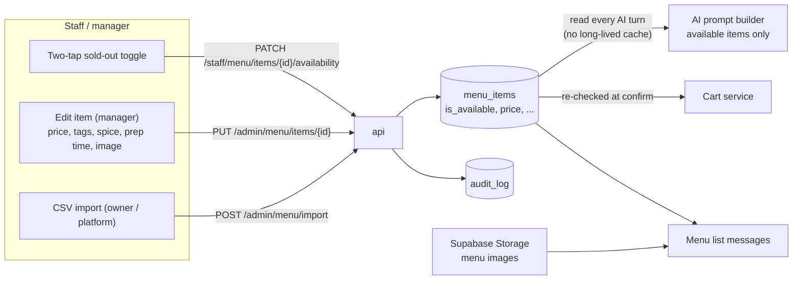
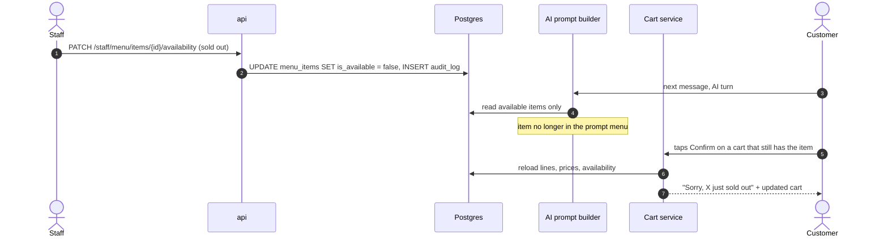

# Menu management and sold-out propagation

> **Area:** Backend
> **Source:** MVP Architecture v0.1 §6.15 (also §5.3, §6.5, §6.6, §7, §8.2, §8.3, §14) ([source](../_source/mvp-architecture-v0.1.md))
> **Status:** Draft v0.1 · **Owner:** Aman
> **Used by:** [`backend/app/domain/CLAUDE.md`](../../backend/app/domain/CLAUDE.md), [`backend/app/domain/ai_agent/CLAUDE.md`](../../backend/app/domain/ai_agent/CLAUDE.md), [`backend/app/domain/cart/CLAUDE.md`](../../backend/app/domain/cart/CLAUDE.md), [`frontend/src/features/CLAUDE.md`](../../frontend/src/features/CLAUDE.md)

## Summary

The menu database is the only source of truth. Staff flip items sold out with a two-tap toggle, managers edit items, and owners or the platform import menus from CSV, all through the API with an audit row. Because the AI reads the available menu on every turn and the cart re-checks at confirmation, a sold-out flip takes effect on the very next message.

## Flow (§6.15)

Every write enters through `api` and lands in `menu_items` plus `audit_log`; the three readers on the right always read the current row.

## Who can do what

| Action | Endpoint | Role |
|---|---|---|
| Sold-out toggle | `PATCH /staff/menu/items/{id}/availability` | `staff`+ |
| Category and item CRUD | `/admin/menu/categories`, `/admin/menu/items` (e.g. `PUT /admin/menu/items/{id}`) | `manager`+ |
| CSV import | `POST /admin/menu/import` | `owner` / `platform_admin` |

Item fields (`menu_items`): `name`, `description`, `price`, `is_veg`, `spice_level`, `tags`, `allergens`, `protein_g`, `calories`, `prep_minutes`, `image_path`, `is_available`, `category_id`. `prep_minutes` drives `expected_ready_at` on orders.

## Sold-out propagation

Two independent catches: the AI cannot suggest the item after the flip, and a cart that already holds it is corrected at the confirmation re-check (§6.6).

Sold-out takes effect on the next AI turn because the available menu is read per turn (a cache, if added, must be invalidated on every toggle). `add_to_cart` also re-checks availability. An optional "back in stock at …" auto-reset can come later.

## CSV import

Menu data + import is part of build step 1 (ordering core). The import goes through `POST /admin/menu/import` by the owner or the platform admin, and is audited like any other menu write.

## Images

Menu images (and the menu PDF fallback) live in Supabase Storage; `menu_items.image_path` references them, and menu list messages use them.

## Rules / invariants

- The AI only ever sees `is_available = true` items.
- No long-lived menu cache. If a cache is ever added, every toggle and edit must invalidate it.
- Dish names and prices shown to customers are rendered by code from `menu_items`, never by the AI.
- All menu writes go through FastAPI and write `audit_log` (sold-out flips are explicitly audited, §10).
- Placed orders keep their name and price snapshots; menu edits never change them.
- Every menu query is filtered by `cafe_id`.

## Open questions

- CSV column format and behaviour on re-import (replace vs merge) are not specified.
- The container view (§5.2) shows the SPA writing images straight to Storage, while §5.3 says every write goes through FastAPI. Decide whether image upload is direct (with Storage policies) or via the API.
- "Back in stock at …" auto-reset is deferred.
- Full menu in the prompt until it exceeds a token budget; switch to `search_menu` + pgvector after that ([../adr/0005-full-menu-in-prompt.md](../adr/0005-full-menu-in-prompt.md)).

## Related

- [cart-and-confirmation.md](cart-and-confirmation.md) · [../ai-agent/prompt-context.md](../ai-agent/prompt-context.md) · [../ai-agent/tools.md](../ai-agent/tools.md)
- [../api/staff.md](../api/staff.md) · [../api/admin.md](../api/admin.md) · [../frontend/staff-panel.md](../frontend/staff-panel.md)
