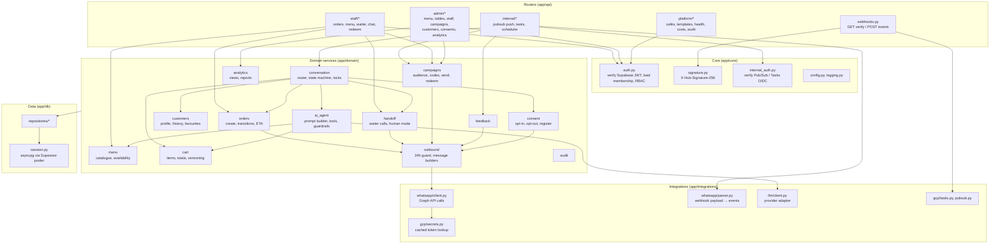
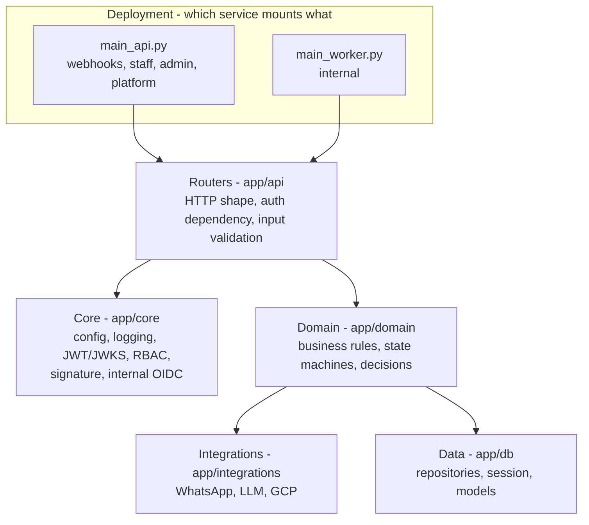

# Backend module structure

> **Area:** Backend
> **Source:** MVP Architecture v0.1 §6.1, §12 ([source](../_source/mvp-architecture-v0.1.md))
> **Status:** Draft v0.1 · **Owner:** Aman
> **Used by:** [`backend/CLAUDE.md`](../../backend/CLAUDE.md), [`backend/app/api/CLAUDE.md`](../../backend/app/api/CLAUDE.md), [`backend/app/core/CLAUDE.md`](../../backend/app/core/CLAUDE.md), [`backend/app/domain/CLAUDE.md`](../../backend/app/domain/CLAUDE.md), [`backend/app/integrations/whatsapp/CLAUDE.md`](../../backend/app/integrations/whatsapp/CLAUDE.md), [`backend/app/db/CLAUDE.md`](../../backend/app/db/CLAUDE.md)

## Summary

One FastAPI codebase, deployed twice: `api` mounts the public routers, `worker` mounts the internal ones. Code is split into routers (`app/api`), cross-cutting core (`app/core`), domain services (`app/domain`), integrations with external systems (`app/integrations`) and data access (`app/db`). Domain services don't know which service they run in, which is what lets the same code serve both deployments.

## Entry points

| File | Service | Mounts |
|---|---|---|
| `backend/app/main_api.py` | Cloud Run `api` (public ingress) | `webhooks`, `staff`, `admin`, `platform` routers |
| `backend/app/main_worker.py` | Cloud Run `worker` (internal ingress + OIDC only) | `internal` routers (Pub/Sub push, Cloud Tasks, Cloud Scheduler) |

See [../adr/0007-one-codebase-two-services.md](../adr/0007-one-codebase-two-services.md) for why it is one image with two entry points.

## Module diagram (§6.1)

Look at the arrows: routers only reach into core and domain; every outbound message funnels through `outbound` into `whatsapp/client.py`; all domain services reach the database only through `repositories/*`.

## Layering

Dependencies only point downwards. The domain layer has no idea whether the caller is `main_api.py` or `main_worker.py`; it receives `cafe`, `customer`, `conversation` and inputs, and returns results.

## Module table

The "must not depend on" column restates the §6.1 arrows and the §5.3 principles as explicit rules.

| Module | Responsibility | Depends on | Must not depend on |
|---|---|---|---|
| `app/core` | `config.py`, `logging.py`; `auth.py` (verify Supabase JWT via JWKS, load `staff_memberships`, RBAC); `signature.py` (`X-Hub-Signature-256`); `internal_auth.py` (verify Pub/Sub / Tasks OIDC) | db (membership lookup) | api, domain |
| `app/api/webhooks.py` | `GET /webhooks/whatsapp` verify, `POST /webhooks/whatsapp` events, `POST /webhooks/meta/data-deletion`; verify signature, store raw event, publish, return `200` | core `signature.py`, `integrations/gcp` (Pub/Sub), db (`webhook_events`) | domain `conversation`, `ai_agent` (no processing on the request path) |
| `app/api/staff/*` | Orders, waiter queue, chat, menu availability, redeem | core `auth.py`, domain `orders`, `menu`, `handoff`, `campaigns` | integrations directly (send via `outbound`), db directly |
| `app/api/admin/*` | Menu, tables, staff, campaigns, customers, consents, analytics, settings, reports | core `auth.py`, domain `analytics`, `campaigns`, `menu`, `customers`, `consent` | integrations directly, db directly |
| `app/api/platform/*` | Cafés, templates, health, costs, audit | core `auth.py` (`platform_admin`), domain | db directly |
| `app/api/internal/*` | Pub/Sub push, Cloud Tasks, Cloud Scheduler jobs | core `internal_auth.py`, `whatsapp/parser.py`, domain `conversation`, `campaigns`, `feedback` and job owners | core `auth.py` (no user JWT here) |
| `app/domain/conversation` | Router, stages, locks, greeting | `ai_agent`, `cart`, `orders`, `handoff`, `consent`, `customers`, db | `api`, knowledge of service |
| `app/domain/ai_agent` | Prompt builder, tools, guardrails, structured output | `menu`, `cart`, `integrations/llm` | `orders` create, `consent`, `outbound` templates (AI cannot do these) |
| `app/domain/menu` | Catalogue, availability | db | `ai_agent` |
| `app/domain/cart` | Items, totals, versioning, tax | `menu`, db | `ai_agent`, `integrations/llm` |
| `app/domain/orders` | Create, transitions, ETA | `outbound`, `audit`, db | `ai_agent` |
| `app/domain/customers` | Profile, history, favourites | db | — |
| `app/domain/handoff` | Waiter calls, human mode | `outbound`, db | `ai_agent` |
| `app/domain/consent` | Opt-in, opt-out, register | `outbound`, db | `ai_agent` |
| `app/domain/campaigns` | Audience, codes, send, redeem | `outbound`, `consent`, `integrations/gcp` (tasks), db | `ai_agent` |
| `app/domain/feedback` | Rating prompt and storage | `outbound`, db | `ai_agent` |
| `app/domain/analytics` | Views, reports | db | write paths |
| `app/domain/outbound` | 24h guard, message builders, the single send path | `integrations/whatsapp`, db | anything above it |
| `app/domain/audit` | `audit_log` writes | db | — |
| `app/integrations/whatsapp` | `client.py` Graph API calls, `parser.py` webhook payload → events, message builders, error codes | `gcp/secrets.py` | domain |
| `app/integrations/llm` | `client.py` provider adapter | Secret Manager key | domain |
| `app/integrations/gcp` | `pubsub.py`, `tasks.py`, `secrets.py` (cached token lookup) | GCP APIs | domain |
| `app/db` | `session.py` (asyncpg via Supavisor pooler), `repositories/*`, models | Postgres | domain, api |

## Rules / invariants

- Domain services never import from `app/api` and never check which service they are in.
- Only `app/domain/outbound` calls `integrations/whatsapp/client.py` to send to customers.
- Only `app/db/repositories/*` issues SQL; every repository method takes `cafe_id` as a required argument.
- Tenant (`cafe_id`) comes from `phone_number_id` (inbound) or the membership behind the JWT (panels), never from request bodies or message text ([../adr/0006-tenant-from-infrastructure.md](../adr/0006-tenant-from-infrastructure.md)).
- `api` publishes and returns; real inbound processing runs only in `worker`.

## Open questions

- §6.1 shows `webhooks.py → gcp/tasks.py, pubsub.py` but no arrow to `repositories/*`, yet §6.2 has `api` inserting `webhook_events`. Assumed the webhook router writes via a repository.
- `app/db` models are kept in sync with Supabase migrations "by hand or by generation" (§7); the method is not chosen. See [../database/migrations.md](../database/migrations.md).

## Related

- [inbound-pipeline.md](inbound-pipeline.md) · [background-jobs.md](background-jobs.md) · [../api/README.md](../api/README.md)
- [../architecture/container-view.md](../architecture/container-view.md) · [../infra/deployment.md](../infra/deployment.md)
- [../adr/0004-all-writes-through-fastapi.md](../adr/0004-all-writes-through-fastapi.md) · [../adr/0007-one-codebase-two-services.md](../adr/0007-one-codebase-two-services.md)
