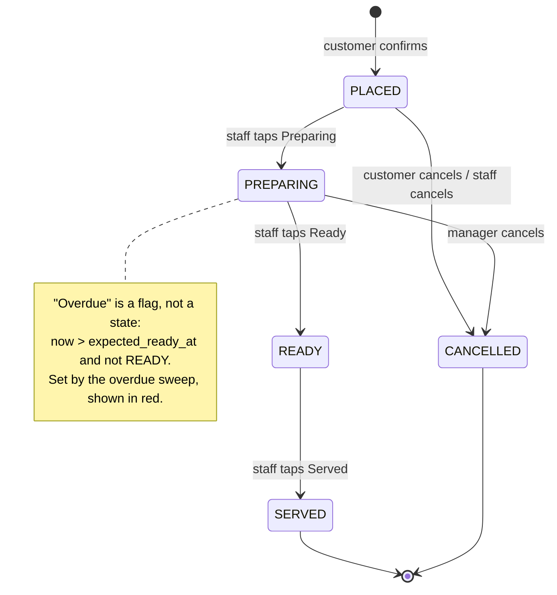
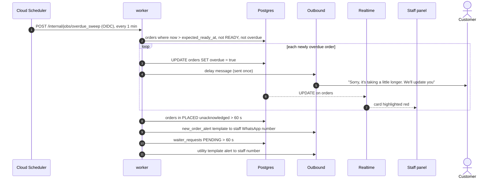

# Order lifecycle

> **Area:** Backend
> **Source:** MVP Architecture v0.1 §6.7 (also §4, §6.8, §6.17, §8.2, §14) ([source](../_source/mvp-architecture-v0.1.md))
> **Status:** Draft v0.1 · **Owner:** Aman
> **Used by:** [`backend/app/domain/orders/CLAUDE.md`](../../backend/app/domain/orders/CLAUDE.md), [`backend/app/api/CLAUDE.md`](../../backend/app/api/CLAUDE.md), [`frontend/src/features/CLAUDE.md`](../../frontend/src/features/CLAUDE.md)

## Summary

An order moves `PLACED → PREPARING → READY → SERVED`, or to `CANCELLED` before the kitchen is far along. Every transition is validated by the order service, writes an `order_status_events` row, and (inside the 24-hour window) sends the customer a status message. "Overdue" is a flag set by a sweep, not a state.

## State diagram (§6.7)

The only paths into `CANCELLED` are from `PLACED` (customer or staff) and from `PREPARING` (manager only).

## Transitions (§6.7)

| Transition | Who | Customer message (inside 24-h window) | Side effects |
|---|---|---|---|
| → PLACED | Customer | "Order #123 received, about 20 min" | Staff alert; consent ask on first order |
| PLACED → PREPARING | Staff | "The kitchen has started on your order" | Customer edits/cancels now blocked |
| → READY | Staff | "Your order is ready and on its way" | — |
| Overdue flag set | Sweep | "Sorry, it's taking a little longer. We'll update you" (sent once) | Order highlighted red |
| READY → SERVED | Staff | — | Feedback task scheduled (+30 min) |
| → CANCELLED | Customer / manager | "Your order has been cancelled" + reason | Audit row; excluded from analytics revenue |

Every transition writes `order_status_events (order_id, from, to, actor, at)` (columns `from_status`, `to_status`, `actor`, `at`). That table gives prep times, delays and the "who changed what" trail without extra work; `v_prep_times` (placed → ready, overdue %) is built on it.

## Who may cancel or edit, and when

| Order status | Customer (WhatsApp) | `staff` | `manager` / `owner` |
|---|---|---|---|
| `PLACED` | Edit or cancel (P2) | Cancel (per state diagram) | Cancel |
| `PREPARING` | Blocked | Blocked | Cancel, with reason (`POST /staff/orders/{id}/cancel`) |
| `READY`, `SERVED` | Blocked | Blocked | Not in the state diagram |
| `CANCELLED` | — | — | — |

Order edits are allowed until `PREPARING` (§14 default). After `PREPARING`, customer edit/cancel buttons are rejected politely.

## How a status change happens

Staff tap a button in the panel, which calls `PATCH /staff/orders/{id}/status` with the target status. The api verifies JWT, role and `order.cafe_id == membership.cafe_id`, checks the transition is allowed, updates `orders`, inserts `order_status_events` and `audit_log`, and sends the status message through the outbound service. Realtime then pushes the `UPDATE` to other devices. See [../frontend/staff-panel.md](../frontend/staff-panel.md) and [../api/staff.md](../api/staff.md).

## Overdue sweep

The `overdue` boolean is the once-only guard: an order already flagged is skipped, so the delay message is sent once.

## Rules / invariants

- Allowed transitions are exactly those in the state diagram; the order service rejects anything else.
- Every transition writes one `order_status_events` row and one `audit_log` row (staff actions).
- Status changes go through FastAPI, never directly from the SPA ([../adr/0004-all-writes-through-fastapi.md](../adr/0004-all-writes-through-fastapi.md)).
- "Overdue" is the `orders.overdue` flag, never a status; the delay message is sent at most once per order.
- Customer edits and cancels are blocked from `PREPARING` onwards.
- `CANCELLED` orders are excluded from analytics revenue.
- `SERVED` schedules the `feedback_prompt` Cloud Task ([feedback.md](feedback.md)).
- Status messages respect the 24-hour window; outside it the outbound service rejects free-form messages and the caller decides (e.g. the `order_update` template) ([../whatsapp/outbound-sender.md](../whatsapp/outbound-sender.md)).

## Open questions

- Staff cancel: the state diagram allows "staff cancels" in `PLACED`, but §4 gives cancel only to `manager`+ and §8.2 marks `POST /staff/orders/{id}/cancel` as `manager`+. Decide whether plain `staff` may cancel in `PLACED`.
- What "acknowledged" means for an order (moving to `PREPARING`, or a separate acknowledge action) is not defined. The sweep re-alerts after 60 s and the metric alerts after 2 min.
- The overdue rule says "not READY"; it presumably also excludes `SERVED` and `CANCELLED`.
- How the customer cancels a `PLACED` order in chat (button ID, confirmation step) is not designed; P2.

## Related

- [cart-and-confirmation.md](cart-and-confirmation.md) · [background-jobs.md](background-jobs.md) · [human-handoff.md](human-handoff.md)
- [../frontend/realtime-and-alerts.md](../frontend/realtime-and-alerts.md) · [../database/analytics-views.md](../database/analytics-views.md)
- [../whatsapp/templates.md](../whatsapp/templates.md)
