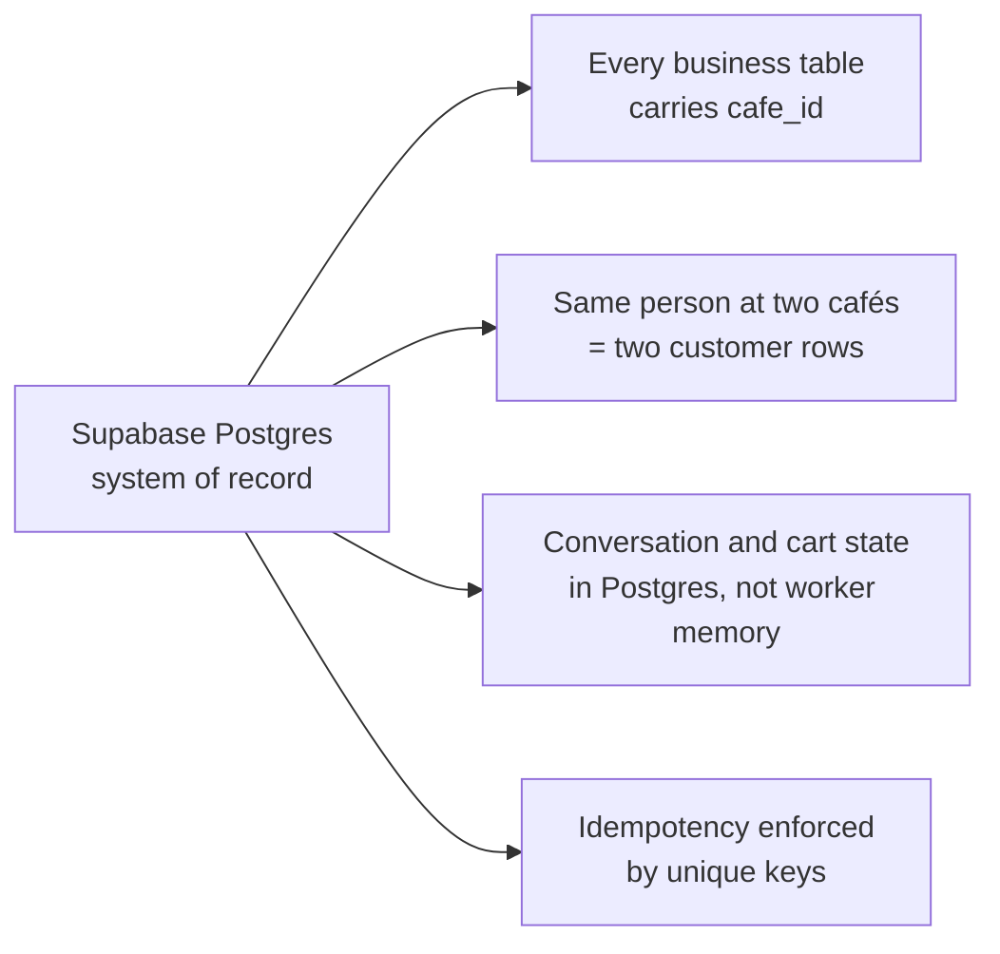

# Database

> **Area:** Database
> **Source:** MVP Architecture v0.1 §7, §6.4, §6.14, §6.16 ([source](../_source/mvp-architecture-v0.1.md))
> **Status:** Draft v0.1 · **Owner:** Aman
> **Used by:** [`/CLAUDE.md`](../../CLAUDE.md), [`supabase/CLAUDE.md`](../../supabase/CLAUDE.md), [`backend/app/db/CLAUDE.md`](../../backend/app/db/CLAUDE.md)

## Summary

Supabase Postgres is the system of record for the whole MVP: cafés, customers, conversations, carts, orders, consent, campaigns and costs all live here. The backend reaches it through the Supavisor pooler with a server-side role; the SPA only reads a handful of tables through Realtime under Row Level Security. This folder describes the schema, the constraints that make the system idempotent, the RLS posture, how migrations are managed and the analytics views built on top.

## Documents in this folder

| Doc | What it covers |
|---|---|
| [data-model.md](data-model.md) | The full ER diagram (verbatim from §7) and a catalogue of every table: purpose, owning module, writers, readers |
| [schema-by-domain.md](schema-by-domain.md) | The ER split into five domain diagrams, enumerated values for status-like columns, snapshot columns |
| [constraints-and-indexes.md](constraints-and-indexes.md) | Unique keys and indexes with the reason for each, idempotency, per-café order numbers, advisory locks |
| [row-level-security.md](row-level-security.md) | RLS on every table, the four frontend `SELECT` policies, backend access through the pooler |
| [migrations.md](migrations.md) | Supabase CLI migrations as source of truth, proposed migration ordering, promotion workflow |
| [analytics-views.md](analytics-views.md) | The seven `v_*` views, their sources, metrics and consumer screens |

## Principles

The four principles below all follow from "Postgres is the only place state lives".

1. **Supabase Postgres is the system of record.** Prices, availability, totals, order state and consent are read from the database by code on every decision. Nothing authoritative lives in the LLM, in a cache or in the frontend (§2, §5.3).
2. **Every business table carries `cafe_id`.** Tenant scoping is a column on the row (or reachable through a parent row that has one), so every repository query can filter on it and every RLS policy can test it (§7).
3. **The same person ordering at two cafés is two customer rows.** Each café owns its own customer list; `customers` is unique on `(cafe_id, wa_id)`, not on `wa_id` alone (§7).
4. **State lives in Postgres, not in worker memory.** `conversations.stage`, `conversations.mode` and the cart are rows, so any worker instance can pick up the next message for any customer (§6.4).
5. **Idempotent everything.** Unique `wamid`, unique order per cart version and monotonic message status mean Meta retries and double taps become no-ops (§5.3). See [constraints-and-indexes.md](constraints-and-indexes.md).

## Rules / invariants

- Never add a business table without `cafe_id` (or a documented parent row that carries it).
- Never key a customer on `wa_id` alone.
- Never hold conversation or cart state in process memory between messages.
- Every schema change goes through `supabase/migrations/` (see [migrations.md](migrations.md)).
- RLS is enabled on every table; the `authenticated` role has no write policies (see [row-level-security.md](row-level-security.md)).

## Open questions

- Supabase tier: free for dev, paid for the pilot café ([../delivery/open-decisions.md](../delivery/open-decisions.md)).

## Related

- [../architecture/design-principles.md](../architecture/design-principles.md)
- [../backend/module-structure.md](../backend/module-structure.md)
- [../security/auth-and-tenant-isolation.md](../security/auth-and-tenant-isolation.md)
- [../adr/0006-tenant-from-infrastructure.md](../adr/0006-tenant-from-infrastructure.md)
- Context files: [`supabase/CLAUDE.md`](../../supabase/CLAUDE.md), [`backend/app/db/CLAUDE.md`](../../backend/app/db/CLAUDE.md)
