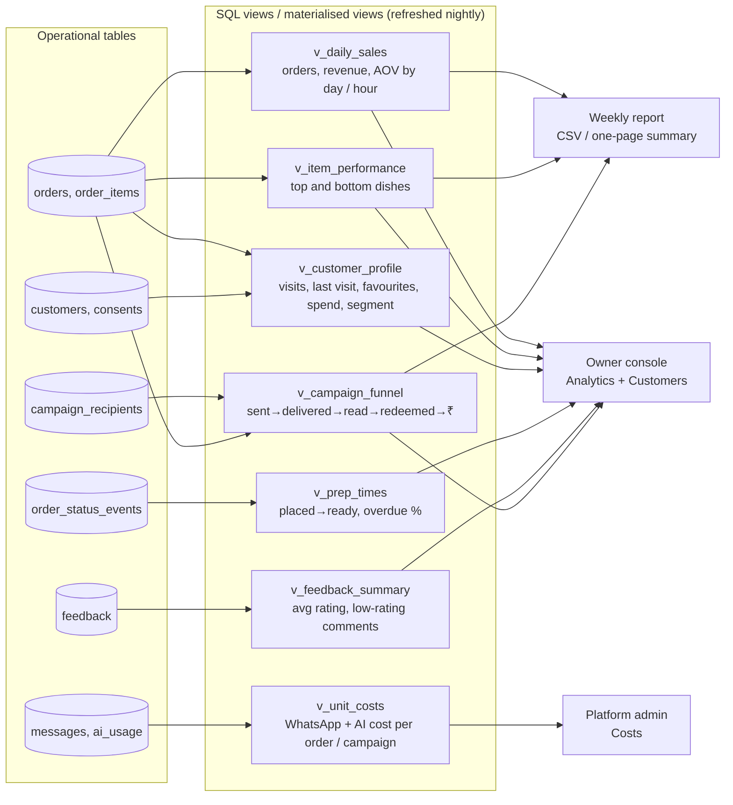

# Analytics views

> **Area:** Database
> **Source:** MVP Architecture v0.1 §6.16, §6.17, §6.7, §6.12, §11 ([source](../_source/mvp-architecture-v0.1.md))
> **Status:** Draft v0.1 · **Owner:** Aman
> **Used by:** [`supabase/CLAUDE.md`](../../supabase/CLAUDE.md), [`backend/app/db/CLAUDE.md`](../../backend/app/db/CLAUDE.md)

## Summary

There is no separate analytics stack in the MVP. Postgres views over the operational tables, served by the API, are enough for one or two cafés. Seven `v_*` views, refreshed nightly by the `refresh_views` job, feed the owner console, the platform cost screen and the weekly report.

## View map (§6.16)

Six views serve the owner console, one serves the platform cost screen, and three also feed the weekly report.

## Views

| View | Source tables | Metrics | Consumer |
|---|---|---|---|
| `v_daily_sales` | `orders`, `order_items` | Order count, revenue, average order value (AOV), by day and by hour | Owner console Analytics (`/admin/analytics/sales`), weekly report |
| `v_item_performance` | `orders`, `order_items` | Top and bottom dishes (quantity and revenue from `order_items` snapshots) | Owner console Analytics (`/admin/analytics/items`), weekly report |
| `v_customer_profile` | `orders`, `order_items`, `customers`, `consents` | Visits, first and last visit, favourite dishes, total spend, consent status, segment label | Owner console Customers (`/admin/customers`, `/admin/customers/{id}`, `/admin/analytics/customers`) |
| `v_prep_times` | `order_status_events` | Placed → ready duration, overdue % | Owner console Analytics (`/admin/analytics/prep`) |
| `v_feedback_summary` | `feedback` | Average rating, low-rating comments | Owner console Analytics (`/admin/analytics/feedback`) |
| `v_campaign_funnel` | `campaign_recipients`, `orders` | Sent → delivered → read → redeemed → revenue (₹) per campaign | Owner console campaign report (`/admin/campaigns/{id}/report`), weekly report |
| `v_unit_costs` | `messages`, `ai_usage` | WhatsApp + AI cost per order and per campaign | Platform admin Costs (`/platform/costs`) |

### Calculation rules

- **Cancelled orders are excluded from revenue** in every view (§6.7). They can still be counted separately (for example a cancellation count).
- **Revenue uses order totals and line snapshots** (`orders.total`, `order_items.unit_price_snapshot`), never current menu prices.
- **Segment label** on `v_customer_profile` is one of `new`, `regular`, `lapsed` (§6.16). The campaign segments define the thresholds: lapsed = no order in N days, regular = ≥ K orders in 60 days (§6.12). N and K are café-level settings **(proposed)**; "new" is a customer who is neither **(proposed)**.
- **Prep time** is the time between the PLACED and READY events in `order_status_events`; overdue % uses `orders.overdue`.
- **AI cost per order** is the sum of `ai_usage.cost_usd` over the conversation that produced the order; **WhatsApp cost** comes from the `pricing` data stored on `messages` (`pricing_category`, `billable`) (§11).
- **Campaign ROI** in the report: cost per redeemed visit and revenue ÷ cost (§11).
- Every view exposes `cafe_id` so the API can filter by the caller's membership. Day and hour buckets use the café's `timezone` **(proposed)**.
- Anonymised customers stay in sales views as anonymous rows (orders are kept on deletion, §6.11), but drop out of profile listings **(proposed)**.

## Refresh

| Item | Value |
|---|---|
| Job | `refresh_views` |
| Trigger | Cloud Scheduler, nightly (§6.17) |
| Mechanism | Materialised views refreshed in one pass |
| Freshness | Up to one day old; screens should show "as of" the last refresh **(proposed)** |

The source allows either plain views or materialised views. Materialising everything and refreshing nightly is the default here. A screen that needs same-day numbers (for example a campaign report on send day) can use a plain view instead **(proposed)**.

## Rules / invariants

- Views are read only by the API with the server-side role; they are never granted to `anon` or `authenticated`, since a view does not apply the caller's RLS by default.
- Exclude `CANCELLED` orders from all revenue figures.
- Views are defined in `supabase/migrations/` like any other schema object.
- No PII beyond what the owner screen already shows (name, masked number) leaves a view.

## Open questions

- Which views stay materialised vs plain, given campaign-day freshness.
- Values for N (lapsed days) and K (regular order count), and whether they are per café.
- Whether `v_unit_costs` needs a currency conversion (`ai_usage.cost_usd` is USD, revenue is ₹).

## Related

- [data-model.md](data-model.md) · [migrations.md](migrations.md)
- [../backend/background-jobs.md](../backend/background-jobs.md) · [../retention/campaigns.md](../retention/campaigns.md) · [../observability/cost-tracking.md](../observability/cost-tracking.md)
- [../frontend/owner-console.md](../frontend/owner-console.md) · [../frontend/platform-admin.md](../frontend/platform-admin.md)
- Context files: [`supabase/CLAUDE.md`](../../supabase/CLAUDE.md), [`backend/app/db/CLAUDE.md`](../../backend/app/db/CLAUDE.md)
