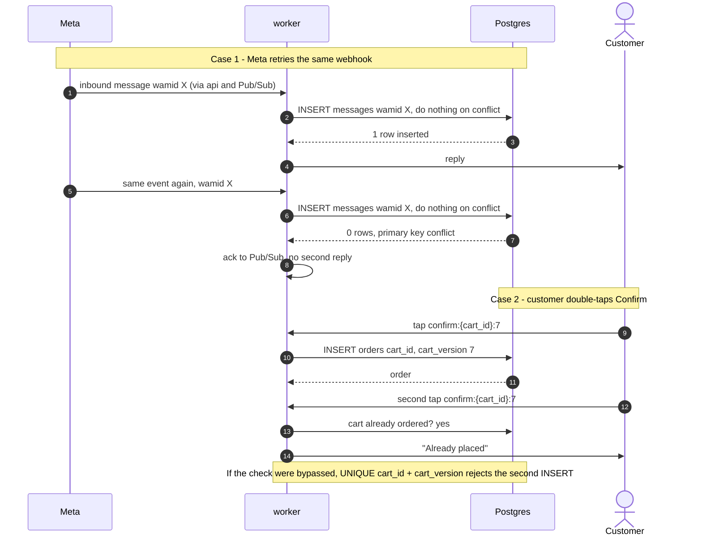
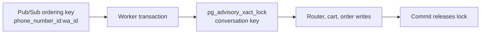

# Constraints and indexes

> **Area:** Database
> **Source:** MVP Architecture v0.1 §7, §5.3, §6.2, §6.6 ([source](../_source/mvp-architecture-v0.1.md))
> **Status:** Draft v0.1 · **Owner:** Aman
> **Used by:** [`backend/app/db/CLAUDE.md`](../../backend/app/db/CLAUDE.md), [`supabase/CLAUDE.md`](../../supabase/CLAUDE.md), [`backend/app/domain/conversation/CLAUDE.md`](../../backend/app/domain/conversation/CLAUDE.md), [`backend/app/domain/orders/CLAUDE.md`](../../backend/app/domain/orders/CLAUDE.md), [`backend/app/domain/campaigns/CLAUDE.md`](../../backend/app/domain/campaigns/CLAUDE.md)

## Summary

The database, not application code alone, is what makes the system idempotent. Meta retries webhooks, customers double-tap buttons and workers get retried by Pub/Sub; unique keys turn each of those into a harmless no-op. This doc lists the key constraints and indexes from §7, explains why each exists, and covers the per-café order number and the per-conversation advisory lock.

## Key constraints and indexes (§7)

| Table | Constraint / index | Why |
|---|---|---|
| `customers` | `UNIQUE (cafe_id, wa_id)` | One record per person per café |
| `messages` | `PRIMARY KEY (wamid)` | Deduplicates Meta retries |
| `orders` | `UNIQUE (cart_id, cart_version)` | A double-tapped Confirm can't create two orders |
| `orders` | `INDEX (cafe_id, status, created_at)` | Live orders query |
| `orders` | `UNIQUE (cafe_id, order_number)` via per-café sequence | Short readable order numbers |
| `campaign_recipients` | `UNIQUE (redemption_code)`, `UNIQUE (campaign_id, customer_id)` | One code per person per campaign |
| `consents` | `INDEX (customer_id, type, created_at DESC)` | Fast "current consent" lookup |
| `cafes` | `UNIQUE (phone_number_id)` | Tenant resolution from webhooks |

## Why each one matters

- **`customers (cafe_id, wa_id)`.** The worker upserts the customer on every inbound message. The composite key makes that upsert safe under concurrency and keeps each café's list separate: the same phone number at two cafés is two rows by design.
- **`messages.wamid` primary key.** The worker inserts the inbound message with "do nothing on conflict" before any other work. A conflict means this exact message was already handled, so the worker acks and stops. Because the insert happens first, a Pub/Sub retry after a partial success can't produce a second reply (§6.2). Outbound rows use the `wamid` Meta returns, so status webhooks find their row by the same key.
- **`orders (cart_id, cart_version)`.** The Confirm button carries `confirm:{cart_id}:{version}`. Code checks that the version is current and the cart isn't already ordered, but the unique key is the backstop that holds even if two confirms slip past that check.
- **`orders (cafe_id, status, created_at)`.** Serves `GET /staff/orders?status=active` and the `overdue_sweep`, which both scan one café's non-terminal orders by age.
- **`orders (cafe_id, order_number)`.** Customers and staff say "Order #123", not a UUID. Numbers are scoped per café so they stay short.
- **`campaign_recipients`.** `UNIQUE (redemption_code)` lets `POST /staff/redeem` look a code up directly and guarantees no two people share one. `UNIQUE (campaign_id, customer_id)` makes the recipient snapshot idempotent, so re-running `campaign_start` can't message anyone twice.
- **`consents (customer_id, type, created_at DESC)`.** Consent is append-only, so "current consent" is the newest row per customer and type. This index makes that a single index lookup, which the outbound guard runs before every marketing template.
- **`cafes (phone_number_id)`.** Every inbound webhook resolves its café from `phone_number_id`. Uniqueness guarantees one number can never map to two tenants.

## Idempotency in practice

Look at where the duplicate stops: in case 1 at the `wamid` primary key, in case 2 at the "already ordered" check with the unique key as the safety net.

Related monotonic rule: status webhooks only move `messages.status` forward (sent → delivered → read, or failed), so an out-of-order "delivered" arriving after "read" is ignored (§6.2).

## Per-café order number

`orders.order_number` is unique per café and allocated by a per-café sequence (§7). It must be allocated inside the same transaction that inserts the order, order lines and the PLACED status event (§6.6), so a rolled-back order doesn't consume visible state other than possibly a skipped number. The mechanism (a counter column on `cafes` locked for update, a small per-café counter table, or one Postgres sequence per café) is **(proposed)** and open. Gaps in numbering are acceptable; duplicates are not.

## Per-conversation advisory lock

Two layers serialise one customer's messages: Pub/Sub ordering per customer, then a transaction-scoped advisory lock per conversation.

- Taken with `pg_advisory_xact_lock(conversation key)` after the customer upsert and before the conversation engine runs (§6.2).
- Transaction-scoped, so it is released automatically on commit or rollback; a crashed worker can't leave it held.
- Purpose: two quick messages from the same person never race each other to create two carts (§5.3), even if Pub/Sub redelivers or two worker instances receive them.
- The key derivation (for example a 64-bit hash of `cafe_id` and `customer_id`) is **(proposed)**. It must be stable for the customer within the café, because the conversation row may not exist yet when the first message arrives.
- Only conversation-engine work takes this lock. Staff actions on orders (`PATCH /staff/orders/{id}/status`) rely on the transition check in the order service.

## Additional indexes (proposed)

Not in the source; listed so they are considered in the first migration.

| Table | Index | Serves |
|---|---|---|
| `staff_memberships` | `UNIQUE (user_id, cafe_id)` | Membership lookup per request and the RLS policy |
| `messages` | `(conversation_id, created_at)` | Last ~10 messages for the prompt, staff chat view |
| `waiter_requests` | `(cafe_id, status, created_at)` | Open queue and the 60 s re-alert in `overdue_sweep` |
| `conversations` | `(cafe_id, customer_id)` | Finding the customer's current conversation |
| `webhook_events` | `(received_at)` | `prune_webhook_events` 30-day delete |
| `campaign_recipients` | `(campaign_id, send_status)` | Funnel report, `campaign_resume` for DEFERRED |

## Rules / invariants

- Insert the inbound `messages` row before any side effect, and treat a conflict as "already handled".
- Never remove or weaken `UNIQUE (cart_id, cart_version)`; it is the last line of defence against duplicate orders.
- Order creation is one transaction: order, lines, PLACED event, order number.
- Hold the advisory lock for the whole conversation turn, transaction-scoped only.

## Open questions

- Order number mechanism and whether numbers reset (daily or never) **(proposed: never reset)**.
- Advisory lock key derivation.
- Adoption of the proposed indexes above.

## Related

- [data-model.md](data-model.md) · [schema-by-domain.md](schema-by-domain.md)
- [../backend/inbound-pipeline.md](../backend/inbound-pipeline.md) · [../backend/cart-and-confirmation.md](../backend/cart-and-confirmation.md)
- [../adr/0003-per-customer-ordering-and-locks.md](../adr/0003-per-customer-ordering-and-locks.md)
- Context files: [`backend/app/db/CLAUDE.md`](../../backend/app/db/CLAUDE.md), [`supabase/CLAUDE.md`](../../supabase/CLAUDE.md)
