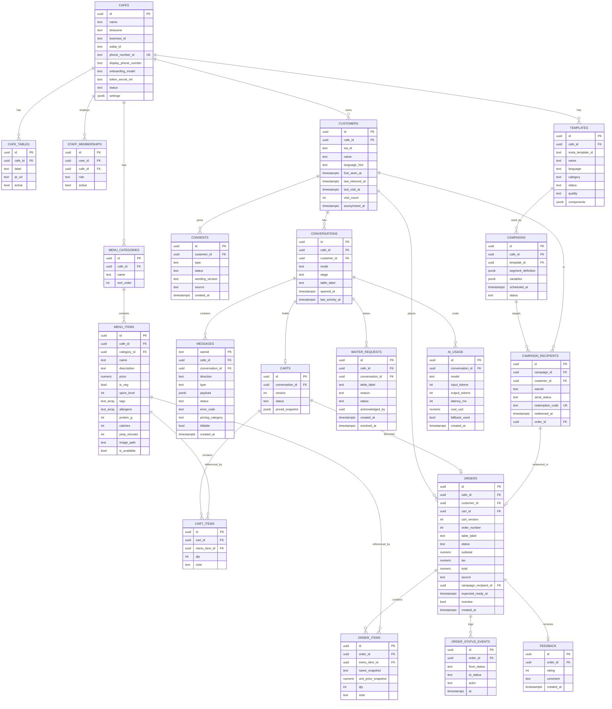

# Data model

> **Area:** Database
> **Source:** MVP Architecture v0.1 §7 ([source](../_source/mvp-architecture-v0.1.md))
> **Status:** Draft v0.1 · **Owner:** Aman
> **Used by:** [`backend/app/db/CLAUDE.md`](../../backend/app/db/CLAUDE.md), [`supabase/CLAUDE.md`](../../supabase/CLAUDE.md), [`backend/app/domain/CLAUDE.md`](../../backend/app/domain/CLAUDE.md)

## Summary

This is the canonical entity-relationship model for the MVP, copied verbatim from §7, plus a catalogue of every table including the three supporting tables the diagram doesn't draw. Every business table carries `cafe_id`; the same person ordering at two cafés is two customer rows, because each café owns its own list. For the same model split into readable domain diagrams with enumerated values, see [schema-by-domain.md](schema-by-domain.md).

## Entity-relationship diagram

Read it from `CAFES` outwards: everything hangs off a café, and the ordering spine is `CONVERSATIONS → CARTS → ORDERS`.

Supporting tables not drawn above: `webhook_events` (raw log), `audit_log (actor, cafe_id, action, entity, before, after, at)`, `data_deletion_requests`. They are drawn in [schema-by-domain.md §5](schema-by-domain.md#5-platform-and-supporting-tables).

## Table catalogue

"Owning module" is the domain service under `backend/app/domain/` (§6.1) that owns the table's invariants. Repositories in `app/db/repositories/` are the only code that issues queries.

| Table | Purpose | Owning module | Written by | Read by |
|---|---|---|---|---|
| `cafes` | The tenant: name, timezone, Meta IDs (`business_id`, `waba_id`, `phone_number_id`), `token_secret_ref`, status, settings (hours, tone, feedback delay, tax) | Platform onboarding (`platform/*` routers; no separate domain module in §6.1) | `POST /platform/cafes`; `PUT /admin/settings`; health jobs (`token_health`, `quality_and_limits`) | Inbound pipeline (tenant from `phone_number_id`), outbound (token lookup via `token_secret_ref`), prompt builder (name, tone), every scoped query |
| `cafe_tables` | Tables and their QR codes | Owner console settings (`admin/tables`) | `/admin/tables` CRUD | `/admin/tables/{id}/qr`; conversation router when matching "Hi, I'm at Table N" |
| `staff_memberships` | Who (Supabase Auth `user_id`) works at which café with which `role` | `core/auth.py` (RBAC) | `/admin/staff` (owner) | Every panel request (membership check), RLS policies |
| `customers` | One row per person per café, keyed by `wa_id` | `customers` | Worker upsert on every inbound message (`last_inbound_at`); name capture; visit counters; `data_deletion` job (`anonymised_at`) | Prompt builder (first name, visit count), outbound 24-hour guard, `/staff/customers/{id}`, `/admin/customers`, `v_customer_profile` |
| `consents` | Append-only consent log; latest row per customer and type is current state | `consent` | Consent buttons after first order or feedback, counter QR opt-in, STOP / "Stop offers" | Outbound guard (marketing templates), campaign audience, `/admin/consents`, `v_customer_profile` |
| `conversations` | Per-customer conversation: `mode` (bot/human), `stage`, table label | `conversation` | Conversation engine, `handoff` (mode), `/staff/conversations/{id}/takeover` · `/release`, `human_mode_timeout` job | Conversation router, staff chat view |
| `messages` | Every inbound and outbound WhatsApp message, keyed by `wamid`, with delivery status and pricing | `outbound` (outbound rows) and inbound pipeline (inbound rows, statuses) | Worker (inbound insert, status webhooks), outbound sender | Prompt builder (last ~10 messages), staff chat view (API + Realtime), `v_unit_costs`, platform AI review |
| `menu_categories` | Menu sections and their order | `menu` | `/admin/menu/categories`, `/admin/menu/import` | Menu list messages, prompt builder |
| `menu_items` | Dishes with price, veg flag, spice, tags, allergens, nutrition, prep time, image, availability | `menu` | `/admin/menu/items`, `/admin/menu/import`, `PATCH /staff/menu/items/{id}/availability` | Prompt builder (available items, every turn), cart service (confirm re-check), list messages, guardrails |
| `carts` | The conversation's working cart with a `version` and a priced snapshot | `cart` | AI cart tools, deterministic handlers, `request_confirmation` (version bump + snapshot) | Confirmation step, order service |
| `cart_items` | Cart lines | `cart` | `add_to_cart`, `update_cart_item`, `remove_from_cart`, confirm re-check (removes sold-out lines) | `get_cart`, confirmation summary |
| `orders` | Placed orders with totals, status, ETA, overdue flag, campaign link | `orders` | Order service (create in one transaction), `PATCH /staff/orders/{id}/status`, `/staff/orders/{id}/cancel`, `/staff/redeem`, `overdue_sweep` | Staff panel (API + Realtime), `get_order_status`, analytics views |
| `order_items` | Order lines with name and price snapshots | `orders` | Order service at create | Staff panel, analytics views |
| `order_status_events` | Every status transition (`from_status`, `to_status`, `actor`, `at`) | `orders` | Every transition, including PLACED at create | `v_prep_times`, audit trail |
| `waiter_requests` | Call-waiter and bill requests | `handoff` | Conversation engine ("Call waiter", "Request bill", AI fallback, `call_human`), `/staff/waiter-requests/{id}/ack` · `/resolve` | Staff panel (Realtime), `overdue_sweep` (re-alert after 60 s) |
| `feedback` | One 1–5 rating and optional comment per order | `feedback` | Feedback handler (`fb:` ids, comment stage) | `v_feedback_summary`, customer profile, platform AI review |
| `templates` | The café's Meta message templates and their status and quality | `campaigns` / platform templates | `/platform/cafes/{id}/templates` · `/sync`, `template_sync` job, template webhooks | `/admin/templates`, campaign creation, outbound (utility alerts) |
| `campaigns` | An offer send: template, segment, variables, schedule, status | `campaigns` | `/admin/campaigns` lifecycle, `campaign_start` job | Owner console, `campaign_start`, report |
| `campaign_recipients` | One row per customer per campaign, with `wamid`, `send_status` and unique `redemption_code` | `campaigns` | `campaign_start` (snapshot + codes), `campaign_send`, status webhooks, `campaign_resume`, `/staff/redeem` | `v_campaign_funnel`, `/admin/campaigns/{id}/report` |
| `ai_usage` | Tokens, latency, model, cost and fallback flag per AI turn | `ai_agent` | Conversation engine after each AI turn | `v_unit_costs`, `/platform/costs` |
| `webhook_events` | Raw webhook payload log with `signature_valid` | Inbound pipeline (`api/webhooks.py`) | `api` on every valid-signature POST | Debugging and replay; deleted after 30 days by `prune_webhook_events` |
| `audit_log` | Who changed what: `actor`, `cafe_id`, `action`, `entity`, `before`, `after`, `at` | `audit` | Status changes, sold-out flips, cancellations, menu edits, campaigns, redemptions, platform-admin actions | `/platform/audit` |
| `data_deletion_requests` | DPDP deletion requests from chat or Meta's callback | `consent` / `customers` (DPDP) | Conversation engine ("delete my data"), `POST /webhooks/meta/data-deletion` | `data_deletion` job |

## Rules / invariants

- Every business table carries `cafe_id`, directly or through a parent row (`consents`, `carts`, `cart_items`, `order_items`, `order_status_events`, `feedback`, `campaign_recipients`, `ai_usage` inherit it from their parent).
- `customers` is per café: `UNIQUE (cafe_id, wa_id)`.
- `consents` is append-only; never update a consent row.
- Order lines store snapshots of name and price; never join back to `menu_items` to reprice a historical order.
- Raw `webhook_events` older than 30 days are deleted.

## Open questions

- Should child tables (`order_items`, `cart_items`, `feedback`, `campaign_recipients`) carry a denormalised `cafe_id` so RLS policies and repository filters don't need a join? **(proposed)** — matters for `order_items`, which has a frontend RLS policy ([row-level-security.md](row-level-security.md)).
- §6.12 says redemption sets `order.campaign_id`, but the ER has `orders.campaign_recipient_id` and `campaign_recipients.order_id`. This doc follows the ER; confirm which link(s) the redemption writes.
- Where `quality_and_limits` stores quality rating and messaging tier (a `cafes` column, `settings`, or a separate table) is not specified.

## Related

- [schema-by-domain.md](schema-by-domain.md) · [constraints-and-indexes.md](constraints-and-indexes.md) · [row-level-security.md](row-level-security.md)
- [../backend/module-structure.md](../backend/module-structure.md)
- Context files: [`backend/app/db/CLAUDE.md`](../../backend/app/db/CLAUDE.md), [`supabase/CLAUDE.md`](../../supabase/CLAUDE.md)
