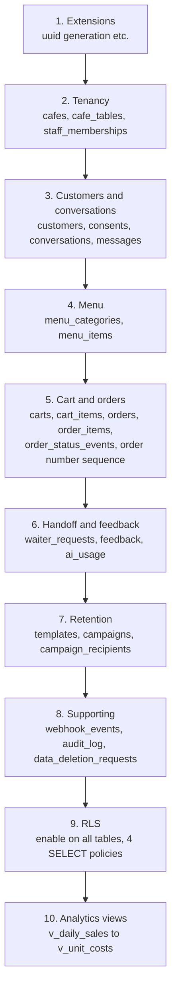
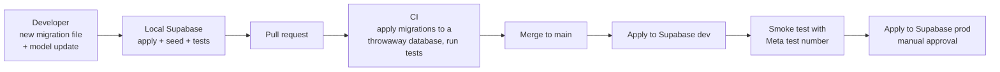

# Migrations

> **Area:** Database
> **Source:** MVP Architecture v0.1 §7 (Migrations), §9, §12, §13 ([source](../_source/mvp-architecture-v0.1.md))
> **Status:** Draft v0.1 · **Owner:** Aman
> **Used by:** [`supabase/CLAUDE.md`](../../supabase/CLAUDE.md), [`backend/app/db/CLAUDE.md`](../../backend/app/db/CLAUDE.md), [`infra/CLAUDE.md`](../../infra/CLAUDE.md)

## Summary

The Supabase CLI migrations folder, `supabase/migrations/`, is the single source of truth for the database: tables, indexes, RLS policies and views. Backend models (SQLAlchemy / Pydantic) follow the migrations, never the other way round. This doc covers what lives where, a proposed ordering for the first migrations, and how a change travels from a developer's machine to prod.

## What lives where

| Location | Contains | Status |
|---|---|---|
| `supabase/migrations/` | Tables, indexes, constraints, RLS policies, views, functions | Source (§7, §12) |
| `supabase/seed/` | Development seed data: a demo café, menu, tables, staff memberships, test customers | Addition |
| `backend/app/db/` | SQLAlchemy / Pydantic models and repositories, kept in sync with migrations by hand or by generation | Source (§7) |

Seed data is for `dev` and local only; it never runs against `prod` **(proposed)**.

## Proposed migration ordering

Ordered so every foreign key points at a table that already exists, and RLS and views come after the tables they depend on. **(proposed)**

Read top to bottom: each step only references tables created above it.

Notes:

- `orders.campaign_recipient_id` points at `campaign_recipients`, which is created later in this order. Either add that foreign key in the retention migration, or move retention before cart and orders.
- In practice, enabling RLS in the same migration that creates each table is safer than a separate step 9 (no window where a table exists without RLS). Step 9 then only adds the four `SELECT` policies. **(proposed)**
- After the initial schema, each change is its own small, timestamped migration; don't edit a migration that has been applied to any shared environment.

## Change workflow

A migration reaches prod only after it has applied cleanly in CI and in dev. The CI and promotion details are **(proposed)**; see [../infra/ci-cd.md](../infra/ci-cd.md).

| Step | What happens | Gate |
|---|---|---|
| Local | Developer writes the migration and updates SQLAlchemy / Pydantic models | Tests pass locally |
| PR | Migration and model changes reviewed together | Review |
| CI | Migrations applied to an empty database; unit and integration tests (including the tenant-isolation test) run against it | Green CI |
| Dev | Migration applied to the `dev` Supabase project | Applies cleanly |
| Prod | Migration applied to the `prod` Supabase project before the new backend image takes traffic | Manual approval **(proposed)** |

## Rules / invariants

- No schema change outside `supabase/migrations/`; no manual edits in the Supabase dashboard on `prod`.
- Migrations and the backend models that depend on them ship in the same PR.
- Migrations are backward compatible with the currently running backend image (expand, then contract), because the database is migrated before the new image is deployed **(proposed)**.
- Every new table gets RLS enabled.

## Open questions

- Models kept in sync by hand or generated from the schema (§7 leaves both open).
- Whether CI applies migrations to dev and prod automatically, and who approves prod ([../delivery/open-decisions.md](../delivery/open-decisions.md)).

## Related

- [data-model.md](data-model.md) · [row-level-security.md](row-level-security.md) · [analytics-views.md](analytics-views.md)
- [../infra/ci-cd.md](../infra/ci-cd.md) · [../infra/environments.md](../infra/environments.md)
- [../delivery/build-order.md](../delivery/build-order.md)
- Context files: [`supabase/CLAUDE.md`](../../supabase/CLAUDE.md), [`backend/app/db/CLAUDE.md`](../../backend/app/db/CLAUDE.md)
