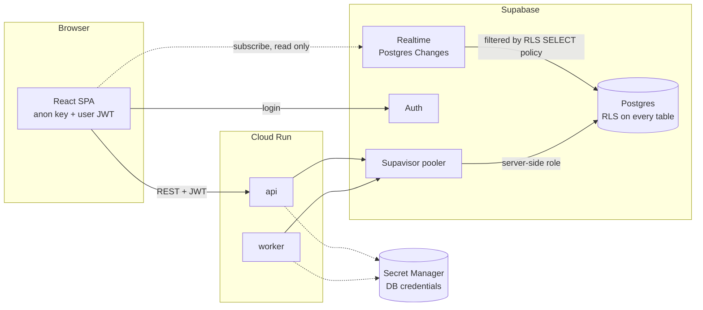

# Row Level Security

> **Area:** Database
> **Source:** MVP Architecture v0.1 §7 (RLS), §6.14, §5.3, §10 ([source](../_source/mvp-architecture-v0.1.md))
> **Status:** Draft v0.1 · **Owner:** Aman
> **Used by:** [`supabase/CLAUDE.md`](../../supabase/CLAUDE.md), [`backend/app/db/CLAUDE.md`](../../backend/app/db/CLAUDE.md), [`frontend/CLAUDE.md`](../../frontend/CLAUDE.md), [`frontend/src/features/CLAUDE.md`](../../frontend/src/features/CLAUDE.md)

## Summary

RLS is the fence around the only direct path from the browser into Postgres: Supabase Realtime subscriptions from the SPA. RLS is enabled on every table, but `SELECT` policies exist on just four tables, and there are no write policies at all for the `authenticated` role. Everything else, including every write, goes through FastAPI, which connects with a server-side role and enforces `cafe_id` in its repositories.

## Two ways into Postgres

The dotted Realtime path is the only one RLS has to protect; the pooler path is trusted and scoped by `cafe_id` in code.

### Path 1: SPA through Realtime (RLS)

- The SPA holds only the Supabase **anon key** and the signed-in user's JWT (§10).
- It subscribes to Postgres Changes on `orders`, `waiter_requests` (and the related tables below) for the live feed and alerts (§6.8).
- Each change is delivered only if the row passes the table's `SELECT` policy for that user.

### Path 2: Backend through the pooler (server-side role)

- `api` and `worker` connect with a server-side Postgres role through the Supavisor pooler (`session.py`, asyncpg) (§6.1, §6.14).
- That role is not limited by the frontend policies, so tenant isolation is enforced in code: every repository method takes `cafe_id` as a required argument and filters on it (§6.14).
- On panel requests `cafe_id` comes from the verified membership; on inbound messages from `phone_number_id` ([../security/auth-and-tenant-isolation.md](../security/auth-and-tenant-isolation.md)).
- The Supabase service-role key never leaves Secret Manager and the backend.

## Policy rule

Every frontend `SELECT` policy uses the same rule, described in words: **a row is visible when its `cafe_id` is one of the cafés the current Supabase user (`auth.uid()`) has a membership for in `staff_memberships`** (§6.14).

Notes on applying it:

- `orders`, `waiter_requests` and `messages` carry `cafe_id` directly.
- `order_items` has no `cafe_id` in the ER; its policy has to reach it through the parent `orders` row, or the table gets a denormalised `cafe_id` **(proposed)**.
- Membership should also require `staff_memberships.active` to be true, so a deactivated staff member stops receiving Realtime events immediately, not just at token expiry **(proposed)**.
- Whether `staff` users should see `messages` for every conversation or only those in human mode is not specified; the source only says the policy exists "for the human-mode chat view".

## Table-by-table posture

| Table | RLS enabled | Frontend `SELECT` policy | Why |
|---|---|---|---|
| `cafes` | Yes | No | Read via API |
| `cafe_tables` | Yes | No | Read via API |
| `staff_memberships` | Yes | No | Used inside policies and by the API, not read by the SPA directly |
| `customers` | Yes | No | PII; served masked via API |
| `consents` | Yes | No | Served via `/admin/consents` |
| `conversations` | Yes | No | Read via API |
| `messages` | Yes | **Yes** | Human-mode chat view |
| `menu_categories` | Yes | No | Read via API |
| `menu_items` | Yes | No | Read via API |
| `carts` | Yes | No | Backend only |
| `cart_items` | Yes | No | Backend only |
| `orders` | Yes | **Yes** | Live order feed |
| `order_items` | Yes | **Yes** | Lines on live order cards |
| `order_status_events` | Yes | No | Read via API and views |
| `waiter_requests` | Yes | **Yes** | Waiter-call and bill alerts |
| `feedback` | Yes | No | Read via API |
| `templates` | Yes | No | Read via API |
| `campaigns` | Yes | No | Read via API |
| `campaign_recipients` | Yes | No | Read via API |
| `ai_usage` | Yes | No | Platform cost screen via API |
| `webhook_events` | Yes | No | Backend only |
| `audit_log` | Yes | No | `/platform/audit` via API |
| `data_deletion_requests` | Yes | No | Backend only |

No table has an `INSERT`, `UPDATE` or `DELETE` policy for the `authenticated` role, so a valid JWT still cannot write anything directly (§7).

Analytics views (`v_*`) are read only by the API. Views run with their owner's privileges by default, so they must not be granted to `anon` or `authenticated` **(proposed)**; see [analytics-views.md](analytics-views.md).

## Rules / invariants

- Enable RLS on every new table in the same migration that creates it.
- Never add a write policy for `authenticated` or `anon`. Writes go through FastAPI because each one also sends a WhatsApp message and/or writes an audit row (§5.3).
- Add a `SELECT` policy only for a table the SPA genuinely subscribes to, and only with the member-cafés rule.
- Backend repositories take `cafe_id` as a required argument; RLS does not protect backend queries.
- The service-role key never reaches the frontend, logs or the repo.

## Open questions

- `order_items` policy via join vs denormalised `cafe_id` **(proposed)**.
- Include `active = true` in the membership rule **(proposed)**.
- Scope of the `messages` policy (all conversations vs human mode only, all roles vs specific roles).
- How `platform_admin` subscribes across cafés, if at all.

## Related

- [../security/auth-and-tenant-isolation.md](../security/auth-and-tenant-isolation.md) · [../security/security-controls.md](../security/security-controls.md)
- [../frontend/realtime-and-alerts.md](../frontend/realtime-and-alerts.md)
- [../adr/0004-all-writes-through-fastapi.md](../adr/0004-all-writes-through-fastapi.md)
- Context files: [`supabase/CLAUDE.md`](../../supabase/CLAUDE.md), [`frontend/CLAUDE.md`](../../frontend/CLAUDE.md), [`backend/app/db/CLAUDE.md`](../../backend/app/db/CLAUDE.md)
