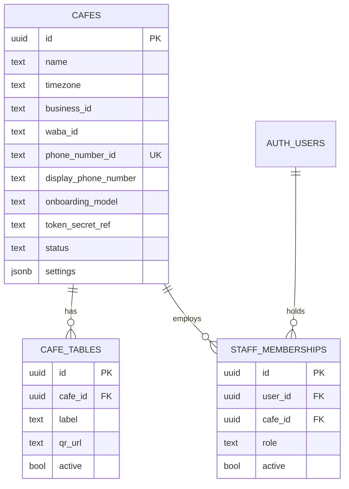
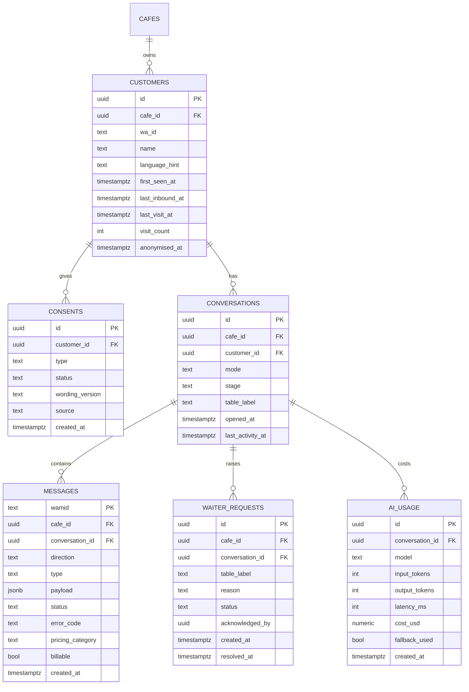
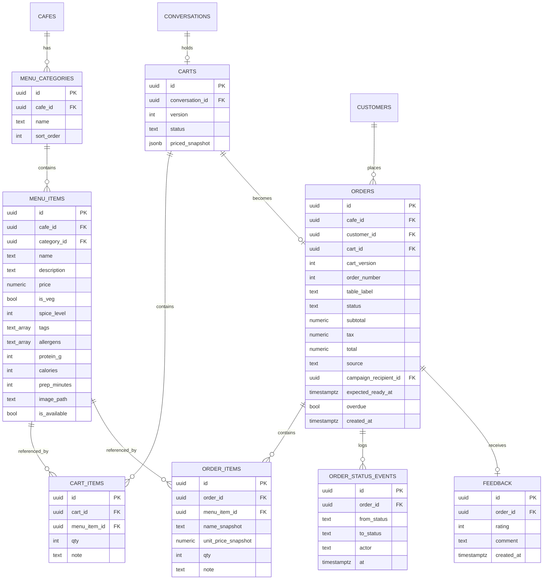
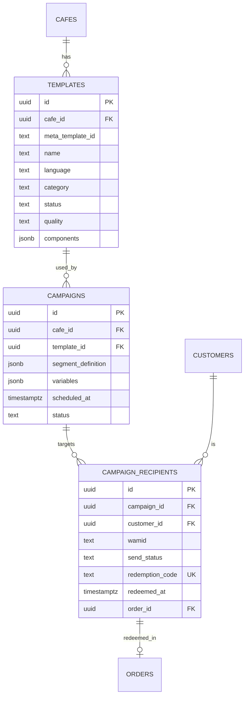
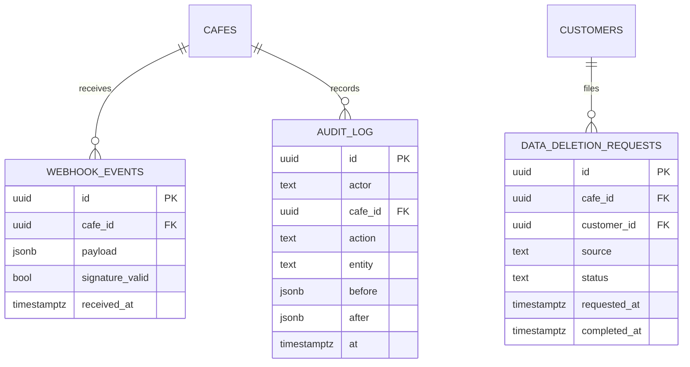

# Schema by domain

> **Area:** Database
> **Source:** MVP Architecture v0.1 §7, §6.3, §6.4, §6.6, §6.7, §6.9, §6.11, §6.12 ([source](../_source/mvp-architecture-v0.1.md))
> **Status:** Draft v0.1 · **Owner:** Aman
> **Used by:** [`backend/app/db/CLAUDE.md`](../../backend/app/db/CLAUDE.md), [`supabase/CLAUDE.md`](../../supabase/CLAUDE.md), [`backend/app/domain/CLAUDE.md`](../../backend/app/domain/CLAUDE.md), [`backend/app/domain/conversation/CLAUDE.md`](../../backend/app/domain/conversation/CLAUDE.md), [`backend/app/domain/cart/CLAUDE.md`](../../backend/app/domain/cart/CLAUDE.md), [`backend/app/domain/orders/CLAUDE.md`](../../backend/app/domain/orders/CLAUDE.md), [`backend/app/domain/consent/CLAUDE.md`](../../backend/app/domain/consent/CLAUDE.md), [`backend/app/domain/campaigns/CLAUDE.md`](../../backend/app/domain/campaigns/CLAUDE.md)

## Summary

The §7 ER diagram split into five domain diagrams, each followed by the allowed values of its status-like columns. Entities from another domain appear without attributes, just to show the link. [data-model.md](data-model.md) holds the verbatim full diagram; if the two ever disagree, that file wins.

Values marked **(proposed)** are not spelled out in the source and need confirming before the first migration.

## 1. Tenancy and staff

`phone_number_id` is how inbound webhooks find the café. `STAFF_MEMBERSHIPS.user_id` points at the Supabase Auth user (shown as `AUTH_USERS`).

| Column | Values | Notes |
|---|---|---|
| `staff_memberships.role` | `staff`, `manager`, `owner`, `platform_admin` | §4. One person can belong to several cafés without schema changes |
| `staff_memberships.active` | true / false | The owner can deactivate staff instantly (§10) |
| `cafes.settings` | Hours, tone, feedback delay, tax | From `GET/PUT /admin/settings` (§8.3) |
| `cafes.token_secret_ref` | A Secret Manager reference | The token itself never lives in the DB (§10) |
| `cafes.status`, `cafes.onboarding_model` | Not listed in source | **(proposed)** define during café onboarding design |

## 2. Customers and conversations

A customer belongs to exactly one café. Messages, waiter calls and AI cost all hang off the conversation.

| Column | Values | Notes |
|---|---|---|
| `conversations.mode` | `bot`, `human` | Separate from stage; can switch at any stage (§6.4) |
| `conversations.stage` | `greeting`, `awaiting_name`, `browsing`, `cart_open`, `awaiting_confirmation`, `order_active`, `awaiting_feedback`, `awaiting_feedback_comment`, `closed` | States from §6.4. `awaiting_name` and `awaiting_feedback_comment` are spelled this way in §6.3; the snake_case spelling of the rest is **(proposed)** |
| `messages.direction` | `in`, `out` | |
| `messages.status` | `sent`, `delivered`, `read`, `failed` | Forward only: sent → delivered → read, or failed (§6.2) |
| `messages.pricing_category`, `billable` | From Meta's `pricing` object on status webhooks | Feeds `v_unit_costs` (§11) |
| `messages.type` | Not listed in source | **(proposed)** text, interactive, template, etc. |
| `waiter_requests.status` | `PENDING`, `ACKNOWLEDGED`, `RESOLVED` | §6.9 |
| `waiter_requests.reason` | Includes `BILL` | "Request bill" reuses this path. Other reasons come from "Call waiter", AI fallback and the `call_human(reason)` tool; their exact codes are **(proposed)** |
| `consents.status` | `Unknown`, `OptedIn`, `Declined`, `OptedOut` | §6.11. Latest row per customer and type is current |
| `consents.source` | `order_flow`, `counter_qr`, `feedback_flow` | §6.11 |
| `consents.type` | Not listed in source | **(proposed)** e.g. a single `marketing` type for the MVP |
| `consents.wording_version` | The exact text shown | Proof of what the customer agreed to |

## 3. Menu, cart and orders

The cart becomes an order exactly once per `(cart_id, cart_version)`; the order then accumulates status events and at most one feedback row.

| Column | Values | Notes |
|---|---|---|
| `orders.status` | `PLACED`, `PREPARING`, `READY`, `SERVED`, `CANCELLED` | §6.7. Allowed transitions in [../backend/order-lifecycle.md](../backend/order-lifecycle.md) |
| `orders.overdue` | true / false | A flag, not a state: now > `expected_ready_at` and not READY. Set by `overdue_sweep` |
| `orders.expected_ready_at` | now + max(`prep_minutes`) of the lines | Set at create (§6.6) |
| `order_status_events.from_status`, `to_status` | Same values as `orders.status` | `from_status` is empty for the initial PLACED event |
| `order_status_events.actor` | Customer, staff user, or sweep | Exact encoding **(proposed)** |
| `orders.source` | Not listed in source | **(proposed)** |
| `carts.status` | Not listed in source | **(proposed)** at least "open" and "ordered", so "cart not already ordered" (§6.6) is a column check |
| `carts.version` | Integer, +1 on every `request_confirmation` | Embedded in the Confirm button id `confirm:{cart_id}:{version}` |
| `cart_items.qty` | 1–20 | Guardrail on `add_to_cart` (§6.5) |
| `feedback.rating` | 1–5 | 4–5 thank you, 3 asks for a comment, 1–2 apologise and alert the manager (§6.10) |
| `menu_items.is_available` | true / false | Only `true` items reach the AI prompt |

### Snapshot columns

| Column | Captured when | Why |
|---|---|---|
| `carts.priced_snapshot` | `request_confirmation`, together with `version += 1` | Freezes the exact lines, prices and totals the customer is shown in the summary they confirm |
| `order_items.name_snapshot` | Order create | Historical orders keep the dish name even if the menu item is renamed or deleted |
| `order_items.unit_price_snapshot` | Order create | Revenue and receipts never change when a price is edited later |

## 4. Retention

A recipient row links a campaign to a customer and, once its code is redeemed, to the order where it was used.

| Column | Values | Notes |
|---|---|---|
| `campaign_recipients.send_status` | `QUEUED`, `DEFERRED`, `SKIPPED`, `SENT`, `DELIVERED`, `READ`, `FAILED`, `REDEEMED` | §6.12 state diagram. `DEFERRED` when the daily messaging limit is reached, `SKIPPED` when opted out before send |
| `campaigns.status` | Draft, `SCHEDULED` from source; cancel exists (`/cancel`) | Full set **(proposed)** e.g. `DRAFT`, `SCHEDULED`, `SENDING`, `COMPLETED`, `CANCELLED` |
| `campaigns.segment_definition` | All opted-in, lapsed (no order in N days), regulars (≥ K orders in 60 days) | Only three MVP segments (§6.12) |
| `templates.category` | Marketing or utility | Marketing requires `OptedIn` at send (§6.13) |
| `templates.status`, `quality` | Synced from Meta | Kept in sync by `template_sync` |
| Template names | `weekly_offer`, `winback`, `order_update`, `new_order_alert` | Submit for approval early (§13) |

## 5. Platform and supporting tables

The source names these tables but only gives columns for `audit_log`. Attributes for `webhook_events` beyond the raw payload and `signature_valid` (§6.2), and all attributes of `data_deletion_requests`, are **(proposed)**.

Source-backed columns: `webhook_events.payload` and `signature_valid`; all `audit_log` columns (`actor`, `cafe_id`, `action`, `entity`, `before`, `after`, `at`). Everything else here, including the surrogate `id` keys, is **(proposed)**.

| Column | Values | Notes |
|---|---|---|
| `data_deletion_requests.source` | Chat ("delete my data") or Meta deletion callback | **(proposed)** column; both paths are in §6.11 |
| `data_deletion_requests.status` | **(proposed)** e.g. received, completed | The `data_deletion` job anonymises the customer |
| `webhook_events.cafe_id` | **(proposed)** | May be null if the payload's `phone_number_id` matches no café |
| `audit_log.actor` | Staff user, owner, platform admin, or job | Every platform-admin action is audited (§4) |

## Rules / invariants

- Status values are stored as fixed codes and validated in code (and ideally by a check constraint); the visible WhatsApp button title is never stored as a status.
- `messages.status` only moves forward.
- `consents` rows are never updated; a change is a new row.
- Snapshot columns are written once and never recomputed.

## Open questions

- Spelling and case of stored enum values: §6.3 writes `opted_out` and `awaiting_name` in lowercase, §6.11 writes `OptedOut`. Pick one convention per column **(proposed: keep source spelling as listed above)**.
- Enum values not given in source: `cafes.status`, `cafes.onboarding_model`, `carts.status`, `orders.source`, `campaigns.status`, `consents.type`, `messages.type`, non-BILL `waiter_requests.reason` codes.
- `platform_admin` is listed as a role but is cross-café; whether it lives in `staff_memberships` (with which `cafe_id`) or elsewhere is undecided.
- Columns for `webhook_events` and `data_deletion_requests` are proposals.

## Related

- [data-model.md](data-model.md) · [constraints-and-indexes.md](constraints-and-indexes.md)
- [../backend/conversation-state-machine.md](../backend/conversation-state-machine.md) · [../backend/order-lifecycle.md](../backend/order-lifecycle.md) · [../retention/consent.md](../retention/consent.md) · [../retention/campaigns.md](../retention/campaigns.md)
- Context files: [`backend/app/db/CLAUDE.md`](../../backend/app/db/CLAUDE.md), [`supabase/CLAUDE.md`](../../supabase/CLAUDE.md)
