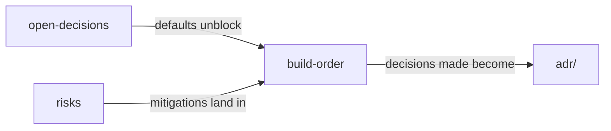

# Delivery

> **Area:** Delivery
> **Source:** MVP Architecture v0.1 §13, §14 ([source](../_source/mvp-architecture-v0.1.md))
> **Status:** Draft v0.1 · **Owner:** Aman
> **Used by:** [/CLAUDE.md](../../CLAUDE.md)

## Summary

How the MVP gets built, what is still undecided, and what could go wrong. Check [open-decisions.md](open-decisions.md) before building anything that depends on an open topic, and [build-order.md](build-order.md) to see which step you are in.

## Docs in this folder

| Doc | What it covers |
|---|---|
| [build-order.md](build-order.md) | Steps 0–6 from foundations to pilot hardening, deliverables per step, template-approval timing |
| [open-decisions.md](open-decisions.md) | The ten open topics with suggested defaults, status and affected docs |
| [risks.md](risks.md) | The top three risks and their mitigations |

## How they relate

Open decisions and risks both feed the build plan; a decision that gets made is recorded as an ADR.

## Related

- [../product/feature-priority.md](../product/feature-priority.md)
- [../adr/README.md](../adr/README.md)
