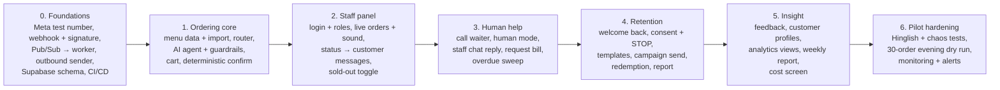

# Build order

> **Area:** Delivery
> **Source:** MVP Architecture v0.1 §13, §3.3 ([source](../_source/mvp-architecture-v0.1.md))
> **Status:** Draft v0.1 · **Owner:** Aman
> **Used by:** [/CLAUDE.md](../../CLAUDE.md)

## Summary

Seven steps, mapped to the MVP plan and starting from the existing chatbot demo. Each step ends with something a café could try. Template approval is slow, so the four templates are submitted during step 1 even though they are used from step 2 onwards.

## Build sequence

Strictly sequential: each step builds on the previous one, and steps 0–3 together make the P0 pilot.

## Steps in detail

| Step | Deliverables | P-level | Docs to read |
|---|---|---|---|
| **0. Foundations** | Meta test number, webhook + signature, Pub/Sub → worker, outbound sender, Supabase schema, CI/CD | P0 | [webhooks.md](../whatsapp/webhooks.md), [inbound-pipeline.md](../backend/inbound-pipeline.md), [outbound-sender.md](../whatsapp/outbound-sender.md), [data-model.md](../database/data-model.md), [migrations.md](../database/migrations.md), [ci-cd.md](../infra/ci-cd.md), [environments.md](../infra/environments.md) |
| **1. Ordering core** | Menu data + import, router, AI agent + guardrails, cart, deterministic confirm. **Submit templates for approval.** | P0 | [menu-management.md](../backend/menu-management.md), [conversation-router.md](../backend/conversation-router.md), [conversation-state-machine.md](../backend/conversation-state-machine.md), [ai-agent/README.md](../ai-agent/README.md), [cart-and-confirmation.md](../backend/cart-and-confirmation.md), [templates.md](../whatsapp/templates.md) |
| **2. Staff panel** | Login + roles, live orders + sound, status → customer messages, sold-out toggle | P0 | [staff-panel.md](../frontend/staff-panel.md), [realtime-and-alerts.md](../frontend/realtime-and-alerts.md), [order-lifecycle.md](../backend/order-lifecycle.md), [auth-and-tenant-isolation.md](../security/auth-and-tenant-isolation.md), [roles-and-permissions.md](../product/roles-and-permissions.md) |
| **3. Human help** | Call waiter, human mode, staff chat reply, request bill, overdue sweep | P0 (request bill is P2) | [human-handoff.md](../backend/human-handoff.md), [background-jobs.md](../backend/background-jobs.md) |
| **4. Retention** | Welcome back, consent + STOP, templates, campaign send, redemption, report | P1 | [consent.md](../retention/consent.md), [campaigns.md](../retention/campaigns.md), [redemption.md](../retention/redemption.md), [templates.md](../whatsapp/templates.md), [number-health.md](../whatsapp/number-health.md) |
| **5. Insight** | Feedback, customer profiles, analytics views, weekly report, cost screen | P1 (feedback), P2 (rest) | [feedback.md](../backend/feedback.md), [customers.md](../backend/customers.md), [analytics-views.md](../database/analytics-views.md), [owner-console.md](../frontend/owner-console.md), [cost-tracking.md](../observability/cost-tracking.md) |
| **6. Pilot hardening** | Hinglish + chaos tests, 30-order evening dry run, monitoring + alerts | — | [evaluation.md](../ai-agent/evaluation.md), [logging-and-metrics.md](../observability/logging-and-metrics.md), [risks.md](risks.md) |

## Template approval

Template approval for `weekly_offer`, `winback`, `order_update` and `new_order_alert` takes time, so **submit them during step 1, not step 4**.

| Template | Category | First needed in |
|---|---|---|
| `order_update` | Utility | Step 2 — status messages when the 24-hour window has closed |
| `new_order_alert` | Utility | Step 2/3 — backup staff alert for unacknowledged orders and waiter calls |
| `weekly_offer` | Marketing | Step 4 — campaigns |
| `winback` | Marketing | Step 4 — lapsed-customer campaigns |

Categories and "first needed in" are inferred from how §6.8, §6.9, §6.13 and §6.12 use each template; see [templates.md](../whatsapp/templates.md).

## Sequence chart

```mermaid
gantt
    title Build order — sequence, not dates
    dateFormat X
    axisFormat ·
    section Foundations
    Step 0 Foundations     :s0, 0, 1d
    section Ordering core
    Step 1 Ordering core   :s1, after s0, 1d
    Submit 4 templates     :milestone, tpl, after s0, 0d
    section Staff panel
    Step 2 Staff panel     :s2, after s1, 1d
    section Human help
    Step 3 Human help      :s3, after s2, 1d
    section Retention
    Step 4 Retention       :s4, after s3, 1d
    section Insight
    Step 5 Insight         :s5, after s4, 1d
    section Pilot hardening
    Step 6 Pilot hardening :s6, after s5, 1d
```

Bars are equal-length units only to show order; the source gives no durations. The milestone marks template submission at the start of step 1.

## Rules / invariants

- Do not start a step before the previous one works end to end.
- Templates are submitted in step 1, regardless of when they are used.
- Step 6 includes a 30-order evening dry run before any live pilot evening.

## Open questions

- Edit/cancel before preparing, reorder and AI conversation review are P2 features with no step in §13 ([feature-priority.md](../product/feature-priority.md)).
- Café onboarding and token health checks are needed before a live café but are not placed in a step.

## Related

- [../product/feature-priority.md](../product/feature-priority.md)
- [open-decisions.md](open-decisions.md)
- [risks.md](risks.md)
- [../whatsapp/templates.md](../whatsapp/templates.md)
